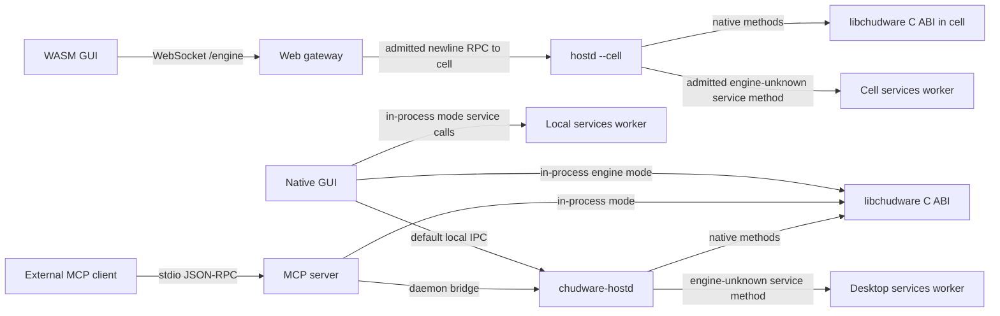
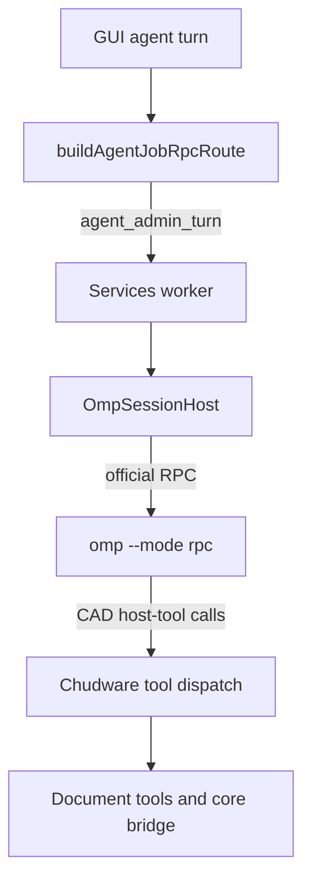
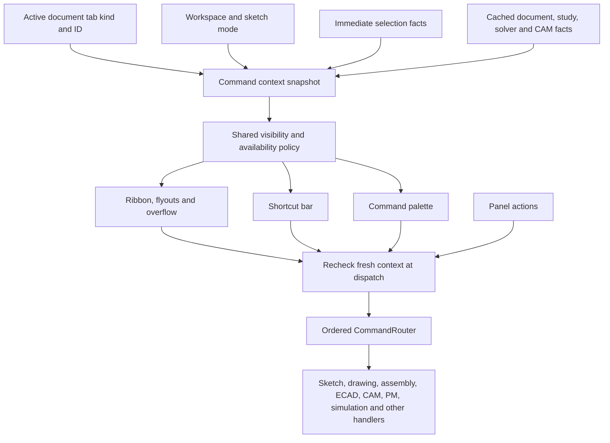
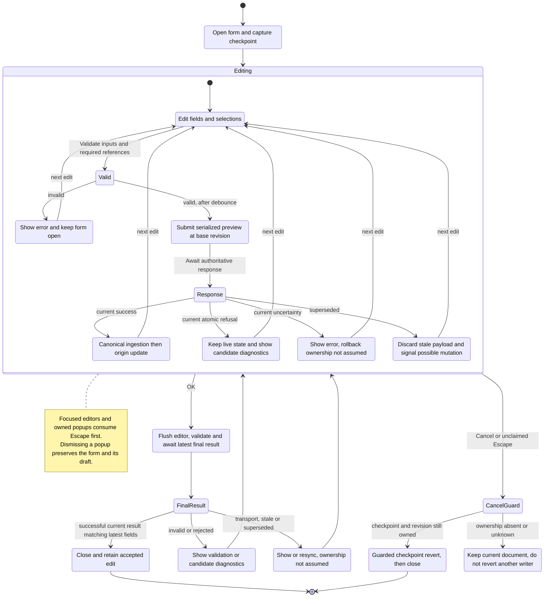
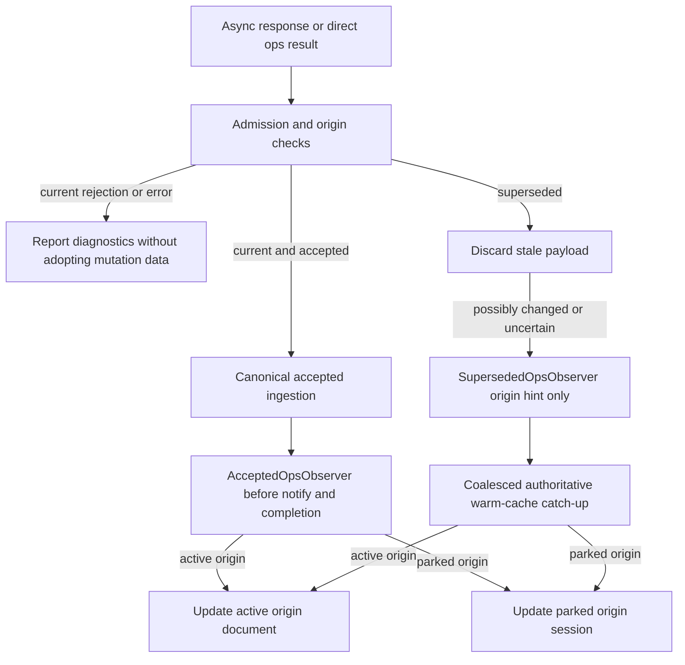
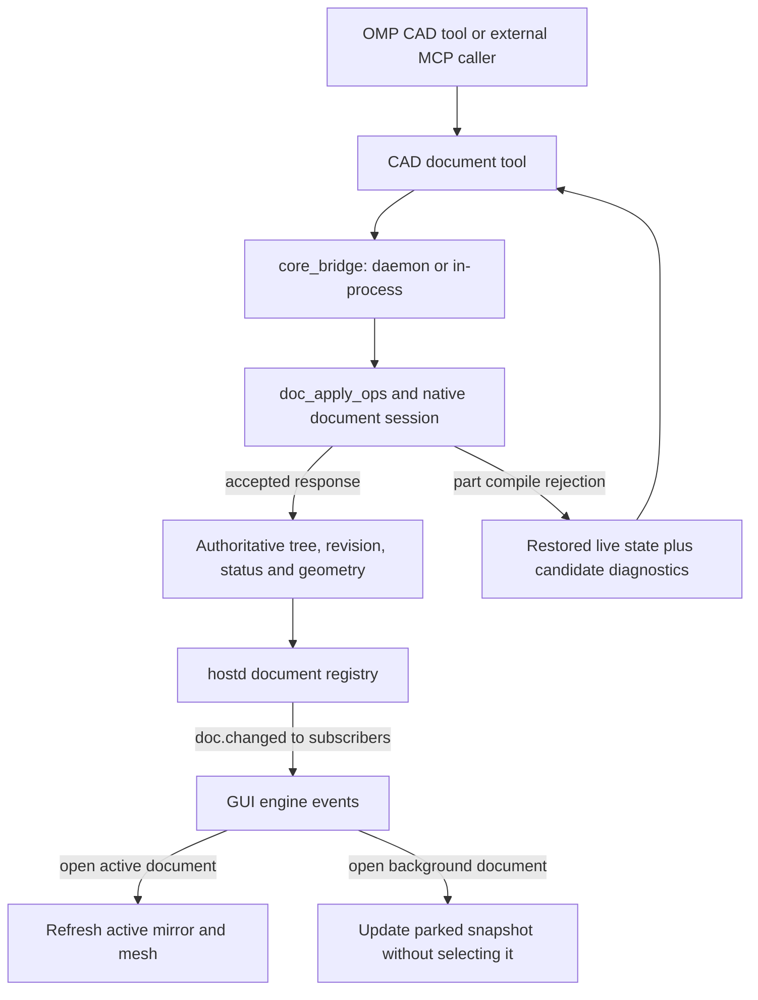

# Chudware — Architecture

The native C++ shared library **`libchudware`** owns the primary CAD engine: geometry,
documents, sketching, solving, CAM, simulation and related operations. There is no
Python CAD document engine. Python services and external programs do nevertheless
execute some workloads, including [simulation jobs](services/sim/jobs.py) and optional
[OpenFOAM subprocesses](services/sim/foam_runner.py); the library is not the only
execution environment. Canonical interface seams are in [contracts/](contracts/README.md).
For subsystem conventions see [developer documentation](docs/dev/README.md).

## Components

- [`core/`](core/) builds the C++ library, C ABI ([`libchudware.h`](core/api/libchudware.h)),
  and [`chudware-hostd`](core/hostd/), the shared engine-host daemon. C++17 is the
  baseline; mesh, manufacturing, twin and print layers require C++20. OCCT is enabled
  with `CHUDWARE_WITH_OCCT=ON`; CUDA LBM is optional (`CHUDWARE_WITH_CUDA=ON`).
  Strict POSIX fillet probes run in the fresh [`shape-build worker`](contracts/shape_build_worker.md),
  which contains construction and validation without inheriting a threaded host's locks.
- [`host/`](host/) is the sole GUI source tree: the native desktop executable and the
  Emscripten/WASM client share the ribbon, PropertyManager, viewport and Copilot UI.
  [`services/worker/`](services/worker/) and [`services/ipc/`](services/ipc/) provide
  its C++ routing and transport seams.
- [`services/`](services/) hosts Python services, including MCP, the persistent worker,
  OMP integration, simulation orchestration, ECAD helpers, installation and other
  service-side functionality. The worker can call back into the native engine.
- [`web/`](web/README.md) serves the WASM client and gateway. The documented image
  includes general Python workers, not the optional online Copilot runtime. Its deployment
  is experimental, single-trusted-operator Linux x86-64, and does **not** support online
  Copilot or promise full desktop parity.

The Electronics workspace is a KiCad project hub with a read-only preview. KiCad
project, schematic and board files are authoritative; desktop users edit in separately
launched KiCad 10 processes, while agents use the ECAD operation engine. `kicad-cli`
provides authoritative ERC/DRC and fabrication/STEP outputs as a child process on
the hostd machine. The in-house engine retains simulation, routing and analysis.
Legacy ECAD containers open for one-way migration and save as KiCad files.

## Program and transport routes

The following describes the implemented routing seams, not a blanket claim that every method
or optional backend is available on every build.

The gateway resolves the documented workspace principal, admits the request
and forwards it to its cell; the browser does not use a local IPC socket. `--cell` is a
POSIX socket-activated daemon with private state; admitted methods are pinned in
[`cell_methods.json`](contracts/cell_methods.json). In daemon dispatch, only an
**unknown** engine method falls through to the services worker: a known engine failure is not masked by a worker
retry, and some native-only methods are explicitly unavailable without their native
implementation. The desktop legacy in-process service worker and the MCP in-process
fallback do not imply that independent processes share one document registry.

Sources: [`IpcConn::gatewayWsUrl`](services/ipc/ipc_transport_wasm.cpp),
[`engine_ws`](web/gateway/engine_bridge.py), [`WorkerClient::callImpl`](services/worker/worker_client.cpp),
[hostd dispatch](core/hostd/server.cpp), [`core_bridge.call`](services/mcp/core_bridge.py),
and the [hostd operator guide](docs/reference/HOSTD.md). The hostd-only
[web parity contract](contracts/web_parity.md) and its worker-disabled probe establish a
specific baseline; they do not imply that the deployed browser has no Python worker.

### Agent lane

Agent turns select `agent_admin_turn`, which runs through the persistent services worker
and official OMP RPC runtime; there is no native agent loop in the engine (`core/agent/`
holds only provider, auth, HTTP, config, path and ask/PropertyManager-assist helpers).
The OMP CAD extension calls Chudware's host-tool registry/handlers; that
edge does not require a separate external MCP stdio connection. OMP owns provider calls,
authentication, model catalog, session history, memory and compaction; Chudware owns
the CAD tools, workspace/document boundary, roles and event presentation. Users bring
their own provider credentials. Browser cells reject agent turns because credential
isolation is not supported there.
See [`buildAgentJobRpcRoute`](host/src/core/jobs.cpp),
[`_agent_admin_turn`](services/agent/worker_rpc.py), [`OmpSessionHost`](services/agent/omp_host.py),
the [extension](services/agent/omp_extension.ts) and [host-tool dispatch](services/agent/omp_tools.py).
The lifecycle and runtime pin are documented in [OMP integration](docs/dev/omp-integration.md).

## Workspace, context and commands

The diagram is the **required shared-availability design** for the UI cutover, not a
runtime verification report. The [quality map](docs/dev/ux-quality.md) records the
specific behavior and evidence still needed.

An inactive mechanical mirror can remain behind a drawing or ECAD tab, so the active tab's
kind and identity—not merely `DocMirror::hasDoc()`—determine applicability. Per-document
PM/sketch/selection state follows tab switching. Hide context-inapplicable choices; grey
out in-context unavailable actions with a reason. A tool that intentionally gathers a
later pick should not be blocked just because nothing is preselected. Context is assembled
once per render/activation, using cached document-derived facts, and rechecked at dispatch;
no geometry probes, worker calls or repeated tree scans per rendered command.

Source owners: [`AppState` active tabs](host/src/core/app_state.h),
[`DocSession` and tab switching](host/src/core/doc_tabs.cpp),
[`commandAvailability` / command metadata](host/src/ui/ribbon_def.h),
[`commandContext` and `CommandRouter`](host/src/app_commands.cpp),
[ribbon](host/src/ui/widgets/ribbon.cpp), [shortcut bar](host/src/ui/shortcut_bar.cpp),
[palette](host/src/ui/command_search.cpp), [simulation](host/src/ui/sim_manager.cpp) and
[CAM](host/src/ui/cam/cam_panel.cpp). Router registration order matters: a matching rule
can decline, allowing later rules to handle a command. Other commands do not necessarily
use the PropertyManager.

## Property form edit, preview and acceptance

This is the **required transaction/state behavior** for a representative part-feature form;
it is not a claim that every path has been exercised. Sources and acceptance cases are in
the [quality map](docs/dev/ux-quality.md#numeric-and-form-audit). The form's live preview
is an actual document mutation, not a separate immutable rendering.

[`PropertyManager::applyPreview`, `commit` and `cancelEdits`](host/src/ui/property_manager.cpp)
submit [`DocMirror::applyOpsAsync`](host/src/core/doc_mirror.cpp) through `WorkerClient` to
[`doc_apply_ops`](core/doc/session.cpp). A successful transport alone is not acceptance:
a failed part rebuild can return an in-band `rejected_tree` and failed feature statuses
while restoring the prior live tree, revision, display and undo history. The candidate
statuses diagnose the rejected edit; they are not the statuses of the restored tree.
Assembly mutation/failure semantics differ and must not be inferred from the part branch.
Guard callbacks by document and form generation. Preserve an expression as authored and
show engine-reported effective fillet values; do not infer geometry limits from a slider or
parse warning text. A final Thread rebuild must not retain its preview proxy.

### Response admission and originating document

The following is the required cutover contract, not a claim of completed runtime
verification. `ApplyAsyncDone` reports whether a response is **current**, independently
of `OpsResponse::ok`: a current rejection or error still carries diagnostics. Only a
current, accepted response may adopt its returned IDs or mesh. An obsolete response
must not mutate a later form or selected document.

The accepted observer runs once after ingestion and before notification/completion for
current async applies and successful direct ingestion. Explicit tessellation is usable
when a nonempty path is supplied, or when an empty path is accompanied by explicitly
empty bodies to clear the origin's mesh. Missing tessellation does not clear it.
Superseded accepted changed-revision or uncertain mutations signal only
`(docId, baseRevision)`, never the obsolete payload. A proven same-base rejection or
read-only completion needs no catch-up. Catch-up is coalesced and uses an authoritative
warm-cache `doc_activate` read on an existing tab/session without forcing a solve; it
never opens or selects a document or downgrades its
revision. Dirty state changes only for a genuinely newer fetched revision, not merely
because an old hint exists. If a tree-only resync already reached an accepted response's
matching revision, reconcile its mesh without overwriting newer or foreign state.
Sources: [`DocMirror`](host/src/core/doc_mirror.cpp), [`AppState`](host/src/core/app_state.h),
and [per-document sessions](host/src/core/doc_tabs.cpp).

## Agent document mutation and presentation

`add_features` checks returned feature statuses and distinguishes an atomic part rejection
from other failures; for a failure that did mutate, it attempts a checkpoint revert guarded
by the revision rather than overwriting foreign edits. The daemon serializes document
operations through the document session and publishes advancing revisions to subscribed
clients, with foreign-edit notices where applicable. Multiple agents may edit the same
file; their edits are applied sequentially and use normal geometry validation. In-process
calls do not acquire daemon fanout by magic. The GUI does not automatically select every
agent-edited document: it presents artifacts the agent chooses to show and documents the
user explicitly opens.

Sources: [`add_features`](services/mcp/cad_doc_tools.py),
[`core_bridge.call`](services/mcp/core_bridge.py), [document transaction](core/doc/session.cpp),
[`DocRegistry::postCall`](core/hostd/doc_registry.cpp), and
[GUI engine events](host/src/core/engine_events.cpp).

## Contracts and evidence

- [Worker RPC](contracts/worker_rpc.md), [document schema](contracts/doc_schema.md),
  [document operations](contracts/doc_ops.md), [ECAD RPC](contracts/ecad/ecad_rpc.md) and
  [web parity](contracts/web_parity.md) define interface seams. Contracts are append-only;
  see the [contract index](contracts/README.md).
- [UX quality inventory](docs/dev/ux-quality.md) maps the audited numeric, command and
  fillet cases to owners, behavioral acceptance and evidence requirements. It is finite and
  does not certify product readiness.
- [Native format design](docs/design/native_format.md) is a proposal; the
  [container contract](contracts/stepplus.md) and implementation govern the existing API.

## History and build

The old Python CAD engine (`engine_oracle/`) was removed; `scripts/check.py` audits
against new `engine.*` / `engine_oracle.*` imports in services, scripts and tools.
For source builds, test commands and platform limitations see
[engineering notes](docs/dev/engineering-notes.md), the [reference index](docs/reference/README.md)
and [browser guide](web/README.md). The full Linux gate is `bash scripts/gate.sh`; its
stage list and environment requirements are in that script. Build and gate descriptions
are not evidence that any particular checkout passed them.
