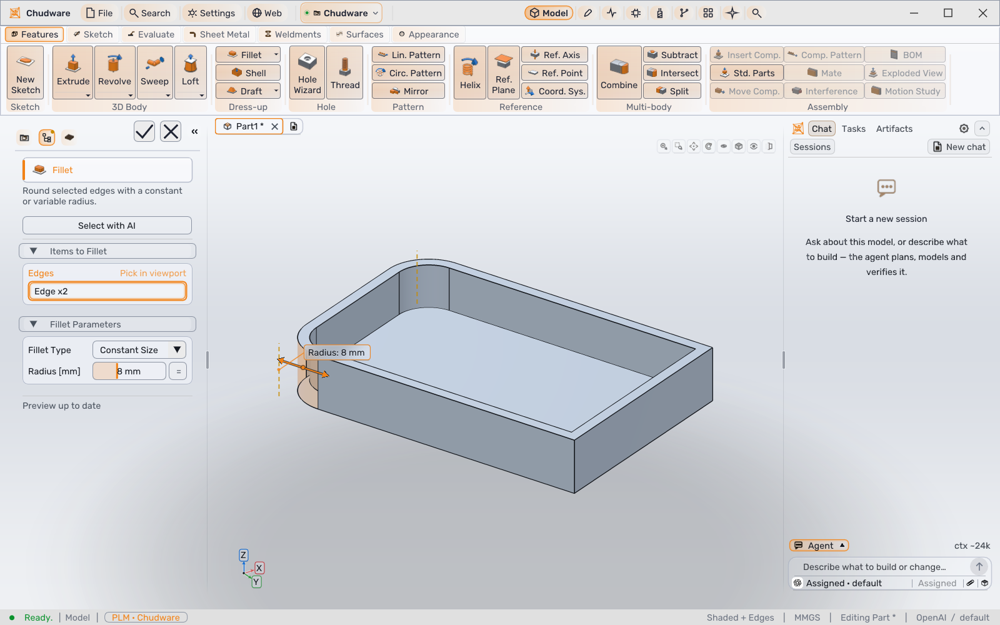
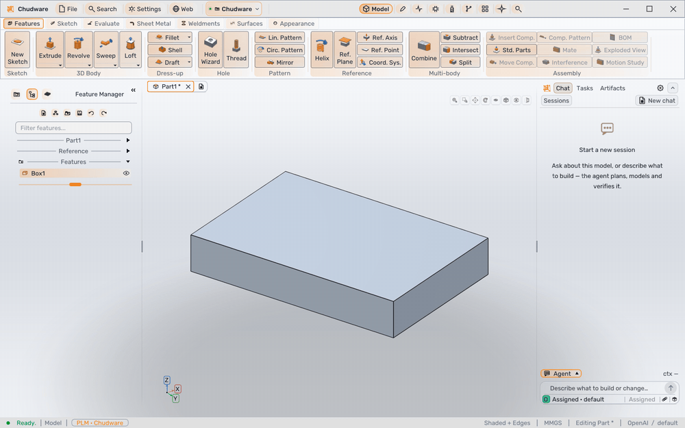
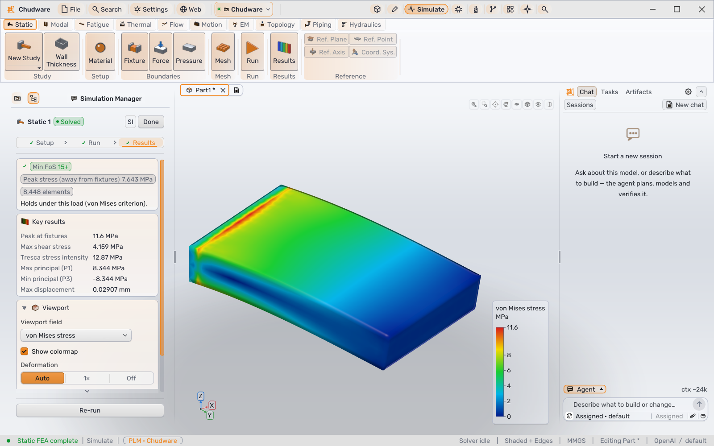

# Chudware

Chudware is open-source parametric CAD for engineers. Its native C++ application uses
[Open CASCADE Technology](https://www.opencascade.com/) for B-rep geometry and keeps
parts in a human-editable feature history. Build with constrained sketches and features,
then revisit the relations and dimensions that define the design.

Agent-assisted modeling brings a team of agents together across the workspace to work on
engineering tasks and create editable histories, using geometric relations and critical
dimensions rather than treating the result as a disposable mesh. You can also work directly
in the desktop interface or connect an external agent through MCP.


Website: <https://chudware.com> · [Development history](https://github.com/Hunter-124/Chudware/commits/master/)



*The animation is a sequence of real captured modeling steps, not a continuous recording.*



## What is here

Chudware brings several engineering workflows into one project:

- Parametric parts, assemblies and drawings, with a native `.step+` document and
  build-dependent import/export options.
- Manufacturing tools including CAM, and an electronics project hub using KiCad 10 for
  schematic/PCB editing, checks and fabrication output; agents edit through ECAD operations.
- Simulation and design tools, including structural FEA, fluid flow, piping networks and
  industrial sizing. The generated [simulation](docs/manual/guide-simulation.md),
  [piping](docs/manual/guide-piping.md) and [industrial](docs/manual/guide-industrial.md)
  guides describe individual workflows and their limits.

Availability depends on the build, platform, format, solver and installed external tools;
the browser image does not provide full desktop parity. An available command or an example
is not proof that a result is suitable for a particular engineering decision. Check its
assumptions, convergence and applicable evidence. The
[format reference](docs/reference/README.md#how-this-fits-into-chudwares-interop-work)
distinguishes implemented capabilities from reference and planned work.

## Project status

Chudware is under active development and has not reached 1.0. File formats and APIs can
change. Existing GitHub releases are prereleases; there is no current public stable desktop
installer or stable `/releases/latest` installation path. Build from source or use the
experimental self-hosted browser deployment below.

The optional owner-operated paid hosting offering supports the open-source project and
covers operation and convenience; it does not unlock software features. There is no public
checkout or promise of current availability. [Contact the project](https://chudware.com/contact)
for hosting inquiries.

## Start in your browser

The experimental Compose deployment is for **one trusted operator** on a Linux x86-64 host.
Anyone who can reach the gateway controls that operator's workspace; it is not a multi-user
service. Online Copilot is unavailable in this deployment.

The default image uses the moving `edge` development channel. If the image has been
published and made accessible, start it with:

```bash
git clone --depth 1 https://github.com/Hunter-124/Chudware.git
cd Chudware
docker compose -f web/compose.yaml up --pull always --no-build -d --wait
```

Open <http://127.0.0.1:8300/app/>. You need Git, Docker Engine with Compose v2 2.24.4 or
newer, and nested unprivileged user namespaces. Ubuntu 24.04+ may require the
[AppArmor host setup](web/README.md#ubuntu-2404-apparmor-setup) before starting Compose.
A current browser with WebAssembly, WebGL2 and cross-origin-isolated shared memory is
required. The shallow clone can be replaced with a full clone by omitting `--depth 1`.

See the [web deployment guide](web/README.md) for source builds, image pinning, the trust
boundary, persistence, backups, authenticated HTTPS and feature limitations. A source build
is an alternative when the image is unavailable.

## Building from source

The desktop build needs a C++20 toolchain, CMake 3.24+, Ninja, OCCT 7.9.x, Python 3.13
(3.12 also works) and Git. Linux also needs the X11/Wayland/OpenGL and libcurl development
libraries; other native dependencies are fetched at pinned versions. Internet access is
needed for the source dependencies and Python packages. The optional online-agent SDK is
installed by the development Python provisioning step; its executable is obtained separately.
Install KiCad 10 separately for electronics editing, checks and exports; it is a
recommended companion application and is not bundled with Chudware.

For a Fedora Linux source checkout, the following configures the OCCT engine tree consumed
by the GUI and builds the app without the optional embedded CEF browser backend:

```bash
git clone https://github.com/Hunter-124/Chudware.git
cd Chudware
sudo .github/scripts/install-fedora-deps.sh
PYTHON=python3.13 scripts/provision_venv.sh pytest
cmake -S core -B core/build-occt-linux -G Ninja \
    -DCMAKE_BUILD_TYPE=Release -DCHUDWARE_WITH_OCCT=ON
cmake -S host -B host/build-linux -G Ninja \
    -DCMAKE_BUILD_TYPE=Release -DCHUDWARE_ENABLE_CEF=OFF
./build.sh all
```

Set `CMAKE_BUILD_PARALLEL_LEVEL=1` before `./build.sh all` to keep native builds
single-job on memory-constrained machines.

The provisioning script creates `.venv-mcp`, installs `requirements.txt` including the
hash-pinned official OMP SDK source, and audits runtime dependencies. To enable CEF, obtain
its SDK with `scripts/fetch_cef_posix.sh` and configure the host accordingly. Linux and
macOS use system OCCT; on Windows CMake provisions its pinned OCCT SDK. See the
[Windows build guide](docs/reference/BUILD_WINDOWS.md),
[CMake presets](CMakePresets.json) and [`build.sh`](build.sh) for other targets and build
modes. macOS uses `host/build-macos-<arch>/`.

### Optional online agent setup

Native online Copilot uses the official [Oh My Pi](https://github.com/can1357/oh-my-pi)
(OMP) runtime as a separate process. For Linux x86-64, download and verify the pinned
executable and export the path reported by the verifier:

```bash
OMP_RESULT=$(.venv-mcp/bin/python scripts/pin_omp.py ensure --target linux-x86_64 \
    --cache-dir "$HOME/.cache/chudware/omp") &&
CHUDWARE_OMP_BIN=$(printf '%s\n' "$OMP_RESULT" | .venv-mcp/bin/python -c \
    'import json, sys; print(json.load(sys.stdin)["path"])') &&
export CHUDWARE_OMP_BIN
```

Configure your own provider credentials and model; Chudware does not sell model tokens.
The SDK, runtime and a usable provider/model are all required for online Copilot. The
cache directory is not itself an automatic executable discovery path. Set the variable
before starting the app; an already-running shared daemon may retain its earlier environment.
The [OMP integration guide](docs/dev/omp-integration.md) covers other platforms, runtime
discovery and session lifecycle. This native setup does not enable browser online Copilot.

## Running

From the Linux checkout, with the service environment provisioned:

```bash
CHUDWARE_PYTHON="$PWD/.venv-mcp/bin/python" CHUDWARE_REPO="$PWD" ./host/build-linux/bin/chudware
```

The GUI normally starts and connects to the shared `chudware-hostd` engine over local IPC.
See the [daemon reference](docs/reference/HOSTD.md) for its lifecycle.

## MCP server

The local MCP server lets compatible external agents use Chudware's available tools. To
register it with supported clients using the provisioned environment:

```bash
.venv-mcp/bin/python services/installer/setup_mcp_clients.py --python "$PWD/.venv-mcp/bin/python" --dry-run
.venv-mcp/bin/python services/installer/setup_mcp_clients.py --python "$PWD/.venv-mcp/bin/python"
.venv-mcp/bin/python services/installer/setup_mcp_clients.py --detect
```

Registration can change project and user client configuration; inspect the dry run first.
Tool and backend availability still depend on the active build and configuration.

## Documentation and quality

- [Documentation index](docs/README.md) — references, design records and generated guides.
- [Architecture](ARCHITECTURE.md) and [interface contracts](contracts/README.md) — system
  boundaries and maintained component contracts.
- [Running tests](CONTRIBUTING.md#running-tests) and the [CI workflow map](docs/reference/CI.md)
  — how changes are built and checked, including environment-dependent skips.
- [UX quality map](docs/dev/ux-quality.md) — audit ownership, acceptance criteria and
  exercised evidence for feature inputs, command availability and document state.
- [FEA verification report](docs/vv/FEA_VV_REPORT.md) — measured results and failures for
  the specified historical build, not blanket evidence for every version or solver. The
  [simulation credibility program](docs/simulation/ACCREDITATION_PROGRAM.md) is a proposed,
  incomplete program, not an external accreditation.

## Repository layout

| Path | Contents |
|---|---|
| [core/](core) | Native engine and `chudware-hostd` daemon |
| [host/](host) | Native and WASM GUI and renderer |
| [services/](services) | IPC, worker, MCP, agent host, installer and domain services |
| [contracts/](contracts/README.md) | Interface contracts |
| [corpora/](corpora/README.md), [fixtures/](fixtures), [samples/](samples) | Test fixtures and sample parts |
| [docs/](docs/README.md) | Design documents, references and developer notes |
| [packaging/](packaging) | Native installers and release packaging |
| [scripts/](scripts), [tools/](tools) | Build, audit and developer tools |
| [web/](web/README.md) | Experimental self-hosted browser application |
| [website/](website) | Promotional site source |
| [assets/](assets), [vendor/](vendor), [extern/](extern) | Assets and vendored dependencies |
| [benchmarks/](benchmarks) | Performance and validity benchmarks |

Some persisted identifiers retain the earlier `aicad` prefix for data compatibility,
including `.aicadvault`, `.aicm`, `refs/aicad/*` and `aicad.<x>/<n>` schema IDs.

## Contributing

Contributions are welcome. Start with [CONTRIBUTING.md](CONTRIBUTING.md) and the
[Code of Conduct](CODE_OF_CONDUCT.md). Report vulnerabilities privately using
[SECURITY.md](SECURITY.md).

## License

Chudware's first-party code is released under the [MIT License](LICENSE), subject to
third-party terms and documented exceptions. The model classes in
[`services/vision/cad_recode.py`](services/vision/cad_recode.py), derived from
[filaPro/cad-recode](https://github.com/filaPro/cad-recode), and the optional CAD-Recode
weights are under CC-BY-NC-4.0 and restricted to non-commercial use.

Optional SuiteSparse CHOLMOD is enabled by default when found and can link
GPL-2.0-or-later code in-process. Distributing a combined binary carries GPL obligations,
including license and corresponding-source requirements; configure with
`-DCHUDWARE_WITH_CHOLMOD=OFF` to build without it. See the
[third-party notices](THIRD_PARTY_NOTICES.md), authoritative
[dependency license ledger](contracts/licenses.md) and
[open compliance register](contracts/license_debt.md) for the applicable build-specific
terms, distribution obligations and unresolved items.
