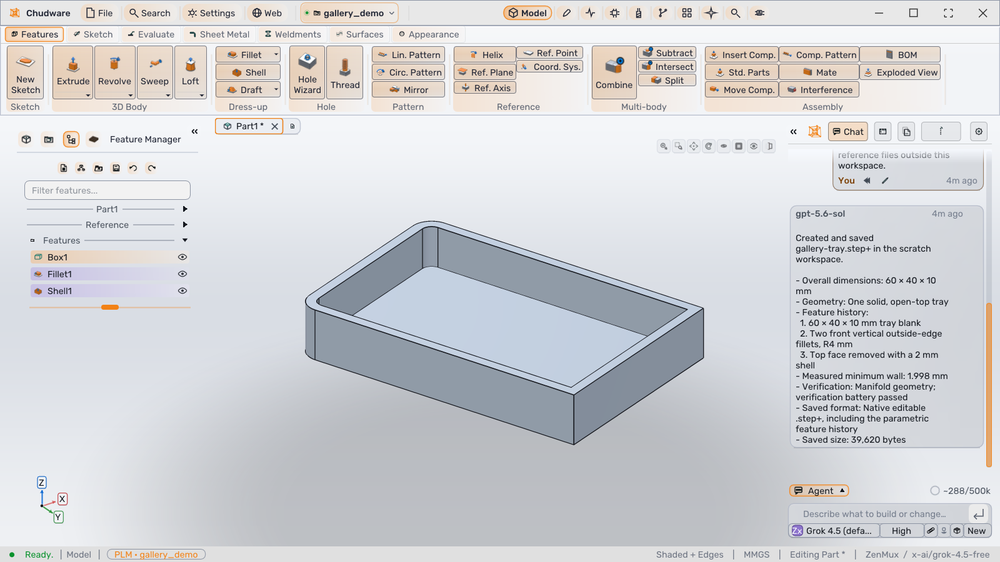
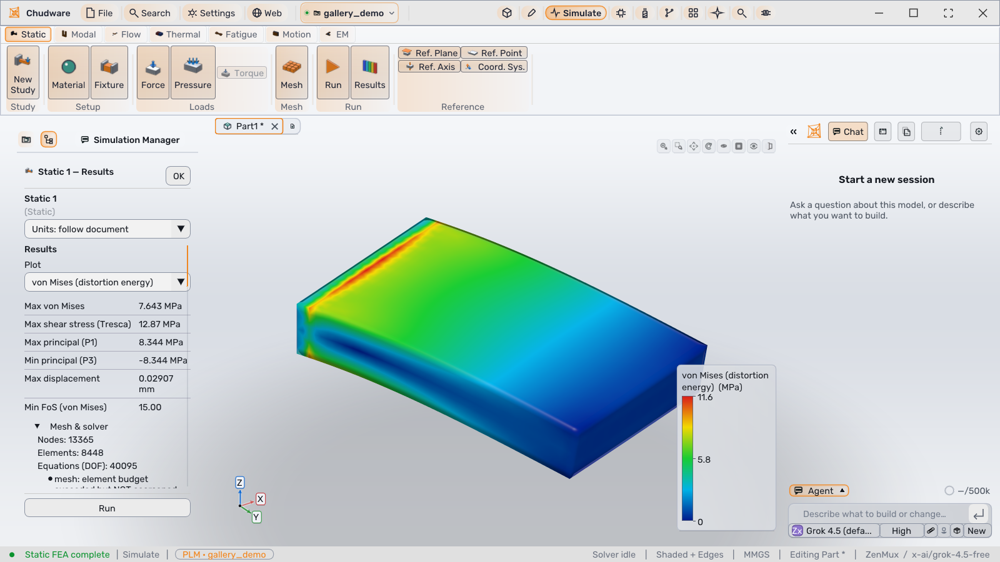
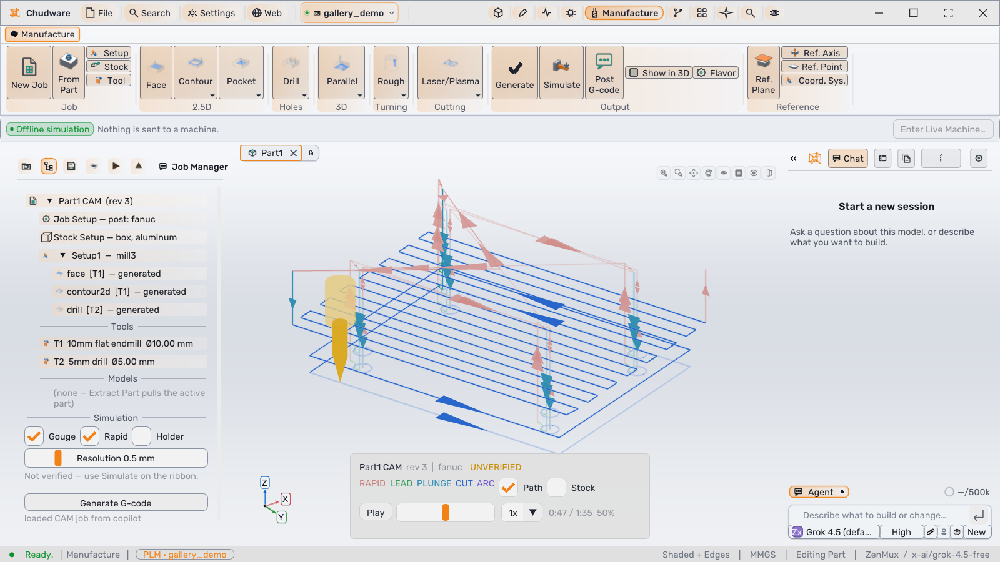

# Chudware

[](LICENSE)

Chudware is an open-source parametric CAD application: a native C++ desktop app with a
ribbon UI, a feature tree, property panels, and a constraint-solver sketcher, built on the
**OpenCASCADE** B-rep kernel. One document model sits under mechanical design, drawings,
CAM, ECAD, and simulation. A built-in AI copilot and an **MCP server** let the same document
be driven by hand, by the copilot, or by any external agent (Claude Code, Cursor, …).

Website: <https://chudware.com> · [Development history](https://github.com/Hunter-124/Chudware/commits/master/)



| Simulation | Manufacturing |
|---|---|
|  |  |

## Start in your browser

The simplest self-hosted path downloads the complete browser client, native CAD engine
and Python workers as one prebuilt image. Get the deployment configuration:

**Ubuntu 24.04+:** after cloning, complete the
[AppArmor host setup](web/README.md#ubuntu-2404-apparmor-setup) before starting Compose.

```bash
git clone --depth 1 https://github.com/Hunter-124/Chudware.git
cd Chudware
docker compose -f web/compose.yaml up --pull always --no-build -d --wait
```

Open <http://127.0.0.1:8300/app/>. You need Git, Docker Engine with the Compose v2
plugin (2.24.4+), and a Linux x86-64 host that permits nested unprivileged user
namespaces. No compilation, Chudware account, license key or provider token is needed.
The image uses the moving `edge` development channel; see the
[web quickstart](web/README.md#quickstart) for sizing, image pinning, source builds,
persistence, backups, upgrades and authenticated HTTPS. Omit `--depth 1` when cloning
to download the complete existing commit history.

The browser deployment is experimental and single-operator, not a multi-user service;
online Copilot is unsupported there. Native/source alternatives are below in
[Building from source](#building-from-source).

Chudware's own native and self-hosted software is free under the [MIT License](LICENSE),
with the third-party terms and documented exception described under [License](#license).
For optional owner-operated paid hosting, [contact the project](https://chudware.com/contact).
Hosting pays for operation, convenience and support for the open-source project, never
for unlocking software features. There is no public checkout or promised hosting
availability.

## Features

- **Mechanical CAD:** sketches with a constraint solver; extrude, revolve, sweep, loft, rib,
  shell, draft, fillet, chamfer, hole wizard, thread, patterns, mirror; surfacing; multi-body
  operations; weldments; sheet metal.
- **Assemblies and drawings:** mates, standard-parts library, exploded views, BOM,
  interference checks; 2D drawings.
- **CAM:** milling, turning, and laser/plasma/waterjet processes with toolpath simulation;
  post-processors for GRBL, LinuxCNC, Fanuc, Haas, Mach3, Centroid, Marlin, and Siemens
  (sample output in [docs/cam_samples/](docs/cam_samples)).
- **ECAD and firmware:** schematic capture, PCB layout, SPICE simulation, Gerber output.
- **Simulation:** static, modal, thermal, and fatigue FEA; motion; LBM wind tunnel and
  OpenFOAM CFD; electromagnetics.
- **PLM:** built-in, git-backed version history for projects.
- **AI copilot:** chat-driven modeling and review inside the app, using your own model
  provider credentials or offline local models; every agent edit goes through the same
  document operations as the GUI.
- **MCP server:** the full modeling surface exposed over stdio JSON-RPC to external agents.
- **Interop:** STEP, IGES, BREP, STL, 3MF, OBJ, PLY, glTF, and 3DM import/export around the
  native `.step+` document; SolidWorks import through the SolidWorks COM API where it is
  installed.

## Project status

Chudware is under active development and has not reached 1.0; file formats and APIs can
still change between releases. The desktop app targets Linux, Windows, and macOS.
Existing GitHub releases are prereleases; there is no current public stable installer
or usable `/releases/latest` installation path to advertise. Build from the public
source checkout, or use the [browser deployment](web/README.md).

## Building from source

Requirements:

- a C++20 toolchain (GCC or Clang on Linux, AppleClang on macOS, Visual Studio 2022 on
  Windows), CMake 3.24+, and Ninja;
- OCCT 7.9 (Linux: the distro development package, for example Fedora `opencascade-devel`;
  macOS: Homebrew `opencascade`; Windows: downloaded by CMake), plus SuiteSparse, libcurl,
  and X11/Wayland/OpenGL development headers on Linux;
- Python 3.13 (3.12 also works) and `git` on `PATH` for the Python services: the MCP
  server, the copilot's agent host, and the test suites.
- Internet access for the pinned optional online-agent SDK source archive and native
  runtime release assets hosted in this repository's GitHub releases; no companion
  repository access is required. The browser container omits the SDK and executable
  because online Copilot is unsupported there.

On Fedora, `sudo .github/scripts/install-fedora-deps.sh` installs the same packages CI uses
(add `gate` for the extra tools `scripts/gate.sh` runs).

Other C++ dependencies (Eigen, GLFW, Dear ImGui, nlohmann/json, Clipper2, …) are fetched at
pinned versions by CMake. The embedded CEF browser is optional: fetch its SDK with
`scripts/fetch_cef_posix.sh`, or configure the host with `-DCHUDWARE_ENABLE_CEF=OFF`.

```bash
git clone https://github.com/Hunter-124/Chudware.git
cd Chudware

# Python service environment (.venv-mcp); extra arguments go to pip, e.g. `pytest`
PYTHON=python3.13 scripts/provision_venv.sh pytest

# Native build: core (libchudware + chudware-hostd), then the GUI, then the daemon
./build.sh all
```

`scripts/provision_venv.sh` creates `.venv-mcp`, installs `requirements.txt` from PyPI
plus the SHA-256-pinned `chudcode-rpc` source archive from this repository's
[`chudcode-runtime-v0.4.4` release](https://github.com/Hunter-124/Chudware/releases/tag/chudcode-runtime-v0.4.4),
and runs the runtime dependency audit. Native runtime binaries use the pinned assets
recorded in `vendor/chudcode/CHUDCODE_ARTIFACT.lock`; `macos-arm64` remains unpinned.
`python3.13 -m venv .venv-mcp && .venv-mcp/bin/python -m pip install -r requirements.txt`
installs the same public dependencies. `./build.sh` is a thin wrapper over CMake; its header
lists every mode (`app|core|daemon|wasm|all|stage|clean`), and bare `./build.sh` rebuilds
only the GUI.
Core-only builds can also use the CMake presets in [CMakePresets.json](CMakePresets.json)
(`cmake --preset linux-core`). Windows builds use the `windows-*` presets from a Visual
Studio 2022 developer prompt; see [docs/reference/BUILD_WINDOWS.md](docs/reference/BUILD_WINDOWS.md).
On macOS the build tree is `host/build-macos-<arch>/`.

### Running

```bash
CHUDWARE_PYTHON="$PWD/.venv-mcp/bin/python" CHUDWARE_REPO="$PWD" ./host/build-linux/bin/chudware
```

The GUI starts the shared engine daemon `chudware-hostd` on demand and attaches to it over
local IPC; see [docs/reference/HOSTD.md](docs/reference/HOSTD.md) for its lifecycle.

The native copilot's optional online agent runtime is
[Chudcode](https://github.com/Hunter-124/chudcode), an MIT-licensed dependency
running as a separate binary (`chud`) pinned by
`vendor/chudcode/CHUDCODE_ARTIFACT.lock`. See its
[contribution guide](https://github.com/Hunter-124/chudcode/blob/main/CONTRIBUTING.md)
for runtime changes. Chudware's verified source archive and supported platform
binaries remain hosted in this repository's releases; no companion repository
checkout or private access is needed. Download and verify the runtime, then point
Chudware at it:

```bash
.venv-mcp/bin/python scripts/pin_chudcode.py ensure --target linux-x86_64 \
    --cache-dir ~/.cache/chudware/chudcode     # prints JSON with the verified path
export CHUDWARE_CHUDCODE_BIN=<path printed above>
```

The lock includes `linux-x86_64`, `macos-x86_64`, and `windows-x86_64`;
`macos-arm64` is not pinned. Online Copilot is unavailable without the runtime and SDK.
The native local-model fallback is separate and needs its own model setup; this does
not make online Copilot available in the browser.

### Testing

```bash
.venv-mcp/bin/python scripts/check.py                       # fast source and audit checks
CHUDWARE_GATE_PYTHON=.venv-mcp/bin/python bash scripts/gate.sh   # full Linux gate
.venv-mcp/bin/python -m pytest services/mcp -q              # one Python suite
```

The gate runs `check.py`, the core and GUI builds, ctest, the Python suites, and headless
smoke tests. Environment-dependent stages (no OCCT, no `xvfb-run`, no emsdk) report SKIP
rather than failing. [CONTRIBUTING.md](CONTRIBUTING.md) has the details.

## MCP server

The MCP server ([services/mcp/](services/mcp)) is a local stdio JSON-RPC server that exposes
the full modeling surface; its `cad_guide` tool carries modeling, CAM, and ECAD guidance.
Register it with your agent clients (Claude Code, Cursor, VS Code, opencode, …):

```bash
python3 services/installer/setup_mcp_clients.py            # Windows: mcp_setup.bat
python3 services/installer/setup_mcp_clients.py --detect   # verify the registration
```

The server id is `chudware`. Agent edits made over MCP appear live in an open GUI because
both attach to the same `chudware-hostd` engine.

## Architecture

The C++ kernel **`libchudware`** ([core/](core)) is the engine. The C++ GUI ([host/](host))
talks to the shared **`chudware-hostd`** daemon, which loads `libchudware`, over local IPC.
Python under [services/](services) provides the MCP server, the copilot's agent host
(online turns use a separate optional agent runtime), the services worker, the installer,
and helpers with no C++ counterpart.

```
            ┌──────────────────────────────────────────────────────┐
            │  Chudware GUI (host/, native C++; same tree → WASM)  │
 user ─────▶│  ribbon / sketcher / viewport (GL)    copilot chat   │
            └───────┬──────────────────────────────────────────────┘
                    │ local IPC
                    ▼
            chudware-hostd ──dlopen──▶ libchudware (core C++ engine)
                    │ stdio  ▲
                    ▼        │
     services.worker_main    └──── external agent via MCP server
     (services-side methods,       (services/mcp, stdio JSON-RPC)
      copilot agent turns)
```

[ARCHITECTURE.md](ARCHITECTURE.md) describes the components, data flow, and RPC contracts;
[contracts/](contracts/README.md) holds the frozen interface contracts.

## Self-hosted web app (experimental)

The same `host/src/ui` tree compiles to WebAssembly. The recommended
[Compose deployment](web/README.md#quickstart) runs the prebuilt client, gateway,
native engine cell and general Python workers together without the online-agent
runtime. The advanced systemd deployment remains available for Linux operators who
need filesystem project-quota enforcement. Both are experimental; see
[web/README.md](web/README.md) for the actual trust boundary and feature limitations.

## Repository layout

| Path | Contents |
|------|----------|
| [core/](core) | C++ kernel → `libchudware` (geometry, document, sketch, solver, CAM, simulation, ECAD, agent), plus the `chudware-hostd` daemon |
| [host/](host) | The GUI (native and WASM) and its OpenGL renderer |
| [services/](services) | Host-side C++ routing/IPC seam (`worker/`, `ipc/`) and the Python services: MCP server, agent host, services worker, installer, domain helpers |
| [contracts/](contracts/README.md) | Frozen interface contracts between components |
| [corpora/](corpora/README.md), [fixtures/](fixtures), [samples/](samples) | Test fixtures and sample parts |
| [docs/](docs/README.md) | Design docs, references, and developer notes |
| [packaging/](packaging) | Installers and release packaging for Linux, Windows, and macOS |
| [scripts/](scripts), [tools/](tools) | Build, gate, audit, and developer tools |
| [web/](web/README.md) | Experimental self-hosted browser app (gateway and deployment) |
| [website/](website) | Source of the chudware.com promotional site |
| [assets/](assets), [vendor/](vendor), [extern/](extern) | Icons and fonts, pinned vendored artifacts, vendored third-party code |
| [benchmarks/](benchmarks) | Performance and validity benchmarks |

Some persisted identifiers keep the project's earlier `aicad` prefix for data compatibility:
the PLM vault directory `.aicadvault`, the `.aicm` mesh format, `refs/aicad/*` git refs, and
`aicad.<x>/<n>` schema ids.

## Contributing

Contributions are welcome. Read [CONTRIBUTING.md](CONTRIBUTING.md) for the workflow, the
checks a change must pass, and the dependency license rules, and follow the
[Code of Conduct](CODE_OF_CONDUCT.md). Report security issues privately as described in
[SECURITY.md](SECURITY.md).

## License

Chudware is released under the [MIT License](LICENSE). Third-party components keep their
own licenses; see [THIRD_PARTY_NOTICES.md](THIRD_PARTY_NOTICES.md) and the dependency
ledger in [contracts/licenses.md](contracts/licenses.md). One exception lives in the tree:
the model classes in `services/vision/cad_recode.py`, used by the optional machine-learning
reverse-engineering backend, are derived from
[filaPro/cad-recode](https://github.com/filaPro/cad-recode) and remain under CC-BY-NC-4.0
(non-commercial use only), as stated in that file's header.
