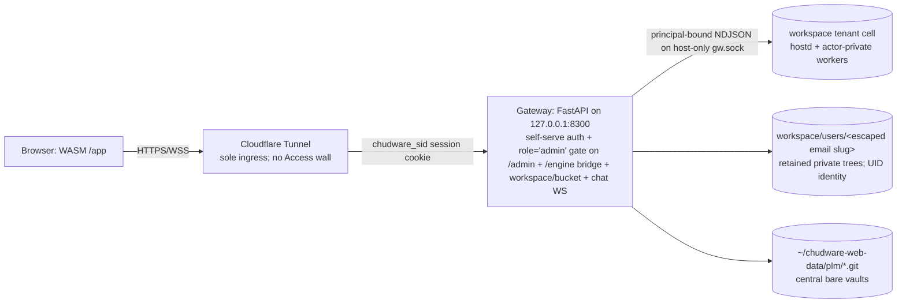

# chudware-web — self-hosted multi-user Chudware in the browser

Ratified design (advisor: `work/questions/T-WEB1.md`, research: `Webservice/research/`).
Original design date 2026-07-14; **revised 2026-08-10** when the streamed-session
product was removed. Host: Fedora 44, Ryzen 7600X3D 6C/12T, 32 GiB RAM, RTX 3080 Ti 12 GiB.

The browser runs a WASM build of `host/src/ui`. CAD and BYOK AI route to
OS-enforced tenant cells, not a shared daemon. Admission fails closed when the
cell policy, socket activation, namespace launcher or principal handshake is
unavailable. External release still requires the security audit's runtime evidence.

## Architecture

## Decisions (advisor verdicts)
1. **Delivery**: WASM only. The gateway resolves a personal or team workspace
   to `sha256(workspace_key)[:32]`, validates `cell.json`, activates only
   `chudware-cell@<hex>.socket`, and connects to a pinned no-follow Unix socket.
   Browser contract version 2 admits methods solely from
   `contracts/cell_methods.json`, capped by the principal's right. There is no
   shared-daemon fallback, including for administrators. Desktop/MCP remain unchanged.
2. **Auth**: self-serve, inside the gateway. `POST /api/auth/register` takes an email and
   an argon2id-hashed password and mails a verification link; redeeming it activates the
   account on a 14-day trial (`CHUDWARE_WEB_TRIAL_DAYS`) and signs the visitor in. Optional
   Google/GitHub OAuth lands on the same account rows. A login writes a server-side session
   row and sets the `chudware_sid` cookie; the gateway resolves that cookie to an account and
   reads status/role/plan from the account store on every request — never from the client.
   OAuth completion discards unverified preregistration passwords and invalidates
   old verification/recovery capabilities; it preserves independently verified
   passwords. Suspension/denial revokes sessions in the status transaction.
   Session issuance locks the same account row and rejects suspended/denied users.
   Billing updates plans/subscriptions, never account approval or security status.
   Cloudflare Tunnel is still the only ingress to the gateway, and it reaches the gateway
   at exactly one hostname, `app.chudware.com` (the apex and `www` are a Cloudflare Pages
   static site with no origin route). Cloudflare Access is **no longer in front of
   anything**, including `/admin`: `_authenticate` tries the `chudware_sid` cookie first,
   and the Access branch is only the fallback for a caller with no session. It remains a
   supported deployment mode — when an Access credential is present the gateway MUST
   verify `Cf-Access-Jwt-Assertion` (iss/aud/exp vs team JWKS, 6-week key rotation)
   instead of the cookie — but no Access application exists over `app.chudware.com` today.
   `CHUDWARE_WEB_DEV=1` bypass for local testing only.
3. **PLM**: NO shared working-tree mount. Central bare folder remotes
   `~/chudware-web-data/plm/<project>.git`; per-account private clone under that
   account's workspace root.
   T-R7 subset in `services/plm/remote.py` (dulwich folder kind): seed/clone, `plm_add_remote`,
   `plm_sync` (fetch + linear replay + expected-old push, same-item_id collision →
   copy-as-variant §6.4), `plm_lock`/`plm_unlock` CAS on `refs/aicad/locks`. Additive under
   `aicad.plm/1`. Author injection: vault `_user_author()` reads `CHUDWARE_USER_ID` /
   `CHUDWARE_USER_DISPLAY`.
4. **Tenant isolation is enforced by the OS and at sinks.** Immutable
   `accounts.uid` identifies actors; personal workspace keys are `user:<uid>`,
   team keys `team:<org>/<team>`. Rights are owner/manager/editor/viewer, with
   viewers read-only and writes requiring current team funding. Each gateway
   connection sends a server-owned principal and revocation epoch in `hello`.
   Strict bounded JSON rejects unknown methods, forged principals and credentials;
   cell replies and class-allowlisted events remain untrusted. Membership and
   account changes bump epochs, close silent observers, stop actor runs and drop
   mesh grants. Cell worker credentials are BYOK only, never operator credentials.
5. **Resources**: the gateway is a single `MemoryMax=1G` unit. Per-account ceilings are
   upload size, disk quota across workspace + bucket, WS frame size, and per-account
   rate limits; `/engine` additionally caps concurrent bridges per account. The disk
   monitor touches `~/chudware-web-data/REFUSE_NEW` under disk pressure.
6. **Chat**: portal-level collapsible sidebar, gateway WS fan-out, PostgreSQL persistence.
   Not inside the Chudware binary.
7. **Layout**: everything under `Webservice/` except the T-R7 subset (services/plm + MCP/worker
   wiring). Secrets only in gitignored files (`Webservice/Cloudflare-info.txt`,
   `Webservice/secrets/`); `config.example.env` committed instead.

## Component contract
- Gateway (port 8300): `/` portal; `/app` WASM client; `/engine` WS bridge to a
  workspace-owned cell; `/workspace/*` and `/bucket/*` file APIs; `/files/aicm` mesh fetch;
  `/ws/chat`; `/api/auth/*` register/login/verify/reset + OAuth start/callback;
  `/api/admin/*` account approvals + ops + terminal + releases; `/api/billing/*`;
  `/healthz` (bare `{ok}` anonymous; RAM/VRAM/presence/engine-bridge detail authenticated).
- Account store: PostgreSQL `accounts` — immutable UUID `uid`, `email`, display,
  role(admin|user), plan, status(pending|active|denied|suspended), heavy — plus
  credential, session and email-token tables (`Webservice/gateway/migrations/*.sql`).
  No file-based allowlist.
- Data root: `~/chudware-web-data/{workspace,bucket,plm,chat.db,logs}`.

## Monitoring (advisor §C)
systemd user units (gateway, cloudflared) `Restart=on-failure`; monitor timer (1–5 min):
free RAM, disk, `nvidia-smi` VRAM; JSONL log; `/healthz` for a remote glance.
No Prometheus in v1.

## Security notes
- The Cloudflare API token + R2 keys once pushed to the public GitHub repo
  (untracked in ac1b912f, history retains them) were revoked 2026-10-20.
- Gateway binds 127.0.0.1 only; the tunnel is the sole ingress; every request is
  authorized server-side — the `chudware_sid` session row first, an Access JWT only in
  the fallback mode nothing uses today.
- Cell gateway sockets and `cell.json` are host-only. Launchers bind only the
  admitted workspace and actor state; no home, gateway data root or ambient
  provider credentials are visible to tenant processes.
- Existing personal slug trees stay in place to preserve customer data; deletion
  atomically tombstones workspace and bucket trees under retained `.deleted`
  directories keyed by immutable UID and timestamp. Re-registering an email
  receives a new UID and empty trees.
- Browser file paths are workspace-relative (`root: "."`, upload `path` only).
  Mesh URIs are `aicm-cell:` plus JSON `{workspace_key,doc_id,path}`; fetch uses
  authenticated UID, workspace and document grants and live epoch/membership.
  `/state/mesh/<random hex>.aicm` maps only to that cell's private mesh directory.
  All reads/listings use descriptor-based no-follow beneath-root traversal,
  regular-file checks and byte bounds; meshes are never served from shared shm.
- Multipart upload admission checks rate, size and quota before parsing/buffering;
  streaming caps also cover chunked bodies. Recents and private chat replacement
  writes share quota accounting. Interim engine usage enforcement scans actual
  workspace usage before write/run admission and after replies; it reports
  over-quota writes without deleting the user's saved feature history. This is
  accounting, not a hard filesystem quota: OS storage quotas remain a deployment
  requirement against code writing inside a cell while a run is in flight.
- Marketplace previews snapshot renderable uploads beneath the seller's personal
  workspace and open them through that seller's cell with a viewer principal.
  Native thumbnail/contact-sheet rendering is read-only; cell-reported paths are
  ignored, and only bounded, regular PNG files opened beneath the gateway-minted
  output directory are published as ungated previews. Existing uploads are staged
  on first render, so cutover preserves published listings. No seller data enters
  a shared daemon, and unavailable or revoked seller cells return a render failure.
- `CHUDWARE_MAIL_CONTEXT_ENCRYPTION_KEY` is mandatory in every mode: URL-safe
  base64 encoding of 32 bytes, independent of session/provider encryption keys.
