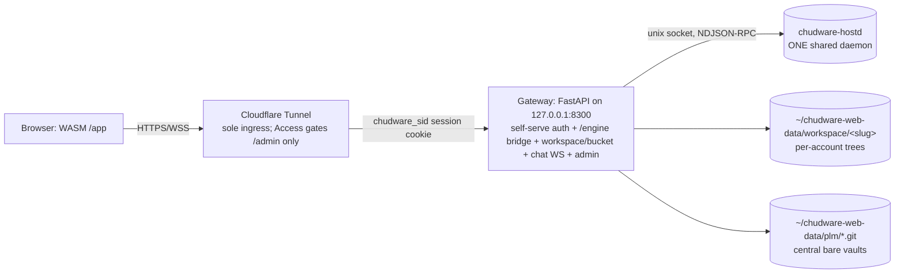

# chudware-web — self-hosted multi-user Chudware in the browser

Ratified design (advisor: `work/questions/T-WEB1.md`, research: `Webservice/research/`).
Original design date 2026-07-14; **revised 2026-08-10** when the streamed-session
product was removed. Host: Fedora 44, Ryzen 7600X3D 6C/12T, 32 GiB RAM, RTX 3080 Ti 12 GiB.

The browser runs a WASM build of `host/src/ui`. There are no per-user containers,
no pixel streaming, and no session manager: every signed-in account shares one
`chudware-hostd` daemon, and isolation is enforced in the gateway.

## Architecture

## Decisions (advisor verdicts)
1. **Delivery**: WASM only. A WASM build of `host/src/ui` talks to the shared
   `chudware-hostd` through the gateway's WS `/engine` bridge
   (`Webservice/gateway/engine_bridge.py` ↔ `services/ipc/ipc_transport_wasm.cpp`),
   a byte-for-byte RPC/event pass-through, so engine/AI behavior is identical by
   construction. See `Webservice/README.md`.
2. **Auth**: self-serve, inside the gateway. `POST /api/auth/register` takes an email and
   an argon2id-hashed password and mails a verification link; redeeming it activates the
   account on a 14-day trial (`CHUDWARE_WEB_TRIAL_DAYS`) and signs the visitor in. Optional
   Google/GitHub OAuth lands on the same account rows. A login writes a server-side session
   row and sets the `chudware_sid` cookie; the gateway resolves that cookie to an account and
   reads status/role/plan from the account store on every request — never from the client.
   Cloudflare Tunnel is still the only ingress, and Cloudflare Access is kept in front of
   `/admin`: when an Access credential is present the gateway MUST verify
   `Cf-Access-Jwt-Assertion` (iss/aud/exp vs team JWKS, 6-week key rotation) instead of the
   cookie. `CHUDWARE_WEB_DEV=1` bypass for local testing only.
3. **PLM**: NO shared working-tree mount. Central bare folder remotes
   `~/chudware-web-data/plm/<project>.git`; per-account private clone under that
   account's workspace root.
   T-R7 subset in `services/plm/remote.py` (dulwich folder kind): seed/clone, `plm_add_remote`,
   `plm_sync` (fetch + linear replay + expected-old push, same-item_id collision →
   copy-as-variant §6.4), `plm_lock`/`plm_unlock` CAS on `refs/aicad/locks`. Additive under
   `aicad.plm/1`. Author injection: vault `_user_author()` reads `CHUDWARE_USER_ID` /
   `CHUDWARE_USER_DISPLAY`.
4. **Tenant isolation is the gateway's job.** The shared daemon resolves whatever
   absolute path it is handed, so containment cannot live below the gateway:
   `_inject_identity()` overwrites the client's claimed identity with the
   gateway-verified one, and `path_violation()` rejects any RPC naming a path
   outside the caller's own workspace/bucket roots. Provider-manager RPCs
   (`agent_provider_*`) are admin-only; client-supplied credentials are stripped.
5. **Resources**: the gateway is a single `MemoryMax=1G` unit. Per-account ceilings are
   upload size, disk quota across workspace + bucket, WS frame size, and per-account
   rate limits; `/engine` additionally caps concurrent bridges per account. The disk
   monitor touches `~/chudware-web-data/REFUSE_NEW` under disk pressure.
6. **Chat**: portal-level collapsible sidebar, gateway WS fan-out, SQLite persistence.
   Not inside the Chudware binary.
7. **Layout**: everything under `Webservice/` except the T-R7 subset (services/plm + MCP/worker
   wiring). Secrets only in gitignored files (`Webservice/Cloudflare-info.txt`,
   `Webservice/secrets/`); `config.example.env` committed instead.

## Component contract
- Gateway (port 8300): `/` portal; `/app` WASM client; `/engine` WS bridge to the shared
  daemon; `/workspace/*` and `/bucket/*` per-account file APIs; `/files/aicm` mesh fetch;
  `/ws/chat`; `/api/auth/*` register/login/verify/reset + OAuth start/callback;
  `/api/admin/*` account approvals + ops + terminal + releases; `/api/billing/*`;
  `/healthz` (bare `{ok}` anonymous; RAM/VRAM/presence/engine-bridge detail authenticated).
- Account store: PostgreSQL `accounts` — `email, display, role(admin|user), plan,
  status(pending|active|denied|suspended), heavy` — plus credential, session and
  email-token tables (`Webservice/gateway/migrations/*.sql`). No file-based allowlist.
- Data root: `~/chudware-web-data/{workspace,bucket,plm,chat.db,logs}`.

## Monitoring (advisor §C)
systemd user units (gateway, cloudflared) `Restart=on-failure`; monitor timer (1–5 min):
free RAM, disk, `nvidia-smi` VRAM; JSONL log; `/healthz` for a remote glance.
No Prometheus in v1.

## Security notes
- **ROTATE the Cloudflare API token + R2 keys** from `Cloudflare-info.txt` — they were pushed
  to the public GitHub repo (untracked in ac1b912f, but history retains them).
- Gateway binds 127.0.0.1 only; the tunnel is the sole ingress; JWT verified on every request.
- The shared daemon is the blast radius: every `/engine` hardening rule in §4 is
  load-bearing, not defense in depth.
