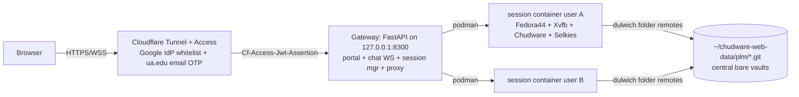

# chudware-web — self-hosted multi-user streamed Chudware sessions

Ratified design (advisor: `work/questions/T-WEB1.md`, research: `Webservice/research/`).
Date: 2026-07-14. Host: Fedora 44, Ryzen 7600X3D 6C/12T, 32 GiB RAM, RTX 3080 Ti 12 GiB,
rootless podman 5.8.3 + crun + CDI (verified: `--device nvidia.com/gpu=all
--security-opt=label=disable`).

## Architecture

## Decisions (advisor verdicts)
1. **Streaming**: Selkies (MPL-2.0, WS/WebCodecs, single HTTP+WS port). Fallback env
   `STREAM_BACKEND=novnc` (x11vnc+noVNC) in the same image.
2. **Auth**: Cloudflare Tunnel + Access. IdPs: Google (exact-email allowlist) + One-Time PIN
   for listed ua.edu addresses. Honest wording: OTP is email-verified school mailbox, NOT
   Entra OAuth. Phase-2 upgrade paths in RUNBOOK. Gateway MUST verify
   `Cf-Access-Jwt-Assertion` (iss/aud/exp vs team JWKS, 6-week key rotation) and map
   `email → user record`. `CHUDWARE_WEB_DEV=1` bypass for local testing only.
3. **PLM**: NO shared working-tree mount. Central bare folder remotes
   `~/chudware-web-data/plm/<project>.git`; per-session private clone in the session HOME.
   T-R7 subset in `services/plm/remote.py` (dulwich folder kind): seed/clone, `plm_add_remote`,
   `plm_sync` (fetch + linear replay + expected-old push, same-item_id collision →
   copy-as-variant §6.4), `plm_lock`/`plm_unlock` CAS on `refs/aicad/locks`. Additive under
   `aicad.plm/1`. Author injection: vault `_user_author()` reads `CHUDWARE_USER_ID` /
   `CHUDWARE_USER_DISPLAY` env (set per session container).
4. **Session image**: `Webservice/image/Containerfile` FROM fedora:44 — dnf OCCT 7.9 + Xvfb +
   VirtualGL(EGL) + fonts + selkies + noVNC fallback; stages the host-built
   `host/build-linux/bin` tree (glibc 2.43 match; Ubuntu bases rejected — glibc 2.39 + old OCCT).
5. **Resources**: default `max_sessions=3` (hard cap 4, CPU-encode only); per session
   `--memory 5g --memory-swap 5g --cpus 2 --pids-limit 2048`; **default seats are CPU
   x264/llvmpipe; ≤2 concurrent `heavy` seats** get GPU (CDI GL + nvh264enc). Idle reaper
   30 min (no WS traffic) + reap on Access logout; keep ≥8 GiB host RAM free or refuse new
   sessions.
6. **Chat**: portal-level collapsible sidebar, gateway WS fan-out, SQLite persistence,
   presence from live sessions. Not inside the Chudware binary.
7. **Layout**: everything under `Webservice/` except the T-R7 subset (services/plm + MCP/worker
   wiring). Secrets only in gitignored files (`Webservice/Cloudflare-info.txt`,
   `Webservice/secrets/`); `config.example.env` committed instead.
8. **WASM**: ~~rejected (OCCT/CEF footprint; WASM bytecode on the client is worse IP posture
   than server-side streaming)~~ — **superseded**: the premise was wrong. A WASM build of
   `host/src/ui` now talks to the shared `chudware-hostd` through the gateway's WS `/engine`
   bridge (`Webservice/gateway/engine_bridge.py` ↔ `services/ipc/ipc_transport_wasm.cpp`),
   a byte-for-byte RPC/event pass-through, so engine/AI behavior is identical by
   construction. Selkies pixel-streaming remains the default session path. See
   `Webservice/README.md`.

## Component contract (frozen for the build wave)
- Image: `localhost/chudware-session:latest`; container `chudware-sess-<slug>`.
- Container listens on **8080** (stream HTTP+WS); published to `127.0.0.1:<8400+n>`.
- Session env: `CHUDWARE_USER_EMAIL`, `CHUDWARE_USER_DISPLAY`, `CHUDWARE_USER_ID`,
  `CHUDWARE_USER_DISPLAY`, `STREAM_BACKEND=selkies|novnc`, `SELKIES_ENCODER=x264enc|nvh264enc`,
  `CHUDWARE_HEAVY=0|1`, `DISPLAY=:0`, `CHUDWARE_PLM_DIR=/plm`.
- Volumes: `~/chudware-web-data/homes/<slug>:/home/user` (private) and
  `~/chudware-web-data/plm:/plm` (shared, **bare repos only**).
- Gateway (port 8300): `/` portal; `/api/sessions` start/stop/status; `/stream/<sid>/…`
  reverse proxy (HTTP+WS); `/ws/chat`; `/transfer` upload/download to the user HOME;
  `/healthz` (sessions, free RAM, VRAM, image bit).
- Users file: `Webservice/gateway/users.yaml` — `email, display, role(admin|user), heavy(bool)`.
- Data root: `~/chudware-web-data/{homes,plm,chat.db,logs}`.

## Demo-readiness gaps to cover (advisor §A)
not-on-the-list page; reconnect-to-same-container (no double seats); seeded demo project +
one-click open; file in/out via `/transfer`; pre-pulled image + warm-seat option +
healthcheck before iframe; CEF `--no-sandbox`/disable if unstable in container; author
injection so the shared timeline never says just "User".

## Monitoring (advisor §C)
systemd user units (gateway, cloudflared) `Restart=on-failure`; monitor timer (1–5 min):
free RAM, disk, `nvidia-smi` VRAM/encoder sessions, stray `chudware-sess-*`; JSONL log +
reaper actions; `/healthz` for a remote glance. No Prometheus in v1.

## Security notes
- **ROTATE the Cloudflare API token + R2 keys** from `Cloudflare-info.txt` — they were pushed
  to the public GitHub repo (untracked in ac1b912f, but history retains them).
- Gateway binds 127.0.0.1 only; the tunnel is the sole ingress; JWT verified on every request.
- Containers: no `--privileged`; SELinux `label=disable` only on GPU seats.
