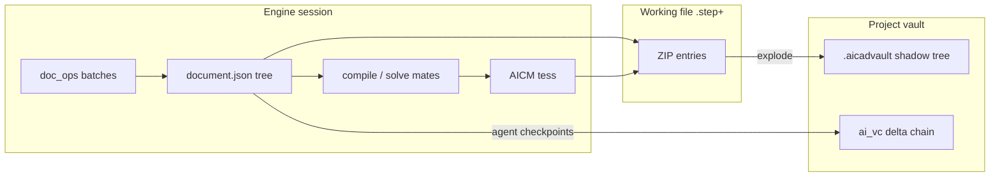

# Unified Native File Format — Design

Status: **design proposal** (implementation-oriented).  
Scope: one container family covering **parts, assemblies, drawings, and FEA/simulation results**.  
Out of scope for embedding: **ECAD** (stays `.ecad+`).  
Interop: foreign standards (STEP/IGES/STL/…) remain **import/export around** the native format.

**Authority scope:** this remains a proposal, not an implementation acceptance record.
The "today"/"already" inventory and API sketches below are the design's baseline; use
[`contracts/stepplus.md`](../../contracts/stepplus.md) and
`core/doc/stepplus.h` / `stepplus.cpp` for the actual container/API boundary.
In particular, `stepplus_open` preserves editable extras while
`stepplus_read_document` / `stepplus_open_component` are read-only dependency paths;
the proposed flags API below is not their signature. Proposal presence does not approve
a format migration or establish that all proposed section/lazy-load behavior shipped.

This document extends what already ships. It does **not** invent a greenfield format. Primary sources:

| Area | Files / contracts |
|---|---|
| Container contract | `contracts/stepplus.md` |
| Document model | `contracts/doc_schema.md`, `contracts/feature_params.md`, `contracts/doc_ops.md` |
| Mesh / overlays | `contracts/mesh_format.md` (AICM) |
| Writer/reader (C++) | `core/doc/stepplus.{h,cpp}`, `core/doc/session.cpp` (`doc_save` / `doc_open`) |
| Assembly load | `core/doc/assembly.cpp` (component `.step+` + `cache.brep` fast path) |
| Drawing embed | `core/doc/drawing_session.h` (`drawings_for_source`) |
| PLM vault | `contracts/plm.md`, `docs/design/PLM_VERSION_CONTROL_PLAN.md`, `services/plm/{vault,snapshot,ai_vc}.py` |
| AI silent VC | `contracts/ai_vc.md`, `services/plm/ai_vc.py` |
| Prior format survey | `docs/reference/cad-file-formats.md` |

---

## 1. Current state — how `.step+` works today

### 1.1 What it is

`.step+` is already the **native working file**: a **ZIP** that “travels like STEP.” Any CAD that understands AP214 can open the embedded geometry snapshot; Chudware restores the full parametric document.

- Contract: `aicad.step+/1` (`contracts/stepplus.md`).
- Implementation: `chudware::doc::stepplus_save` / `stepplus_open` via **miniz** (`core/doc/stepplus.cpp`).
- Atomic save: write `<path>.tmp` → rename.
- Forward-compat rule: **unknown ZIP entries are preserved** on resave.

### 1.2 ZIP layout (v1, as contracted + implemented)

| Entry | Required | Role today |
|---|---|---|
| `thumbnail.png` | yes | 256×256; **STORED, first entry** for shell previewers |
| `meta.json` | yes | `{container, app_version, kind, created, modified, units, name}` — timestamps live here, **not** in `document.json` |
| `document.json` | yes | Full `aicad.part/1` or `aicad.asm/1` (and, by schema, drawings/CAM when present) — **sole parametric source of truth** |
| `geometry.step` | yes* | AP214 (`AUTOMOTIVE_DESIGN`) of the last successful rebuild, mm — written by `doc_save` after a fully-ok rebuild (part: compiled bodies; assembly: flattened world-placed component bodies) via `stepplus_geometry_step_bytes`. Absent only when the document has never rebuilt successfully; open tolerates absence |
| `parts/<uuid>.json` | asm only | Embedded component docs via `source.embedded` |
| `drawings/<drawing_id>.json` | no | Live drawings whose **source** is this doc, collected on save (`drawings_for_source`) |
| `studies/<id>.json` | no | Study definitions (also mirrored / primarily stored as top-level `studies[]` in the doc JSON) |
| `studies/<id>/results.npz` | no | Cached FEA/CFD solve payload (**AICRES1** blob, **20 MB cap** per study) |
| `studies/<id>/overlay.aicm` | no | Instant result overlay for reopen |
| `cache.json` + `cache.aicm` + `cache.brep` + `cache.ckpt` | no | Display/build acceleration only (2026-07-12 additive; `cache.ckpt` build checkpoints 2026-10-05, `contracts/stepplus.md` §9) |
| `ai/memory.json` | no | Design intent / decisions digests |
| unknown entries | — | Preserved verbatim |

Canonical `document.json` rules (`doc_schema.md` Appendix A):

- sorted keys, full round-trip numeric precision, indent=2, UTF-8 no BOM, **no wall-clock timestamps**.
- C++: `canonical_doc_json()` uses `doc.dump(2)` without quantization (`stepplus.cpp`).
- Hash for cache validity: FNV-1a of that form with volatile top-level `id` stripped (`stepplus_doc_hash`).

### 1.3 Document kinds already carried by the container

| Schema | Kind | How it lands in `.step+` |
|---|---|---|
| `aicad.part/1` | part feature history + params + configs | `document.json` |
| `aicad.asm/1` | components + mates + optional assembly features | `document.json`; components usually **external** `.step+` paths; optional `parts/<uuid>.json` embed |
| `aicad.drawing/1` | sheets/views/annotations | Separate drawing sessions; **embedded into source part/asm** as `drawings/*.json` on save (not a standalone user-facing drawing file today) |
| Studies | FEA/CFD setups | Opaque JSON in `doc["studies"]` (session RPCs); results in ZIP under `studies/` |
| CAM / requirements | `aicad.cam/*`, `aicad.req/*` | PLM infers kind from schema (`services/plm/vault.py` `_SCHEMA_KIND`) when the same container family is used |

**ECAD is intentionally separate:** `.ecad+` ZIP with its own session/RPC surface (`contracts/ecad/*`, `ecad_save`). PLM versions both suffixes: `_CONTAINER_SUFFIXES = (".step+", ".ecad+")`.

### 1.4 Load order (normative today)

1. Read `meta.json`; reject unknown **major** container version.
2. Parse `document.json` → full rebuild (`compile_document` / assembly solve).
3. If rebuild fails: offer `geometry.step` as frozen import (when present); leave broken JSON on disk.
4. `studies/*` load **lazily** when Simulation opens; overlays tagged “cached — re-run to refresh.”
5. Optional: if `cache.json` engine key + `doc_hash` (+ asm component fingerprints) match → skip rebuild and show `cache.aicm` immediately. Parts also hydrate the session's compile (from `cache.ckpt`, else `cache.brep`), so the first activate/pick/measure/save executes no feature, and restore the per-feature checkpoints from `cache.ckpt`, so the **first edit executes only the edited tail** (not the whole tree). Every miss/skip is named in the `doc_open` result (`cache_miss_reason`, `cache`; `contracts/stepplus.md` §9).

### 1.5 What works well

- **Parametric round-trip is faithful**: deterministic rebuild from JSON; no op-log required for persistence (`doc_ops.md` ops are session-transient).
- **Display cache** already solves the dominant cold-open cost (tess + BREP for assembly components).
- **Self-contained imports**: `embedded_brep` on import features so saves do not depend on external source files surviving (Bug N-8).
- **PLM-friendly explode**: vault stores canonical JSON + thumbnail, not opaque ZIP blobs (`services/plm/snapshot.py`).
- **AI-VC** already content-addresses delta chains for agent-authored docs without bloating the working tree (`services/plm/ai_vc.py`).

### 1.6 Limits (what a “unified format” must fix or formalize)

| Limit | Detail |
|---|---|
| **Not one user mental model** | Drawings ride inside the source part’s ZIP; there is no first-class standalone `.step+` drawing file UX. Assemblies are multi-file by default (external component paths). |
| **Sim results are second-class** | 20 MB drop-on-save; no section index for partial load of large result sets; study defs dual-homed (doc JSON vs `studies/*.json` entries). |
| **geometry.step fallback not wired into open** | The writer is live (`stepplus_geometry_step_bytes`, entry written right after `document.json`), but §2 step 3 — offering the embedded snapshot as a frozen `import` feature when a rebuild fails — is not implemented: `editable_container_open` treats `geometry.step` as an owned entry and drops it from `extra`, so the bytes never reach the loader |
| **No section index** | Open always scans/extracts all non-owned entries into `extra_entries` (memory); no random-access “load only drawings” API. |
| **ZIP is git-hostile** | Already solved *around* the file by PLM explode — but the working file itself remains a monolithic ZIP (diff noise, whole-file rewrite). |
| **Assembly graph not self-describing for lazy load** | Component fingerprints live only in `cache.json` when cached; no formal `index.json` of external refs for partial project open. |
| **CAM / multi-body deliverables** | Schema kinds exist in PLM; container layout is still “whatever is in document.json + extras,” not a declared section map. |
| **mmap / streaming** | miniz heap-extract; large STORED blobs (`cache.aicm`) are optimized for CRC skip, not mmap. |
| **History inside the file** | Working `.step+` has **no** built-in history; history is **external** (`.aicadvault/` + optional `ai_vc/`). That split is good — but not documented as the unified format’s versioning law. |

### 1.7 Data flow (today)



---

## 2. Proposed unified container

### 2.1 Design goals

1. **One container family** for mechanical docs: part / assembly / drawing / sim-bearing docs — same ZIP mechanics, same PLM explode path.
2. **`document.json` remains source of truth** for authored state; binary caches remain **derived, hash-gated, droppable**.
3. **Sectioned layout** so open can be **partial / lazy** without rewriting the doc model.
4. **ECAD stays external** (`.ecad+`); assemblies/projects **reference** boards, never embed KiCad-scale graphs into `.step+`.
5. **Extend `aicad.step+/1` additively** where possible; bump to `aicad.step+/2` only when major load rules change.
6. **PLM + AI-VC stay the history engines** — do not stuff full git history into the working file.

### 2.2 Naming / extension

| Option | Pros | Cons | Recommendation |
|---|---|---|---|
| Keep `.step+` | Zero user migration; shell associations; already everywhere (missions, PLM, web app) | Name suggests “STEP with extras,” not drawings/sim | **Keep** as primary extension |
| Add alias `.chudware` / `.blt` | Clean brand | Dual extensions, dual filters forever | Optional Save-As alias later; same container magic |
| Directory bundle (`.step+/` folder) | Git-friendly working tree | Breaks “single file share,” shell preview, atomic rename | **Not** the working format; PLM shadow tree already is the directory form |

**Decision: single-file ZIP remains the interchange + working unit.** Directory form = PLM shadow tree only.

### 2.3 Container mechanics

Stay on ZIP (miniz today; same as contract):

- **Central directory** already provides O(log n) locate by name — treat entry names as the **section key space**.
- **STORED** for large binary (mesh, BREP, results); **DEFLATE** for JSON.
- **Atomic tmp+rename** unchanged.
- Add a small **section index** entry so readers need not `stat` every member to decide lazy policy:

```
index.json   (optional in v1.x readers; required for writers of aicad.step+/2)
{
  "container": "aicad.step+/2",
  "schema": "aicad.part/1",
  "sections": [
    {"name": "document.json", "role": "document", "codec": "deflate", "sha256": "…", "bytes": 12345},
    {"name": "cache.aicm", "role": "tess_cache", "codec": "store", "sha256": "…", "bytes": 900000},
    {"name": "drawings/d1.json", "role": "drawing", "codec": "deflate", "bytes": 4000},
    {"name": "studies/s1/results.npz", "role": "sim_result", "codec": "store", "bytes": 8000000,
     "cap_note": null}
  ],
  "externals": [
    {"role": "component", "path": "base.step+", "item_id": "i0a1b2c3"},
    {"role": "ecad_board", "path": "Controller.ecad+", "item_id": "i9f8e7d6"}
  ]
}
```

`index.json` is **derived** from the ZIP at save (like `cache.json`): if missing or inconsistent, fall back to today’s full scan.

### 2.4 Unified section map

Roles (stable strings; unknown roles preserved):

| Role | Path pattern | Content | Load policy |
|---|---|---|---|
| `thumb` | `thumbnail.png` | PNG | On open (preview) |
| `meta` | `meta.json` | Container bookkeeping | On open |
| `index` | `index.json` | Section table | On open |
| `document` | `document.json` | Parametric / drawing / cam JSON | On open (always) |
| `geometry_step` | `geometry.step` | AP214 snapshot | Lazy / fallback |
| `tess_cache` | `cache.aicm` | AICM v1 (`mesh_format.md`) | Fast path if hash ok |
| `brep_cache` | `cache.brep` | `AICBREP1` + BinTools bodies | Asm component open |
| `cache_hdr` | `cache.json` | engine + doc_hash + solved + response | Validates caches |
| `embedded_part` | `parts/<uuid>.json` | Embedded `aicad.part/1` | When asm resolves `source.embedded` |
| `drawing` | `drawings/<id>.json` | `aicad.drawing/1` | Lazy when Drawing workspace opens **or** when listing drawings |
| `sim_def` | `studies/<id>.json` | Study definition (optional mirror) | Lazy with Simulation |
| `sim_result` | `studies/<id>/results.npz` | AICRES1 / npz | Lazy; respect size cap |
| `sim_overlay` | `studies/<id>/overlay.aicm` | Result visualization | Lazy with results |
| `ai_memory` | `ai/memory.json` | Intake / memory role | Lazy on follow-up AI session |
| `ecad_ref` | *(not embedded)* | Listed only in `index.externals` | Open via ECAD session |

### 2.5 Geometry section (B-rep + feature history)

**Authored**

- Entire feature tree, equations, materials, configurations, rollback bar, appearances, intake meta (`doc["meta"]`), studies **definitions** as today — all in `document.json` per `doc_schema.md` + `feature_params.md`.
- Ops from `doc_ops.md` are **not** persisted as a log; the tree is the snapshot after applied ops (same as today / PLM plan §3.1).

**Derived**

| Artifact | When written | Validity |
|---|---|---|
| `cache.brep` | After fully-ok part rebuild | `engine` + `doc_hash` + `solved:true` |
| `cache.aicm` | Same | Same (+ `display_quality`) |
| `cache.ckpt` | Every part save (only the checkpoints before the first failed feature; full result only after a fully-ok rebuild) | `engine` + per-checkpoint compile chain (content-addressed) + `cache.aicm` hash for the full result |
| `geometry.step` | After fully-ok rebuild (**live**; erase-first, same gate as `cache.*`) | Same doc_hash optional sidecar note in `cache.json` |
| Tess in `ops_response` | Session only unless cached | — |

Feature-tree vs replay tradeoff: **keep snapshot tree, not op log**, consistent with PLM plan (“Not op-log replay… snapshots are already cheap and semantic diff already exists”).

### 2.6 Assembly graph section

Authored in `document.json` (`aicad.asm/1`):

```json
{
  "schema": "aicad.asm/1",
  "components": [
    {"id": "k1", "name": "base", "source": {"path": "base.step+"},
     "transform": [1,0,0,0, 0,1,0,0, 0,0,1,0, 0,0,0,1],
     "fixed": true, "suppressed": false}
  ],
  "mates": [ … ]
}
```

**Unified format additions (additive, no schema bump if optional):**

1. **`index.externals[]`** — denormalized list of every `source.path` + optional PLM `item_id` for project tools / lazy open without parsing full JSON twice.
2. **Prefer path refs over embed** for multi-user PLM (one item_id per part). Keep `source.embedded` + `parts/<uuid>.json` for single-file pack/export (`Pack and Go`).
3. **Pack mode** (export only): resolve all components, embed as `parts/<uuid>.json` + rewrite sources to `embedded`, write one shareable `.step+`.

Assembly cache already fingerprints components in `cache.json` (`path, size, mtime`) — promote that structure into `index.externals` with content hash when available:

```json
{"role":"component","path":"base.step+","size":12000,"mtime":1720000000,
 "doc_hash":"…","item_id":"i0a1b2c3"}
```

### 2.7 Drawings section

Today: drawings are live sessions; on **source** `doc_save`, serialized into `drawings/<id>.json`.

**Unified rules:**

| Mode | Behavior |
|---|---|
| **Embedded (default, current)** | Drawing docs ride in the source part/asm container; associative `source` is the parent doc id/path. |
| **Standalone drawing file** | `document.json` schema `aicad.drawing/1`, `meta.kind = "drawing"`, `source: {path: "Bracket.step+"}`; no feature tree. PLM kind already includes `drawing`. |
| **Projected geometry** | Still **not stored** (recomputed via HLR) — only view defs + annotations (`doc_schema.md` §8). Optional future `drawings/<id>/cache.hlr` STORED blob, hash-gated on source `doc_hash` + view set. |

Save path stays: `session.cpp` gather `drawings_for_source` → extra entries; open restores via `register_restored_drawing`.

### 2.8 Simulation setups + results

**Definitions (authored):** keep in `document.json` top-level `studies[]` (session already does this — cheap, undoable, no geometry rebuild). Optional mirror files `studies/<id>.json` only if needed for external tools; prefer **single home** in document JSON to end dual-writing.

**Results (derived):**

```
studies/<study_id>/
  results.npz          # AICRES1 payload (existing stepplus_*_study_result API)
  overlay.aicm         # optional viewport overlay
  summary.json         # tiny: max stress, FoS, frequencies — always loadable
```

Rules (extend existing):

- Erase-first on save; engine key + input_hash validate on open (`stepplus.h`).
- Cap: keep **20 MB** default for inline results; if larger, write `results.external` pointer:

```json
{"schema":"aicad.sim_result_ref/1","path":"studies_data/<study_id>.aicres",
 "sha256":"…","bytes":85000000}
```

  Large blobs live beside the project (or under `.aicadvault/objects/`) so working `.step+` stays shareable.

### 2.9 ECAD reference (not embed)

- Project folder may contain `Controller.ecad+` next to `MainAssembly.step+`.
- Mechanical docs reference ECAD only via:
  - `index.externals` `{role:"ecad_board", path}`, and/or
  - optional `doc.meta.ecad_links[]` (opaque meta already supported by `doc_set_meta`).
- 3D board handoff remains `ecad_to_3d` → STEP + `aicad.boardphys/1` sidecar (existing), importable as geometry if needed — **not** a second ECAD document inside `.step+`.

### 2.10 Tradeoff table — container shape

| Approach | Partial load | Single-file share | PLM/git | Complexity | Verdict |
|---|---|---|---|---|---|
| Monolithic ZIP (today) | weak | excellent | explode needed | low | baseline |
| ZIP + `index.json` + lazy extract | good | excellent | same explode | low | **adopt** |
| Directory working tree | excellent | poor | natural | medium | PLM only |
| Custom mmap container | excellent | good | custom tools | high | reject for now |
| SQLite container | good | good | awkward diffs | high | reject |

---

## 3. Load-time optimization

### 3.1 Target open paths

| Scenario | Goal | Mechanism |
|---|---|---|
| Thumbnail / file dialog | &lt; 5 ms | First ZIP entry STORED PNG (already) |
| Open part for view-only | skip rebuild | `cache.json` + `cache.aicm` hash gate (already) |
| Open part for edit | fast first paint, then background revalidate | show cache; async rebuild if policy requires |
| Open assembly | no recompile of unchanged components | `cache.brep` per component (already in `assembly.cpp`) |
| Open drawing only | no FEA blobs | extract `document.json` + `drawings/*` only via index |
| Open Simulation tab | geometry already up; results on demand | lazy `studies/*/results.*` |

### 3.2 Lazy / section-on-demand

API sketch (engine-internal; not a contract bump until implemented):

```
stepplus_open_header(path) -> {meta, index, doc_hash?}
stepplus_read_entry(path, name) -> bytes
stepplus_open(path, flags) -> StepPlusDoc
  flags: NeedDocument | NeedCache | NeedDrawings | NeedStudies | NeedAllExtras
```

Default `doc_open` = Document + Cache (validate) + preserve entry names for unknown roles without loading heavy results until requested.

### 3.3 Cached tessellation / mesh

- Keep **AICM v1** as the only viewport binary (`contracts/mesh_format.md`).
- `cache.aicm` STORED + extract with `MZ_ZIP_FLAG_COMPRESSED_DATA` (already; skips inflate + CRC).
- Optional **mmap path** later: if entire archive is STORED for that entry and OS allows, map file range — only after index records local header offsets (ZIP64-aware). Phase 3+.

### 3.4 Feature-tree vs full replay

| Strategy | Open cost | Edit fidelity | Disk | Choice |
|---|---|---|---|---|
| Store only ops log, replay always | high | perfect history | small | no |
| Store tree snapshot, rebuild geometry | medium | perfect (deterministic compile) | small | **yes (today)** |
| Store tree + BREP/tess cache | low | first edit rebuilds whole tree | medium | superseded |
| Store tree + incremental feature cache (`cache.ckpt`) | lowest | first edit executes only the edited tail; content-addressed per feature | high | **yes (today, 2026-10-05)** |

Do **not** introduce a persistent op log for load performance; PLM + AI-VC already version snapshots.

### 3.5 Precompute vs recompute

| Artifact | Precompute on save | Recompute on open/edit |
|---|---|---|
| Feature tree | authored | — |
| Solved sketch coords | last solved in tree | re-solve on edit |
| B-rep bodies | `cache.brep` + `cache.ckpt` | compile_document from the deepest valid checkpoint on miss/edit |
| Tessellation | `cache.aicm` | tessellate on miss/edit (a display-tier change re-meshes only) |
| Mate solves | optional in asm cache response | solve_mates on edit |
| HLR drawing curves | optional later | every drawing_get |
| FEA results | if &lt; cap | re-run study |
| `geometry.step` | on successful rebuild / release | import fallback only |
| PLM `summary.txt` | on vault commit | — |

### 3.6 mmap-ability notes

ZIP + DEFLATE is not mmap-friendly for JSON. Practical path:

1. Keep JSON small (canonical tree).
2. Keep big payloads STORED.
3. For Phase 3, optional `payloads/` multi-file pack is unnecessary if STORED zip offsets are published in `index.json` (`offset`, `size`).

---

## 4. Version control / PLM

### 4.1 Law: history is outside the working file

Aligned with `contracts/plm.md` and `docs/design/PLM_VERSION_CONTROL_PLAN.md`:

| Layer | What | Where |
|---|---|---|
| Working file | Current editable container | `Bracket.step+` |
| Project history | Auto on explicit save, checkpoints, releases | `.aicadvault/` git shadow tree |
| AI silent VC | Per-tool/prompt checkpoints for agent docs | `.aicadvault/ai_vc/` content-addressed deltas |
| Session undo | Op batches | In-memory only (`doc_undo`) |

**Do not** embed full history inside `.step+` (SolidWorks-style bloated files). Optional `ai/memory.json` is **narrative memory**, not a revision DAG.

### 4.2 Built-in-file history vs external delta store

| Option | Disk bloat | Multi-doc project | Team sync | Verdict |
|---|---|---|---|---|
| History slices inside ZIP | severe | weak | weak | reject |
| External git shadow (PLM) | low (content-addressed blobs) | strong | strong | **primary** |
| AI-VC delta chain | low (delta + full every N) | per-doc | local/session | **agent path** |
| Git-LFS on whole `.step+` | medium | ok | ok | unnecessary if explode stays |

### 4.3 Efficient change tracking (no bloat)

Reuse what exists:

1. **Canonical `document.json`** → byte-stable when model unchanged → git blob dedup.
2. **Explode on check-in** (`snapshot.explode_container`):  
   `items/<item_id>/{document.json,thumbnail.png,meta.json,summary.txt,extra/…}`  
   `geometry.step` **only on release** (`plm.md` §5).
3. **Whole-tree commit, unchanged items share blobs** (git).
4. **AI-VC** (`ai_vc.py`):  
   - objects content-addressed under `objects/<hh>/<hash>`  
   - zlib/zstd  
   - delta vs previous; full snapshot every `full_every` (default 8)  
   - dedup by content hash  
   - applies to `.step+` and ECAD text forms.

### 4.4 Interplay with unified sections

When adding sections, update explode rules:

| Container entry | Shadow path | Versioned? |
|---|---|---|
| `document.json` | `items/…/document.json` | always |
| `thumbnail.png` | `items/…/thumbnail.png` | always |
| `drawings/*.json` | `items/…/extra/drawings/*` **or** promote to `items/…/drawings/*` | always (authored) |
| `cache.*` | **omit from vault commits** (recomputable) | no |
| `studies/*/results.*` | omit from auto/checkpoint; optional release attach | default no |
| `studies summary.json` | optional small extra | yes if tiny |
| `geometry.step` | release only | release |
| `index.json` | omit or regenerate | no |

**Change for `snapshot.py`:** treat `cache.json` / `cache.aicm` / `cache.brep` as **known-derived** (like `netlist.json` comment in snapshot docstring) — strip on explode so history stays small. Today they ride under `extra/` and **do** bloat commits; that is a concrete fix in Phase 1.

### 4.5 Release freeze (unchanged semantics)

Release commit:

1. Preflight (stale refs, verify battery, clean tree).
2. Rev letter + lifecycle.
3. Freeze `geometry.step` (+ optionally pin sim `summary.json`).
4. BOM freeze for assemblies.

---

## 5. Migration path and interop

### 5.1 From today’s `.step+` (`aicad.step+/1`)

| Step | Action |
|---|---|
| Read | v2 reader accepts `aicad.step+/1` and `/2`; missing `index.json` → synthesize from ZIP CD |
| Write | Default write `aicad.step+/2` with `index.json`; still emit all v1 entries |
| Preserve | Unknown entries; old files without cache still full-rebuild |
| geometry.step | Writer live; old files without it keep rebuild-or-fail behavior |
| Drawings | No change to embed paths; standalone drawing files opt-in |
| PLM | Strip caches on explode (behavior fix, backward compatible restore: missing cache = rebuild) |

No bulk re-save required. First save under new writer upgrades container string.

### 5.2 Import / export (foreign formats)

Keep existing lanes (`core/doc/formats.cpp`, engine formats registry):

| Direction | Formats | Notes |
|---|---|---|
| Import → native | STEP, IGES, BREP, STL, 3MF, OBJ, PLY, glTF, DXF, … | Become `import` feature + `embedded_brep` or new part doc |
| Export from native | STEP/IGES/BREP/meshes | Geometry only; warn parametrics lost (existing Save As notice) |
| Native open | `.step+` | Feature tree path |
| Pack-and-go | multi `.step+` → one embedded container | New export mode §2.6 |

`.aicm` remains **session/cache mesh**, not a user document format.

### 5.3 ECAD co-existence

```
MyProject/
  Bracket.step+          # part
  MainAssembly.step+     # asm refs Bracket.step+
  Bracket-Drawing.step+  # optional standalone drawing (future)
  Controller.ecad+       # separate
  .aicadvault/           # versions both container types
```

### 5.4 Compatibility matrix

| Producer \ Consumer | Old app (v1) | New app (v2) | Foreign CAD |
|---|---|---|---|
| Old `.step+` | full | full (synthesize index) | geometry.step if present |
| New `.step+` with index | full if unknown entries preserved; ignore index | full lazy | geometry.step |
| New with only STORED caches | ok | ok | ignores caches |

Writers MUST continue to preserve unknown entries (existing rule).

---

## 6. Open questions

1. **Standalone drawing files vs embed-only** — embed-only is implemented; standalone needs GUI Save As + PLM path registration. Prefer both, default embed for “detail this part.”
2. **Should `studies[]` leave `document.json`?** — Currently nice for undo; large mesh params could bloat canonical JSON. Possibly split heavy mesh seeds into `studies/<id>/mesh_seed.bin` later.
3. **Results larger than 20 MB** — sidecar vs LFS vs recompute-only; lean sidecar + hash under project `studies_data/`.
4. **Pack-and-go encryption / IP** — out of scope; plain ZIP is not a security boundary.
5. **Whether to write `geometry.step` on every save or only release** — contract says every successful rebuild; PLM only *versions* it on release. Working file can still contain it for interchange (size cost).
6. **CAM jobs** — confirm all CAM state fits in document JSON vs needs `cam/` section binaries (toolpath caches analogous to `cache.aicm`).
7. **Cross-platform mtime fingerprints** in asm cache — known fragility; prefer content `doc_hash` of components when component is `.step+`.
8. **Container brand string** — keep `aicad.step+/N` vs rename to `chudware.step+/N` (compat alias).

---

## 7. Phased implementation plan

### Phase 0 — Document & inventory (this doc)

- Freeze intent; no wire changes.
- Cite contracts; list derived entries PLM should strip.

### Phase 1 — Correctness & vault hygiene (small, high leverage)

1. ~~Implement **`geometry.step` write** on fully-ok rebuild (close contract gap) in `stepplus_save` / `doc_save`.~~ **Done** — `stepplus_geometry_step_bytes` (AP214/mm) is written by `doc_save` behind the same fully-ok gate and erase-first discipline as `cache.*`; covered by `core/tests/test_export_assembly.cpp` (part volume parity, assembly flattening, and the never-rebuilt omission). Still open: the §2 step-3 *reader* fallback (see §1.6).
2. **PLM explode**: drop `cache.json`, `cache.aicm`, `cache.brep`, and large `studies/*/results.*` from shadow commits (recomputable).
3. Single-home studies: stop dual-writing defs if both `document.studies` and `studies/*.json` diverge; document the winner (`document.json`).
4. Tests: open v1 file, save, open; PLM checkpoint size does not include AICM.

### Phase 2 — Section index + lazy open

1. Emit `index.json` on save; `container` → `aicad.step+/2` (or stay `/1` with optional index if we must avoid major bump — prefer `/2` for honest major).
2. `stepplus_open` flags: skip loading `studies/*/results*` and optional drawings until requested.
3. `externals[]` populated for assemblies; used by project hub / stale-ref.
4. Drawing workspace: open drawings from index without touching sim blobs.

### Phase 3 — Pack-and-go + standalone drawings

1. Export: embed components → single `.step+`.
2. Save drawing as standalone `.step+` with `aicad.drawing/1` + path source.
3. Optional HLR cache entry hash-gated on source.

### Phase 4 — Large sim & mmap

1. `aicad.sim_result_ref/1` sidecars for &gt; cap results.
2. Index local offsets + optional mmap for STORED payloads.
3. CAM toolpath cache section if profiles show need.

### Phase 5 — Polish

1. Optional `.chudware` alias.
2. File-dialog preview via thumbnail only.
3. Docs/manual update; `contracts/stepplus.md` append-only revision (integrator).

### Suggested ownership

| Phase | Primary code | Contract touch |
|---|---|---|
| 1 | `core/doc/stepplus.cpp`, `session.cpp`, `services/plm/snapshot.py` | append `stepplus.md` geometry.step writer note; plm explode note |
| 2 | `stepplus.*`, `doc_open` | `stepplus.md` § index |
| 3 | drawing session, assembly pack | `doc_schema` only if source object form |
| 4 | `sim_cache`, stepplus study helpers | stepplus studies § |

---

## 8. Concrete section-format sketches

### 8.1 `meta.json` (v2 additive fields)

```json
{
  "container": "aicad.step+/2",
  "app_version": "Chudware/…",
  "kind": "part",
  "schema": "aicad.part/1",
  "created": "2026-07-16T12:00:00Z",
  "modified": "2026-07-16T12:05:00Z",
  "units": {"system": "MMGS"},
  "name": "Bracket",
  "item_id": "i0a1b2c3"
}
```

`item_id` optional — filled when the file is registered in a PLM project (mirrors manifest; not required for lone files).

### 8.2 `cache.json` (existing, documented)

```json
{
  "engine": "<occt+schema key from stepplus_cache_engine_key()>",
  "doc_hash": "<fnv1a hex of canonical document.json without id>",
  "solved": true,
  "response": { "revision": 18, "rebuild": {…}, "tess": {…} },
  "components": [
    {"path": "base.step+", "size": 12000, "mtime": 1720000000, "doc_hash": "…"}
  ]
}
```

### 8.3 `cache.brep` binary (existing)

```
"AICBREP1" | u64 body_count | repeat { u64 len | BinTools stream }
```

### 8.4 Drawing embed (existing path)

```
drawings/<drawing_id>.json  → full aicad.drawing/1 document
```

### 8.5 Sim result entry (existing API)

```
studies/<study_id>/results.npz
  # payload managed by stepplus_put_study_result / AICRES1
```

---

## 9. Non-goals

- Merging ECAD into `.step+`.
- Replacing PLM git vault with in-file history.
- Persistent op-log as the native source of truth.
- Real-time co-edit container protocol.
- Guaranteeing bit-identical ZIP bytes across saves (only `document.json` is byte-stable).

---

## 10. Summary decision record

| Decision | Choice | Grounded in |
|---|---|---|
| Working unit | Single ZIP file `.step+` | `contracts/stepplus.md`, all save paths |
| Source of truth | Canonical `document.json` | `doc_schema.md` Appendix A |
| Derived caches | Hash-gated, droppable | `stepplus.md` §4, `session.cpp` doc_save |
| History | External PLM + AI-VC | `plm.md`, `ai_vc.md` |
| ECAD | Separate `.ecad+`, reference only | `vault.py` suffixes, ecad contracts |
| Unification strategy | Section index + lazy load + pack-and-go on **existing** ZIP | extend, don’t replace |
| Ops log | Not persisted | `doc_ops.md` + PLM plan §3.1 |

---

*End of design doc. Implementation must land through append-only contract updates (`contracts/stepplus.md`, possibly `plm.md` explode notes) owned by the integrator; this file is the intent map only.*
