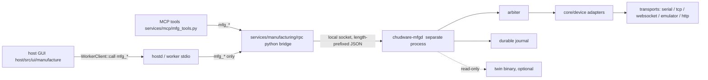
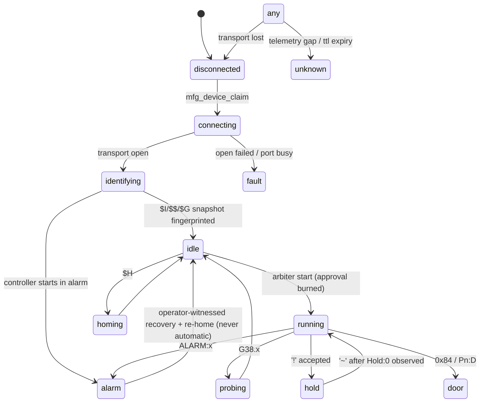
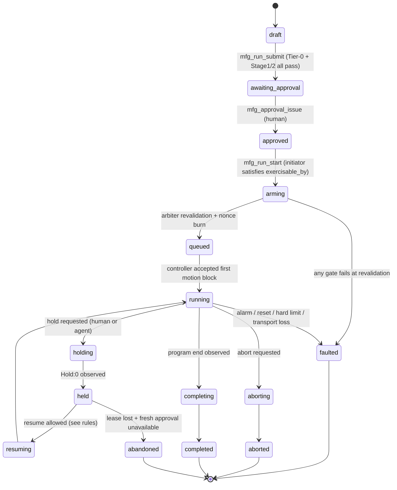

# Manufacturing Gateway — Final Design (DoD v4)

Owner: `GatewayArchitecture`. Status: **closed**. Design-only: this document specifies the
gateway; it records no implementation change by itself.

Inputs read for this document: `services/mcp/tool_registry.py`, `services/worker/worker_client.h`,
`services/worker/worker_client.cpp`, `contracts/worker_rpc.md`, the agent-control and
controller-ecosystem audits, the printer-monitoring research (summarized in
`90_research_printers.md`), `00_decisions.md` and `01_definition_of_done.md`.

**Amendment pass (this revision).** The architecture plan review returned NO-GO for W1.1 with
sixteen blocking findings. This revision closes every gateway-owned one in place — B1, B2, B3, B4
(gateway half), B5, B10, B11, B12 (gateway half), B13, B14/B15 ownership, C1's reservation table, C7
and C10 — and publishes the two registers the review asked the gateway to own: **§25** the stable
rule ids, **§26** the finding-by-finding closure table, which names for every finding not closed here
the document and owner that closes it. No product scope changed and no rule was invented: every
change reconciles two statements already inside the accepted corpus, or one statement against DoD
v4. The one repository file read as additional evidence for this pass was `services/agent/config.py`
(§17).

## 0. Bindings absorbed (all prior rulings, restated as constraints on this design)

1. Gateway owns the canonical normalized controller wire/state schema and exact enum strings in
   `contracts/manufacturing_gateway.md`. Raw vendor payload is retained alongside every normalized
   snapshot/event. Twin consumes these names; it never mints a competing status/alarm vocabulary.
2. The **sole** external/UI/event freshness shape is UX's `FreshValue<T>` verbatim:
   `{v,state,t_mono_ns,seq,age_ms,ttl_ms,src,why,last_ok?}`. The earlier gateway proposal
   `TelemetryValue{v,unit?,mono_ns,age_ms,trust}` is **deleted** and appears nowhere. Twin stays in
   `{tick,dt_ns,…}` internally and never fabricates wall time; the gateway republisher stamps
   `t_mono_ns`/`seq`/`age_ms`/`ttl_ms` and sets `src:"simulated"`.
3. Two-stage gates. Stage 1 only *admits*; it never passes. Stage-2 guards are named, meaningful, and
   both-way testable. Any Stage-2 guard that merely restates Stage-1 admission is deleted (§10.4).
4. `falsified` ≠ `superseded`. Both carry `at_seq`; supersession carries `superseded_by` and never
   alarms. Producers push; they never wait for polling or staleness.
5. Gateway stamps the establishing durable `seq` on **every** durable result a consumer may paint,
   not only telemetry, and owns lane-epoch/process-start reconciliation for all of them.
6. Runtime approval is selectable per job: `human_only` | `human_or_agent`, default `human_only`,
   ceilinged by commissioning policy. Arbiter enforces and logs initiator provenance + nonce burn.
7. One command owner per device. Approval validation lives **only** in the deterministic arbiter.
8. Public `libchudware` C ABI carries no `mfg_*` symbols; the gateway is a separate process.
9. **Path ruling (latest):** production GUI additions live only under
   `host/src/ui/manufacture/**` (no `ui/mfg`, no new canvases); cross-domain service root is
   `services/manufacturing/**`; domain engines may use `core/<domain>/**`; RPC/events stay
   `mfg_*`/`mfg.*`; `host/src/ui/cam/**` remains offline-CAM owner, extended only via named seams.
   This retires the earlier `services/mfg/**` spelling; the C++ device engine stays at
   `core/device/**` (that *is* `core/<domain>/**`, and `TwinArchitecture` is already bound to
   `chudware::device::grbl_protocol.h` / `grbl_adapter.h`).
10. **Prefix and name reservation register — total over all ten domains (`MFG-PREFIX-1`, closing review
    C1's reservation half).** No two rows collide. A prefix **absent** from this table is unreserved:
    an RPC, event or durable kind under it is a contract-test failure until the table is amended here,
    in this document, by the gateway. MCP *tool* names are a separate namespace and are not required to
    carry the wire prefix (so PnP's `pnp_define_panel` and the gateway's `propose_mfg_run` are both
    conformant); the wire methods and events are not.

| domain | RPC prefix | event prefix | durable kind-id prefix | shared type names |
|---|---|---|---|---|
| gateway (this doc) | `mfg_device_*`, `mfg_run_*`, `mfg_approval_*`, `mfg_capability_*`, `mfg_event_*`, `mfg_policy_*`, `mfg_tier0_*`, `mfg_result_*` | `mfg.device.*`, `mfg.run.*`, `mfg.approval.*`, `mfg.result.*`, `mfg.gateway.*` | `controller_snapshot`, `device_identity`, `capability_report`, `lease`, `preflight_evidence`, `approval_binding`, `run_record`, `nc_artifact_hash`, `post_check_result`, `gate_report`, `procedural_fact`, `waiver` | `FreshValue<T>`, `CapabilityTruth`, `CapabilityReport`, `Tier0Row`, `ProceduralFact`, `ControllerSnapshot`, `ITransport`, `IReadTransport` |
| monitoring | `mfg_monitor_*` | `mfg.monitor.*` | `monitor_observation`, `monitor_condition`, `monitor_source_state`, `monitor_sequence_gap`, `monitor_capability` | `ObservationRecord`, `MonitorSourceCapability` |
| cutting | `mfg_cut_*` | `mfg.cut.*`, `mfg.plasma.*` | `cam.cut.*`, `cam.plasma.*` | — |
| turning | `mfg_turn_*` | `mfg.turn.*` | `cam.turn.*` | — |
| PnP | `mfg_pnp_*` | `mfg.pnp.*` | `pnp.*` | — |
| robot | `mfg_robot_*` | `mfg.robot.*` | `robot_*` | — |
| twin | `mfg_twin_*` | `mfg.twin.*` | `twin_*` | — |
| additive | `mfg_print_*` | `mfg.print.*` | `print.*` | — |
| metrology | `mfg_metrology_*` | `mfg.metrology.*` | `metrology.*` | — |
| perception | `mfg_perception_*` | `mfg.perception.*` | `perception.*` | — |

    Three spellings are normalized by this table rather than granted an exception, because §0.9 fixes
    the wire prefix as `mfg_*`/`mfg.*` and nine of ten domains already comply: additive's `print_*`
    methods and `mfg.print.*` events are reserved here as **`mfg_print_*`**, and metrology's
    `mfg.metrology_*` and perception's `mfg.perception_*` event spellings are reserved in the dotted
    **`mfg.metrology.*`** / **`mfg.perception.*`** form every other domain uses. Renaming those in the
    owning documents is recorded in §26 (C1); nothing else in the batch depends on the old spellings.

## 1. Process and ownership boundaries



Rules that make this boundary real:

- **`chudware-mfgd` is the only process that opens a device.** It links `core/device/**` and
  `core/manufacturing/**`. It is **not** linked into `libchudware`, is not a CMake dependency of the
  GUI, and exports no C ABI symbol. DoD 16 holds by construction: `nm -D libchudware.so | grep mfg_`
  must be empty, and that is a gate assertion (§20.6).
- **`mfg_*` never routes to C++ in-process.** `services/worker/worker_client.cpp` gets exactly one
  append-only seam, mirroring the existing `agent_` guard at line 235 inside `routeDocToCpp`:
  `if (method.rfind("mfg_", 0) == 0) return false;` plus the same early-`false` in
  `routeSimToCpp` / `routeEcadToCpp` / `routeFirmwareToCpp` and exclusion from the `engineBound`
  predicate at lines 1044-1048. So a `mfg_*` call always reaches the Python bridge, never
  `engine::call`. This is 5 added lines in an existing maintainer-owned file — no behavior change for
  any existing method.
- **The Python bridge is a proxy, not a decision maker.** `services/manufacturing/rpc/gateway_rpc.py`
  exports `WORKER_METHODS` (same registration pattern `services/worker_main.py` uses per
  `contracts/worker_rpc.md` §2 Drawings) and forwards each `mfg_*` request verbatim over a local
  socket, then relays gateway events as worker `event` lines. It contains **zero** policy: no
  approval check, no gate, no lease decision, no state derivation. If the daemon is unreachable it
  returns the structured error envelope with `code:"mfg_gateway_unavailable"` and never synthesizes
  device state.
- **MCP tools are proposal/read surfaces only** (§17). Model prompts and MCP guards contain no
  approval logic (DoD 15).
- **GUI owns no state machine.** `host/src/ui/manufacture/**` paints `FreshValue<T>` and the
  gateway's enums; it computes no verdict, derives no device state, and holds no cached device truth
  across an epoch change.

## 2. Exact file tree

New, gateway-owned exclusively:

```
contracts/manufacturing_gateway.md          canonical device/run/event/approval/capability schema
core/device/device_id.h                     DeviceId, MachineFingerprint, MachineClass
core/device/transport.h                     ITransport, TransportKind, TransportEvent (no I/O impl)
core/device/grbl_protocol.h|.cpp            PURE Grbl 1.1 parse/encode (shared with Twin)
core/device/grbl_adapter.h|.cpp             protocol state machine -> ControllerSnapshot (no syscalls)
core/device/emulator_transport.h|.cpp       hardware-free ITransport (built-in fake or twin binary)
core/device/controller_snapshot.h           ControllerSnapshot, ControllerEvent, DeviceState enums
core/device/capability.h                    CapabilityReport, TruthLevel, Provenance
core/manufacturing/fresh_value.h            FreshValue<T> encode/decode (UX shape, single definition)
core/manufacturing/journal.h|.cpp           append-only durable journal, seq stamping, replay
core/manufacturing/result_registry.h|.cpp   durable-result kinds + epoch reconciliation policy
core/manufacturing/invalidation.h|.cpp       falsified/superseded envelope + at_seq scoping
core/manufacturing/approval.h|.cpp          ApprovalBinding, nonce ledger, falsification
core/manufacturing/tier0.h|.cpp             Tier-0 construction-refusal register
core/manufacturing/gates.h|.cpp             Stage-1 admission + named Stage-2 guards + waivers
core/manufacturing/arbiter.h|.cpp           deterministic command arbiter + run state machine
core/manufacturing/lease.h|.cpp             exclusive command lease
core/manufacturing/policy.h|.cpp            machine-class policy (attendance, spindle authority)
services/manufacturing/gateway/main.cpp     chudware-mfgd entrypoint (socket server, event fanout)
services/manufacturing/gateway/rpc_server.cpp  mfg_* dispatch -> arbiter/journal (no policy of its own)
services/manufacturing/gateway/transport_serial.cpp   OS serial (Win/POSIX), exclusive open
services/manufacturing/gateway/transport_tcp.cpp      raw TCP (FluidNC telnet 23)
services/manufacturing/gateway/transport_ws.cpp       WebSocket (FluidNC 81; 4.0.0/4.0.1 = 80)
services/manufacturing/gateway/adapter_moonraker.cpp  Moonraker HTTP + JSON-RPC/WS client
services/manufacturing/gateway/adapter_octoprint.cpp  OctoPrint REST + SockJS client
services/manufacturing/gateway/adapter_prusalink.cpp  capability-probed PrusaLink client
services/manufacturing/rpc/gateway_rpc.py   WORKER_METHODS proxy (mfg_* <-> daemon socket)
services/manufacturing/rpc/schema.py        generated-from-contract validators (bridge-side only)
services/mcp/mfg_tools.py                   MCP read/propose tools (shared family "manufacture")
host/src/ui/manufacture/device_panel.h|.cpp        device list / claim / capability truth levels
host/src/ui/manufacture/run_panel.h|.cpp           run state, gate results, waiver rates
host/src/ui/manufacture/approval_dialog.h|.cpp     approval authoring (renders frozen binding in Live)
fixtures/mfg/gateway/**                     golden Grbl/Moonraker/OctoPrint transcripts, journals
```

Existing files touched, **append-only, maintainer-owned**. Every row names exactly one owning wave and
one owning slice, and a file in this table is edited by no other domain in that wave; §2.1 carries the
batch-wide ownership assignments, including the two shared files this document does not itself edit:

| file | owner / wave | seam | size |
|---|---|---|---|
| `services/agent/config.py` | **Gateway, W1.1** (`MFG-FAM-1`) | add `"manufacture"` to `DEFAULT_TOOL_FAMILIES` (`:589-593`) **and** add `DEFAULT_OFF_TOOL_FAMILIES = ("manufacture",)`, consulted in the `get_tool_families` fallback branch (`:1002-1005`), so the family resolves **off** both when `agent.role_tools` is absent and when it is present with no role listing it | ~6 lines |
| `services/worker/worker_client.cpp` | Gateway, W4.1 | `mfg_` early-`false` in the four `route*ToCpp` fns + `engineBound` predicate | ~5 lines |
| `services/mcp/tool_registry.py` | **Gateway, W4.3 — sole owner** (`MFG-MOTION-1`, `MFG-OWN-1`) | add `RISK_MOTION`/`RISK_SAFETY` to `RISKS`, `_MOTION_TOOLS`/`_SAFETY_TOOLS` explicit-membership sets, one `deny_reason` clause; every peer's risk-override row lands as data handed to this owner (§2.1) | ~25 lines |
| `contracts/worker_rpc.md` | Gateway, W1.1 (`MFG-SECT-1`, `MFG-OBS-1`) | new append-only `## 7. Manufacturing gateway (mfg_*)` section pointing at `contracts/manufacturing_gateway.md`, the §2.1 per-domain section allocation, and the `observer` client kind in §5.1 | doc |
| `contracts/events.md` | Gateway, W1.1 (`MFG-SUB-1`) | append `mfg.*` event kinds **and** amend §5 so an accepted `*_subscribe` lane may emit events after the final response line for the life of the subscription | doc |
| `core/CMakeLists.txt` | Gateway, per wave | `add_executable(test_grbl_protocol tests/test_grbl_protocol.cpp)` etc., doctest include, same pattern as line 458 | ~30 lines |
| `scripts/gate.sh` | Gateway, per wave | append the gateway test/smoke block; **zero** new SKIP conditions (§24.4) | ~20 lines |
| `docs/manufacturing/README.md` as-built map | the wave's owner | one update per wave (DoD 20) | doc |

One further new, gateway-owned file, added by `MFG-FAM-1` in W1.1:

```
services/agent/test_manufacture_family_default_off.py   the family resolves off with no config, with
                                                        role_tools present, and with an empty
                                                        tool_families map; enabling it is config-only
```

Non-created, explicitly: no `services/mfg/**`, no `host/src/ui/mfg/**`, no new GUI canvas, no
`core/twin/**` file (Twin owns those), no `contracts/cam.md` rewrite.

### 2.1 Shared-file ownership across the batch (`MFG-OWN-1`)

One owner per shared file per wave. **This table is the authority; a coordination note inside a domain
document is not.** Every other claimant either hands its rows to the owner as data, applied in that one
edit, or lands in a strictly later wave.

| shared file / line | single owner | wave | how every other claimant lands | shared acceptance check |
|---|---|---|---|---|
| `services/mcp/tool_registry.py` — risk classes, `_MOTION_TOOLS`/`_SAFETY_TOOLS`, the `deny_reason` clause | **Gateway** | W4.3 | robot's append-after-`:69`, PnP's three `_RISK_OVERRIDES` rows (`run_pnp_harness`→`RISK_EXTERNAL`, `pnp_simulate_job`→`RISK_WRITE`, `pnp_define_panel`→`RISK_WRITE`), additive's rows and perception's ≤3-line family/risk row are submitted to the owner as data and applied in this single edit — five concurrent appenders were each able to break the others' unchanged-`classify_risk` assertion | `services/mcp/test_mfg_tools.py`: `classify_risk` output for every pre-existing tool byte-for-byte unchanged (§20 test 12) — the shared check for all five claimants |
| `services/agent/config.py` — family default-off | **Gateway** | W1.1 | `RobotArchitecture` found the default-on `else` branch and keeps the analysis credit; it does not keep the edit, because its wave is not first and any earlier MCP wave would ship the surface enabled | `services/agent/test_manufacture_family_default_off.py` (§20 test 13) |
| `contracts/worker_rpc.md` — section numbering | **Gateway** | W1.1 | the allocation table below; no domain picks its own number (gateway and monitoring both drafted `## 7`) | `test_contract_parity.py`: every domain's methods documented in its allocated section; no duplicate section number |
| `contracts/events.md` §5 subscription lane + §5.1 `observer` client kind | **Gateway** | W1.1 | monitoring's stated dependency is discharged here instead of degrading its wave 2 to poll-only; the gateway's own two subscribe methods are non-conformant without it | `test_contract_parity.py`: an accepted `*_subscribe` may emit after the final response line; an `observer` client kind reaches no write dispatch path |
| `core/cam/post.cpp:487` — the shared footer line | **TurningArchitecture** | the CAM post wave | turning **deletes** the `!g.lathe` condition while cut only **adjusts** the laser condition, so turning owns the line and cut consumes the result. Cut's "the seams are disjoint by line region and by branch" is false for this one line and is corrected in cut's own document | the CAM post regression suite shows both the lathe footer and the laser footer emitted from the single edited line |

**`contracts/worker_rpc.md` section allocation (`MFG-SECT-1`), published in W1.1** — append-only, one
section per domain, in this order:

| section | domain | contents |
|---|---|---|
| `## 7. Manufacturing gateway (mfg_*)` | gateway | §15 + §24 methods, pointing at `contracts/manufacturing_gateway.md` |
| `## 8. Manufacturing monitor (read-only)` | monitoring | `mfg_monitor_*` read RPCs — monitoring's draft called this `## 7` |
| `## 9. Manufacturing cutting` | cutting | `mfg_cut_*` |
| `## 10. Manufacturing turning` | turning | `mfg_turn_*` |
| `## 11. Manufacturing PnP` | PnP | `mfg_pnp_*` |
| `## 12. Manufacturing robot` | robot | `mfg_robot_*` |
| `## 13. Manufacturing twin` | twin | `mfg_twin_*` |
| `## 14. Manufacturing additive` | additive | `mfg_print_*` |
| `## 15. Manufacturing metrology` | metrology | `mfg_metrology_*` |
| `## 16. Manufacturing perception` | perception | `mfg_perception_*` |

## 3. Identities, freshness, provenance, capability truth

### 3.1 Identities (minted by the gateway; every other domain consumes them)

```
DeviceId      "dev:" <machine_class> ":" <stable_hash12>      stable across reconnects
LeaseId       "lease:" <ulid>
RunId         "run:" <ulid>
ApprovalId    "appr:" <ulid>
ResultRef     "res:" <kind> ":" <ulid>                        anything a UI may paint
LaneEpoch     { process_start_id: ulid, lane_id: str, epoch: u32 }
Seq           u64, strictly monotonic per gateway install, never reused, never reset
```

`MachineFingerprint` = SHA-256 over the canonicalized identity snapshot:
`{firmware_banner, $I build/options, $$ settings map, axis_count, machine_class, transport_kind,
transport_endpoint_id, installed_accessories[]}`. For printers: `{firmware_name/M115 or
Moonraker klippy `software_version`, config hash, kinematics, extruder count, adapter kind}`.

### 3.2 `FreshValue<T>` (verbatim, one definition)

```json
{"v": <T|null>, "state": "ok|stale|unknown|refused|absent",
 "t_mono_ns": 0, "seq": 0, "age_ms": 0, "ttl_ms": 0,
 "src": "probed|declared|assumed|simulated|advisory",
 "why": "human reason, present whenever state != ok",
 "last_ok": {"v": <T>, "t_mono_ns": 0, "seq": 0}}
```

Gateway rules: `v` is null unless `state=="ok"`. `last_ok` is display-only and can never be admitted
by a gate. A detected sequence gap on a lane forces `state:"unknown"` with
`why:"sequence gap <a>..<b>"`.

**`src` derivation (`MFG-SRC-1`) — the only rule, and never declared by a caller (`MFG-SRC-3`).** `src`
is a function of the **pair** `(transport_kind, endpoint_is_physical)`, not of the transport kind alone:

| `(transport_kind, endpoint_is_physical)` | `src` |
|---|---|
| `serial` \| `tcp` \| `websocket` \| `http_adapter` \| `opcua_read`, with `endpoint_is_physical == true` | `probed` |
| **any** transport kind with `endpoint_is_physical == false` | `simulated` |
| `emulator` (always `endpoint_is_physical == false`) | `simulated` |
| profile/config-file facts, no transport | `declared` |
| unverified inference | `assumed` |
| camera/model output | `advisory` |

`endpoint_is_physical` is a **required** field of the endpoint record in the fixture/endpoint manifest,
is bound to monitoring's existing `origin` field so exactly one mechanism exists batch-wide, and is
`false` for every virtual, emulated, recorded, replayed or loopback endpoint (`MFG-SRC-2`): the
OctoPrint virtual-printer plugin, `fake_moonraker`, the recorded Moonraker fixture lane, monitoring's
replay source, cut's `grbl-sim`, and `EmulatorTransport`'s built-in responder. So a **software** printer
reached over HTTP is `simulated`, not `probed` — the `http_adapter` kind alone never launders
provenance, and neither does §24.5's read-only slot, which yields `probed` only for a physical endpoint
(`MFG-ROTRANSPORT-1`). An endpoint whose manifest omits the field reads `false` (fail-closed) and the
omission is a contract-test failure; `test_mfg_capability.cpp` and monitoring's
`test_replay_determinism.py` both assert the rule from their own side.
`core/manufacturing/fresh_value.h` is the only encoder; a second envelope is a contract test failure
(§20.5).

### 3.3 Capability truth levels (DoD 2)

Levels, in order: `plan`, `generate`, `post`, `parse`, `simulate`, `monitor`, `transport`, `execute`,
`safety_integration`. Each level in a `CapabilityReport` is one of
`verified | declared | assumed | unsupported | not_applicable`.

```json
{"device_id":"dev:open_frame_router:9f1c2ab7d0e4",
 "levels":{"post":{"truth":"verified","evidence":["res:post_check:01J…"]},
           "transport":{"truth":"verified","evidence":["res:device_identity:01J…"]},
           "execute":{"truth":"assumed","missing_level":"execute",
                      "why":"highest passed emulator stage is E3; execute requires E6"},
           "safety_integration":{"truth":"unsupported",
                      "why":"no interlock circuit on machine class open_frame_router"}},
 "max_advertised":"transport","emulator_stage_passed":"E3"}
```

`assumed` disables actions **exactly like absent** and names the missing level in `why` and
`missing_level` — the gateway refuses actions requiring that level with the same Tier-0 refusal shape
either way (§9). `max_advertised` may never exceed `emulator_stage_passed`'s ceiling (§18, DoD 18).

## 4. Durable journal, seq stamping, lane-epoch reconciliation (DoD 10 — accepted, owned)

### 4.1 Journal

`core/manufacturing/journal.{h,cpp}`. Single-writer append-only JSONL per gateway install at
`<AppData>/Chudware/mfg/journal/<install_id>/<epoch>.jsonl` plus a `seq.head` checkpoint.

```cpp
namespace chudware::mfg {
struct JournalRecord {
  Seq         seq;             // assigned HERE, at append, by the journal alone
  LaneEpoch   epoch;
  std::string kind;            // "device.snapshot" | "run.transition" | "approval.issued" | …
  std::string subject;         // DeviceId | RunId | ApprovalId | ResultRef
  nlohmann::json body;         // normalized payload
  nlohmann::json raw;          // retained vendor payload (may be null)
  uint64_t      t_mono_ns;
};
class Journal {
public:
  Seq append(std::string_view kind, std::string_view subject,
             nlohmann::json body, nlohmann::json raw);      // fsync-batched, returns durable seq
  Seq head() const;
  Seq epochFloor() const;                                   // first seq of the current epoch
  std::vector<JournalRecord> replay(Seq from) const;
  // no update(), no erase() — correction is a new record, never a rewrite
};
}
```

**Every RPC result and every referenceable result row carries the establishing durable seq.** The
envelope every `mfg_*` result is wrapped in:

```json
{"result_seq": 918342, "epoch": {"process_start_id":"01J…","lane_id":"dev:…:cmd","epoch": 7},
 "results": [{"ref":"res:preflight_evidence:01J…","seq": 918331, "…": "…"}],
 "…": "method payload"}
```

Non-negotiable: a result that a UI may paint and that has **no** `seq` cannot leave the gateway. The
serializer refuses (`mfg_internal_unstamped_result`) rather than emitting a seq-less row; that refusal
is asserted in `test_mfg_journal.cpp`.

### 4.2 Durable-result kinds and their epoch reconciliation policy

On every gateway process start, and on every lane-epoch bump (transport reopen, device reset,
adapter reconnect, config-epoch change), the `ResultRegistry` sweeps **every** durable result a
consumer may still paint — not only telemetry fields — and applies exactly one policy per kind:

| result kind | policy on new epoch / process start | notice emitted |
|---|---|---|
| `controller_snapshot` (all telemetry) | `falsify` | `mfg.result.falsified` |
| `device_identity` (`$I`/`$$`/banner, M115, klippy info) | `falsify`, then re-probe | falsified, later a fresh row |
| `capability_report` (`verified` levels) | `falsify`; `declared` levels `reestablish` | falsified + superseded |
| `lease` | `falsify` (process-bound) | falsified |
| `preflight_evidence` (`[PRB:]`, tool setter, fixture attestation) | `falsify` — physically time-bound | falsified |
| `approval_binding` | `reestablish` **only if** journal replay proves nonce unburned, not expired, and every bound input re-hashes equal; otherwise `falsify` | superseded (with `superseded_by`) or falsified |
| `run_record`, terminal (`completed`/`aborted`/`faulted`) | `epoch_invariant` — keeps its original seq | none |
| `run_record`, non-terminal at process death | `falsify` **and** transition to `abandoned` | falsified + `mfg.run.state` |
| `nc_artifact_hash`, `post_check_result` | `epoch_invariant` (artifact-hash-bound) | none |
| `simulation_conclusion` (twin) | `epoch_invariant`, `src:"simulated"` forever | none |
| `procedural_fact` ("check `X` ran against artifact `H`, config `C`, snapshot `S` at seq `N`") | `epoch_invariant` | none |
| `waiver` `{by,reason,at_seq}` | `epoch_invariant` | none |
| `monitor_observation` (`ObservationRecord`, peer-produced) | `falsify` | falsified |

Fail-closed default: a durable-result kind **not** listed in the registry table is treated as
`falsify`. Adding a kind without a policy row is a contract-test failure (§20.5) — this is the
standing rule for future state additions.

Sweep ordering guarantee: the sweep runs before the socket accepts its first client, so no consumer
can read an unreconciled row. Reconciliation notices are journaled first, then pushed.

## 5. Invalidation envelope and seq scoping (DoD 9)

```json
{"class": "falsified" | "superseded",
 "reason": "approval_input_changed" | "epoch_reset" | "revoked" | "expired" |
           "artifact_rehashed" | "recalibrated" | "newer_measurement" | "transport_lost",
 "why": "operator-readable sentence",
 "affected": ["res:preflight_evidence:01J…", "appr:01J…"],
 "at_seq": 918420,
 "superseded_by": "res:preflight_evidence:01J…"}
```

- Consumers apply a notice **only** to rows with `seq <= at_seq`. Out-of-order and replayed notices
  are therefore idempotent; no synchronous hold is needed for ordering.
- `falsified` clears the row and, for approval/gate-bearing rows, flips dependent verdicts to
  unknown. `superseded` retains the row, marks it not-current, points forward, and **never** raises
  an alarm-styled surface.
- Producers push. Nothing in this design lets a stale row survive until someone polls. Every producer
  capable of retroactively invalidating a painted value (revoked approval, changed profile, re-posted
  artifact, new measurement, recalibration, epoch reset) has a push path listed in §16.

## 6. Normalized state machines

### 6.1 `DeviceState` (canonical strings; raw vendor status always retained)

`disconnected` · `connecting` · `identifying` · `idle` · `running` · `hold` · `door` · `probing` ·
`homing` · `alarm` · `fault` · `unknown`



Mapping notes, grounded: Grbl `Hold:0` vs `Hold:1` distinguishes settled hold from decelerating —
resume is only offered on `Hold:0`. `Pn:` triggered-input letters populate
`ControllerSnapshot.inputs`. `Ov:` values are displayed as reported and never hard-coded. `unknown`
is a real state, not a null render; the UI paints the reason from `FreshValue.why`.

`ControllerSnapshot` (normalized; the type Twin consumes):

```json
{"device_id":"dev:…","state":"running","substate":"Hold:0|Door:1|null",
 "mpos":[0,0,0],"wpos":[0,0,0],"wco":[0,0,0],
 "feed_rpm":{"feed":600,"spindle":18000},
 "overrides":{"feed":100,"rapid":100,"spindle":100},
 "inputs":{"x":false,"y":false,"z":false,"probe":false,"door":false,"hold":false,
           "reset":false,"start":false},
 "buffer":{"planner":15,"rx":128},
 "alarm":null,"line":null,
 "raw":"<Run|MPos:…|FS:600,18000|Ov:100,100,100>"}
```

Buffer fields are optional and are **never** used to clock streaming (grbl `interface.md`). `line` is
present only when the controller reports it and is explicitly not a resume checkpoint.

### 6.2 `RunState`

`draft` · `awaiting_approval` · `approved` · `arming` · `queued` · `running` · `holding` · `held` ·
`resuming` · `completing` · `completed` · `aborting` · `aborted` · `faulted` · `abandoned`



**No transparent resume (DoD 13).** `faulted`, `aborted`, `abandoned`, and `completed` are terminal.
There is no edge from any of them back into `running`. After reset, alarm, hard limit, disconnect, or
power loss the only forward path is a *new* `RunId` with new inspection, new preflight evidence, and a
new approval. `held → resuming` is permitted only when **all** hold: (a) device never left `hold`/
`door`; (b) no `ALARM`, soft reset, or transport loss appeared in the journal after the hold seq;
(c) approval unexpired and nonce state is `burned_for_this_run`; (d) the resume initiator satisfies
`exercisable_by`; (e) for spindle-authority `manual_confirmed` machines, a fresh manual spindle
confirmation for this resume. Violate any → the run goes `abandoned`.

## 7. Exclusive command lease (one command owner per device — DoD 15)

```json
{"lease_id":"lease:01J…","device_id":"dev:…",
 "owner":{"client_kind":"gui|mcp|agent|test|control","seat":"operator@ws1","session":"01J…"},
 "role":"commander",
 "granted_at_seq":918001,"ttl_ms":15000,"heartbeat_ms":3000,
 "transport_kind":"serial","exclusive_endpoint":"/dev/ttyACM0"}
```

- Exactly one `role:"commander"` lease per `device_id` at a time; the journal append is the mutual
  exclusion point (compare-and-append on the lease row's latest seq). Observers need no lease and are
  hard-wired read-only: an observer socket cannot reach any write dispatch path in `rpc_server.cpp`,
  which is a static ownership test, not a runtime check (§20.3).
- Serial claim is a **state transition, not observation** (opening USB serial may reset the
  controller). It is therefore gated by Tier-0 prerequisites (§9) and never offered as "read-only
  attach". FluidNC accepts several simultaneous clients — that does not make several commanders safe;
  the gateway holds the single lease anyway and surfaces detected foreign traffic as
  `mfg.device.foreign_client_detected`.
- Heartbeat loss while `running`: arbiter issues a controlled hold immediately (`!`, plus spindle-off
  when authority is `commanded_feedback`), run → `holding`. Recovery requires a re-claim by an
  authenticated seat and the §6.2 resume rules. Never an auto-resume, never a silent continue.

## 8. `ApprovalBinding` (DoD 11, 12) — with selectable `exercisable_by`

```json
{"approval_id":"appr:01J…","issued_at_seq":918100,
 "machine":{"device_id":"dev:…","fingerprint_sha256":"…"},
 "artifact":{"hash_sha256":"…","bytes":204831,"kind":"nc|gcode|print_job",
             "post_profile_id":"…","post_profile_hash":"…"},
 "job":{"job_id":"…","setup_revision":41,"quantity":1},
 "snapshot":{"tool_table_hash":"…","fixture_hash":"…","wcs":{"system":"G54","offset":[…],
             "established_by":"res:preflight_evidence:01J…"}},
 "preflight":{"evidence":["res:preflight_evidence:01J…","res:post_check:01J…"],
              "gate_report":"res:gate_report:01J…"},
 "approver":{"identity":"alex","auth":"os_seat+pin","at_mono_ns":…},
 "expiry":{"t_mono_ns":…,"ttl_ms":3600000},
 "exercisable_by":"human_only",
 "nonce":{"value":"…","state":"unburned|burned|void","burned_at_seq":null},
 "max_starts":1,
 "initiator":null,
 "attendance":{"mode":"physical_attended","attested_by":"alex","at_seq":918099},
 "spindle_authority":"manual_confirmed"}
```

### 8.1 `exercisable_by` — selectable, policy-ceilinged

| value | meaning | who may call `mfg_run_start` |
|---|---|---|
| `human_only` (**default**) | agent may prepare and request, never exercise | authenticated human seat only |
| `human_or_agent` | human approved the immutable job *and* permitted agent exercise | human seat, or an agent whose request the arbiter revalidates |

Ceiling: `mfg_policy_get(device_id).max_exercisable_by` from commissioning policy. A job requesting
`human_or_agent` on a device whose ceiling is `human_only` is refused at **construction**
(`tier0.exercisable_by_exceeds_policy`, §9) — not silently downgraded. The arbiter records
`initiator{kind:"human"|"agent",identity,seat,at_seq}` and the nonce burn seq on every start attempt,
successful or refused. An agent may never issue or amend an approval: `mfg_approval_issue` is not in
the MCP surface at all (§17), so there is no model allow path, not merely a denied one.

### 8.2 Falsification of an approval

Any of these pushes `{class:"falsified",reason:…}` naming the approval and every dependent row:
fingerprint change, artifact re-hash, post-profile change, setup-revision bump, tool/fixture/WCS
snapshot change, preflight evidence falsified, expiry reached, nonce burned, explicit revoke,
attendance attestation withdrawn, machine-class policy change. Live mode reads the **frozen** binding,
never editable planning state (DoD 3), and the UI shows initiator + approval id at all times.

## 9. Tier-0 construction refusal (DoD 6) — artifact-dependent

Tier 0 answers "can this action even be constructed?" **before** any proposal or preflight exists, and
renders the missing prerequisite at the action entry point. It is not a guard; a guard later catching
the same prerequisite is defense-in-depth (§10.5), never a substitute.

```cpp
struct Tier0Refusal {
  std::string action;              // "mfg_run_start"
  std::string prerequisite;        // "capability.execute"
  std::string why;                 // rendered verbatim at the entry point
  std::string missing_level;       // capability level name when applicable
  std::vector<std::string> remedy; // ordered operator steps
  bool artifact_dependent;         // this row's applicability came from the artifact
};
```

Register (each row = one refusal; `PREREQ` never becomes `not_applicable` — missing evidence fails):

| action | prerequisite | class | artifact-dependent? |
|---|---|---|---|
| `mfg_device_claim` | `transport.available` (port exists, not held by another process) | PREREQ | no |
| `mfg_device_claim` (serial) | `exclusive_port_acknowledged` (vendor host closed) | PREREQ | no |
| `mfg_run_submit` | `artifact.present_and_hashed` | PREREQ | no |
| `mfg_run_submit` | `post_profile.bound` | PREREQ | **yes** — required for `nc`, `not_applicable` shape omitted for `print_job` where the slicer profile hash substitutes |
| `mfg_run_submit` | `machine_class.known` | PREREQ | no |
| `mfg_run_start` | `capability.execute == verified` | PREREQ | **yes** — machine-class-scoped: a physical class requires E6-backed `execute` (§18); the `emulated` class requires its own emulator-scoped `execute` at E3, which binds to no physical device (`MFG-EMU-1`, `MFG-CEIL-2`) |
| `mfg_run_start` | `approval.present_unexpired_unburned` | PREREQ | no |
| `mfg_run_start` | `attendance.attested` | PREREQ | **yes** — mode set is machine-class-derived (§14) |
| `mfg_run_start` | `spindle_authority.satisfied` | PREREQ | **yes** — omitted from the required set entirely for `fdm_printer_*` artifacts (DoD 7) |
| `mfg_run_start` | `wcs.established_this_setup` | PREREQ | **yes** — required for `nc` on a router/mill; for `print_job` the equivalent is `bed_origin.declared_by_firmware` |
| `mfg_run_start` | `emulator_stage.at_least_pilot` (physical classes) / `emulator_stage.at_least_e3` (`emulated`) | PREREQ | **yes** — machine-class-derived: a physical start below E4 is refused at construction, and the `emulated` class can never reach a pilot stage because there is no hardware behind it |
| `mfg_approval_issue` | `exercisable_by <= policy.max_exercisable_by` | PREREQ | no |
| `mfg_run_resume` | `no_alarm_since_hold` | PREREQ | no |
| any write | `lease.commander_held_by_caller` | PREREQ | no |

Artifact-dependency is computed by `tier0::classify(action, artifact_kind, machine_class)` and
returned to the UI so the entry point can render "Start is unavailable: capability.execute is
`assumed` (missing level: execute) — highest passed emulator stage is E3" instead of an enabled button
that fails later. `test_mfg_tier0.cpp` asserts the register is total over
`action × artifact_kind × machine_class` and that no PREREQ row can be produced as
`not_applicable`.

## 10. Two-stage gates (DoD 5, 7, 8) — arbiter-owned

### 10.1 Stage 1 — admission only

```cpp
enum class Admit     { admitted, rejected };
enum class Admission { probed_evidence, procedural_fact };   // the complete set; there is no third
struct AdmitResult { Admit a; Admission cls; std::string why; };  // why names the rejecting condition
AdmitResult admit(const FreshValueMeta& fv, const SubjectRef& subj,
                  const GuardAccepts& accepts, CapabilityTruth exec_truth);
```

**Exactly two admission classes exist (`MFG-ADMIT-1`), and each carries a declared scope.** Admission
is necessary and **never** sufficient, in either class. DoD 5 fixes the first; DoD 14's "Gateway may
gate on procedural facts that a named check ran against a specific artifact/config/snapshot/seq" is the
second, and the seam between them is closed here rather than left implicit.

| class | admits | scope |
|---|---|---|
| `probed_evidence` | a fresh `FreshValue<T>` with `state=="ok" && src=="probed"` — and, for an execute-side subject, verified `execute` capability | the **only** class admissible for an execute-side subject (`monitor`, `transport`, `execute`, `safety_integration`) or for an approval-bound device guard |
| `procedural_fact` | a gateway-stamped `ProceduralFact{check_name, artifact_hash, config_epoch, snapshot_id?, at_seq, outcome}` row bound to an `art:`, `job:` or `res:` subject | admissible **only** where the guard's own `accepts.admission` declaration lists it (`MFG-SUBJNS-2`); this is what makes the cut, turning, PnP and robot release gates fireable at all |

Rejected in both classes: `unknown`, `stale`, `refused`, `absent`, and any `advisory`, `simulated`,
`assumed` or `declared` value offered as `probed_evidence`.

**Class-scoped modifier, and the only one (`MFG-EMU-1`).** For a subject whose device is of
`machine_class == emulated`, that device's own `EmulatorTransport` values are admitted as
`probed_evidence` for that device's own subjects despite carrying `src:"simulated"` — because for an
emulated device the emulator *is* the machine, and there is no physical motion path behind it. The
modifier is bounded by three contract-tested invariants: it applies only where
`approval.machine.device_id` names a device of class `emulated`; it can never admit a `simulated` value
for a subject bound to an approval on a device of any other class; and it raises no level on any
physical device (`MFG-ADMIT-2`, `MFG-CEIL-2`). §10.5 and §14 declare that class's required set.

**`procedural_fact` admission can never satisfy an execute-side subject (`MFG-ADMIT-2`).** The
enforcement points already exist and are not new mechanism: the guard's `accepts` declaration
(§24.8(2)) and the flip table of §24.3(i) (`MFG-PFFLIP-1`). A `procedural_fact` offered to an
approval-bound device guard is refused **by name** in the gate report, never silently skipped, and §20
test 6 asserts exactly that for each such guard. A domain that contributes no Stage-1 probed evidence —
cut ("no cut process has any probed device evidence"), turning ("turning contributes no Stage-1
evidence"), PnP's export path, offline robot planning — therefore has a real, admissible Stage-1 source
for its release gate, and no route whatsoever to a device-side level. Stage 2 runs; the gate fires.

**Corroboration for `unsupported → not_applicable` (`MFG-CORROB-1`) — two separate axes.** The earlier
wording collapsed *binding* and *independence* into one clause, which excluded every same-epoch
corroborator and so made the transition unreachable for every subject. They are orthogonal:

- **Binding** — the corroborator MUST be bound to the **same subject and the same config epoch** as the
  claim. Same-epoch binding is *required*, not disqualifying.
- **Independence** — the corroborator MUST be independently fresh and MUST **NOT** originate from the
  same **source or lane** as the claim.

`gates::corroborate()` enforces both, in that order, and reports which axis rejected. §20 test 6 then
reads correctly exactly as written — it rejects a same-source corroborator and a **different**-epoch
one, the latter because a different config epoch fails the binding axis. §23.1 carries the identical
sentence, and every consumer is satisfied by it unchanged: gateway §23.1, monitoring §2.1.1(1),
additive's "same `device_id` and `identity_fingerprint` and `state:"ok"` itself", metrology's "a
corroborator must be bound and must itself pass stage 1", robot §6.4.

### 10.2 Stage 2 — `pass | fail | not_applicable`, no unknown

Each guard is a named, both-way-testable predicate over already-admitted evidence:

| guard | passes when | fails when (concrete input) | machine classes in required set |
|---|---|---|---|
| `artifact_hash_matches_approval` | run artifact hash == `approval.artifact.hash_sha256` | NC re-posted after approval (`fixtures/mfg/gateway/repost_after_approval/`) | all |
| `machine_fingerprint_matches` | live fingerprint == approval fingerprint | `$$` step/mm edited between approval and start | all |
| `envelope_within_travel` | NC extents ⊂ `$130..$132`/profile travel | fixture NC exceeding X travel by 3 mm | router/mill, printer, `emulated` |
| `wcs_established_this_setup` | WCS-establishing evidence seq ≥ setup-revision seq | setup revision bumped after last `[PRB:]` | router/mill |
| `attendance_policy_satisfied` | attested mode ∈ class-allowed modes (§14) | `unattended` attested on `open_frame_router` | all |
| `spindle_authority_satisfied` | `commanded_feedback`, or `manual_confirmed` + fresh confirmation for this run | automated start on manual-router machine with no confirmation | router/mill only |
| `alarm_history_clear_since_preflight` | no `ALARM` in journal after preflight seq | `ALARM:1` recorded between preflight and start | all |
| `nonce_unburned` | nonce state `unburned` | second `mfg_run_start` on same approval | all |
| `exercisable_by_permits_initiator` | initiator kind allowed by binding | agent starts a `human_only` job | all |
| `approval_unexpired_at_seq` | `t_mono_ns < expiry` at the revalidation seq | start attempted 1 s past TTL | all |
| `emulator_stage_at_least` | requested level ≤ the ceiling of `(highest passed stage, machine_class)` (§18, `MFG-CEIL-1`) | `execute` requested on an `open_frame_router` or `fdm_printer_open` with only E3 passed | all |
| `interlock_engaged` | interlock closed, corroborated by an independent source | door opened mid-arming | `enclosed_interlocked_*` only |
| `feedhold_ack_observed` | `Hold:0` present before resume | resume issued during `Hold:1` | router/mill, `emulated` |
| `tier_at_least_q2` | metrology-owned evidence tier ≥ Q2 | Q1 camera-derived offset offered for a machine offset | when an offset is bound |
| `slicer_profile_hash_matches` | print artifact's slicer profile hash == approval | profile edited after approval | `fdm_printer_*` only |

Machine-class-irrelevant checks are **omitted from the required set**, not marked
`not_applicable`. `not_applicable` is legal only for a *missing corroborating sub-condition* (e.g.
`door_closed_corroborated` on a machine independently confirmed to have no door sensor for this config
epoch) and never for a whole action prerequisite; it never counts as pass.

Every guard additionally carries the `accepts:{subject_ns:[…], admission:[…]}` declaration of §24.8(2)
(`MFG-SUBJNS-2`), so the guard table has three axes, not one: which subject namespaces it reads, which
admission classes it accepts (`MFG-ADMIT-1`), and which machine classes include it in the required set.
Evidence outside the first two is a **named refusal** recorded in the gate report, never a silent skip.

### 10.3 Gate report (durable, seq-stamped, `ResultRef`-addressable)

```json
{"ref":"res:gate_report:01J…","seq":918099,"subject":"run:01J…",
 "stage1":[{"subject":"controller_snapshot","admit":"admitted"},
           {"subject":"probe_evidence","admit":"rejected","why":"state=stale age_ms=41211>ttl_ms=5000"}],
 "stage2":[{"guard":"artifact_hash_matches_approval","verdict":"pass"},
           {"guard":"spindle_authority_satisfied","verdict":"fail",
            "why":"authority=manual_confirmed and no confirmation for run:01J…"},
           {"guard":"interlock_engaged","omitted":"machine_class=open_frame_router"}],
 "required_set":["…"],"waivers":[{"guard":"…","by":"alex","reason":"…","at_seq":918098}],
 "verdict":"fail","rejecting":["stage1:probe_evidence","stage2:spindle_authority_satisfied"]}
```

No verdict word exists without the complete check set: `verdict` is computed from `required_set`
coverage, is revision/artifact bound, and flips to unknown on any bound-input edit (DoD 3). The UI
renders the rejecting **stage and guard by name**. Waivers are durable `{by,reason,at_seq}` and the
aggregate waiver rate per guard is exposed by `mfg_event_query` so a guard waived on effectively every
recent run is visible (DoD 8).

### 10.4 Guards DELETED by the required audit (each merely restated Stage-1 admission)

`telemetry_not_stale` · `evidence_class_qualified` · `value_present` · `source_is_probed` ·
`capability_execute_verified` · `transport_connected` · `snapshot_seq_contiguous`. A value failing any
of these could never have been admitted, so they were dead and untestable-in-failure. `tier_at_least_q2`
survives precisely because it discriminates *within* admitted probed values.

### 10.5 Guard/gate liveness obligations (DoD 8)

For every surviving guard `test_mfg_gates.cpp` provides a **pass fixture and a fail fixture**, so each
guard demonstrably can pass for some producer output and fail for some input. Those fixtures inject
evidence directly, per guard, so **guard**-level liveness needs no machine and no emulator at all.

**Gate-level liveness is scoped by machine class (`MFG-EMU-1`), because a hardware-free source set
cannot honestly drive a physical machine's required set to pass.** The three statements that used to
disagree — the emulator boundary, this section, and §22 row 8 — now say one thing:

| source set | drives to **pass** | drives to **refusal** |
|---|---|---|
| E0-E3 on `EmulatorTransport` plus the virtual/recorded printer fixtures | the required set of the **`emulated`** machine class only, declared in §14, the one class for which its own emulator's `src:"simulated"` values are admissible and which binds to no physical device | — |
| the same hardware-free source set aimed at `open_frame_router` / `open_frame_mill` / `fdm_printer_*` | — | `mfg_run_start` is **refused**, naming `capability.execute` as `assumed` with `missing_level:"execute"`; the refusal is the asserted outcome, and a pass there would be the failure |
| E4-E6 on a pilot machine | the required set of the physical router, mill and printer classes, end-to-end | — |

So the emulator drives the whole authorization path — propose → submit → approve → start → hold →
resume-refused-after-alarm → abort — to a **pass** for the `emulated` class, which is what makes the
`mfg-e0e3` smoke's tail reachable at all; and it drives every physical class to a **named refusal**,
which is what §12's provenance rule (`MFG-SRC-2`) and twin §9.5 ("since every twin output is
emulator-sourced by construction, no twin value can ever pass Stage-1 admission for an execute-side
subject") already require. Nothing about a virtual or emulated pass raises a level on a physical device
(`MFG-CEIL-2`): **E4-E6 is the only source set that drives a physical required set to pass
end-to-end**, and §22 row 8 records both halves against this section.

Deliberately absent guards (`safety_integration` on the open-frame and `emulated` classes) and the
machine-class omissions are documented in `contracts/manufacturing_gateway.md` §Guards with the reason.

## 11. Arbiter — the only place approval is validated

`core/manufacturing/arbiter.{h,cpp}`, no network, no model, no prompt, injected clock and journal:

```cpp
class Arbiter {
public:
  StartOutcome  start (RunId, ApprovalId, Initiator, Journal&, Clock&);  // revalidate → burn → command
  HoldOutcome   hold  (RunId, Initiator, HoldKind);   // feed_hold | controlled_stop | door_suspend
  AbortOutcome  abort (RunId, Initiator);
  ResumeOutcome resume(RunId, Initiator);             // §6.2 rules; refuses after alarm/reset/loss
  GateReport    evaluate(RunId) const;                // stage1 admit + stage2 guards, pure
};
```

`start()` order is fixed and journaled at each step: (1) Tier-0 recheck; (2) Stage-1 admission;
(3) Stage-2 required set; (4) fingerprint + artifact re-hash; (5) `exercisable_by` vs initiator;
(6) nonce compare-and-burn at a durable seq; (7) device command. A failure at any step journals the
refusal with the rejecting stage/guard and never advances the run.

Stop semantics are distinct and never conflated: `feed_hold` (Grbl `!`, **motion only** — spindle and
coolant keep running), `door_suspend` (`0x84`, disables spindle/coolant only where the build and
wiring support it), `controlled_stop` (hold, then spindle-off through the feedback relay when
authority is `commanded_feedback`), `abort` (soft reset `0x18` → alarm, position presumed lost),
`E-stop` (**hardwired only — no software path exists in this design**). No surface anywhere in the
gateway, MCP, or GUI claims "emergency stop"; `contracts/manufacturing_gateway.md` states that
software reset/abort/hold is not safety-rated.

Agent authority, exactly (DoD 12): an agent may request `start` only against an active human approval
with `exercisable_by:"human_or_agent"`, and may request `hold`/`abort` always. It may never approve
itself, resume after alarm/reset/disconnect, jog, home, zero, set overrides, unlock (`$X`), bypass an
interlock, or issue any safety command. Those verbs have **no** MCP tool (§17) — absence, not denial.

## 12. Grbl parser / transport / emulator boundary

Three layers, deliberately separated so the parser is unit-testable and shareable and the I/O is
replaceable:

**(a) `core/device/grbl_protocol.h|.cpp` — pure, no I/O, no clock, no allocation beyond a caller-owned
buffer.** Shared verbatim with Twin (`TwinArchitecture` is bound to this header).

```cpp
namespace chudware::device {
struct GrblStatus { … };                                      // fields per §6.1, all optional-aware
ParseResult<GrblStatus> parseStatusReport(std::string_view);   // "<Run|MPos:…|Ov:…>" order-agnostic
ParseResult<PushMessage> parsePushMessage(std::string_view);   // "ok" | "error:N" | "ALARM:N" | "[MSG:…]" | "[PRB:…]" | "[GC:…]" | "Grbl 1.1f ['$' for help]"
AlarmClass classifyAlarm(int code);                            // position_lost | probe_fail | limit | soft_limit | other
uint8_t    encodeRealtime(RealtimeCmd);                        // '?' '!' '~' 0x18 0x84 0x90..0x9E
std::string_view encodeLine(std::string_view gcode, LineBuf&); // appends '\r'
}
```

Grounded invariants encoded here: status fields are optional and unordered; `ok` means *parsed/queued,
not physically executed*; `ALARM:1` (hard limit) and `ALARM:3` (reset while in motion) map to
`AlarmClass::position_lost`; alarms 4/5 map to `probe_fail` (failed setup/contact — never update
zero); overrides are raw bytes and reported `Ov:` values are displayed, never hard-coded.

**(b) `core/device/grbl_adapter.h|.cpp` — protocol state machine, no syscalls.** Owns send/ack
accounting (`sent`, `acked`, `controller_state` tracked separately), **simple send/response streaming
first** (character-counting is a later, capability-gated option because a stuffed RX buffer keeps
executing after a parse error), halt-on-first-`error:`/`ALARM`, `$C` check-mode preflight, a
status-poll scheduler clamped to **≤5 Hz** off an injected clock, and `GrblStatus → ControllerSnapshot`
normalization. Streaming is never clocked from the optional buffer fields.

**(c) transports — the only layer with syscalls.** `core/device/transport.h` declares:

```cpp
enum class TransportKind { serial, tcp, websocket, emulator, file_drop, http_adapter };
struct ITransport {
  virtual OpenResult open(const Endpoint&) = 0;     // may reset the controller: a state transition
  virtual void       close() = 0;
  virtual WriteResult write(std::span<const std::byte>) = 0;
  virtual PollResult  poll(Deadline) = 0;
  virtual TransportKind kind() const = 0;           // typed provenance -> FreshValue.src
};
```

Implementations: `transport_serial.cpp` (115200 8-N-1, **exclusive** open, Win/POSIX),
`transport_tcp.cpp` (FluidNC telnet 23), `transport_ws.cpp` (FluidNC WS 81; 4.0.0/4.0.1 used 80 — the
adapter probes both and records which answered), and `core/device/emulator_transport.{h,cpp}`.

**Emulator boundary (no collision with Twin).** `EmulatorTransport` is an `ITransport`, nothing more:
it either drives the optional twin binary (`CHUDWARE_TWIN_BIN`, spoken to over the twin's own
protocol) or, when absent, runs a built-in hardware-free protocol-level responder that answers `?`,
`!`, `~`, `0x18`, `$$`, `$I`, `$G`, `$#`, `$C`, `$H`, `G38.2`, and line acks from a golden transcript.
The gateway owns **no** file under `core/twin/**` and defines no physics; Twin owns the deterministic
emulation and consumes `grbl_protocol.h`/`ControllerSnapshot`. `kind()==emulator` forces
`src:"simulated"` at the republisher — and so does **any** endpoint whose manifest records
`endpoint_is_physical == false`, whatever its transport kind (`MFG-SRC-2`, §3.2) — so neither an
emulator nor a virtual printer reached over HTTP can satisfy `probed_evidence` admission for an
execute-side subject (`MFG-ADMIT-1`). E-stage progress on the five offline levels is proven by
`procedural_fact` rows ("check `X` ran against artifact `H`, config `C` at seq `N`"), the only thing
simulation is allowed to establish (DoD 14, `MFG-PFFLIP-1`); on the `emulated` machine class the same
simulated lane additionally drives that class's own declared required set (`MFG-EMU-1`, §10.5, §14),
which is not a device-side level on any physical machine and binds to no physical approval.

Shapeoko-specific rules encoded as policy data, not code branches: identify banner + `$I`, snapshot
`$$`/`$#`/`$G` before any write; never send `$RST=*`, generic settings, or firmware; require an
explicit installed-accessory profile (BitZero/BitSetter workflows may be Carbide-host logic, not
controller logic); require witnessed probe preflight; treat the router as **external** safety (hold
does not cut router power); label the mode "expert direct-Grbl, outside the documented Carbide Motion 5
workflow" in every surface that offers it.

## 13. Printer adapters (Moonraker first, OctoPrint second, PrusaLink probed third)

All three are **HTTP/WebSocket clients over documented public APIs**. No firmware, plugin, or server
code is copied or linked — Klipper and Moonraker are GPLv3 and OctoPrint is AGPLv3, so linkage would
violate DoD 17; wire-protocol interoperability is the entire relationship. Pins recorded at the
2026-08-08 research snapshot: Klipper `v0.13.0`, Moonraker master `d5ee17128b…`, OctoPrint `1.11.8`,
Mainsail `v2.18.2`, Fluidd `v1.37.3`, Prusa-Firmware-Buddy `v6.6.3`, Marlin `2.1.2.8`.

**`adapter_moonraker.cpp`** — HTTP + JSON-RPC over `/websocket`.

| gateway need | Moonraker/Klipper source | normalization |
|---|---|---|
| subscribe telemetry | `printer.objects.subscribe` over WS | one lane, gap-detected, `seq`-stamped |
| run state | `print_stats.state` ∈ `standby|printing|paused|complete|error|cancelled` | → `RunState`; `error` → `faulted`, `cancelled` → `aborted` |
| progress | `virtual_sdcard.progress`, `file_position`, `is_active` | display only, never a resume checkpoint |
| pause truth | `pause_resume.is_paused` | `holding`/`held` |
| host health | `webhooks.state`, `idle_timeout` | `DeviceState`; klippy disconnect → `unknown` then `disconnected` |
| identity | klippy `software_version` + config hash | `MachineFingerprint` |
| artifact upload | `POST /server/files/upload` | transport level only; upload ≠ start |
| commands | `printer.print.start|pause|resume|cancel` | arbiter-issued only, lease-held |
| cameras | `GET /server/webcams/list` | advisory perception only |
| auth | `X-Api-Key` or Bearer JWT, `trusted_clients` | credentials never journaled; only auth *method* is |

**`adapter_octoprint.cpp`** — REST + SockJS push.

`GET /api/printer` (state flags + temps) and `GET /api/job`; `POST /api/job` with
`start|pause|resume|cancel|restart`; `POST /api/files/local` with `select`/`print`; push topics
`current`/`history` on SockJS; `X-Api-Key` header. State strings normalized:
`Operational`→`idle`, `Printing`/`Printing from SD`→`running`, `Pausing`→`holding`, `Paused`→`held`,
`Cancelling`→`aborting`, `Error`/`Offline after error`→`faulted`, `Offline`→`disconnected`,
`Opening serial connection`→`connecting`. OctoPrint's **virtual printer** plugin is the hardware-free
E-stage fixture for the printer lane. `restart` is deliberately **not** exposed: it is a re-run, and a
re-run needs a new approval (DoD 13).

**`adapter_prusalink.cpp`** — capability-probed only. `GET /api/v1/status` and `/api/v1/job` per the
Prusa-Link-Web OpenAPI, digest auth. PrusaLink ships under Prusa's freeware terms, so nothing is
bundled or redistributed; the adapter probes at runtime, and every level it cannot prove reports
`assumed` with the missing level named. Direct Marlin serial (`M105`/`M27`/`M24`/`M25`/`M524`/`M110`,
`M115` identity) remains later and post-only for now; Marlin's `M112` is explicitly not safety-rated
and `M410` loses position, so neither is ever surfaced as a stop control.

**No physical printer target until virtual qualification** (DoD product choice) — a **necessary
condition, never a sufficient one (`MFG-CEIL-2`).** Virtual qualification raises **nothing**: passing
the Moonraker/Klipper and OctoPrint-virtual-printer E-stages is the precondition for being allowed to
*attempt* E4 on a bench printer, and no more. The printer lane's `execute` level stays `assumed` with
`missing_level:"execute"` until **E6 on a pilot printer, attended** — exactly as §18 says and as DoD 18
requires. A successful Moonraker or OctoPrint handshake yields `transport` evidence subject to the
E4-E5 ceiling and never `execute`; and because a virtual printer's endpoint is
`endpoint_is_physical == false`, every value it produces is `src:"simulated"` (`MFG-SRC-2`), so it
cannot even be admitted as `probed_evidence` for a device-side subject. Any reading of "`transport` +
`execute` are `probed` after a successful handshake" is superseded by this paragraph. 3D printing
remains the first predictive-model dataset — read-only, local by default.

## 14. Machine-class policy (attendance and spindle authority)

`core/manufacturing/policy.{h,cpp}`, commissioning-owned data, arbiter-enforced:

| machine class | attendance modes allowed | spindle authority required for automated start | `safety_integration` | notes |
|---|---|---|---|---|
| `open_frame_router` (Shapeoko 3 XL) | `physical_attended` **only** | `commanded_feedback`; otherwise motion only after explicit manual spindle confirmation per run | `unsupported` | never unattended; router power is external and operator-switched |
| `open_frame_mill` | `physical_attended` only | same | `unsupported` | |
| `enclosed_interlocked_mill` | `physical_attended`, `remote_attended`, `unattended` — each only after separate qualification evidence | `commanded_feedback` | `declared` until independently qualified | `interlock_engaged` joins the required set |
| `fdm_printer_open` | `physical_attended`, `remote_attended` | n/a — guard omitted from required set | `unsupported` | |
| `fdm_printer_enclosed` | + `unattended` after qualification | n/a | `declared` | |
| `emulated` | `physical_attended` | n/a — guard omitted from the required set | `unsupported`, `why:"emulated class has no interlock circuit"` | `src` forever `simulated`; own required set, declared below |

Attendance is **policy by machine class**, never a global toggle: `attendance.mode` in an approval is
validated against this table, and a mode outside the class's set is a Tier-0 construction refusal, not
a gate failure at start. Spindle authority `commanded_feedback` requires a feedback-capable relay/VFD
whose state is *probed*; a declared relay does not qualify.

`safety_integration` on the `emulated` class is **`unsupported` with a `why`**, never `not_applicable`
(`MFG-SAFETY-1`, closing review C7). `not_applicable` requires an independently fresh,
subject/config-epoch-bound corroborator (`MFG-CORROB-1`), and a class whose evidence is forever
`simulated` can have no admissible one — so the value was unreachable as written; DoD 7 forbids
`not_applicable` for a whole action prerequisite in any case. `unsupported` + `why` is the shape every
no-device-path domain in the batch already uses (twin §9.5, PnP §8.1, robot §6.1, turning §13.4,
cut §6.1).

**The `emulated` class's required set, declared separately (`MFG-EMU-1`).** This is the one class whose
own emulator's `src:"simulated"` values are admissible at Stage 1, and only for its own subjects:

- **In the required set:** `artifact_hash_matches_approval`, `machine_fingerprint_matches` (the
  emulator's own fingerprint), `envelope_within_travel`, `attendance_policy_satisfied`,
  `alarm_history_clear_since_preflight`, `nonce_unburned`, `exercisable_by_permits_initiator`,
  `approval_unexpired_at_seq`, `feedhold_ack_observed`, and `emulator_stage_at_least` — satisfied at
  **E3**, because the only level this class advertises is `execute` **on the emulator**.
- **Omitted from the required set entirely** (machine-class-irrelevant, per DoD 7 — omitted, never
  `not_applicable`): `spindle_authority_satisfied`, `interlock_engaged`, `wcs_established_this_setup`,
  `tier_at_least_q2`, `slicer_profile_hash_matches`.

Hard boundary, contract-tested: an approval whose `machine.device_id` names a device of any class other
than `emulated` can never be satisfied by a value whose `src` is `simulated`, and no `emulated`-class
pass raises any level on any physical device. An `emulated`-class pass is not a step toward a physical
start — it is a different machine (`MFG-ADMIT-2`, `MFG-CEIL-2`, §10.5, §18).

## 15. RPC surface (`mfg_*`) — payload fields

Every result is wrapped in the §4.1 envelope (`result_seq`, `epoch`, per-row `seq`); every numeric or
enum field a UI paints is a `FreshValue<T>`; all methods use the structured error envelope of
`contracts/doc_ops.md` §5.

| method | params | result |
|---|---|---|
| `mfg_device_list` | `{}` | `{devices:[{device_id, machine_class, FreshValue<DeviceState>, capability_summary, lease:{owner?,role?}}]}` |
| `mfg_device_describe` | `{device_id}` | `{identity, fingerprint_sha256, CapabilityReport, transport:{kind,endpoint_id}, policy}` |
| `mfg_device_claim` | `{device_id, role:"commander"|"observer", ttl_ms?}` | `{lease}` or Tier-0 refusal |
| `mfg_device_release` | `{lease_id}` | `{released:true}` |
| `mfg_device_heartbeat` | `{lease_id}` | `{lease, ttl_ms}` |
| `mfg_device_snapshot` | `{device_id}` | `{FreshValue<ControllerSnapshot>, raw}` |
| `mfg_device_subscribe` | `{device_id, kinds[]}` | streams `mfg.device.*`, ends `{subscribed:true, from_seq}` |
| `mfg_capability_report` | `{device_id}` | `CapabilityReport` (§3.3) |
| `mfg_policy_get` | `{device_id}` | `{machine_class, attendance_allowed[], spindle_authority, max_exercisable_by, emulator_stage_passed}` |
| `mfg_run_propose` | `{device_id, artifact:{path|bytes_ref, kind}, job, snapshot}` | `{run_id, state:"draft", tier0:[…], gate_report_ref}` |
| `mfg_run_submit` | `{run_id}` | `{state:"awaiting_approval"|"draft", gate_report_ref}` |
| `mfg_approval_issue` | `{run_id, approver_auth, exercisable_by, expiry_ttl_ms, attendance:{mode,attested_by}, spindle_confirmation?}` | `ApprovalBinding` (**human seats only — no MCP tool**) |
| `mfg_approval_revoke` | `{approval_id, reason}` | `{revoked:true, at_seq}` + falsified push |
| `mfg_approval_describe` | `{approval_id}` | frozen `ApprovalBinding` (Live mode reads this, never planning state) |
| `mfg_run_start` | `{run_id, approval_id, initiator}` | `{state, nonce_burned_at_seq, gate_report_ref}` or refusal naming stage/guard |
| `mfg_run_hold` | `{run_id, kind:"feed_hold"|"controlled_stop"|"door_suspend", initiator}` | `{state, at_seq}` |
| `mfg_run_resume` | `{run_id, initiator}` | `{state}` or refusal (`no_alarm_since_hold`, …) |
| `mfg_run_abort` | `{run_id, initiator}` | `{state:"aborting"}` |
| `mfg_run_describe` | `{run_id}` | `{state, approval_id, initiator, gate_report_ref, artifact_hash, timeline_from_seq}` |
| `mfg_run_list` | `{device_id?, state?, limit?}` | `{runs:[…]}` |
| `mfg_event_query` | `{from_seq, kinds[]?, subject?, limit?}` | `{records:[JournalRecord], head_seq, waiver_rates:{guard:rate}}` |
| `mfg_event_subscribe` | `{from_seq, kinds[]?}` | streams journal records + invalidation notices |

`mfg_run_propose`/`submit` never touch the device. No method jogs, homes, zeroes, unlocks, sets an
override, or writes controller settings — those verbs do not exist in this surface at all, for any
caller.

**Subscription lane (`MFG-SUB-1`) and the durable-row publication rule (`MFG-FRESH-3`).**
`mfg_device_subscribe` and `mfg_event_subscribe` emit worker `event` lines *after* the final response
line of the accepting call, for as long as the subscription lives. `contracts/events.md` §5 forbids that
today, so these two methods are non-conformant with the contract they cite until it is amended: the
amendment is **gateway-owned**, and its text lands in **W1.1** together with the section allocation
(§2.1) rather than with the W4.1 implementation, because it is prose with no daemon dependency and
monitoring's read-only stream ships in its own wave 2 — absent the rule that wave would degrade to
poll-only. The `observer` client kind in `contracts/worker_rpc.md` §5.1 (`MFG-OBS-1`), which §7's
observer/commander split depends on, is gateway-owned on the same schedule. And one ruling for every
domain that journals (`MFG-FRESH-3`): a durable authored or derived row is journaled **and** published
wrapped in `FreshValue<T>`, with `ttl_ms:null` and `state:"ok"` for a row that does not decay — "no
wall-clock TTL" is the distinction, not "no envelope". The two meanings of a null TTL are separated by
rule rather than by comment: on a **durable authored row** `ttl_ms:null` means *this row does not
decay*, so `state:"ok"` is correct and permanent; on a **telemetry or observation lane** `ttl_ms:null`
means *the publication interval is unknown*, so freshness cannot be asserted and the row renders
`state:"unknown"` with a `why`. A lane may never use the first meaning to keep a decaying value `ok`,
and the contract test asserts both directions.

## 16. Event surface (`mfg.*`)

| event | payload | pushed when |
|---|---|---|
| `mfg.gateway.epoch` | `{epoch, process_start_id, epoch_floor_seq, reconciled:{falsified:n, superseded:n, invariant:n}}` | process start / lane-epoch bump, **before** first client accept |
| `mfg.device.state` | `{device_id, FreshValue<DeviceState>, raw}` | every normalized change |
| `mfg.device.snapshot` | `{device_id, FreshValue<ControllerSnapshot>}` | ≤5 Hz poll result |
| `mfg.device.alarm` | `{device_id, alarm:{code,class,text}, raw}` | any `ALARM:` |
| `mfg.device.lease` | `{device_id, lease, change:"granted|released|expired|preempted"}` | lease change |
| `mfg.device.foreign_client_detected` | `{device_id, evidence}` | unexpected traffic (FluidNC multi-client) |
| `mfg.device.capability_changed` | `{device_id, CapabilityReport, downgraded[]}` | probe/E-stage change |
| `mfg.run.state` | `{run_id, state, at_seq, cause}` | every transition |
| `mfg.run.gate_report` | `{run_id, gate_report_ref, verdict, rejecting[]}` | every evaluation |
| `mfg.approval.issued` / `.burned` / `.revoked` | `{approval_id, run_id?, initiator?, at_seq}` | arbiter action |
| `mfg.result.falsified` | §5 envelope, `class:"falsified"` | revoked/expired/re-hashed/epoch reset/transport loss |
| `mfg.result.superseded` | §5 envelope, `class:"superseded"`, `superseded_by` | newer measurement/re-established row |

Every producer that can retroactively invalidate a painted value has a push edge in this table; none
relies on polling or TTL expiry to correct a consumer.

## 17. MCP surface and risk gating (DoD 15)

`services/mcp/mfg_tools.py`, registered `register_mfg_tools(view(mcp, "manufacture"))`. **Final ruling:
one shared family id `"manufacture"` covers the entire overhaul (`MFG-FAM-2`)** — and the
enumeration is now **total over all ten domains**, so no later contributor can read it as exhaustive and
conclude their domain is outside it: **gateway, monitoring, cutting, turning, PnP, robot, twin,
additive, metrology, perception**. Every one of them registers through `view(mcp, "manufacture")`; none
registers a second family id and none leaves its family unnamed, because under the mechanism below a
separate or unnamed family ships **enabled**. Settings → AI → Tools therefore has a single honest toggle
for the whole Manufacture surface instead of ten that drift apart, and per-tool granularity is retained
by the existing `get_tool_options` toggles exactly as every domain already uses. The wire prefix stays
`mfg_*` / `mfg.*` (§0.10); MCP *tool* names are a separate namespace and need not carry it. The
user-facing and config family id is the existing product term **Manufacture**, not `mfg`.

**The family is OFF by default by mechanism — gateway-owned, landing in W1.1 (`MFG-FAM-1`).** Omission
does **not** achieve it, and an earlier draft of this section asserted the property as already true when
it was false. Read from `services/agent/config.py`: `DEFAULT_TOOL_FAMILIES` (`:589-593`) does not contain
`manufacture`; `get_tool_families` only populates keys it iterates out of that tuple (`:999`), so an
unlisted family never appears in the map; and `is_tool_family_enabled` defaults a family missing from the
map to `True` (`:1016-1017`). An unlisted family is therefore default-**ON**. Two edits, both
gateway-owned, both in **W1.1**, ahead of every MCP-registration wave in this batch:

1. add `"manufacture"` to `DEFAULT_TOOL_FAMILIES` (`:589-593`), so it is a known key rather than an
   unknown one that defaults on;
2. add `DEFAULT_OFF_TOOL_FAMILIES = ("manufacture",)` and consult it in the `get_tool_families` fallback
   branch (`:1002-1005`): the `role_union` branch already resolves `manufacture` to `False` when
   `agent.role_tools` is configured, since no harness role lists it, and the no-`role_tools` branch
   changes from `out[fam] = True` to `out[fam] = fam not in DEFAULT_OFF_TOOL_FAMILIES`.

Enabling `manufacture` is then a human settings act — an explicit `agent.tool_families.manufacture =
true`, or a role assignment — and the self-enable path (`enable_tools`) cannot silently add motion
surface, because a default-off family is not something a model can grant itself.
The robot design identified this gap; the gateway owns the fix because its wave is first
(§2.1). `services/agent/test_manufacture_family_default_off.py` asserts the
property three ways and is, with the two edits, a **hard predecessor of W4.3 and of every peer's
MCP-registration wave** (§19). Without it, the whole Manufacture surface — including the three
motion-class tools below — would ship enabled by default the moment any MCP wave landed, and the only
surviving mitigation would be `_motion_membership_allows`, which lives in the same shared file family
(§2.1).

Optional sidecars (ROS, OpenPnP, twin binary) are **opt-in qualification only** and add **no
normal-gate SKIP**: the gateway's E0-E3 suites are hardware-free by construction and
`EmulatorTransport` ships a built-in protocol responder, so an absent sidecar degrades fixture
richness, never coverage.

| MCP tool | risk | wraps |
|---|---|---|
| `mfg_device_list` | `read` | `mfg_device_list` |
| `mfg_device_describe` | `read` | `mfg_device_describe` |
| `mfg_device_capability` | `read` | `mfg_device_capability` |
| `mfg_telemetry_snapshot` | `read` | `mfg_telemetry_snapshot` |
| `mfg_gate_report` | `read` | `mfg_gate_report` |
| `mfg_run_list` | `read` | `mfg_run_list` |
| `mfg_run_describe` | `read` | `mfg_run_describe` |
| `mfg_journal_query` | `read` | `mfg_journal_query` |
| `mfg_approval_inspect` | `read` | `mfg_approval_inspect` |
| `mfg_artifact_register` | `write` | `mfg_artifact_register` — immutable registration; no device I/O |
| `mfg_preflight_run` | `write` | `mfg_preflight_run` — Tier-0 plus seq-stamped Stage 1/2 report |
| `mfg_approval_propose` | `write` | `mfg_approval_propose` — creates an unapproved draft binding only |
| `request_mfg_run_start` | `motion` | `mfg_run_start` — arbiter revalidates; refused unless the human binding says `human_or_agent` |
| `request_mfg_hold` | `motion` | `mfg_run_hold` |
| `request_mfg_abort` | `motion` | `mfg_run_abort` |

Every wrapper returns the daemon result or structured refusal unchanged, including its `reason` and
`hint`; the shared family guard runs before the wrapper, so a disabled-family call reaches neither
the daemon bridge nor its transport retry path.

**Absent by design (no model allow path, DoD 15):** `mfg_approval_create` (the human approval act),
amend/revoke approval, resume, jog, home, zero/set-WCS, unlock (`$X`), override, interlock bypass,
settings write, firmware write, E-stop, lease preempt, waiver grant.

`services/mcp/tool_registry.py` append-only change:

```python
RISK_MOTION = "motion"          # physical motion request; explicit membership only
RISK_SAFETY = "safety"          # safety-adjacent; no model allow path exists
RISKS = (RISK_READ, RISK_WRITE, RISK_SPEND, RISK_EXTERNAL, RISK_MOTION, RISK_SAFETY)

# Explicit membership — deliberately NOT lexical. A new mfg tool is `write` (the existing
# fail-safe default) until a human adds it here, so no name pattern can mint motion risk.
_MOTION_TOOLS = frozenset({"request_mfg_run_start", "request_mfg_hold", "request_mfg_abort"})
_SAFETY_TOOLS = frozenset()     # empty on purpose: no safety-class tool is exposed to models
```

and one clause in `deny_reason`, after the family check (so an OFF family consistently returns the
family refusal) and before default-open/allow-list handling:

```python
    if name in _SAFETY_TOOLS:
        return f"tool {name!r} is safety-class: no model dispatch path exists"
    if name in _MOTION_TOOLS:
        motion_allow = _current_allow()
        if motion_allow is None or name not in motion_allow:
            return (f"tool {name!r} is motion-class and requires explicit membership "
                    f"(CHUDWARE_TOOLS_ALLOW / DAG tools list); default-open does not apply")
```

This closes the audit's "default-open" finding for motion specifically: `allow is None` returning
`None` (line 324-325) still means default-open for read/write, but motion class requires explicit
membership. `classify_risk` adds only the explicit manufacturing read and motion memberships; its
pre-existing lexical taxonomy and every pre-existing tool's result remain byte-for-byte unchanged.
The audit's second finding (CAM tools bypass the `doc_id` lease
seam because they hide the job in process-global `_CAM`) is avoided here structurally: every `mfg_*`
tool takes an explicit `device_id`/`run_id`, holds no process-global current device, and the real
mutual exclusion is the gateway lease, not the MCP guard.

## 18. Emulator stages and the capability ceiling (DoD 18)

| stage | hardware | proves | in normal gates |
|---|---|---|---|
| E0 | none | protocol parse/encode against golden transcripts | yes |
| E1 | none | adapter state machine: send/ack accounting, halt-on-error, ≤5 Hz poll | yes |
| E2 | none | journal seq/epoch/reconciliation + invalidation scoping | yes |
| E3 | none | the full arbiter path end-to-end on `EmulatorTransport` + virtual/recorded printer fixtures **for the `emulated` machine class only** (`MFG-EMU-1`, §10.5, §14), **and** the named refusal of the identical path aimed at a physical class | yes |
| E4 | bench controller, no motors | real transport open/reset behavior, identity snapshot | pilot only |
| E5 | bench controller + motors, no tool | motion, hold/resume, alarm recovery refusal | pilot only |
| E6 | pilot machine, attended | witnessed cut/print under full approval | pilot only, **required before `execute` is advertised on any physical class** |

Ceiling with the machine-class axis made explicit (`MFG-CEIL-1`): `max_advertised` is
`min(ceiling(highest passed stage, machine_class), per-level evidence)`.

| machine class | highest reachable stage | ceiling at E0-E3 | at E4-E5 | at E6 |
|---|---|---|---|---|
| every **physical** class — `open_frame_router`, `open_frame_mill`, `enclosed_interlocked_mill`, `fdm_printer_open`, `fdm_printer_enclosed` | E6 | `monitor` | `transport` | `execute` |
| `emulated` — not a physical class; no hardware exists behind it | **E3, permanently** | `execute` **on the emulated device only**, every level carrying a `why` naming that scope | — | — |

**Virtual qualification unlocks nothing on a physical device (`MFG-CEIL-2`).** Passing E0-E3, the
OctoPrint virtual printer, `fake_moonraker` or a recorded fixture lane is a *precondition for being
allowed to attempt E4*, and is never itself a level on a router, mill or printer: those classes stay
`assumed` with `missing_level:"execute"` until E6 is actually passed on that pilot machine (§13). An
`emulated`-class `execute` is a claim about the emulator and transfers to no physical machine — the
contract test asserts that no code path can produce an `execute`-level authorization for a device whose
`machine_class != emulated` from any stage below E6, and that no `src:"simulated"` value can bind to an
approval on a device of any class other than `emulated` (`MFG-ADMIT-2`). `safety_integration` is
unlocked by no emulator stage, for any class (`MFG-SAFETY-1`). `emulator_stage_at_least` (§10.2)
enforces the whole table at runtime and `test_mfg_capability.cpp` asserts no code path can advertise
above the recorded stage for the recorded class.

## 19. Wave plan and dependencies

| wave | slice | depends on | deliverable |
|---|---|---|---|
| W0 | land the existing dirty tree in coherent units | — | baseline (already the plan's Wave 0) |
| W1.1 | `contracts/manufacturing_gateway.md` (**including the total durable-result-kind + `<domain>.capability` table**, §24.3(iii)) + `core/device/{device_id,controller_snapshot,capability,transport}.h` + `core/manufacturing/fresh_value.h` + `services/agent/config.py` family default-off and its test (`MFG-FAM-1`) + the `contracts/worker_rpc.md` section allocation (`MFG-SECT-1`) + the `contracts/events.md` §5 subscription-lane and `observer` amendments (`MFG-SUB-1`, `MFG-OBS-1`) | W0 | **unblocks all nine peer workstreams** — Twin, UX, Additive, Monitor, Cut, Turn, Robot, PnP, Metrology, Perception — schedule first |
| W1.2 | `journal` + `result_registry` + `invalidation` (E2) | W1.1 | durable seq, epoch sweep, at_seq scoping |
| W2.1 | `grbl_protocol` (E0) | W1.1 | pure parser; Twin links it here |
| W2.2 | `grbl_adapter` (E1) + `emulator_transport` | W2.1 | hardware-free device lane |
| W3.1 | `tier0` + `policy` | W1.2 | construction refusals, machine-class table |
| W3.2 | `gates` (Stage 1 + Stage 2 + waivers) | W1.2, W3.1 | gate report, liveness fixtures |
| W3.3 | `approval` + `lease` + `arbiter` (E3) | W2.2, W3.2 | full authorization path on emulator |
| W4.1 | `chudware-mfgd` (`main`, `rpc_server`) + `worker_client.cpp` `mfg_` seam | W3.3 | process boundary live |
| W4.2 | `services/manufacturing/rpc/gateway_rpc.py` bridge | W4.1 | `mfg_*` reachable from host + MCP |
| W4.3 | `services/mcp/mfg_tools.py` + `tool_registry` motion/safety classes (sole owner, §2.1) | W4.2, **W1.1 `MFG-FAM-1`** | agent surface; the family is already off by default from W1.1, so this wave opens no default-on window |
| W5.1 | `transport_serial` / `transport_tcp` / `transport_ws` | W4.1 | real transports (E4 gated) |
| W5.2 | `adapter_moonraker` | W4.1 | printer lane, virtual-qualified |
| W5.3 | `adapter_octoprint` | W5.2 | second printer lane + virtual-printer fixture |
| W5.4 | `adapter_prusalink` (probe-only) | W5.3 | capability-probed third |
| W6 | `host/src/ui/manufacture/{device_panel,run_panel,approval_dialog}` | W4.2 | operator surfaces (UX-owned rendering rules) |
| W7 | E4→E6 pilot campaign, then `execute` advertisement | W5.1, W6 | hardware capability, gated |

W1.1 is the critical path for **all nine** peer workstreams; W2.1 is Twin's link point. Nothing in
W5.1/W7 may land ahead of W3.3 — a transport without the arbiter would be a command path without
authorization. Two hard predecessor rules are added by the review-closure pass: (a) `MFG-FAM-1` (W1.1)
precedes W4.3 **and every peer's MCP-registration wave**, so no wave can open a default-on Manufacture
surface; (b) the total durable-result-kind and `<domain>.capability` table (`MFG-KIND-3`,
`MFG-CAPKIND-1`) is part of W1.1's **exit criteria**, so no domain's W1.x slice can be called
independently green while its appends would still be refused `mfg_unregistered_result_kind`.

## 20. Tests and smokes (exact files, exact assertions)

C++ targets appended to `core/CMakeLists.txt` with the existing `add_executable(... tests/...)` +
doctest include pattern (line 458 is the template):

1. `core/tests/test_grbl_protocol.cpp` (E0) — golden transcripts from `fixtures/mfg/gateway/grbl/`:
   unordered/optional status fields; `Hold:0` vs `Hold:1`; `ALARM:1`/`:3` → `position_lost`;
   alarm 4/5 → `probe_fail`; `[PRB:x,y,z:0]` failure never yields an offset; `Ov:` passthrough;
   realtime byte encodings; malformed frames contained (no throw, no partial state).
2. `core/tests/test_grbl_adapter.cpp` (E1) — halt on first `error:`; `ok` never advances physical
   completion; poll scheduler never exceeds 5 Hz under a driven clock; streaming ignores buffer
   fields; soft reset during motion produces `position_lost` + run `faulted`.
3. `core/tests/test_mfg_journal.cpp` (E2) — seq strictly monotonic across restart; a result without a
   seq is refused (`mfg_internal_unstamped_result`); replay from any seq is byte-identical;
   `fsync` batching never reorders.
4. `core/tests/test_mfg_reconcile.cpp` (E2) — the §4.2 table, one case per kind: telemetry falsified;
   terminal run keeps its seq; non-terminal run falsified **and** `abandoned`; approval with unburned
   nonce + equal hashes superseded with `superseded_by`; approval with a changed hash falsified; a
   kind with **no** policy row defaults to falsify; the sweep completes before the first accept.
5. `core/tests/test_mfg_invalidation.cpp` — a notice with `at_seq=N` applies to `seq<=N` only; two
   orderings and a replay produce identical consumer state; `superseded` never raises alarm severity.
6. `core/tests/test_mfg_gates.cpp` — **pass and fail fixture per surviving guard** (§10.2 table's fail
   column is the fixture list); every deleted guard's name is absent from the required set;
   machine-class-irrelevant guards are `omitted`, never `not_applicable`; `not_applicable` never
   counts as pass; a whole action prerequisite can never be `not_applicable`; corroboration **accepts** a
   same-config-epoch, different-lane corroborator and rejects a same-source or different-epoch one,
   naming which axis rejected (`MFG-CORROB-1`); a `procedural_fact` fed to each approval-bound device
   guard is refused **by name** through that guard's `accepts.admission` declaration (`MFG-ADMIT-2`,
   `MFG-SUBJNS-2`); a `procedural_fact` admitted where `accepts.admission` does list it drives the
   cut/turning/PnP/robot release gates to a real `pass`/`fail` rather than leaving them unfireable
   (`MFG-ADMIT-1`); every required gate of the **`emulated`** class is driven to pass by the E3 source
   set, and every required gate of a physical class is driven to pass **only** by an E4-E6 source set
   and to a **named refusal** by the E3 set (`MFG-EMU-1`, §10.5).
7. `core/tests/test_mfg_arbiter.cpp` — the fixed `start()` order; nonce burns exactly once
   (`max_starts=1`, second start fails `nonce_unburned`); `human_only` + agent initiator fails
   `exercisable_by_permits_initiator`; `human_or_agent` + agent initiator passes with
   `initiator.kind=="agent"` journaled; no edge from `faulted`/`aborted`/`abandoned` to `running`;
   resume refused after an alarm in the journal; lease heartbeat loss holds and never resumes;
   `feed_hold` does not assert spindle-off unless authority is `commanded_feedback`.
8. `core/tests/test_mfg_tier0.cpp` — register total over `action × artifact_kind × machine_class`;
   the artifact-dependent rows flip with artifact kind (`post_profile.bound`,
   `spindle_authority.satisfied`, `wcs.established_this_setup`); every refusal renders a `why` and a
   non-empty `remedy`; a PREREQ row can never be emitted as `not_applicable`.
9. `core/tests/test_mfg_capability.cpp` — `assumed` disables exactly like absent and names the missing
   level; `max_advertised` can never exceed the ceiling of `(emulator_stage_passed, machine_class)`
   (§18); no path advertises `execute` on a device whose `machine_class != emulated` below E6, and no
   `src:"simulated"` value binds to an approval on a non-`emulated` device (`MFG-CEIL-2`,
   `MFG-ADMIT-2`); `unsupported → not_applicable` only with a corroborator that is independently fresh
   **and** subject/config-epoch-bound, so the `emulated` class's `safety_integration` stays
   `unsupported` with a `why` (`MFG-CORROB-1`, `MFG-SAFETY-1`); and `src` derives from
   `(transport_kind, endpoint_is_physical)` — an `http_adapter` endpoint recorded
   `endpoint_is_physical:false` (OctoPrint virtual printer, `fake_moonraker`, recorded Moonraker lane)
   yields `simulated`, and a manifest omitting the field yields `simulated` **plus** a contract failure
   (`MFG-SRC-1`, `MFG-SRC-2`).
10. `core/tests/test_mfg_policy.cpp` — §14 table: `unattended` on `open_frame_router` is a Tier-0
    refusal; automated start without `commanded_feedback` requires per-run manual confirmation;
    printer classes omit the spindle guard from the required set entirely.

Python (`engine/doc/test_*.py` convention):

11. `services/manufacturing/rpc/test_gateway_rpc.py` — the bridge is a pure proxy: no policy symbol is
    importable from it; a daemon-down call returns `mfg_gateway_unavailable` and **never** a
    synthesized device state; every result it relays carries `result_seq` and `epoch`.
12. `services/mcp/test_mfg_tools.py` — the absent-verb list (§17) has no registered tool; the three
    motion tools carry `risk=="motion"` and are denied under default-open; `_SAFETY_TOOLS` is empty;
    `classify_risk` output for every pre-existing tool is unchanged (the shared acceptance check for all
    five `tool_registry.py` claimants, §2.1); and every manufacturing tool in the batch — gateway,
    monitor, cut, turn, PnP, robot, twin, print, metrology, perception — registers under family
    `"manufacture"`, with no second manufacturing family id anywhere in the tree (`MFG-FAM-2`).
13. `services/agent/test_manufacture_family_default_off.py` (`MFG-FAM-1`) —
    `is_tool_family_enabled("manufacture")` is `False` with no config at all, with `agent.role_tools`
    configured and no role listing it, and with an `agent.tool_families` map present but empty; `True`
    only after an explicit `agent.tool_families.manufacture = true` or a role assignment; every
    pre-existing family's resolved value is unchanged in all four cases; and `DEFAULT_OFF_TOOL_FAMILIES`
    is honoured by both `get_tool_families` and `is_tool_family_enabled`, so neither path leaves a
    default-on hole.

Contract tests as policy boundaries (DoD 19), `core/tests/test_mfg_contracts.cpp` +
`services/manufacturing/rpc/test_contract_parity.py`: the Tier-0 register, the guard source table with
its prerequisite/corroborating/artifact-dependent columns **and each guard's
`accepts:{subject_ns,admission}` declaration**, the invalidation event schema, the durable-result-kind
table — **total over every appending domain, every row carrying both §24.1 columns, and every domain
with a painted `CapabilityReport` carrying a `<domain>.capability` kind** (`MFG-KIND-3`,
`MFG-CAPKIND-1`) — the §0.10 prefix reservation register (`MFG-PREFIX-1`), and the durable schemas must
match `contracts/manufacturing_gateway.md` exactly; a schema addition without a contract row fails;
**only one** `FreshValue` definition exists repo-wide (grep-assert that no second envelope with
`trust`/`mono_ns` fields appears). **Every assertion keys on the stable rule id of §25, never on a
section number** (`MFG-RULEID-1`): section numbers move, ids do not, and a test naming `§24.6` when it
means the procedural-fact flip scope becomes a wrong assertion the moment someone implements it
literally.

Smokes appended to `scripts/gate.sh`:

- `mfg-e0e3` — hardware-free, and it asserts **two** outcomes rather than one (`MFG-EMU-1`, §10.5):
  (i) against a device of `machine_class == emulated` on `EmulatorTransport`, the full path
  propose → submit → approve → start → hold → resume-refused-after-alarm → abort reaches every state,
  asserting the journal's seq/epoch/notice stream; (ii) the identical artifact, approval and source set
  aimed at an `open_frame_router` and at an `fdm_printer_open` is **refused at `mfg_run_start`**, naming
  `capability.execute` as `assumed` with `missing_level:"execute"` — that refusal is the assertion, and
  a pass there would be the failure.
- `mfg-printer-virtual` — OctoPrint virtual-printer + recorded Moonraker fixture lane, both recorded
  `endpoint_is_physical:false`: every value they produce is `src:"simulated"` (`MFG-SRC-2`), the printer
  lane's `execute` stays `assumed` with `missing_level:"execute"` (`MFG-CEIL-2`), and a physical-class
  start attempted on this source set is refused.
- `mfg-abi` — `libchudware` exports contain no `mfg_` symbol (DoD 16).
- `mfg-license` — no GPL/AGPL source under `services/manufacturing/**` or `core/device/**`; adapters
  are HTTP/WS clients only; fast-fail on any in-process libslic3r/CuraEngine coupling (DoD 17).

Documented SKIP conditions only (DoD 1): absent OCCT, absent runtime venv, absent emsdk, unset
`CHUDWARE_SLICER_BIN`, absent optional twin binary. The gateway suites themselves never SKIP: E0-E3
are hardware-free by construction, and `EmulatorTransport` has a built-in responder so a missing twin
binary degrades fixture richness, not coverage.

## 21. Non-goals

1. No E-stop, no safety function, no safety rating. Software hold/reset/abort is not a substitute for
   hardwired E-stop, limits, interlocks, or accessible spindle/router power.
2. No unattended operation on open/hobby machines, ever, regardless of policy configuration.
3. No transparent resume after reset, alarm, hard limit, disconnect, or power loss.
4. No emulation of a vendor host (Carbide Motion, PathPilot), no UI scraping, no private-IPC
   reverse-engineering, no proprietary-control emulation.
5. No proprietary live control (FANUC/Haas/Mach/Centroid/PathPilot) — post/file only until an explicit
   vendor contract, exact model/options matrix, and machine-builder safety validation exist.
6. No g2core, Machinekit, Smoothieware, or direct-Marlin execute path in this design.
7. No camera-derived machine offset and no perception in any guarding or stop function; camera output
   is `src:"advisory"` and can never be admitted at Stage 1.
8. No jog/home/zero/override/unlock/settings-write/firmware-write surface, for any caller including
   humans-via-agent; the gateway is approved-job execution plus observation.
9. No cloud dependency: the gateway is local, durable, and fully functional offline. Cloud/mobile is a
   later optional authenticated relay that adds no authority.
10. No CAM/toolpath/post ownership (`core/cam/**`, `host/src/ui/cam/**` stay put), no twin physics, no
    measurement/offset schemas, no print-project schemas, no observation type — those are peers'.
11. No `libchudware` C ABI surface, no GUI canvas, no second freshness envelope, no duplicate state
    machine in the GUI.
12. No continuous recording: short rolling buffers and event-centric evidence clips only.

## 22. DoD v4 checklist — explicit acceptance of every gateway obligation

| # | criterion | gateway obligation | accepted | where |
|---|---|---|---|---|
| 1 | `gate.sh` green, documented SKIPs only | E0-E3 + printer-virtual + ABI + license smokes; no gateway suite may SKIP | **yes** | §20 |
| 2 | explicit truth levels; `assumed` disables like absent and names the missing level | `CapabilityReport` with 9 levels, `missing_level`, refusal parity | **yes** | §3.3, test 9 |
| 3 | no verdict without the complete check set; computed, revision/artifact bound; unknown on edit; Live reads the frozen binding | gate report `required_set` + `verdict`; `mfg_approval_describe` is the Live source | **yes** | §8, §10.3 |
| 4 | sole external shape is `FreshValue<T>`; `v` null unless ok; last-good display-only; gaps → unknown; twin tick-domain internally, publisher stamps | one encoder in `core/manufacturing/fresh_value.h`; `TelemetryValue` deleted; republisher stamps and sets `src:"simulated"` | **yes** | §0.2, §3.2, test 12/contract |
| 5 | two-stage gates; Stage 1 admits only; advisory/simulated/assumed/declared fail closed; `unsupported→not_applicable` only with independent same-epoch corroboration | `admit()` with exactly two admission classes (`probed_evidence`, scoped `procedural_fact` — `MFG-ADMIT-1`/`MFG-ADMIT-2`) + `corroborate()` over two separate axes, binding and independence (`MFG-CORROB-1`); `src` derived from `(transport_kind, endpoint_is_physical)` so emulator **and** virtual/recorded endpoints are forced `simulated` (`MFG-SRC-1`/`MFG-SRC-2`); one declared, contract-bounded exception — the `emulated` machine class admits its own `EmulatorTransport`'s `simulated` values for its own subjects only, never for an approval on any other class (`MFG-EMU-1`) | **yes** | §3.2, §10.1, §12, §14 |
| 6 | Tier-0 construction refusal, artifact-dependent, rendered at the entry point; guard is defense-in-depth; missing evidence fails | Tier-0 register + `tier0::classify` + UI-rendered `why`/`remedy` | **yes** | §9, test 8 |
| 7 | Stage 2 `pass|fail|not_applicable`; no unknown; not-applicable only a missing corroborating sub-condition; class-irrelevant checks omitted; durable waivers + visible rates | guard table with `omitted`, waiver rows `{by,reason,at_seq}`, `waiver_rates` in `mfg_event_query` | **yes** | §10.2, §10.3, test 6 |
| 8 | guard/gate liveness; approval-path owners drive every gate to pass; waived-on-every-run visible; absent guards documented | pass+fail fixture per guard by direct evidence injection (no machine required); the E0-E3 source set drives the **`emulated`** class's declared required set to pass and drives the physical router and printer classes to a **named refusal**; **E4-E6 is the only source set that drives a physical required set to pass end-to-end**; documented absences | **yes — with the source set stated per machine class** | §10.5, §14, §18, §20 test 6, `mfg-e0e3` |
| 9 | invalidation envelope; falsified clears, superseded retains and points forward; every result carries establishing `seq`; notices apply to `seq<=at_seq`; producers push | §5 envelope; journal-stamped seq on every row; push table | **yes** | §4.1, §5, §16, test 5 |
| 10 | **gateway owns durable seq stamping and lane-epoch/process-start reconciliation for every durable result a UI may paint, not only telemetry; corroborators independently fresh and subject/config-bound** | journal is the sole seq authority; `ResultRegistry` sweep covers all kinds with a fail-closed default; `corroborate()` enforces independence | **yes — explicitly owned, not inferred** | §4.1, §4.2, §10.1, tests 3/4 |
| 11 | approval binds machine/fingerprint, artifact hash, job/setup revision, tool/fixture/WCS, preflight, approver, expiry, `exercisable_by`, one-shot nonce, `max_starts=1`; fingerprint or bound-input change falsifies; initiator + approval id visible | full `ApprovalBinding`; falsification list; UI shows initiator/approval id | **yes** | §8, §8.1, §8.2 |
| 12 | approved-job autonomy: AI may request start only with an active human approval permitting agent exercise; arbiter revalidates, starts, burns nonce, logs; AI may request hold/abort; never self-approve, resume, jog, home, zero, override, unlock, bypass, or issue safety commands | `exercisable_by`; arbiter `start()` order; absent-verb list in MCP | **yes** | §8.1, §11, §17 |
| 13 | no transparent resume after reset/alarm/hard limit/disconnect/power loss; only a new authored run | terminal states with no return edge; five-condition resume rule; non-terminal run at crash → `abandoned` | **yes** | §6.2, §4.2, test 7 |
| 14 | simulation/perception never satisfy execute-side gates; simulated conclusions are context; gating on procedural facts allowed | `kind()==emulator` **and** any endpoint recorded `endpoint_is_physical:false` → `src:"simulated"` (`MFG-SRC-2`); `procedural_fact` is a first-class Stage-1 admission class for the five offline levels and can never satisfy an execute-side subject or an approval-bound device guard (`MFG-ADMIT-1`/`MFG-ADMIT-2`, `MFG-PFFLIP-1`); the `emulated` class is not a physical execute-side subject and binds to no physical approval (`MFG-EMU-1`) | **yes** | §3.2, §10.1, §12, §14, §24.3(i) |
| 15 | one command owner per device; approval validation only in the arbiter; motion/safety risk explicit-membership; safety has no model allow path | lease + static observer/write separation (the `observer` client kind is gateway-owned, W1.1 — `MFG-OBS-1`); arbiter-only validation; `_MOTION_TOOLS`/`_SAFETY_TOOLS` (safety empty) with `services/mcp/tool_registry.py` single-owned (§2.1); and the `manufacture` family is off by default **by mechanism** in `services/agent/config.py`, gateway-owned, landing in W1.1 ahead of every MCP wave (`MFG-FAM-1`) | **yes — mechanism named, owned and waved, not asserted** | §2, §2.1, §7, §11, §17, §19 |
| 16 | public `libchudware` C ABI carries no `mfg_*`; gateway is a separate service/process | `chudware-mfgd`; `mfg_` early-`false` routing seam; `mfg-abi` smoke | **yes** | §1, §2, §20 |
| 17 | no GPL/AGPL/non-commercial code, weights, or datasets in the permissively licensed core; fast gate rejects in-process libslic3r/CuraEngine; sidecars carry matching source/hashes/scripts/notices/URL | printer adapters are HTTP/WS clients over public APIs only (Moonraker/Klipper GPLv3, OctoPrint AGPLv3, PrusaLink freeware — none linked or bundled); `mfg-license` smoke | **yes** | §13, §20 |
| 18 | emulator progression capability-gated: E0-E3 in normal gates, pilot E6 before `execute`; no level exceeds the highest passed stage | stage table with an explicit machine-class ceiling axis; virtual qualification is a precondition for *attempting* E4 and raises no level on any physical class (`MFG-CEIL-2`); `emulator_stage_at_least` guard; `safety_integration` unlocked by no stage for any class (`MFG-SAFETY-1`) | **yes** | §13, §18, test 9 |
| 19 | Tier-0 registers, guard source tables, prerequisite/corroborating/artifact-dependent columns, invalidation events, durable schemas are contract-tested as policy boundaries | `test_mfg_contracts.cpp` + `test_contract_parity.py` | **yes** | §20 |
| 20 | major waves record their change summary and update the relevant developer documentation in the same green commit | one change summary per wave in §19; the as-built map in `docs/manufacturing/README.md` + `contracts/README.md` updated in the same commit | **yes** | §2, §19 |

Standing rule for future state additions, accepted: any new durable result kind must land with a
`ResultRegistry` policy row, a contract row, and a reconciliation test in the same commit; absent a
row it is treated as `falsify` and the contract test fails.

## 23. Shared types the gateway owns and every domain consumes

Requested by `PnpArchitecture` and binding on all manufacturing domains (turning, cutting, PnP,
robot, monitor, additive, twin, UX). Both live in gateway-owned headers, are declared in
`contracts/manufacturing_gateway.md`, and are contract-tested (§20 test 19). No domain redefines
either; a second definition is a contract-test failure.

### 23.1 `CapabilityTruth` — `core/device/capability.h`

```json
{"level": "plan|generate|post|parse|simulate|monitor|transport|execute|safety_integration",
 "truth": "verified|declared|assumed|unsupported|not_applicable",
 "evidence_ref": ["res:<kind>:<ulid>"],
 "emulator_stage": "E0|E1|E2|E3|E4|E5|E6|none",
 "missing_level": "<level name, required whenever truth is assumed>",
 "why": "operator-readable sentence, required unless truth==verified"}
```

A `CapabilityReport` (§3.3) is `{device_id|domain_id, levels:{<level>:CapabilityTruth},
max_advertised, emulator_stage_passed}`. Consumption rules, identical for every domain: `assumed`
disables actions exactly like absent and must name `missing_level`; `max_advertised` may never exceed
the ceiling of `(emulator_stage_passed, machine_class)` (§18, `MFG-CEIL-1`); `unsupported →
not_applicable` only with a corroborator that is **bound** to the same subject and the same config
epoch **and independent** of the claim's source and lane (`MFG-CORROB-1` — two axes, not one, and
same-epoch binding is required rather than disqualifying); a level in
`monitor|transport|execute|safety_integration` may be flipped to `verified` only by `probed_evidence`
(`MFG-ADMIT-2`, `MFG-PFFLIP-1`), never by a `procedural_fact`; `evidence_ref` entries must be
seq-stamped durable results, so a capability claim is always traceable to a journal row. A domain with
no device path (PnP as declared, offline turning validation, cut post/parse) reports
`monitor|transport|execute|safety_integration` as `unsupported` with a `why`, which is the correct,
truthful shape — not `not_applicable`.

### 23.2 Tier-0 prerequisite register row — `core/manufacturing/tier0.h`

```json
{"action": "<rpc method or UI action id>",
 "prerequisite": "<dotted prerequisite id, e.g. capability.execute>",
 "class": "PREREQ",
 "artifact_dependent": true,
 "applies_when": {"artifact_kind": ["nc","print_job","pnp_job","cut_program","turn_program"],
                  "machine_class": ["open_frame_router","fdm_printer_open","…"]},
 "why": "rendered verbatim at the action entry point",
 "missing_level": "<capability level, when the prerequisite is a capability>",
 "remedy": ["ordered operator step", "…"]}
```

Row semantics, binding on every domain that registers rows: `class` is always `PREREQ` — a whole
action prerequisite can never be emitted as `not_applicable`, and missing evidence fails; a row whose
applicability depends on the artifact sets `artifact_dependent:true` and enumerates `applies_when`;
the register must be **total** over `action × artifact_kind × machine_class` for the actions the
domain owns; refusal is rendered at the action entry point before any proposal or preflight exists; a
later guard catching the same prerequisite is defense-in-depth, never a substitute. Domains register
their own rows through `tier0::registerRows(domain_id, rows)`; the gateway owns the type, the totality
check, and the rendering contract, not the domain's row contents.

## 24. Python-reachable seam for the two shared types (closes PnpArchitecture's blocker)

Problem, correctly raised: `CapabilityTruth` and the Tier-0 register row are C++ headers, the journal
is C++, and pure-Python domains (PnP by design, offline turning validation, cut post/parse services)
must neither reimplement them nor mint a seq. Ruling: **both options PnpArchitecture offered, combined
— a declarative Python table registered through the existing service seam.** No Python
reimplementation, no locally minted seq, no second definition of either type.

Three gateway-owned RPCs are added to the surface in §15 (prefix claim extended to `mfg_tier0_*` and
`mfg_result_*`; announced to all peers):

| method | params | result |
|---|---|---|
| `mfg_tier0_register` | `{domain_id, schema_version, rows:[Tier0Row]}` | `{registered, rejected:[{row_index,why}], totality:{covered, missing:[{action,artifact_kind,machine_class}]}, at_seq}` |
| `mfg_event_append` | `{domain_id, kind, subject, result_kind, body, raw?, admission?}` | `{seq, epoch, ref}` |
| `mfg_result_invalidate` | `{domain_id, class:"falsified"\|"superseded", reason, why, affected[], superseded_by?}` | `{at_seq}` |

Rules that make this safe rather than a hole:

1. **`mfg_event_append` is the only way any domain obtains a stamped `seq`.** The journal still assigns
   it; the caller supplies content only. A domain that mints its own seq is a contract-test failure
   (§20 test 11 extends to every domain bridge, not just the gateway's).
2. **`result_kind` must already exist in the contract's durable-result-kind table with a reconciliation
   policy.** An unlisted kind is refused with `mfg_unregistered_result_kind` — a domain cannot create
   an unreconciled durable row, which is the standing rule for future state additions enforced at the
   seam instead of by convention.
3. **`src`/`admission` is computed by the gateway, never accepted from a caller (`MFG-SRC-3`).**
   `probed` is settable only by transport code inside the daemon holding an open `ITransport` or
   `IReadTransport` **whose endpoint manifest records `endpoint_is_physical: true`** (`MFG-SRC-1`,
   `MFG-SRC-2`), so neither a Python domain nor a virtual, emulated, recorded or loopback endpoint can
   produce probed evidence — this encodes PnpArchitecture's own withdrawn claim as a mechanism: a
   subprocess loading a config file is not a probed transport, so a Q1-style headless path is capped at
   `declared` in every path, with auditability the only difference.
   `ProceduralFact{check_name, artifact_hash, config_epoch, snapshot_id?, at_seq, outcome}` tagged
   `admission:"procedural_fact"` is the correct and only DoD-14 route for such domains; it is a
   **first-class Stage-1 admission class** wherever a guard's `accepts.admission` lists it
   (`MFG-ADMIT-1`, §10.1), and it can never satisfy an execute-side subject (`MFG-ADMIT-2`).
4. **`mfg_tier0_register` is atomic and idempotent** per `(domain_id, action, prerequisite,
   hash(applies_when))`: re-registration replaces that domain's whole row set by compare-and-append, so
   a restart or hot reload cannot leave a half-registered register. The gateway runs the totality check
   over `action × artifact_kind × machine_class` for the domain's declared actions and returns the
   uncovered tuples; rows are rejected individually with a reason rather than silently dropped, and
   `class` values other than `PREREQ` are rejected outright.
5. **Domain-side shape:** each Python domain ships a declarative table (e.g.
   `services/manufacturing/pnp/tier0.py`) and calls the gateway-owned helper
   `services/manufacturing/rpc/journal_client.py` — `append(...) -> seq`,
   `invalidate(...) -> at_seq`, `register_tier0(domain_id, rows) -> report` — at domain init. That
   helper is the single Python caller path; it is gateway-owned so no per-domain copy exists.
6. **Offline domains still get durable seq: `chudware-mfgd --journal-only`.** The bridge starts it on
   demand when no daemon is running. Journal-only mode opens no transport, registers no device, and
   reports `monitor|transport|execute|safety_integration = unsupported` with a `why` for every subject,
   so a pure-Python offline domain gets seq stamping, epoch reconciliation, and invalidation pushes
   without any device capability and without a SKIP: it is hardware-free by construction.
7. **No new C ABI symbol, no native build surface for pure-Python domains.** These are three more
   `mfg_*` methods over the bridge such a domain already calls; nothing links `libchudware`, and the
   `mfg-abi` smoke is unaffected.

Test additions: `services/manufacturing/rpc/test_journal_client.py` — a domain cannot append an
unlisted `result_kind`; a domain-supplied `src:"probed"` is rejected/downgraded with a reason; a
partially invalid Tier-0 batch registers nothing and reports per-row reasons; re-registration is
idempotent; the totality report names uncovered tuples; journal-only mode returns monotonic seq across
restart and reports the four device-side levels as `unsupported` with a `why`.

### 24.1 Two distinct columns per result kind, and the dependency closure

PnpArchitecture's ten kinds exposed an ambiguity in §4.2 worth fixing rather than absorbing: a durable
result kind needs **two** independent declarations, and the ten submitted entries describe only the
second.

- **(a) Epoch policy** — what happens at gateway process start or lane-epoch bump:
  `falsify | reestablish | epoch_invariant`. This is the §4.2 column.
- **(b) Runtime invalidation triggers** — what pushes a `falsified`/`superseded` notice *during* an
  epoch (re-import, source-hash change, revision bump, rejected re-fit, bound-input change, failing
  re-run).

They are not the same axis: a kind can be `epoch_invariant` (survives restart) and still be falsified
mid-epoch by a source-hash change. Every registered kind must declare both; a kind declaring only one
is rejected at `mfg_tier0_register`/`mfg_event_append` schema validation, and the contract test in §20
asserts both columns are present for every row.

**Dependency closure.** `mfg_event_append` takes an optional `derived_from:[ResultRef]`, and
`mfg_result_invalidate` computes the transitive closure over it before applying the notice — so a
domain cannot forget a dependent row, and `affected[]` is the closure the gateway computed, not the
caller's best guess. `class:"falsified"` propagates along `derived_from`; `class:"superseded"` does
**not** propagate (the old row stays true, so its dependents stay true and merely become
not-current) except for rows that declared `supersede_with_parent`, which is exactly the "supersede
with its job artifact" relationship PnP needs for `pnp.sim_result` and `pnp.export_artifact`.

### 24.2 PnP result kinds — accepted, with epoch policies assigned

| result kind | (a) epoch policy | (b) runtime triggers (as submitted) |
|---|---|---|
| `pnp.board_revision` | `epoch_invariant` | supersede on re-import; falsify on source-hash change |
| `pnp.panel_definition` | `epoch_invariant` | supersede on array edit |
| `pnp.machine_profile` | `epoch_invariant` | supersede on revision bump |
| `pnp.feeder_assignment` | `epoch_invariant` | falsify on incompatibility |
| `pnp.fiducial_fit` | `epoch_invariant` | falsify on rejected re-fit |
| `pnp.job_artifact` | `epoch_invariant` | supersede on any bound-input change |
| `pnp.sim_result` | `epoch_invariant`, `src:"simulated"` permanently | supersede with its job artifact (`supersede_with_parent`) |
| `pnp.gate_row` | `epoch_invariant` | falsify with its subject (via `derived_from` closure) |
| `pnp.export_artifact` | `epoch_invariant` | supersede with its job artifact (`supersede_with_parent`) |
| `pnp.q1_procedural_fact` | `epoch_invariant` | falsify on a failing re-run |

All ten are `epoch_invariant`, and that is a **consequence, not a concession**: PnP constructs no
probed transport, so it owns no transport-bound or physically time-bound evidence, and therefore has
no falsify-on-epoch row. The general rule, now stated in the contract: **a domain with no probed
transport has no `falsify` epoch policy anywhere, so its durable state survives a gateway restart
intact** — the epoch sweep is a device-lane phenomenon. Conversely, any domain that later gains a
probed transport must re-declare its kinds, and the contract test fails until it does.

Ownership split, confirmed: the gateway owns the journal, the seq, the epoch sweep, the closure
computation, and the kind table; the **domain** owns its content and its runtime triggers. The gateway
does not author domain rows and does not append on a domain's behalf. A domain-local mirror event
(`mfg.pnp.invalidated`) is acceptable only as a mirror: it must carry the same `at_seq` the gateway
returned and must never be read as a source of truth.

### 24.3 Three clarifications two domains now depend on

**(i) What a `ProceduralFact` may and may not flip.** Two domains (`cam.cut`, `twin`) flip capability
levels to `verified` on a `ProceduralFact` row tagged `admission:"procedural_fact"`. That is correct
**only for offline levels**. Binding split:

| level | may be flipped to `verified` by | never by |
|---|---|---|
| `plan`, `generate`, `post`, `parse`, `simulate` | a `procedural_fact` row naming check + artifact hash + config epoch + `at_seq` | — |
| `monitor`, `transport`, `execute`, `safety_integration` | fresh `probed` evidence from an open `ITransport`, plus the emulator-stage ceiling (§18) | any `procedural_fact`, `simulated`, `declared`, `advisory`, or `assumed` row |

So "a named check ran against artifact `H`, config `C`, snapshot `S` at seq `N`" is a real, gateable
fact about *offline* capability (DoD 14's allowance) and is never a route to device-side capability. A
domain that reports the four device-side levels `unsupported` — `cam.cut`, `twin`, `pnp`, offline
turning — therefore cannot be affected by this rule at all, which is the intended shape.

**(ii) One register, two entry points, no drift.** `mfg_tier0_register` is a thin wrapper over
`tier0::registerRows` **inside the daemon** — the same register, the same totality check, the same
refusal text. In-daemon C++ domains (device, arbiter, twin) call `registerRows` directly; out-of-process
domains (PnP, cut services, turning services) call the RPC. `CuttingProcessArchitecture` deleting its
C++ `registerRows` call in favour of the single RPC path is right for a domain whose rows are authored
in Python: two authoring sites for one domain's rows is exactly the drift this ownership decision
removes. What is prohibited is a domain-private *second register*, not a second entry point into the
one register.

**(iii) Domain result-kind ids land in W1.1, and the table MUST be total (`MFG-KIND-3`).** Kind ids are
namespaced by domain (the kind-id column of §0.10) and are appended to the durable-result-kind table in
`contracts/manufacturing_gateway.md` during **W1.1**, each with **both** columns of §24.1 — epoch
policy and runtime triggers. This is a hard prerequisite, not a nicety: until a kind is in the table,
every append of it is correctly refused `mfg_unregistered_result_kind` (`MFG-KIND-2`) and the domain's
durable surface does nothing, so a domain whose kinds are missing cannot have an independently green
W1.x slice. The table as accepted for W1.1, now **total over every domain that appends**:

| domain | kinds accepted for W1.1 | capability kind (`MFG-CAPKIND-1`) |
|---|---|---|
| gateway | the §4.2 device-lane table | `capability_report` (§4.2) |
| PnP | the ten of §24.2 | `pnp.capability` (its eleventh) |
| cutting | nine: `cam.cut.{plan,post,parse,sim,emulate,recipe,capability,procedural_fact}` + `cam.plasma.replay` | `cam.cut.capability` |
| twin | three: `twin_run`, `twin_trace_verification`, `twin_procedural_fact` | `twin_capability` (§24.11) |
| robot | the eight of §24.4 | `robot_capability` (its eighth) |
| monitoring | the four of §24.6 | `monitor_capability` (§24.11) |
| **turning** | **six `cam.turn.*` plus `cam.turn.capability`** — accepted as submitted; turning's own §13.5 already declares both §24.1 columns and the `*capability` non-inheritance, so these rows were merely missing from this table | `cam.turn.capability` |
| **metrology** | **both-column table due before W1.1 closes** — its observation, proposal, approval, apply and inspection-result rows; it advertises five or more levels above `unsupported` | `metrology.capability` (**required**) |
| **additive** | **both-column table due before W1.1 closes** — its print-run, preflight and artifact rows, with `seq` taken from `mfg_event_append` and the file-local ordinal renamed `record_index` (`MFG-SEQ-1`) | `print.capability` (**required**) |
| **perception** | **both-column table due before W1.1 closes** — its durable perception rows; it advertises `monitor` | `perception.capability` (**required**) |

Every non-gateway, non-monitoring row is `epoch_invariant` per the no-probed-transport rule of §24.2
(`MFG-EPOCH-2`), with the submitted runtime triggers unchanged; monitoring's four carry the batch's only
`falsify` epoch rows because it is the one peer holding probed transports.

**W1.1 does not close until this table is total.** Turning, metrology, additive and perception each
advertise at least one level above `unsupported`, so without a registered `<domain>.capability` kind
their capability registration is refused `mfg_capability_requires_durable_kind` (`MFG-CAPKIND-3`) and
every durable append is refused `mfg_unregistered_result_kind` — their W1.x slices could not be
independently green. The three outstanding tables are therefore W1.1 **exit criteria**, not follow-ups,
and the contract test asserts totality over the §0.10 domain list rather than over a hand-maintained
enumeration, so the next domain added cannot be forgotten.

### 24.4 Robot result kinds, and the batch SKIP tally

`RobotArchitecture`'s kinds are accepted for W1.1 — **eight**, after `robot_capability` was added under
§24.11. It supplied no runtime triggers for the first seven, so the
following are assigned from the §24.1 closure rules; the domain may narrow them but not remove a
column:

| result kind | (a) epoch policy | (b) runtime triggers (assigned) |
|---|---|---|
| `robot_cell` | `epoch_invariant` | supersede on layout/config edit; falsify on referenced-asset hash change |
| `robot_reach` | `epoch_invariant` | falsify with its cell (via `derived_from`) |
| `robot_analysis` | `epoch_invariant` | supersede on a newer analysis for the same artifact hash + config epoch |
| `robot_plan` | `epoch_invariant` | supersede on any bound-input change |
| `robot_traj` | `epoch_invariant` | `supersede_with_parent` (its plan) |
| `robot_mockrun` | `epoch_invariant`, `src:"simulated"` permanently | `supersede_with_parent` (its trajectory) |
| `robot_procedural_fact` | `epoch_invariant` | falsify on a failing re-run; falsify with its parent |
| `robot_capability` | `epoch_invariant`, `supersede_with_parent` **false** (§24.11) | falsify on parent cell change or on any cited `evidence_ref` being falsified; supersede on re-derivation from newer evidence; `derived_from:[robot_cell]` |

**SKIP tally, corrected: this batch adds ZERO new `gate.sh` SKIPs.** `RobotArchitecture` withdrew
`CHUDWARE_ROS_SIDECAR_BIN` after the opt-in-qualification ruling and made its rotation-parity test
hermetic against committed golden vectors; `cam.cut` keeps `CHUDWARE_GRBL_SIM_BIN` out of `gate.sh`
behind `scripts/qualify_cut_e2.sh`; `pnp` does the same with `CHUDWARE_OPENPNP_BIN` behind
`scripts/qualify_pnp_q1.sh`; the gateway adds none because E0-E3 are hardware-free and
`EmulatorTransport` ships a built-in responder. The documented SKIP list in §20 therefore stays exactly
the DoD-1 five: OCCT, runtime venv, emsdk, `CHUDWARE_SLICER_BIN`, optional twin binary. The right
pattern, now used by three domains, is **exclusion with an asserting test** (`gate.sh` provably never
invokes the qualification script) rather than a SKIP — a SKIP advertises a hole in the normal gate,
while an opt-in qualification script is honestly outside it.

### 24.5 Read-only transport slot — granted, with a structural split of `ITransport`

`MonitoringArchitecture` is right that rule 3 would otherwise cap an HTTP/OPC-UA collector at
`declared` and make `monitor:verified` unreachable. Granting the slot is correct; granting it as a full
`ITransport` would not be, because §7 requires exactly one command owner and a collector must never be
able to command. So `core/device/transport.h` (§12) splits:

```cpp
struct IReadTransport {                                   // NO write() — not overridden, absent
  virtual OpenResult open(const Endpoint&) = 0;
  virtual void       close() = 0;
  virtual PollResult poll(Deadline) = 0;
  virtual TransportKind kind() const = 0;
};
struct ITransport : IReadTransport {                       // commanding transports only
  virtual WriteResult write(std::span<const std::byte>) = 0;
};
enum class TransportKind { serial, tcp, websocket, emulator, file_drop, http_adapter, opcua_read };
```

Consequences, all intended:

1. A daemon-hosted collector implements **`IReadTransport` only** (`http_adapter` for MTConnect GET-only,
   `opcua_read` for the OPC-UA read exe). It is provably incapable of commanding — the method does not
   exist, so this is not a runtime check that can be bypassed.
2. Because it is a real in-daemon transport, it yields `src:"probed"` **whenever its endpoint manifest
   records `endpoint_is_physical: true`** — so `monitor:verified` is reachable for a real machine and
   live telemetry is not demoted to config-grade assertion, while a replayed, recorded or loopback
   collector endpoint is `src:"simulated"` under the same single rule as every other lane (`MFG-SRC-1`,
   `MFG-SRC-2`). Transport kind alone never decides provenance, here or anywhere else.
3. The command lease (§7) is defined over `ITransport` only. A read-only transport never takes,
   contends for, or blocks a lease, and never appears as a command owner.
4. Replay and twin-trace sources remain `src:"simulated"` with no special-casing, because they are not
   transports at all — exactly the side effect Monitoring observed.
5. The Python layer stays transport-free (canonical model, mapping tables, quality/units, sequence
   analysis, replay, read RPCs, Tier-0 rows) and a contract test asserts
   `services/manufacturing/monitor/**` constructs no socket and never writes `src` — so the Python side
   remains structurally incapable of manufacturing probed evidence.

**Refinement of the earlier guidance to Monitoring** (it was right while monitor was capped at declared,
and would be wrong now): a *probed* monitor observation **may** be admitted at Stage 1 for the subject
it directly measures. It still may not (a) corroborate itself or another observation from the same
source or config epoch, (b) substitute for the device lane's own `ControllerSnapshot` where a gate is
bound to the approval's machine fingerprint — different subject binding, not a freshness question, or
(c) participate in any command path. `mfg_run_start` therefore never depends on a monitor lane.

### 24.6 Monitor result kinds — accepted, and the first `falsify` rows in the batch

`retain_as_last_ok` is added to the policy vocabulary: a `falsify` row whose *value* clears (`v` null,
`state` downgraded) while `FreshValue.last_ok` is retained **display-only**. This is what Monitoring
described and it needs no new invalidation class — falsify already means "cannot re-assert ok".

| result kind | subject | (a) epoch policy | (b) runtime triggers |
|---|---|---|---|
| `monitor_observation` | `{source_id}:{item_key}` | `falsify` + `retain_as_last_ok` — state recomputed from age vs ttl at read, so a restart can only downgrade to `stale`/`unknown` and never re-assert `ok` | falsify on source loss; supersede on a newer observation for the same subject |
| `monitor_condition` | `{source_id}:{item_key}` | `falsify` + `retain_as_last_ok`, transition preserved; an epoch change with no fresh confirmation renders `severity:"unavailable"`, never "cleared" | falsify on source loss; supersede on a newer condition transition |
| `monitor_source_state` | `{source_id}` | `falsify`, no retention, `why:"lane epoch changed"` | falsify on disconnect |
| `monitor_sequence_gap` | `{source_id}` | `epoch_invariant`, **terminal** — never reconciled away | superseded only by a later contiguous run |

These are the batch's first `falsify` rows, and that is the §24.2 rule working rather than an
exception: monitoring now owns probed transports, so it owns transport-bound evidence, so it owns
falsify-on-epoch rows. Every other domain in this batch declares no probed transport and is therefore
entirely `epoch_invariant`. A domain's epoch-policy profile is a direct consequence of whether it holds
a transport — which is the property the whole design wants to be legible.

### 24.7 Every `procedural_fact` kind MUST declare `supersede_with_parent`

Promoted to a general rule from `RobotArchitecture`'s close-out, because the reasoning is
load-bearing and applies to every domain, not just robot: **a procedural fact is what flips a
capability level to `verified`** (§24.3(i)). If a superseded parent left its old fact standing, a stale
fact could keep a level `verified` after the check it cites was re-run — a fabricated-competence path,
and precisely the class of defect DoD 3 and DoD 8 exist to prevent.

Therefore, for every registered kind whose id ends in `procedural_fact` — `pnp.q1_procedural_fact`,
`cam.cut.procedural_fact`, `twin_procedural_fact`, `robot_procedural_fact`, and any future one:

1. `supersede_with_parent: true` is **mandatory**, not optional. A `procedural_fact` kind registered
   without it is rejected at `mfg_event_append`/kind registration with
   `mfg_procedural_fact_must_follow_parent`.
2. Falsification of the parent always propagates (that is universal, §24.1).
3. Consequence, asserted by the contract test: a level cannot remain `verified` on a fact whose parent
   was superseded — re-running a check either produces a fresh fact that re-establishes the level, or
   the level drops. There is no path where a re-run silently preserves the old verdict.

The complementary half of Robot's ruling is equally correct and is adopted with it: **shipped artifact
kinds deliberately do NOT follow the parent** (`robot_traj`, `pnp.export_artifact`,
`cam.cut.post`). An exported file is a historical artifact, not a live claim; rewriting its status on
every re-run would be dishonest in the other direction. The distinction is exactly whether the row is a
*claim about current competence* (must follow) or a *record of what was produced* (must not).

Domains whose `procedural_fact` submission did not name `supersede_with_parent` — PnP
(`pnp.q1_procedural_fact`) and cut (`cam.cut.procedural_fact`) — are updated to `true` here; twin and
robot already declared it.

### 24.8 Subject binding becomes a mechanism and a contract test, not prose

`PnpArchitecture` is right that §24.5's subject-binding rule is currently the only thing standing
between two lanes that can name the same physical machine — a probed MTConnect observation and an
offline domain's gate row living in one journal — and that a rule of that weight must be executable.
Adopted:

**1. Namespaced subjects, declared per domain.** Every durable row's `subject` carries an explicit
namespace, and a domain declares its permitted namespaces alongside its result kinds at registration:

| namespace | meaning | who may append |
|---|---|---|
| `dev:<device_id>[:<field>]` | device-lane truth from a commanding `ITransport` | gateway device lane only |
| `src:<source_id>:<item_key>` | monitor-lane observation from an `IReadTransport` | monitor lane only |
| `art:<sha256>` | artifact-hash-bound fact | any domain |
| `job:<job_id>` / `run:<run_id>` / `appr:<approval_id>` | gateway job identities | gateway, plus domains for their own rows |
| `res:<ref>` | derived from another result | any domain |

An append whose subject namespace is outside the domain's declared set is refused
`mfg_subject_namespace_not_permitted`. So an offline domain cannot mint a `dev:` row, and the monitor
lane cannot mint one either — its probed observations are `src:` rows, permanently.

**2. Guards declare what they accept.** Each Stage-2 guard gains a declaration
`accepts:{subject_ns:[…], admission:[…]}`, and `gates::evaluate` **refuses** evidence whose subject
namespace or admission class is outside that set — a named refusal recorded in the gate report, never a
silent skip. Approval-bound device guards declare `subject_ns:["dev:"]` and additionally require
`subject.device_id == approval.machine.device_id` with fingerprint equality, so an `src:` row naming the
same physical machine cannot satisfy them however fresh and probed it is.

**3. Contract test, replacing the prose.** In `core/tests/test_mfg_gates.cpp` and
`test_mfg_contracts.cpp`: for every guard, feeding evidence from every subject namespace and admission
class it did **not** declare must produce a refusal; specifically, a fresh `state==ok, src==probed`
monitor observation fed to each approval-bound device guard must be refused with a subject-binding
reason, and a `procedural_fact` fed to each of `monitor|transport|execute|safety_integration` must leave
the level `unsupported` (§24.3(i), which PnP, twin and robot each also assert domain-side). The
cross-lane case is therefore covered by a test whether or not a domain ever names a colliding subject.

This closes the last substantive item raised in the design wave. PnP's own posture — every gate row
`admission:"procedural_fact"` bound to `art:` subjects rather than device subjects — is the pattern that
makes it structurally immune, and it is now the enforced default rather than a convention any domain
could drift from.

### 24.9 Refinement of §24.7's second half — derived artifacts are the domain's call

Two domains landed on opposite answers for the same shape and both defended it well:
`RobotArchitecture` sets no `supersede_with_parent` on `robot_traj` ("an exported file is a historical
artifact, not a live claim"), while `CuttingProcessArchitecture` sets it on `cam.cut.post` ("a no-op
revision bump carries the whole chain forward without alarm"). The §24.7 example list named
`cam.cut.post` on the must-not side, so this is a real conflict and it is resolved here rather than
left for each doc to quietly disagree.

The dividing line first drawn — artifact vs claim — is the wrong axis, because supersession is not an
accusation. Saying "this posted program is no longer the current derivation of its plan" is honest;
*falsifying* it would not be. What actually matters for safety is a much narrower set of invariants:

1. **Falsification always propagates** along `derived_from`. Non-negotiable, every kind, no opt-out.
2. **`*procedural_fact` kinds MUST set `supersede_with_parent`** (§24.7) — they flip capability levels,
   so a stale fact is a fabricated-competence path.
3. **`*capability` kinds MUST NOT set it** — a capability row is always re-derived from its own evidence,
   never inherited. `CuttingProcessArchitecture` reached this independently for `cam.cut.capability`;
   it is now general.
4. **Approval-bound artifact identity never depends on supersession either way**, because
   `artifact_hash_matches_approval` (§10.2) compares hashes directly. So neither choice can widen an
   execution path.

With (1)-(4) held, **supersession of a derived artifact row is the owning domain's choice**, provided
the choice is declared explicitly in its kind table with a one-line reason so it is auditable rather
than accidental. Both submissions stand as written: `robot_traj` and `pnp.export_artifact` do not
follow, `cam.cut.post`/`parse`/`sim`/`emulate`/`plasma.replay` and `pnp.job_artifact`/`sim_result`/
`gate_row` do. The contract test asserts (1)-(4) and that every kind's choice is declared, not that
every domain chose the same way.

That was the last open item from the design wave. §§1-24 stand **as amended by the W1.1 review-closure
pass recorded in §26**; that pass changed no product scope and added no rule that was not already
implied by two statements inside the accepted corpus.

### 24.10 One label to correct: `monitor_condition` is `falsify + retain_as_last_ok`, not `reestablish`

`MonitoringArchitecture`'s close-out lists `monitor_condition` as `reestablish`. That is a mislabel of
the behaviour it correctly described earlier, and the distinction is exactly the one the epoch sweep
exists to protect:

- `reestablish` means **the gateway re-derives the row from durable inputs** and issues a new seq with a
  forward pointer. A condition cannot be re-derived that way — it is an observation of a source the
  gateway cannot consult during a sweep. Labelling it `reestablish` would license the gateway to
  re-assert a condition nobody observed, which is precisely the fail-open the sweep must never do.
- `falsify + retain_as_last_ok` is what Monitoring actually specified: the open condition's transition
  history is retained display-only, the value clears, and with no fresh confirmation the row renders
  `severity:"unavailable"` — never "cleared".

The behaviour Monitoring wants after the sweep is normal runtime operation, not an epoch policy: when
the source reconnects and confirms, the collector appends a **new** row with a new seq, and the retained
row gets a `superseded_by` pointer to it. Same observable outcome, no gateway-invented assertion.
§24.6's table stands as written; the monitoring doc should read `falsify + retain_as_last_ok` for
`monitor_condition`.

Two confirmations. Nothing in this document ever called monitoring "context only" —
that phrase belongs to *simulated* conclusions under DoD 14, and §24.5's refinement is the operative
text for probed observations, with the four subject-binding limits Monitoring restated verbatim
correct. And pinning capability to `assumed` with the missing level named when a collector is absent is
the right move over a SKIP: `assumed` disables exactly like absent (DoD 2), so the honest degradation is
visible in the capability report instead of hidden in a gate exemption.

### 24.11 Batch-wide gap found by PnpArchitecture: every domain needs a `<domain>.capability` kind

`PnpArchitecture`, applying §24.7's converse rule, noticed it had never registered a capability kind at
all — and since its GUI paints the capability truth table, the most truth-bearing surface in that track
was the one unjournaled thing on screen. That is a **criterion-10 violation, and the gateway owns closing it**,
because DoD 10 requires a gateway-stamped durable row for every durable result a UI may paint, not only
telemetry. It is also not PnP-specific: `twin` and `monitor` both stated they register no `*capability`
kind, `robot` composes a `CapabilityReport` without one, and every one of those reports is rendered.
Only `cam.cut` had registered one (`cam.cut.capability`).

Rule, effective for every domain in the batch:

1. **Any domain whose `CapabilityReport` can reach a UI MUST register a capability durable kind**
   (`MFG-CAPKIND-1`), spelled in that domain's own kind-id convention rather than a new one. Accepted
   for W1.1, total over all ten domains: `pnp.capability` (PnP's eleventh kind), `cam.cut.capability`,
   `cam.turn.capability`, `twin_capability`, `robot_capability` (robot's eighth), `monitor_capability`,
   `metrology.capability`, `print.capability`, `perception.capability`, and the gateway's own
   device-lane row — the existing `capability_report` kind of §4.2. Every one of those ten domains
   paints a capability surface, so every one of them registers a kind; §24.3(iii) is where the
   registration is tracked and W1.1 does not close while one is missing.
2. **Epoch policy `epoch_invariant`; `supersede_with_parent` explicitly false** (§24.7 converse) — a
   capability row re-derives from its own evidence and never inherits.
3. **`derived_from` = the evidence rows the report cites.** Whenever any cited row is falsified or
   superseded, the domain re-derives and appends a fresh capability row; the closure (§24.1) makes the
   old one non-current automatically, so a level cannot outlive the evidence under it.
4. **Enforced at registration, not by discipline:** a domain that advertises any level above
   `unsupported` without a registered `<domain>.capability` kind is refused
   `mfg_capability_requires_durable_kind`. A domain reporting every level `unsupported` with a `why`
   needs none, because it paints no capability claim that could go stale.
5. Contract test: for each domain, falsifying one cited evidence row must produce a new capability row
   and must drop the affected level — no path where a level stays `verified` on falsified evidence.

This is the second fabricated-competence path closed in this wave (the first being §24.7's stale
procedural fact), and both were found by a peer applying the gateway's own rule back to it — which is the guard
audit working as intended rather than a hole in it.

PnP's two `supersede_with_parent: false` decisions are also worth recording as the canonical worked
examples of §24.9, since they resolve in the opposite direction from its job/sim/gate/export chain:
`pnp.feeder_assignment` is **human-authored intent**, so a machine-profile bump must never silently
retire an assignment a person made — genuine incompatibility falsifies it instead; `pnp.fiducial_fit`
is a **measurement-like claim rather than a derivation**, so it is either still true or falsified, never
merely stale.

## 25. Stable rule ids (`MFG-RULEID-1`) — the citation surface for every domain and every test

Closes review C10. Cross-references drifted because they named section numbers: the procedural-fact
flip scope is §24.3(i) but was cited as §24.4 by cut and as §24.6 by turning and robot; the read-only
transport split is §24.5 but monitoring cites §24.1; subject namespacing is §24.8 but turning cites
§24.10 — and §24.4, §24.6 and §24.10 are unrelated rules (robot kinds, monitor kinds, the
`monitor_condition` relabel). Because §20's contract tests are specified *by rule*, a wrong section
number becomes a wrong assertion the moment someone implements it literally.

From here on, **every domain document, every contract row and every contract test cites the id, never
the section.** Section numbers in the right-hand column are navigational only and may move without a
rule change; an id never changes meaning, and retiring one requires a row here naming what replaced it.

| rule id | rule | here |
|---|---|---|
| `MFG-PREFIX-1` | prefix/name reservation register, total over ten domains; an unreserved prefix is a contract-test failure | §0.10 |
| `MFG-OWN-1` | one owner per shared file per wave; the §2.1 table is the authority over any domain's coordination note | §2.1 |
| `MFG-SECT-1` | `contracts/worker_rpc.md` section allocation, one section per domain, gateway-published | §2.1 |
| `MFG-SUB-1` | `contracts/events.md` §5 amendment: an accepted `*_subscribe` lane may emit events after the final response line | §2.1, §15 |
| `MFG-OBS-1` | `observer` client kind; an observer socket reaches no write dispatch path | §2.1, §7 |
| `MFG-FRESH-1` | sole external freshness shape `FreshValue<T>`, one encoder repo-wide | §0.2, §3.2 |
| `MFG-FRESH-2` | every numeric or enum field a UI paints is published wrapped in `FreshValue<T>` | §15 |
| `MFG-FRESH-3` | a durable authored/derived row is journaled **and** published wrapped, `ttl_ms:null` + `state:"ok"` when it does not decay; on a telemetry/observation lane `ttl_ms:null` means interval-unknown and forces `state:"unknown"` — the two nulls are distinguished by rule, never by comment | §15 |
| `MFG-SRC-1` | `src` derives from `(transport_kind, endpoint_is_physical)`, never from transport kind alone | §3.2 |
| `MFG-SRC-2` | any virtual, emulated, recorded, replayed or loopback endpoint forces `src:"simulated"`; a missing flag reads `false` | §3.2, §12, §24.5 |
| `MFG-SRC-3` | the gateway computes `src`/`admission`; a caller never supplies either | §24 rule 3 |
| `MFG-SEQ-1` | `mfg_event_append` is the only source of a durable `seq`; minting one is a contract-test failure | §24 rule 1 |
| `MFG-EPOCH-1` | one epoch-sweep policy per kind; an unlisted kind defaults to `falsify` | §4.2 |
| `MFG-EPOCH-2` | no probed transport ⇒ no `falsify` epoch policy anywhere in that domain | §24.2 |
| `MFG-KIND-1` | every kind declares **both** columns: epoch policy and runtime invalidation triggers | §24.1 |
| `MFG-KIND-2` | kind-table presence is a prerequisite; an unlisted kind is refused `mfg_unregistered_result_kind` | §24 rule 2 |
| `MFG-KIND-3` | the durable-result-kind table MUST be **total** over every appending domain before W1.1 closes | §24.3(iii) |
| `MFG-CLOSURE-1` | the gateway computes the `derived_from` transitive closure; falsification always propagates; `affected[]` is never the caller's guess | §24.1, §24.9(1) |
| `MFG-ADMIT-1` | exactly two Stage-1 admission classes exist: `probed_evidence` and scoped `procedural_fact` | §10.1 |
| `MFG-ADMIT-2` | `procedural_fact`, `simulated`, `declared`, `assumed` and `advisory` can never satisfy an execute-side subject or an approval-bound device guard | §10.1, §24.3(i) |
| `MFG-CORROB-1` | corroboration has two axes: binding (same subject + same config epoch, **required**) and independence (different source/lane, **required**) | §10.1, §23.1 |
| `MFG-PFFLIP-1` | a `procedural_fact` may flip only `plan`, `generate`, `post`, `parse`, `simulate`; the four device-side levels need `probed_evidence` | §24.3(i) |
| `MFG-PFPARENT-1` | every `*procedural_fact` kind MUST set `supersede_with_parent` | §24.7 |
| `MFG-CAPKIND-1` | every domain whose `CapabilityReport` reaches a UI registers a `<domain>.capability` kind | §24.11(1) |
| `MFG-CAPKIND-2` | `*capability` kinds MUST NOT set `supersede_with_parent`; a capability row re-derives, never inherits | §24.9(3), §24.11(2) |
| `MFG-CAPKIND-3` | advertising any level above `unsupported` without a registered capability kind is refused `mfg_capability_requires_durable_kind` | §24.11(4) |
| `MFG-SUBJNS-1` | namespaced subjects declared per domain; an out-of-set append is refused `mfg_subject_namespace_not_permitted` | §24.8(1) |
| `MFG-SUBJNS-2` | each guard declares `accepts:{subject_ns,admission}`; evidence outside it is a **named refusal** in the gate report, never a silent skip | §24.8(2) |
| `MFG-ROTRANSPORT-1` | `IReadTransport`/`ITransport` split; a collector is structurally incapable of commanding and never takes a lease | §24.5 |
| `MFG-ROTRANSPORT-2` | a probed monitor observation is admissible only for the subject it directly measures: never self-corroborating, never a substitute for the device lane under an approval-bound guard, never in a command path | §24.5 refinement |
| `MFG-MONCOND-1` | `monitor_condition` is `falsify + retain_as_last_ok`, never `reestablish`; with no fresh confirmation it renders `severity:"unavailable"` | §24.10 |
| `MFG-TIER0-1` | one Tier-0 register, two entry points; total over `action × artifact_kind × machine_class`; `PREREQ` never becomes `not_applicable` | §9, §23.2, §24 rules 4-5 |
| `MFG-EMU-1` | the `emulated` machine class has its own declared required set and is the **only** class whose own `EmulatorTransport` `simulated` values are admissible — for its own subjects only, bound to no physical approval | §10.5, §14 |
| `MFG-CEIL-1` | `max_advertised` ≤ the ceiling of `(emulator_stage_passed, machine_class)` | §18 |
| `MFG-CEIL-2` | virtual qualification is a precondition for *attempting* E4 and raises **no** level on any physical class; physical `execute` requires E6 | §13, §18 |
| `MFG-SAFETY-1` | `safety_integration` is unlocked by no emulator stage for any class; the `emulated` class reports it `unsupported` with a `why`, never `not_applicable` | §14, §18 |
| `MFG-SKIP-1` | zero new normal-gate SKIPs: an absent optional prerequisite is **excluded** into an opt-in qualification script (with an asserting test that `gate.sh` never invokes it) and pins the capability level at `assumed` with the missing level named — a SKIP advertises a hole in the normal gate, exclusion does not | §20, §24.4, §24.10 |
| `MFG-FAM-1` | the `manufacture` family is off by default **by mechanism** in `services/agent/config.py`; gateway-owned, W1.1, hard predecessor of every MCP-registration wave | §2, §2.1, §17, §19 |
| `MFG-FAM-2` | one shared family id `"manufacture"` for all ten domains; no second family and no unnamed family | §17 |
| `MFG-MOTION-1` | motion/safety risk is explicit-membership, never lexical; `_SAFETY_TOOLS` is empty and safety has no model allow path | §17 |
| `MFG-RULEID-1` | tests and domain documents cite rule ids, never section numbers | §20, §25 |

Peer citations to repair mechanically against this table: cut §6.1 and its test 32, turning §14, and
robot §6.1/§6.4 cite §24.4/§24.6 for what is `MFG-PFFLIP-1`; monitoring §2.1 cites §24.1 for what is
`MFG-ROTRANSPORT-1`; turning §13.6 cites §24.10 for what is `MFG-SUBJNS-1`.

## 26. Review closure table — every named finding in the architecture plan review

`closed here` = the corrected text is in this document, in this revision. `owned elsewhere` = by the
review's own assignment the correction belongs to a peer document; the gateway-side half, where one
exists, is closed here and named. Nothing is deferred: every row names a document and an owner.

| finding | sev | disposition | where |
|---|---|---|---|
| B1 Stage 1 has no `procedural_fact` admission class | P0 | **closed here** — two named admission classes with declared scopes; `procedural_fact` is admissible wherever a guard's `accepts.admission` lists it, so the cut, turning, PnP and robot release gates are fireable, and it can never satisfy an execute-side subject | §10.1 (`MFG-ADMIT-1`, `MFG-ADMIT-2`), §20 test 6 |
| B2 corroboration rule self-contradictory | P0 | **closed here** — binding and independence separated into two axes; same-epoch binding is required, same-source/lane forbidden; §20 test 6 now reads correctly exactly as written | §10.1, §23.1 (`MFG-CORROB-1`) |
| B3 E0-E3 cannot drive an approval-path gate to pass | P0 | **closed here** via the review's option (a), narrowed: the E3 source set drives the **`emulated`** class's declared required set to pass, and drives the physical router and printer classes to a **named refusal** that `mfg-e0e3` asserts; E4-E6 remains the only source set that drives a physical required set to pass | §10.5, §14, §18, §22 row 8, `mfg-e0e3` (`MFG-EMU-1`) |
| B4 printer `execute` specified three incompatible ways | P1 | **gateway half closed here** — virtual qualification raises nothing; a handshake yields `transport` evidence under the E4-E5 ceiling; printer `execute` stays `assumed` with `missing_level:"execute"` until E6 on a pilot printer. Additive §10's "probed after a successful handshake" is struck by this text and must be removed in additive's own document | §13, §18 (`MFG-CEIL-2`); additive §10 → additive owner |
| B5 provenance laundering by the virtual-printer fixture | P0 | **closed here** — `src` derives from `(transport_kind, endpoint_is_physical)`; every virtual, recorded or loopback endpoint is `simulated`; §24.5(2)'s widening is qualified; the flag is bound to monitoring's existing `origin` field so exactly one mechanism exists | §3.2, §12, §24.5(2), §20 test 9 (`MFG-SRC-1`, `MFG-SRC-2`) |
| B6 additive claims `src:"probed"` for a computed preflight report | P1 | **owned elsewhere**; the gateway mechanism it needs is closed here — those rows are `admission:"procedural_fact"` with gateway-derived `src` (`declared` for profile inputs) | §24 rule 3 (`MFG-SRC-3`), §10.1; additive §8.2 → additive owner |
| B7 additive/metrology re-declare `CapabilityTruth` | P1 | **owned elsewhere**; the single definition and its consumption rules are restated here for verbatim adoption | §23.1; additive §10, metrology §1 → their owners |
| B8 additive mints its own durable `seq` | P1 | **owned elsewhere**; `MFG-SEQ-1` is unchanged and additive's kind table — with the file-local ordinal renamed `record_index` — is now a W1.1 exit criterion | §24 rule 1, §24.3(iii); additive §3.6/§8.4 → additive owner |
| B9 metrology computes its own closure and keeps a second store | P1 | **owned elsewhere**; `MFG-CLOSURE-1` and the mirror-only status of a domain ledger are unchanged here | §24.1, §24.2; metrology §6.3 → metrology owner |
| B10 four domains' durable kinds absent from the W1.1 table | P0 | **closed here** — the table is total over ten domains: turning's six `cam.turn.*` plus `cam.turn.capability` accepted as submitted, and metrology, additive and perception must submit both-column tables plus a capability kind before W1.1 closes. W1.1 does not close until totality holds | §24.3(iii), §24.11(1) (`MFG-KIND-3`, `MFG-CAPKIND-1`) |
| B11 family-off-by-default has no owner and no wave | P0 | **closed here** — the two `services/agent/config.py` edits plus `test_manufacture_family_default_off.py` are gateway-owned, listed in §2 as a shared seam, land in **W1.1**, and are a hard predecessor of W4.3 and of every peer's MCP-registration wave; robot keeps the analysis credit, not the ownership | §2, §2.1, §17, §19, §20 test 13 (`MFG-FAM-1`) |
| B12 second/unnamed MCP families | P1 | **gateway half closed here** — §17's ruling enumeration is now total over ten domains and states plainly that a separate or unnamed family ships **enabled**; perception, additive and metrology register through `view(mcp, "manufacture")` in their own documents, and §20 test 12 asserts no second manufacturing family id exists | §17 (`MFG-FAM-2`), §20 test 12; perception §4.7/§10.2, additive §5.3, metrology §10 → their owners |
| B13 `worker_rpc.md` §7 claimed twice; events amendment unowned | P1 | **closed here** — one section per domain allocated and published (gateway §7, monitoring §8, then cut, turn, PnP, robot, twin, additive, metrology, perception); the `contracts/events.md` §5 subscription-lane rule and the `observer` client kind are gateway-owned, and their **text lands in W1.1** so monitoring's W2 stream is never degraded to poll-only, with the streaming implementations still in W4.1 | §2, §2.1, §15, §19 (`MFG-SECT-1`, `MFG-SUB-1`, `MFG-OBS-1`) |
| B14 `tool_registry.py` has five claimants | P1 | **closed here** — Gateway is sole owner for the risk-class change in one wave; the other four claimants' rows land as data supplied to that owner or in a strictly later wave; the unchanged-`classify_risk` assertion is the shared acceptance check for all five | §2, §2.1, §20 test 12 (`MFG-OWN-1`) |
| B15 `core/cam/post.cpp:487` needs a joint edit | P1 | **ownership closed here** — the shared footer line is assigned to **turning** (it *deletes* the `!g.lathe` condition; cut only *adjusts* the laser condition) and recorded in the batch ownership table rather than in one document's coordination note; cut's "the seams are disjoint" claim is false for that line and is corrected in cut's own document | §2.1 (`MFG-OWN-1`); cut §3.2 → cutting owner |
| B16 UX slice frozen by summary | P1 | **owned elsewhere** — UX's run-approval row set, the 8-row Tier-0 register, the downgradable/non-downgradable register and the 12 named existing files must be recovered into a checked-in document before W1.1 closes, or the run-approval bullet-(ii) audit reassigned to Gateway in writing. The gateway's own half of the DoD-8 obligation is discharged by B3's closure above | §10.5, §22 row 8; UX recovery → UX owner |
| C1 additive path/prefix divergence; §0.10 incomplete | P2 | **reservation table closed here** — total over ten domains plus `mfg_tier0_*`/`mfg_result_*`, reserving additive's spellings as `mfg_print_*`/`mfg.print.*` and normalizing the `mfg.metrology.*`/`mfg.perception.*` event forms. Additive's `host/src/ui/print/**`, `print_*` and `services/gateway/**` spellings are non-conformances in additive's own document | §0.10 (`MFG-PREFIX-1`); additive §0/§2/§5/§9/§11/§12 → additive owner |
| C2 DoD-16 ABI gate is lexical | P2 | **owned elsewhere**; recorded against §20 for the additive slice to mechanize — `mfg-abi` asserts the C ABI carries no transport, lease, run, approval or device-command entry point **regardless of prefix** | §20; additive §5.1 → additive owner |
| C3 invalidation dispatch specified five ways | P2 | **owned elsewhere** — one `mfg.<domain>.invalidated` per domain, consumers branching on `class`; the gateway's `mfg.result.falsified`/`.superseded` pair is the single ratified exception and §16 already documents it as such | §5, §16; additive §8.2.1, perception §4.1, metrology §6.1 → their owners |
| C4 monitoring §11.2 says E1/E2 are gate-skippable | P2 | **owned elsewhere**; §24.4's zero-SKIP tally and the exclusion-with-an-asserting-test pattern are unchanged here | §24.4; monitoring §11.2 → monitoring owner |
| C5 twin SKIP contradiction | P2 | **owned elsewhere**; §20's DoD-1 five and "the gateway suites themselves never SKIP" are unchanged | §20, §24.4; twin §11/§14 → twin owner |
| C6 twin's prohibited-word grep fails on twin's own corpus | P2 | **owned elsewhere** — no gateway text is involved | twin §7 → twin owner |
| C7 `emulated` claims `safety_integration: not_applicable` | P2 | **closed here** — `unsupported` with `why:"emulated class has no interlock circuit"`, the shape every no-device-path domain uses. The old value was unreachable: a forever-`simulated` class can have no admissible corroborator, and DoD 7 forbids `not_applicable` for a whole action prerequisite | §14, §18, §20 test 9 (`MFG-SAFETY-1`) |
| C8 capability rows FreshValue-wrapped vs never-wrapped | P2 | **owned elsewhere**; the one gateway ruling is now stated explicitly and split from `MFG-FRESH-2` so the two null-TTL meanings are distinguishable by rule — a durable authored row is journaled **and** published wrapped, `ttl_ms:null` + `state:"ok"` when it does not decay, so PnP's prose narrows from "no envelope" to "no wall-clock TTL" | §15 (`MFG-FRESH-3`); PnP §4.1 → PnP owner |
| C9 turning's fixtures outside `fixtures/mfg/**` | P3 | **owned elsewhere** — `fixtures/mfg/turn/**` | turning §16.3 → turning owner |
| C10 cross-reference drift on the two most load-bearing §24 rules | P3 | **closed here** — the stable rule-id register, the instruction that every document and every test cites ids rather than sections, and the explicit list of the four drifted peer citations with what each should read | §20, §25 (`MFG-RULEID-1`) |
| P1-P9 verified-clean properties | — | **preserved**; nothing in this amendment touches them. The one property this pass could plausibly have regressed — a single `FreshValue<T>` definition — is intact: `endpoint_is_physical` is a field of the **endpoint manifest**, not of the envelope, and `CapabilityTruth` gains no field | §3.2, §23.1 |

Go/no-go, restated for the gateway's own slice. The three findings that made **W1.1 itself** non-green
were B10, B11 and B13; all three are closed above with an owner, a wave and an exit criterion. The five
that gate the arbiter/gates slices were B1, B2, B3, B5 and B16; four are closed here, and B16's
gateway-side half is discharged by B3's closure — leaving the UX run-approval row-set recovery as the
one item outside this document that W1.1 still waits on. Every remaining row is owned by a named peer
document, and none of them blocks W1.1.
