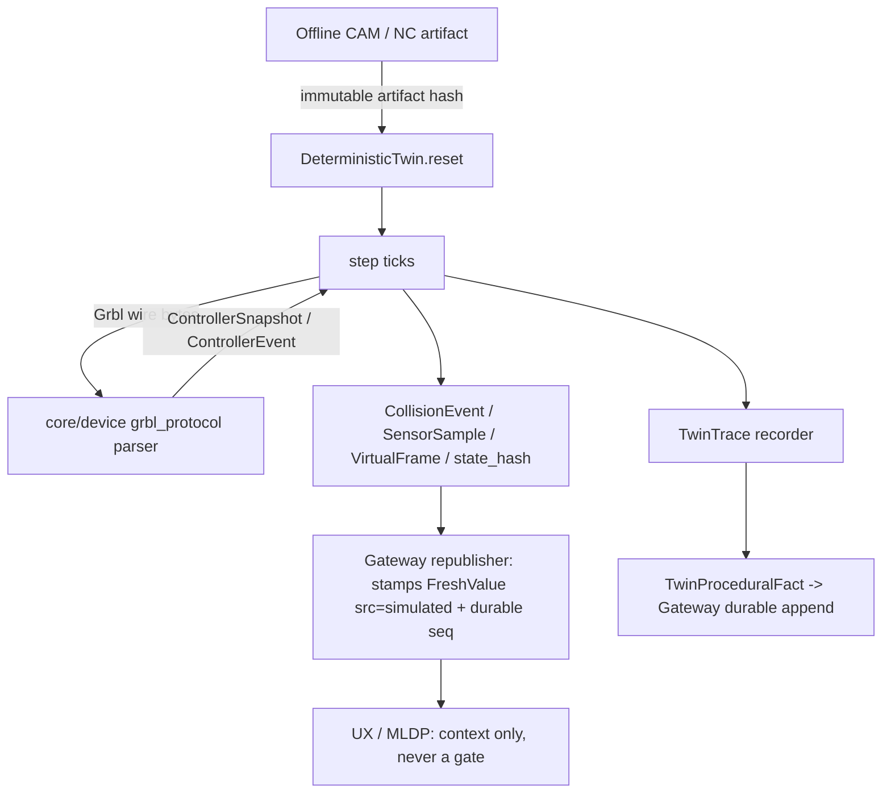

# Deterministic Engineering Twin — Final Design (DoD v4)

Owner: `TwinArchitecture` / `TwinDesignRecovery`. Design-only: this document specifies the twin;
it records no implementation change by itself.

Everything below is bound to `00_decisions.md` and `01_definition_of_done.md`, and to the rulings
already accepted across the design corpus (Gateway owns the controller vocabulary; UX owns the sole
external `FreshValue<T>`; Gateway owns durable `seq`; Metrology owns offsets).

Grounding: `core/cam/stock_sim.h`, `core/cam/stock_sim.cpp`, `core/mate/mate.h`,
`core/firmware/sim_sensor_bridge.cpp`, `core/CMakeLists.txt` target wiring, the twin-reuse audit
and the controller-ecosystem research. Line references are to those files as read on 2026-08-08.

---

## 0. What the twin is, in one paragraph

A pure, incremental, integer-tick simulator of one 3-axis Grbl-1.1-class machine, its stock, its
fixtures and its tool, plus deterministic virtual sensors, cameras and typed faults. It is the only
component in the manufacturing stack that owns simulated physical state. It is **not** a safety
function, **not** virtual commissioning, **not** a capability level, and its conclusions **never**
gate an action (DoD v4 §14). The only gate-relevant thing it can produce is a *procedural fact* that
a named check ran against a specific artifact/config/snapshot, recorded and `seq`-stamped by the
Gateway.



---

## 1. Ownership and file tree

### 1.1 New, exclusively twin-owned

```
core/twin/                                  # static lib chudware_twin, namespace chudware::twin
  clock.h                                   # Tick, TwinClock, integer unit conversions
  entity.h                                  # EntityId, EntityKind, FrameId, Pose, unit tags
  fidelity.h  fidelity.cpp                  # FidelityDeclaration + the frozen declaration table
  profile.h   profile.cpp                   # MachineProfile, ToolEntry, BodySpec, StockSpec, configs
  state.h     state.cpp                     # AxisState/SpindleState/MachineState + canonical hashing
  machine3.h  machine3.cpp                  # 3-axis plant integrator (commanded -> actual, limits)
  grbl_emu.h  grbl_emu.cpp                  # Grbl 1.1 interpreter + planner approximation, wire out
  bodies.h    bodies.cpp                    # fixture/table/holder envelopes + envelope-vs-stock tests
  collide.h   collide.cpp                   # CollisionEvent production, tick-scoped
  faults.h    faults.cpp                    # FaultKind/FaultSpec/FaultSchedule + counter-based RNG
  vsensor.h   vsensor.cpp                   # SensorSample, per-tick schedules, firmware export seam
  vcamera.h   vcamera.cpp                   # CameraIntrinsics/Extrinsics, VirtualFrame, CPU raster
  record.h    record.cpp                    # TwinSnapshot, TwinAction, TwinTrace, hashes, verify
  twin.h      twin.cpp                      # DeterministicTwin facade: reset/step/submit/snapshot
  train.h     train.cpp                     # TwinEnv training wrapper + declarative RewardSpec
  twin_rpc.h  twin_rpc.cpp                  # mfg_twin_* dispatch (gateway-process only, no C ABI)
  twin_cli.cpp                              # optional `twin_cli` binary (CHUDWARE_TWIN_BIN)

core/tests/                                 # doctest, appended to core/CMakeLists.txt
  test_twin_clock.cpp  test_twin_grbl.cpp  test_twin_motion.cpp  test_twin_stock.cpp
  test_twin_collide.cpp  test_twin_faults.cpp  test_twin_replay.cpp  test_twin_camera.cpp
  test_twin_fidelity.cpp  test_twin_contracts.cpp  test_twin_env.cpp

contracts/manufacturing_twin.md             # new contract doc (append-only registry entry)
fixtures/mfg/twin/                          # golden traces, machine/tool/fixture profiles, hashes
  shapeoko3xl_grbl11.profile.json  tools.json  e0..e3 scenario dirs, each with trace.json + hashes
services/manufacturing/twin/                # non-GUI service side only
  __init__.py  env.py                       # TwinEnv Python binding over twin_cli / RPC, offline
  trace_tools.py                            # trace diff / hash verify / dataset export
docs/TWIN.md                                # fidelity table + determinism contract, human-facing
```

### 1.2 Existing files modified, at named append-only seams (integrator applies)

| File | Change | Why the seam is contained |
|---|---|---|
| `core/cam/stock_step.h`, `core/cam/stock_step.cpp` | **New**, but inside CAM's directory: pure extraction of `dist_point_seg` (`stock_sim.cpp:24-30`), the `sweep_seg` lambda (`:339-359`) and the `holder_hit_seg` lambda (`:364-388`) into free functions over an explicit context struct. | One implementation, two callers. No behavior change intended; `test_cam` is the regression oracle. |
| `core/cam/stock_sim.cpp` | `simulate_setup` calls `cam::stock_step` instead of its local lambdas. Signature, options, results, warnings, frame logic and the lathe branch (`:197-245`) untouched. | Coordinated with `TurningArchitecture`, which extends the lathe branch and `model.h`; the two edits do not overlap. |
| `core/CMakeLists.txt` | Append `add_library(chudware_twin STATIC ...)`, `cam/stock_step.cpp` into the existing `chudware_cam` source list (after `cam/stock_sim.cpp`, currently line 291), the eleven `test_twin_*` executables, and the optional `twin_cli`. | Append-only, integrator-owned. `chudware_twin` links `chudware_cam chudware_mate chudware_firmware chudware_device nlohmann_json::nlohmann_json` and needs `_USE_MATH_DEFINES` like `chudware_cam`. |
| `contracts/README.md` | One registry row per new `aicad.twin_*` contract. | Append-only. |
| `scripts/gate.sh` | Twin test executables appended to the existing test list. The twin adds **no new SKIP**: every suite is dependency-free. | Append-only, integrator-owned. |
| `docs/manufacturing/README.md` as-built map, developer docs | One update per twin wave, in the same green commit (DoD v4 §20). | Required. |

### 1.3 Explicit non-ownership

- No GUI. Twin adds nothing under `host/src/ui/**`; production twin UI, if any, belongs to
  `host/src/ui/manufacture/**` and is outside the twin's scope.
- No `core/device/**` file. Twin **consumes** `chudware::device` types.
- No transport, no serial port, no socket, no device handle, no command owner. Twin cannot reach
  hardware by construction: `chudware_twin` links no I/O library and exposes no write path.
- No `mfg_*` symbol in the public `libchudware` C ABI (DoD v4 §16). `twin_rpc.cpp` registers only
  inside the out-of-process gateway/device service and the optional `twin_cli`.
- No offsets, no measurement results, no verdict words. Metrology owns those.
- No `FreshValue<T>` **construction**, no `seq` minting, no `t_mono_ns`, no `ObservationRecord`, no
  `MonitorSourceCapability`. Twin's durable rows are *published* wrapped by the Gateway republisher
  (§9.2, `MFG-PUBLISH-DURABLE-WRAPPED`); the twin never builds the envelope and never stamps it.

### 1.4 Types consumed from other owners

| Consumed type / API | Owner | How twin uses it |
|---|---|---|
| `chudware::device::ControllerSnapshot` | Gateway (`core/device/grbl_protocol.h`) | Stored verbatim as the twin's published controller view. Twin never adds fields or enum strings. |
| `chudware::device::ControllerEvent` | Gateway | Twin appends emitted events in local tick order and hands the vector to the caller. Twin assigns **no** `seq`, no wall time, no dedup key, and defines no wire ordering. |
| `chudware::device::parse_grbl_line(...)` / `grbl_adapter.h` | Gateway | The emulator emits **Grbl 1.1 wire text**; the Gateway's real parser turns it into snapshot/events. This is the load-bearing anti-duplication decision: there is exactly one Grbl vocabulary in the product, and the twin exercises it. |
| `chudware::device::CapabilityTruth`, `CapabilityReport` | Gateway (`core/device/capability.h`) | Composed for the twin's own report (§9.5). Twin never redeclares the nine levels, the truth vocabulary, or the stage-ceiling rule. |
| `tier0::Row`, `mfg_tier0_register{domain_id,schema_version,rows[]}` | Gateway (`core/manufacturing/tier0.h`) | Twin registers its own `PREREQ` rows (§9.4) atomically and idempotently; Gateway owns the row shape, the totality check and the rendering contract. |
| `mfg_event_append{...,derived_from[]} -> {seq,epoch,ref}`, `mfg_result_invalidate{...} -> {at_seq}` | Gateway journal | The **only** way a twin row becomes durable or gets a `seq`, and the only way a twin invalidation is published. Twin supplies content and lineage; the journal assigns ordering and computes the `affected[]` transitive closure. |
| `ProceduralFact{check_name,artifact_hash,config_epoch,snapshot_id?,at_seq,outcome}` | Gateway | Composed by the twin (§9.3), tagged `admission:"procedural_fact"` by the journal. Twin adds no envelope field; twin-specific data rides in `body`. |
| `cam::HeightField`, `cam::Setup/Stock/Tool/ToolLibrary/Toolpath/Move/Machine/TriMesh/Vec2/Vec3` | CAM | Stock and tool geometry. |
| `cam::stock_step` | CAM (extraction above) | Per-sub-segment removal / rapid / holder tests. |
| `mate::rodrigues`, `mate::mat_to_rotvec`, `mate::unit`, `mate::solve_mates` | Mate | Rotation math every tick; `solve_mates` **once at reset only** (§6.3). |
| `firmware::TrajectorySample`, `firmware::build_sensor_scenario` | Firmware | Offline scenario **export only** (§6.4). Never in `step()`. |
| `FreshValue<T>` | UX | Twin never constructs it. Named here to state the boundary in both directions: twin emits raw tick-domain values and journaled rows, and the Gateway republisher wraps every durable twin row a UI paints (`ttl_ms: null`, `state:"ok"` while current, `src:"simulated"`) — see §9.2. |

---

## 2. Time, units, entities

### 2.1 Clock (`core/twin/clock.h`)

```cpp
namespace chudware::twin {

using Tick = std::int64_t;                 // monotone, 0 at reset, never wraps in practice
using Nm   = std::int64_t;                 // nanometres  (1 mm = 1'000'000 Nm)
using NmPerS = std::int64_t;               // nanometres / second
using NmPerS2 = std::int64_t;              // nanometres / second^2
using MilliRpm = std::int32_t;             // 1/1000 rev/min

struct TwinClock {
    std::int64_t dt_ns = 1'000'000;        // fixed 1 ms; must divide 1'000'000'000 exactly
    Tick tick = 0;
    constexpr std::int64_t ns() const { return tick * dt_ns; }   // exact, integer
};

constexpr double to_mm(Nm v)   { return static_cast<double>(v) * 1e-6; }
Nm from_mm(double mm);                     // round-half-away-from-zero, rejects non-finite
constexpr Nm  kMmToNm = 1'000'000;
NmPerS from_mm_per_min(double f);          // exact integer division with documented rounding
}
```

- `dt_ns` legal values: 1'000'000 (default), 500'000, 250'000, 100'000. Any other value is a
  construction refusal, because non-divisors of 1e9 make tick↔second mapping lossy.
- There is **no `double seconds` anywhere in twin state**. Doubles exist only inside the geometry
  backend (`cam::HeightField` z values, mm) and inside camera shading, and both are quantized before
  hashing (§8.2).
- The twin never reads a wall clock. There is no `std::chrono::now()` in `core/twin/**`; a contract
  test greps for it.

### 2.2 Entities and frames (`core/twin/entity.h`)

```cpp
enum class EntityKind : std::uint8_t {
    Machine=0, Axis=1, Spindle=2, Fixture=3, Workpiece=4, Stock=5, Tool=6, Holder=7,
    Sensor=8, Camera=9, Probe=10, Table=11
};

struct EntityId {                          // total order = (kind, index); name is display-only
    EntityKind kind{};
    std::uint32_t index = 0;
    std::string name;                      // stable, from the profile, never generated
    friend bool operator<(const EntityId&, const EntityId&);
};

enum class FrameId : std::uint8_t { Machine=0, Work=1, Fixture=2, Stock=3, Tool=4, Sensor=5, Camera=6 };

struct Pose {                              // rigid, mm + Rodrigues; parent-relative
    FrameId parent = FrameId::Machine;
    Eigen::Matrix3d R = Eigen::Matrix3d::Identity();
    Eigen::Vector3d t_mm = Eigen::Vector3d::Zero();
};

struct FrameTree {                         // resolved once at reset, frozen into the snapshot
    Pose work_from_machine;                // = WCO from the controller snapshot
    std::vector<Pose> fixture_from_machine;
    Pose stock_from_fixture;
    std::vector<Pose> camera_from_machine;
    std::vector<Pose> sensor_from_machine;
    Eigen::Matrix4d resolve(FrameId) const;
};
```

Canonical frames: `Machine` = MCS with origin at the homed position and Z+ away from the work
(matching Grbl's negative-workspace convention); `Work` = MCS ⊕ WCO taken from
`device::ControllerSnapshot`, never invented; `Stock` frame origin = `Stock::min` corner (or cylinder
base) so `cam::HeightField` indices map by pure integer arithmetic. Units are mm everywhere in
geometry, integer Nm everywhere in the plant, and the conversion is exactly one function.

**Frame/unit closure:** the twin-reuse audit (§5) records that mate (mm + rotvec), CAM (mm + s) and
the firmware bridge (NED metres, m/s, rad, ms) share no frame registry. `FrameTree` plus §2.1 is
that registry. The firmware bridge's NED/geographic semantics are **not** joined to it — they are
export-only (§6.4).

---

## 3. State

### 3.1 Machine state (`core/twin/state.h`)

```cpp
struct AxisState {
    Nm cmd_pos = 0;                 // planner output (integer)
    Nm act_pos = 0;                 // plant output; equals cmd_pos unless a fault is active
    NmPerS vel = 0;
    Nm soft_min = 0, soft_max = 0;  // from $130-$132 + $23 homing direction
    NmPerS max_rate = 0;            // $110-$112
    NmPerS2 accel = 0;              // $120-$122
    bool homed = false;
    bool limit_input = false;       // hard limit switch, reported as Grbl `Pn:`
    bool stalled = false;           // fault-driven divergence between cmd and act
};

struct SpindleState {
    MilliRpm cmd = 0, act = 0;
    bool cw = true, enabled = false;
    bool feedback_present = false;  // false => no automated spindle authority (DoD v4 §8)
    bool stalled = false;
};

struct ToolState {
    int number = 0;                 // 0 = none
    Nm length_offset = 0;
    bool broken = false;
    bool geometry_known = false;    // false is a refusal, never a silent radius-1.0 fallback
};

struct MachineState {
    AxisState axis[3];              // X,Y,Z in that order, always
    SpindleState spindle;
    ToolState tool;
    std::uint8_t coolant_mask = 0;  // bit0 mist (M7), bit1 flood (M8)
    Nm probe_last[3] = {0,0,0};
    bool probe_input = false, probe_succeeded = false;
    bool door_open = false;
};
```

### 3.2 Stock, bodies, collisions

```cpp
struct StockState {                        // the only mutable geometry in the twin
    cam::HeightField hf;                   // top-down Z-dexel, exactly as CAM builds it
    double res_mm = 0.5;
    double bottom_mm = 0.0;
    double initial_sum_mm3 = 0.0;          // baseline for removed-volume accounting
};

struct BodyEnvelope {                      // fixtures, table, vise jaws, clamps, holder shroud
    enum class Shape : std::uint8_t { Box, Cylinder, HeightPrism };
    EntityId id;
    Shape shape = Shape::Box;
    Pose pose;                             // fixed for the run; twin models no compliance
    Eigen::Vector3d half_mm = Eigen::Vector3d::Zero();   // Box
    double radius_mm = 0, height_mm = 0;                 // Cylinder
    cam::HeightField prism;                              // HeightPrism (imported fixture top)
    bool is_soft = false;                  // sacrificial wasteboard: contact is a warning class
};

struct CollisionEvent {
    enum class Class : std::uint8_t {
        RapidThroughStock, HolderVsStock, ShankVsStock, ToolVsFixture, ToolVsTable,
        HolderVsFixture, GougeBelowPart, AxisSoftLimit, AxisHardLimit, UnsupportedGeometry
    };
    Tick tick = 0;
    Class cls{};
    EntityId a, b;
    double depth_mm = 0.0;                 // penetration or overcut, resolution-bounded
    Nm at_pos[3] = {0,0,0};
    std::uint32_t cell_count = 0;          // grid cells implicated, for honesty about resolution
};
```

`CollisionEvent` is **per unique contact episode**, not per grid cell: `collide.cpp` latches an
episode key `(cls, a, b)` and closes it when the predicate goes false for a full tick. This fixes the
audited defect that `stock_sim.cpp:356` increments `rapid_hits` per intersected cell.

Unlike `simulate_setup`, which only appends warnings and never sets `ok=false`
(`stock_sim.cpp:449-471`), the twin **halts**: a collision class in the profile's `halt_on` set stops
motion at the tick of first contact, emits `mfg.twin.halt`, and requires a fresh `reset` — mirroring
the "no transparent resume" rule (DoD v4 §13) inside the simulator so that operators never learn a
resume habit from the twin.

### 3.3 Faults (`core/twin/faults.h`)

```cpp
enum class FaultKind : std::uint8_t {
    AxisStall, AxisLostSteps, LimitSwitchTrip, SoftLimitBreach,
    SpindleStall, SpindleNoFeedback, ToolBreak, ToolPullout,
    ProbeNoTrigger, ProbeFalseTrigger, ProbeCableOpen,
    SerialDisconnect, SerialGarbage, SerialLatency, ControllerSoftReset, PowerLoss,
    DoorOpen, CoolantFail,
    SensorBias, SensorNoise, SensorDropout, SensorStuck, SensorLatency,
    CameraOcclusion, CameraExposure, CameraDropout
};

struct FaultSpec {
    Tick at_tick = 0;
    FaultKind kind{};
    EntityId target;
    std::int64_t magnitude_q = 0;          // quantized, kind-specific units, documented per kind
    std::int64_t duration_ticks = 0;       // 0 = latched until reset
    std::uint64_t seed = 0;                // per-fault; never a shared stream
};

struct FaultSchedule {
    std::vector<FaultSpec> specs;          // canonical sort: (at_tick, kind, target, seed)
    static FaultSchedule from_json(const json&);   // rejects duplicates and unsorted input
};
```

RNG is **counter-based, not stateful**: `splitmix64(run_seed ^ mix(fault_index, tick, sub_index))`.
There is no shared mutable RNG object, so fault sampling is independent of evaluation order and of
how many ticks were stepped per call. `faults.cpp` contains the whole generator (≈20 lines,
stdlib-only) and no dependency on `mate/numpy_rng.cpp` — the mate restart RNG
(twin-reuse audit, mate.cpp:1379-1385) is numerical recovery, not fault injection, and the
two must not be conflated.

---

## 4. The Grbl 1.1 emulator

### 4.1 API (`core/twin/grbl_emu.h`)

```cpp
class GrblEmu {
public:
    struct Settings {                      // integer-scaled $$ subset; unknown $n is error:3
        std::int32_t step_mm[3] = {400'000,400'000,400'000};   // $100-$102, micro-units/mm *1000
        NmPerS max_rate[3]{}; NmPerS2 accel[3]{}; Nm max_travel[3]{};
        std::int32_t junction_dev_nm = 10'000;    // $11 approximation input
        std::int32_t arc_tol_nm = 2'000;          // $12
        bool soft_limits = false;                 // $20
        bool hard_limits = false;                 // $21
        bool homing_enable = false;               // $22
        std::uint8_t homing_dir_mask = 0;         // $23
        bool laser_mode = false;                  // $32
        std::uint8_t block_queue = 16;            // planner depth; declared approximation
        std::string build_banner;                 // for $I; must match a fixture, never invented
    };
    enum class ResetKind : std::uint8_t { PowerOn, SoftReset, AlarmLatched };

    void configure(const Settings&);
    void reset(ResetKind);
    // Line-mode input. Returns false when the RX buffer is full (128 bytes, Grbl 1.1 behavior).
    bool feed_line(std::string_view line);
    // Realtime bytes: '?' 0x3F, '!' 0x21, '~' 0x7E, 0x18 Ctrl-X, 0x84 door, 0x90-0x9E overrides.
    void feed_realtime(std::uint8_t byte);
    // Advance exactly one tick. Mutates the plant, appends wire text to out_wire.
    void step(const TwinClock&, MachineState&, StockState*, std::vector<std::string>& out_wire);

    struct Counters { std::uint64_t lines_ok=0, errors=0, alarms=0, blocks_planned=0; };
    const Counters& counters() const;
private:
    // planner queue, modal state, override percentages, status-report scheduler
};
```

### 4.2 What the emulator emits and who interprets it

`out_wire` is **Grbl 1.1 text, byte for byte**: `ok`, `error:N`, `ALARM:N`,
`<Idle|MPos:0.000,0.000,0.000|FS:0,0|Ov:100,100,100|Pn:PZ>`, `[PRB:0.000,0.000,-1.234:1]`,
`[GC:G0 G54 G17 G21 G90 G94 M5 M9 T0 F0 S0]`, `[MSG:...]`, `Grbl 1.1f ['$' for help]`. The twin
then calls the Gateway's `device::parse_grbl_line` to obtain `ControllerSnapshot` /
`ControllerEvent`. Consequences:

1. Exactly one Grbl vocabulary exists in the product, and it is the Gateway's (the project ruling).
2. The E0-E3 suites are simultaneously parser tests — the parser is exercised against
   hardware-shaped bytes with no hardware.
3. Twin never invents wire ordering, `seq`, timestamps, dedup keys or gap semantics. It hands over an
   ordered `std::vector<ControllerEvent>` for the current step and nothing more.
4. If the Gateway parser rejects a line the twin produced, that is a twin bug or a parser bug, and
   `test_twin_grbl.cpp` fails. No twin-local fallback parse exists.

### 4.3 Modeled Grbl surface (from the controller-ecosystem research)

Supported, emulated: `G0 G1 G2 G3 G4 G10L2 G10L20 G17-19 G20 G21 G28 G30 G38.2-38.5 G43.1 G49
G53 G54-G59 G80 G90 G91 G92 G93 G94`, `M0 M2 M3 M4 M5 M7 M8 M9 M30`, `$$ $# $G $I $N $H $X $C $J=`,
realtime `? ! ~ 0x18 0x84 0x90-0x9E`, states `Idle Run Hold:0 Hold:1 Jog Alarm Door:0-3 Check Home
Sleep`, `error:1-38`, `ALARM:1-10`, `Pn:` inputs, `Ov:` overrides, `WCO:`, `Bf:`, `Ln:`, `[PRB:]`.

Behavioral rules taken directly from the cited Grbl documentation:

- `ok` means *parsed/queued*, not *executed*. The emulator acknowledges on parse and moves later, so
  senders that conflate the two fail against the twin exactly as they would against hardware.
- `!` stops motion only; spindle and coolant keep running. `0x84` disables them only when the profile
  says the build/wiring supports it.
- Hold takes ≥1 tick to decelerate; `Hold:1` → `Hold:0` transition is observable, and `~` before
  `Hold:0` is ignored, not queued.
- Hard limit while moving ⇒ `ALARM:1`, `homed=false` on all axes, position declared lost.
- `0x18` while moving ⇒ `ALARM:3`, `homed=false`. `$X` clears the lock but never restores `homed`.
- Post-alarm, only `$X`, `$H`, `$$`, `$I`, `?` are accepted; every motion word returns `error:9`.
- Overrides are clamped to profile-declared OEM values, not hard-coded, and the resulting `Ov:` is
  echoed. A profile with `spindle_feedback=false` refuses spindle-override effect and says so.
- Character-counting streaming is **not** modeled as safe: with a full RX buffer the emulator keeps
  parsing queued lines after an `error:`, reproducing the documented hazard.

### 4.4 Planner approximation — declared, not claimed as parity

`grbl_emu.cpp` implements: a `block_queue`-deep block queue; per-block integer trapezoidal profile
from `max_rate`/`accel`; junction velocity limited by a documented centripetal approximation over
`junction_dev_nm`; arcs pre-segmented with `arc_tol_nm` using the same integer chord rule as
`stock_sim.cpp:416` (~2 samples per grid cell, capped at 1440); rate-limited status reports at the
profile's report interval, never faster than 5 Hz of *simulated* time.

Not modeled, and declared `NotModeled` in §7: Grbl's exact `st_prep_buffer` segment mathematics,
AMASS step smoothing, real step-pulse timing, ISR jitter, serial byte timing, and the exact numeric
outcome of Grbl's own junction-deviation implementation. **The twin is not a Grbl step-accurate
simulator and no document, UI string or capability may say it is.**

---

## 5. The facade: reset / step / submit / snapshot / restore

### 5.1 `core/twin/twin.h`

```cpp
class DeterministicTwin {
public:
    struct Config {
        std::uint32_t schema = 1;
        TwinClock clock;
        MachineProfile machine;            // kind must be Mill3Axis; profile id is fixture-backed
        GrblEmu::Settings controller;
        StockSpec stock;                   // cam::Stock + resolution + bottom
        cam::ToolLibrary tools;
        std::vector<BodySpec> bodies;      // fixtures, table, jaws
        std::vector<SensorSpec> sensors;
        std::vector<CameraSpec> cameras;
        FaultSchedule faults;
        std::uint64_t seed = 0;
        cam::TriMesh part_mesh;            // optional; enables GougeBelowPart
        std::string artifact_hash;         // immutable NC/job artifact this run is bound to
        std::set<CollisionEvent::Class> halt_on;
        FidelityRequest fidelity;          // requested aspects; refused if unsupported
    };

    struct ResetReport {
        bool ok = false;
        std::vector<Refusal> refusals;     // Tier-0: named missing prerequisites, ordered
        std::uint64_t config_hash = 0;     // canonical hash of Config
        std::uint64_t state_hash = 0;      // hash of the initial state
        FidelityDeclaration fidelity;      // what this run actually supports
        std::string twin_build_fp;         // §8.3
    };

    struct StepResult {
        Tick tick = 0;                                    // tick AFTER the step
        std::int64_t sim_ns = 0;                          // tick * dt_ns, exact
        bool snapshot_valid = false;
        device::ControllerSnapshot snapshot{};            // valid only when a status frame was due
        std::vector<device::ControllerEvent> events;      // twin-order; no seq, no wall time
        std::vector<CollisionEvent> collisions;
        std::vector<SensorSample> samples;
        std::vector<VirtualFrame> frames;
        std::vector<FaultSpec> faults_fired;
        std::vector<std::string> wire;                    // raw Grbl text, for parser tests
        std::uint64_t state_hash = 0;
        bool halted = false;
        HaltCause cause = HaltCause::None;
        bool program_complete = false;
    };

    ResetReport reset(const Config&);
    void submit(const TwinAction&);        // queued to the next tick boundary; never mid-tick
    StepResult step(std::int64_t ticks = 1);   // atomic whole ticks; ticks>=1
    StepResult run_until(Tick deadline, std::int64_t max_ticks);   // halts on halt/complete/cap
    TwinSnapshot snapshot() const;
    bool restore(const TwinSnapshot&);     // false on schema/build/config-hash mismatch
    const FidelityDeclaration& fidelity() const;
    const MachineState& machine_state() const;
    const StockState& stock_state() const;
    std::optional<TwinProceduralFact> procedural_fact() const;   // §9.3
};

enum class HaltCause : std::uint8_t {
    None, Alarm, CollisionHalt, SoftLimit, FaultPowerLoss, FaultDisconnect,
    ProgramEnd, UnsupportedGeometry, TickCap
};

// Refusal is the twin's runtime rendering of one registered Tier-0 row (§9.4); the row shape and
// the register itself are Gateway-owned (`core/manufacturing/tier0.h`), never redeclared here.
struct Refusal { std::string action; std::string prerequisite; std::string why; std::vector<std::string> remedy; };
```

### 5.2 Tick order (fixed, tested, and the same on every path)

Each tick executes exactly these phases, in this order. `test_twin_replay.cpp` asserts the order is
observable via hashes taken between phases in a debug build.

1. **Actions** — drain actions whose `at_tick == tick` in canonical order
   (`GcodeLine` < `RealtimeByte` < `Fault` < `Attach`/`Detach`; ties broken by submission index).
2. **Faults** — apply `FaultSpec`s due at this tick; expire duration-limited ones.
3. **Interpret** — `GrblEmu` parses queued lines, appends `ok`/`error:N`, plans blocks.
4. **Plan/plant** — one tick of the trapezoidal profile; `machine3` updates `cmd_pos`, then
   `act_pos` (equal unless a stall/lost-step fault is active), then `vel`.
5. **Limits** — soft-limit and hard-limit predicates on the *post-step* position; a breach emits the
   collision class, the Grbl alarm, and latches.
6. **Geometry** — `cam::stock_step` over the sub-segment travelled *this tick only*, then holder /
   shank / fixture / table envelope tests, then gouge test if `part_mesh` is present.
7. **Probe** — `G38.x` contact test against stock/fixture surfaces; on trigger, `probe_last` and
   `[PRB:]`.
8. **Observe** — sensors and cameras scheduled for this tick sample the *post-step* state.
9. **Publish** — if a status report is due, build wire text; parse all wire text through
   `device::parse_grbl_line`; collect snapshot/events.
10. **Hash** — canonical `state_hash` (§8.2).

Phase 6 is the crucial fix to the audited defect that CAM sweeps a whole move and *then* emits every
crossed frame threshold (`stock_sim.cpp:389-436`), so several nominal times share one stock state.
The twin never sweeps more than one tick of travel, so stock state and time advance together and
snapshots are exact rather than sampled.

### 5.3 Actions (`core/twin/record.h`)

```cpp
struct TwinAction {
    enum class Kind : std::uint8_t { GcodeLine, RealtimeByte, Fault, AttachStock, DetachStock };
    Tick at_tick = 0;
    Kind kind{};
    std::string line;          // GcodeLine
    std::uint8_t byte = 0;     // RealtimeByte
    FaultSpec fault;           // Fault
    std::uint32_t submit_index = 0;   // canonical tie-break, assigned by submit()
};
```

There is no `Jog`, `Home`, `Zero`, `Unlock`, `Approve`, `Start`, `Resume`, `Override` action type at
the facade: those are Grbl lines/bytes like any other and carry no authority, because the twin has no
device and no approval logic. Approval validation lives only in the deterministic arbiter
(DoD v4 §15); it is not present in `core/twin/**` and a contract test asserts the twin exposes no
approval, nonce, or capability symbol.

---

## 6. Adapting existing math without misrepresenting fidelity

### 6.1 Heightfield stock (`core/cam/stock_step`)

Extracted verbatim from `stock_sim.cpp`:

```cpp
namespace chudware::cam {

struct StepContext {                        // everything the two lambdas closed over
    HeightField* field = nullptr;
    Vec2 flo{}; double res_mm = 0.5;
    int nx = 0, ny = 0;
    double tool_r = 0, shank_r = 0, holder_r = 0, flute_len = 0, shoulder_len = 0;
    double gouge_tol = 0.05;
};

struct StepTally { std::uint32_t rapid_cells = 0; bool holder_hit = false; double max_depth_mm = 0; };

// Straight sub-segment a->b. `cutting` lowers cells to the interpolated tip Z; `rapid` counts
// cells where remaining stock stands above the tip by >0.01 mm. Identical arithmetic to
// stock_sim.cpp:339-359 (floor/ceil cell window, dist_point_seg, exact float compares).
void sweep_segment(StepContext&, const Vec3& a, const Vec3& b, bool cutting, bool rapid, StepTally&);

// Non-cutting body sweep, identical to stock_sim.cpp:364-388.
bool holder_hit_segment(const StepContext&, const Vec3& a, const Vec3& b);

double dist_point_seg(double px,double py,double ax,double ay,double bx,double by,double& t);
}
```

`simulate_setup` becomes a caller. Its observable results must not change; `test_cam` is the oracle
and `test_twin_stock.cpp` additionally asserts that stepping a program tick-by-tick through the twin
and running `simulate_setup` on the same program produce the **same final `HeightField`** for a
program with no faults, no collisions and a tick small enough that per-tick travel is below
`res_mm/2`. That equivalence is the honest statement of what the shared backend buys, and it is a
test, not a claim.

Inherited limitations, carried into the fidelity declaration verbatim rather than papered over:
one height per XY (no undercuts, no re-entrant geometry, no chips, no deflection, no thermal, no
arbitrary cutter orientation); collision counts and removed volume are resolution-dependent; exact
float height comparisons (`stock_sim.cpp:354`, `:441`, `:467`) are backend-sensitive.

Deliberate divergences from `simulate_setup`, each of which is a bug fix, not a fidelity claim:

| `simulate_setup` behavior | Twin behavior | Reason |
|---|---|---|
| Missing tool ⇒ radius 1.0, zero body (`:325-334`) | `reset` refuses with `Refusal{code:"tool_geometry_missing"}` | Audited as unsafe for any commissioning-adjacent claim. |
| Holder checks default off (`stock_sim.h:19`) | `check_holder` forced on whenever shank/holder dims exist; absent dims are a refusal when `HolderVsStock ∈ halt_on` | A silently disabled crash check is worse than no check. |
| First move only seeds `prev` (`:395`, `:105`) | Initial position is `MachineState.axis[].act_pos`; every block contributes travel and time | Removes dependence on toolpath framing. |
| Collisions/gouges are warnings, `ok` stays true (`:449-471`) | Typed `CollisionEvent` + optional halt + `mfg.twin.halt` | Matches the no-transparent-resume posture. |
| Lathe axisymmetric branch (`:197-245`) skips gouge/holder/rapid checks | `reset` refuses `MachineKind::Lathe` with `Refusal{code:"unsupported_machine_kind"}` | Turning fidelity belongs to `TurningArchitecture`; a silent partial sim must never look like a full one. |

### 6.2 Machine kinematics

`machine3` is a plain 3-axis Cartesian plant: tool tip position = axis positions ⊕ tool length
offset ⊕ WCO, no joint chain, no IK, no singularities. It is **not** built on `solve_mates`, because
per-tick nonlinear constraint projection would manufacture nonphysical motion
(twin-reuse audit, conceptual mismatch 1) and because `solve_mates` accepts a wall-clock
`time_budget_ms` (`mate.h:85`) whose effect on iteration count is load-dependent.

### 6.3 Mate math, used exactly twice

1. **Every tick, pure helpers only:** `mate::rodrigues`, `mate::mat_to_rotvec`, `mate::unit` for
   composing `FrameTree` poses. Deterministic, allocation-free, no solver.
2. **Once at reset, optional:** if a profile places fixtures by assembly mates instead of explicit
   poses, `reset` calls `mate::solve_mates(components, mates, geom, /*warm=*/nullopt,
   /*drag=*/nullopt, tol=1e-9, max_iter=80, /*time_budget_ms=*/nullopt)` a single time, then freezes
   the resulting transforms into `FrameTree` and into the snapshot. `warm` and `time_budget_ms` are
   `nullopt` **by contract** (a wall-clock budget is forbidden in the twin, per the audit's
   determinism concern), and `converged == false`, `over_defined == true`, or any
   `MateStatus.status == "conflicting"` is a `Refusal{code:"fixture_placement_unresolved"}`.

`solve_mates` is never called from `step()`, `restore()`, or any observation path. A contract test
asserts `core/twin/twin.cpp`, `machine3.cpp` and `collide.cpp` contain no `solve_mates` call.

### 6.4 Virtual sensors: reuse the encoders, not the flight semantics

`core/firmware/sim_sensor_bridge.cpp` is a one-way encoder from a precomputed flight/CFD profile to
I2C/UART scenario tracks (`:149-209`, `:345-412`), with NED metres, quaternions, geographic origins
and `long double`/`double dt_s` sample counting (`:192-203`). Reusing it as a live twin sensor would
misrepresent both its frame and its determinism.

Design:

```cpp
struct SensorSpec {
    EntityId id;
    enum class Kind : std::uint8_t { AxisEncoder, SpindleTacho, ProbeContact, LoadCell,
                                     Accel3, Gyro3, Mag3, Thermistor, DoorSwitch, LimitSwitch };
    Kind kind{};
    std::int64_t period_ticks = 1;          // integer schedule; no accumulated doubles
    Pose mount;                             // sensor frame in the machine frame
    std::int64_t quantum_q = 1;             // ADC/least-significant-bit quantum, integer
    std::int64_t bias_q = 0, fullscale_q = 0;
};

struct SensorSample {                       // tick-domain, twin-internal
    Tick tick = 0;
    EntityId id;
    std::int64_t value_q[3] = {0,0,0};      // integer counts, kind-defined axes
    std::uint8_t valid_mask = 0x7;
    bool saturated = false, dropped = false, stuck = false;
};
```

Sampling is `tick % period_ticks == 0` — integer, so the audited `long double`/epsilon boundary
sensitivity disappears. Noise/bias/dropout/stuck come only from `FaultKind::Sensor*` with
counter-based RNG, so a fault-free run is noiseless and reproducible.

The firmware bridge is reused for exactly one thing: **offline export**.
`vsensor.cpp::export_firmware_scenario(const TwinTrace&, const json& sensor_map, double dt_s)`
converts a recorded trace into `firmware::TrajectorySample`-shaped input and calls
`firmware::build_sensor_scenario` so existing HIL scenario tooling can consume twin runs. That path
is offline, is not in `step()`, and is documented as an export adapter. Bus electrical timing, I2C
clock stretching, arbitration and the atomic-register-consumption requirement
(`sim_sensor_bridge.cpp:236-239`) are declared `NotModeled` in the twin's own sensor aspect; the
export inherits the bridge's own limits, including its 32-endpoint / 10'000-sample caps.

### 6.5 Virtual cameras

```cpp
struct CameraIntrinsics { int w=0,h=0; double fx=0,fy=0,cx=0,cy=0,k1=0,k2=0,p1=0,p2=0; };

struct CameraSpec {
    EntityId id; CameraIntrinsics K; Pose mount;   // FIXED mount only (DoD v4 §10)
    std::int64_t period_ticks = 100;
    bool depth = true, gray = true;
    std::uint8_t exposure_q = 128;
};

struct VirtualFrame {                       // the canonical twin frame type
    Tick tick = 0;
    EntityId camera;
    int w = 0, h = 0;
    std::vector<std::uint8_t> gray8;        // row-major, size w*h when gray
    std::vector<std::int32_t> depth_nm;     // integer depth, 0 = no hit
    std::uint64_t hash = 0;                 // over depth_nm and gray8
    bool occluded = false, saturated = false;
};
```

Renderer: CPU-only, integer scanline over the stock `HeightField` plus `BodyEnvelope`s, per-pixel ray
intersection in the camera frame, depth stored as integer nanometres, grayscale from a fixed
256-entry integer shading LUT over quantized surface slope. No GPU, no libm in the shading path, no
threading, no texture filtering. Consequence: frame hashes are bitwise stable across platforms for
the same quantized inputs, which is what makes camera observations usable in replay at all.

Declared honestly: pinhole + Brown-Conrady distortion, no motion blur, no rolling shutter, no
lens flare, no PBR, no chip/coolant/mist obscuration except as `CameraOcclusion` faults.
Twin camera output is **not** perception validation and never advisory-to-authoritative: perception
consumes it as synthetic training data only, and camera-derived results remain advisory
(decision brief, DoD v4 §5).

---

## 7. Fidelity declarations

```cpp
struct FidelityDeclaration {
    enum class Level : std::uint8_t { NotModeled=0, Approximate=1, Emulated=2, Measured=3 };
    struct Aspect {
        std::string name;
        Level level{};
        std::string basis;        // what the implementation actually is
        std::string known_error;  // the honest bound or "unbounded/unknown"
    };
    std::string id;               // e.g. "twin/mill3-grbl11-hf/1"
    std::string twin_build_fp;
    std::vector<Aspect> aspects;  // canonical order = name order
    json to_json() const;
};

struct FidelityRequest { std::vector<std::pair<std::string, FidelityDeclaration::Level>> minimums; };
```

`reset` compares `Config::fidelity.minimums` against the frozen table and refuses with
`Refusal{code:"fidelity_unsupported", missing:"<aspect>@<level>"}` when the request exceeds support.
This is a Tier-0 construction refusal (DoD v4 §6): it happens before any proposal exists and names
the missing prerequisite at the entry point. It is never `not_applicable`.

Frozen table for `twin/mill3-grbl11-hf/1`:

| Aspect | Level | Basis | Known error |
|---|---|---|---|
| `controller.wire_protocol` | Emulated | Grbl 1.1 line/realtime subset in §4.3, parsed by the Gateway parser | Unmodeled `error:` codes outside 1-38; no serial byte timing |
| `controller.state_machine` | Emulated | Idle/Run/Hold/Jog/Alarm/Door/Check/Home/Sleep with documented transitions | Door behavior depends on a profile flag, not on real wiring |
| `controller.planner` | Approximate | 16-block queue, integer trapezoid, centripetal junction approximation | Not Grbl-numeric-parity; no AMASS, no ISR jitter, no step timing |
| `axis.kinematics` | Approximate | Integer trapezoidal per-axis, exact Cartesian | No jerk limit, no servo following error, no backlash, no compliance |
| `axis.limits` | Emulated | Soft limits from `$130-$132`+`$23`; hard-limit inputs latch `ALARM:1` | Switch debounce and mechanical overtravel not modeled |
| `spindle.dynamics` | NotModeled | Commanded RPM equals actual unless a fault fires | No ramp, no load droop, no torque; `feedback_present=false` blocks any spindle authority claim |
| `stock.removal` | Approximate | 2.5D top-down Z-dexel (`cam::HeightField`) via `cam::stock_step` | No undercuts, no re-entrant geometry; volumes/counts resolution-dependent |
| `stock.turning` | NotModeled | Refused (`unsupported_machine_kind`) | — |
| `collision.tool_stock` | Approximate | Tip disc lowering + shank/holder annulus tests | Cylindrical envelopes only; depth bounded by `res_mm` |
| `collision.fixture_table` | Approximate | Static box/cylinder/height-prism envelopes | No clamping force, slip, breakaway or compliance |
| `collision.machine_self` | NotModeled | No gantry/enclosure/spindle-body geometry | — |
| `cutting.physics` | NotModeled | No forces, deflection, wear, chips, heat, vibration, chatter | — |
| `probe.contact` | Approximate | Geometric contact against stock/fixture surfaces | No stylus stiffness, pre-travel, lobing, or repeatability distribution |
| `sensor.values` | Approximate | Integer-quantized values from post-step state on integer schedules | No bus electrical timing, no I2C arbitration, no clock stretching |
| `camera.image` | Approximate | CPU pinhole + Brown-Conrady, integer depth, fixed shading LUT | No blur, rolling shutter, PBR, coolant/mist obscuration |
| `faults` | Emulated | Typed schedule with counter-based RNG | Only the enumerated kinds; consequences are geometric/state, not physical |
| `determinism` | Measured | §8 invariants, hash-verified in `test_twin_replay.cpp` | Quantized-hash equality, not bitwise float equality across builds |

**Prohibited claims — whole phrases, word-boundary matched, scoped to claim-bearing surfaces.**
`test_twin_fidelity.cpp` greps for the claim *phrases* below, each matched with word boundaries
(`\bcertified\b`, `\bverified safe\b`, `\bcollision-free\b`, …), never as bare substrings:

`certified`, `verified safe`, `provably safe`, `safe to run`, `crash-proof`, `collision-free`,
`virtual commissioning`, `step-accurate`, `Grbl-exact`, `guaranteed`.

The bare token `safe` is **removed** from the list. It is a substring of `safety`,
`safety_integration`, `safety_confirmed` and `unsafe`, which §9 and §14 use throughout, and of
"full-suite safe" in §11, so as a substring rule it could never pass — an unfireable truthfulness
test, which is the exact defect class this corpus exists to eliminate. What the DoD forbids is the
*claim*, and a claim is a phrase.

Scope of the grep — the surfaces on which a false claim can actually mislead an operator or a model:
twin UI strings and toasts, the twin's capability text (`why`, `remedy`, `missing_level`, and any
`CapabilityReport` prose), `FidelityDeclaration::basis` / `known_error` strings, refusal and
`HaltCause` text, and the contract prose of `contracts/manufacturing_twin.md`. Design prose — this
document and `docs/TWIN.md` — is deliberately **out** of scope: it is where the honest negative
statements live ("not a safety function", "not safety-rated", "not virtual commissioning"), and a
grep that forbids those cannot coexist with §14.

Allowed exceptions, enumerated in the test so a later rename cannot silently re-break it:
identifiers and prose beginning `safety` (`safety_integration`, `safety_confirmed`, `_SAFETY_TOOLS`),
`unsafe`, the fixed phrase "full-suite safe", and a negated occurrence of any listed phrase (`not
collision-free`, `never certified`, `no guaranteed …`) — a phrase under explicit negation is the
honest form, not the prohibited claim. The test carries one positive fixture per prohibited phrase
and one negative fixture per exception, so it is both-way testable rather than assert-only.

---

## 8. Determinism invariants

- **D1 Integer time.** All twin state time is `Tick` + fixed `dt_ns`. No accumulated `double`
  seconds; no `std::chrono` call in `core/twin/**`. Grep-tested.
- **D2 Atomic ticks.** `step(n)` is exactly `n` applications of the §5.2 phase order.
  `step(1)` ten times ≡ `step(10)` ≡ `step(2)+step(3)+step(5)`, with identical event sequence and
  identical `state_hash`. Batching is an API convenience with zero semantic effect.
- **D3 Action alignment.** Actions apply only at tick boundaries, in the canonical order of §5.3.
  Submission time never affects outcome; only `at_tick` and `submit_index` do.
- **D4 Canonical ordering.** Entities sort by `(kind,index)`; faults by
  `(at_tick,kind,target,seed)`; events in tick order then producer order (limits → geometry → probe →
  controller). Reordering semantically equivalent config input cannot change results. Duplicate
  entity indices or duplicate fault keys are refusals, not silent last-wins.
- **D5 No wall clock, no ambient state.** No `now()`, no locale, no environment read, no
  `unordered_map` iteration in any ordering-relevant path, no address-dependent behavior, no
  uninitialized read. `std::map`/sorted vectors only where order is observable.
- **D6 No concurrency.** `step()` is single-threaded. `core/twin/**` starts no thread and touches no
  thread pool. Trace export may be parallel because it is pure and order-preserving.
- **D7 Counter-based randomness.** All stochasticity derives from
  `splitmix64(seed ^ mix(fault_index, tick, sub_index))`. No shared mutable RNG, no global state, no
  reliance on evaluation order.
- **D8 No wall-clock budgets.** `mate::solve_mates` is called with `time_budget_ms == nullopt`, once,
  at reset. Any other solver budget is forbidden.
- **D9 Quantized hashing.** `state_hash` is FNV-1a-64 over a canonical little-endian byte stream in
  which every float is first quantized: axis positions/velocities are already integers; stock heights
  → `int64` nanometres; camera depth → `int32` nanometres; poses → `int64` nanometres and
  micro-radians. The quantum is part of the hash preimage, so changing it changes every hash
  visibly instead of silently.
- **D10 Snapshot completeness.** `TwinSnapshot` contains everything `step()` reads: schema, twin
  build fingerprint, `config_hash`, `Tick`, `MachineState`, full emulator state (modal state, block
  queue, overrides, RX buffer, report scheduler, alarm/latch state), `StockState` heights, body
  poses, tool state, fault cursor and expiry set, sensor/camera schedule phases, pending action
  queue, and `state_hash`. `restore(snapshot()); step(n)` ≡ `step(n)` — hash-equal.
- **D11 Restore is total or refused.** `restore` rejects mismatched `schema`, `twin_build_fp` or
  `config_hash` and leaves the twin untouched. Partial restore does not exist.
- **D12 Replay equality is the contract.** `replay(trace)` re-executes from `trace.initial` through
  `trace.actions` and must reproduce every recorded `tick_hash` and `final_hash`. First divergence
  reports `{tick, expected, actual, phase}`.
- **D13 Cross-build claim, stated exactly.** Bitwise-identical binaries reproduce hashes exactly.
  Across compilers/platforms the claim is *quantized-hash equality at the declared quantum*, and
  `fixtures/mfg/twin/**` stores hashes per `twin_build_fp`. Where quantized equality fails, that is a
  reported defect, not a tolerated tolerance: no test is loosened to hide it.
- **D14 Geometry advances with time.** No phase sweeps more than one tick of travel. The CAM
  "several frame thresholds share one stock state" behavior cannot occur.
- **D15 No hidden fallbacks.** Every missing input is a named refusal. There is no default tool
  radius, no default machine profile, no implicit stock, no guessed WCO.

`twin_build_fp` (D10/D13) = FNV-1a-64 over: twin schema version, `dt_ns` legal-set version,
`FidelityDeclaration::id`, the quantization quanta, compiler id+version, target triple, optimization
level, `-ffast-math` state (which must be off; a static assert enforces it), Eigen version, and the
`cam::stock_step` implementation hash.

---

## 9. External surface

### 9.1 RPCs (gateway/device process only; no `mfg_*` symbol in the public C ABI)

| RPC | Params | Result contract | Notes |
|---|---|---|---|
| `mfg_twin_reset` | `Config` JSON | `aicad.twin_reset/1` — `{ok, refusals[], config_hash, state_hash, fidelity, twin_build_fp}` | Tier-0 refusals here, before any proposal exists |
| `mfg_twin_submit` | `{actions:[TwinAction]}` | `aicad.twin_submit/1` — `{accepted, rejected:[{index,code,why}]}` | Rejects `at_tick < current_tick` |
| `mfg_twin_step` | `{ticks, want:{wire,frames,samples,collisions}}` | `aicad.twin_step/1` | Payload opt-in; hashes always returned |
| `mfg_twin_run_program` | `{program:[lines], artifact_hash, max_ticks, want}` | `aicad.twin_step/1` + `{program_complete, halted, cause}` | Bounded by `max_ticks`; `TickCap` is a halt, never silent success |
| `mfg_twin_state` | `{}` | `aicad.twin_state/1` — machine/stock/tool/fidelity/tick/hash | Read-only |
| `mfg_twin_snapshot` | `{}` | `aicad.twin_snapshot/1` — snapshot blob + `state_hash` | Blob is opaque, versioned, self-describing |
| `mfg_twin_restore` | snapshot blob | `{ok, refusals[]}` | Total or refused |
| `mfg_twin_trace_record` | `{on:bool, tick_hash_stride}` | `{ok}` | Recording is explicit |
| `mfg_twin_trace_replay` | trace blob | `aicad.twin_trace/1` | Re-executes; does not trust recorded observations |
| `mfg_twin_trace_verify` | trace blob | `{ok, first_divergence?:{tick,expected,actual,phase}}` | The only thing that produces the `twin_trace_hash_matches` fact |
| `mfg_twin_camera_frame` | `{camera, tick}` | `aicad.twin_camera_frame/1` — `{w,h,depth_nm[],gray8[],hash}` | Frames exist only for scheduled ticks |
| `mfg_twin_fidelity` | `{}` | `aicad.twin_fidelity/1` | The declaration table, verbatim |

There is deliberately **no** `mfg_twin_connect`, `mfg_twin_attach_device`, `mfg_twin_start`,
`mfg_twin_approve`, `mfg_twin_jog`, `mfg_twin_home`, `mfg_twin_resume`, or any RPC whose name could
be mistaken for machine authority. One command owner per device (DoD v4 §15); the twin is not a
device and owns nothing.

MCP tools, registered in the single shared family id **`manufacture`** (the final project ruling: the
user-facing/config family is the existing product term Manufacture, while `mfg_*` / `mfg.*` remain
the wire prefix). The family is **OFF by default** in `agent.tool_families` until machine
commissioning, so `enable_tools` cannot silently self-add manufacturing surface; per-tool toggles
retain granularity through the existing `get_tool_options`. The twin mints no per-domain family.
Registration is `view(mcp, "manufacture")`. All four twin tools are `RISK_READ`, offline, no device path:
`describe_twin_fidelity`, `get_twin_state`, `run_twin_program_offline`, `verify_twin_trace`.
`run_twin_program_offline` is bounded (`max_ticks` capped by policy) and returns refusals verbatim so
a model cannot mistake a `TickCap` halt for completion.

No twin tool is `RISK_MOTION`: the twin has no device, so it contributes nothing to the explicit
motion-risk membership set, `_SAFETY_TOOLS` stays empty, and no twin tool exists for
approve/resume/jog/home/zero/unlock/override/interlock-bypass/E-stop — absence, not denial.

### 9.2 Events

`mfg.twin.step`, `mfg.twin.collision`, `mfg.twin.halt`, `mfg.twin.fault`, `mfg.twin.trace_verified`,
`mfg.twin.invalidated`.

`mfg.twin.invalidated` carries the plan-wide envelope and nothing else:
`{class:"falsified"|"superseded", reason, why, affected:[ids], at_seq, superseded_by?}`
(DoD v4 §9). Consumers branch on `class`. An earlier proposal to split
falsified/superseded into two event names is **superseded** by DoD v4 §9 and is not implemented.

Producer obligations the twin accepts:

- **Push, never wait for staleness.** When a bound input changes (artifact hash, config hash,
  machine profile, tool table, fixture set, fidelity table, `twin_build_fp`), the twin pushes an
  invalidation immediately for the affected twin result ids.
- **Falsified** = the twin result is wrong: replay divergence, a bound artifact/profile/tool/fixture
  changed, a fidelity aspect was downgraded, or the trace failed verification. It clears.
- **Superseded** = still true, no longer current: the same artifact/config re-simulated at finer
  resolution, a longer run, or a newer `twin_build_fp`. It retains and carries `superseded_by`. It is
  never alarm-styled.
- **Seq scoping without inventing ordering.** Twin does not mint `seq`. Every durable twin row is
  appended through the Gateway's `mfg_event_append{domain_id:"twin", kind, subject, result_kind,
  body, derived_from[]}`, which returns `{seq, epoch, ref}`; the twin stores that `seq` opaquely as
  `established_seq` and echoes it, never computes it. Invalidations go out through
  `mfg_result_invalidate{domain_id:"twin", class, reason, why, affected[], superseded_by?}`, which
  returns the `at_seq` the journal assigned. Consumers apply a notice only to rows with
  `seq <= at_seq`, so ordering and replay are idempotent and no synchronous hold is needed
  (DoD v4 §10). Minting a twin-local `seq` is a contract-test failure, asserted in
  `test_twin_contracts.cpp`.
- **Derivation, not guessed fan-out.** Twin declares lineage and lets the journal compute the
  closure: `twin_trace_verification` and `twin_procedural_fact` are both appended with
  `derived_from=[<twin_run ref>]`. The twin therefore submits only the row it directly knows to be
  wrong; the Gateway's transitive closure fills `affected[]`. Falsification propagates along
  `derived_from`, so falsifying a run automatically clears its verification and its fact.
  Supersession does not propagate by default, so both derived kinds declare
  `supersede_with_parent: true` — a run re-simulated at finer resolution makes its fact no longer
  current without alarming. A hand-built `affected[]` fan-out is a contract-test failure.
- **Registered result kinds, both columns declared.** Every twin kind declares (a) an epoch policy
  and (b) its runtime invalidation triggers; declaring only one is a schema rejection. All four are
  `epoch_invariant`, which is the correct and structural answer for a domain with no probed
  transport: nothing the twin recorded depends on a live lane, so twin state survives a gateway
  restart intact and a restart may never re-assert or downgrade it.

  | `result_kind` | epoch policy | `supersede_with_parent` + declared reason | runtime invalidation triggers |
  |---|---|---|---|
  | `twin_run` | `epoch_invariant` | n/a — it is the parent | falsify on any bound-input change (artifact hash, config epoch, machine profile, tool table, fixture set, fidelity table, `twin_build_fp`); supersede on a newer run for the same `artifact_hash` + `config_epoch` |
  | `twin_trace_verification` | `epoch_invariant` | `true` — "a verification cites one specific run; once that run is superseded the verification is no longer the current derivation, and superseding is honest where falsifying would wrongly accuse a still-correct result" | falsify on replay divergence or a `twin_build_fp` mismatch; supersede on re-verification under a newer `twin_build_fp` |
  | `twin_procedural_fact` | `epoch_invariant` | `true` — **mandatory**: the id ends in `procedural_fact`, and a fact is what flips `simulate` to `verified`, so a superseded parent leaving its old fact standing would keep a level verified after the check it cites was re-run | falsify on parent-run falsification (via `derived_from`) or a fidelity-aspect downgrade; never independently revived |
  | `twin_capability` | `epoch_invariant` | **`false`, explicitly** (`MFG-CAP-NO-PARENT-INHERIT`) — a capability row re-derives from its own evidence and never inherits a parent's fate | re-derive and append a fresh row whenever any cited evidence row is falsified or superseded; the closure makes the prior row non-current, so `simulate` cannot outlive the facts under it |

  `twin_capability` (twin's own underscore convention, kept rather than a new one, per
  `MFG-CAP-DURABLE-KIND`) is required, not
  optional: the twin's `CapabilityReport` is painted by a UI and advertises `simulate` above
  `unsupported`, so DoD v4 §10 demands a gateway-stamped durable row behind it. Registration refuses
  a domain that advertises any level above `unsupported` without
  one (`mfg_capability_requires_durable_kind`). Its `derived_from` is the set of evidence rows the
  report cites — the `twin_procedural_fact` rows for the E0-E3 suites bound to this `twin_build_fp`
  and `fidelity_id`, plus the `twin_trace_verification` rows they rest on — so falsifying any one of
  them forces a re-derivation that drops `simulate` back to `unsupported` with the missing level
  named. There is no path on which `simulate` stays `verified` on falsified evidence.

  Registration refuses a `procedural_fact` kind that omits `supersede_with_parent`
  (`mfg_procedural_fact_must_follow_parent`) and refuses a `*capability` kind that sets it.
  Derived-artifact supersession is the owning domain's choice, so the twin's
  choice for `twin_trace_verification` is declared with the one-line reason above rather than left
  implicit. An unregistered kind is refused as `mfg_unregistered_result_kind`, and the twin has no
  fallback path that would create an unreconciled durable row.
- **Declared subject namespaces.** At registration the twin declares exactly `art:`, `job:`, `run:`
  and `res:` as its permitted subject namespaces. It declares **neither `dev:` nor `src:`**: the twin
  has no device lane and no monitor source, so an append naming either is refused
  (`mfg_subject_namespace_not_permitted`) rather than merely discouraged. That refusal is what makes
  "the twin cannot speak for a device" structural instead of prose.
- **Freshness, publication, and admission boundary** (`MFG-FRESHVALUE-SOLE-SHAPE`,
  `MFG-PUBLISH-DURABLE-WRAPPED`, `MFG-SRC-GATEWAY-COMPUTED`, `MFG-EMULATOR-SIMULATED`). Twin never
  *constructs* `FreshValue<T>` and never sets `t_mono_ns`, `age_ms`, `ttl_ms`, `seq`, `src` or
  `admission`; internally it stays in `{tick, dt_ns, …}` and fabricates no wall time (§2.1).

  "Twin does not build the envelope" is **not** "twin rows are painted raw". Every durable twin row a
  UI may paint — `twin_run`, `twin_trace_verification`, `twin_procedural_fact`, `twin_capability` — is
  journaled through `mfg_event_append` **and** published to the UI wrapped in the single UX
  `FreshValue<T>` by the Gateway republisher at the process boundary, with `ttl_ms: null` (a durable
  authored row does not decay on a wall clock), `state:"ok"` while the row is current, `seq` = the
  `seq` the journal assigned, and `src:"simulated"`. One freshness shape, one builder, one place —
  the Gateway boundary — and no second envelope anywhere in `core/twin/**`.

  A durable twin row therefore changes state by **lineage, never by age**: falsification downgrades
  it (with `last_ok` retained display-only where the kind's policy says `retain_as_last_ok`), and
  supersession marks it non-current and carries `superseded_by`. No twin row may read `stale` because
  time passed, and no UI may recompute freshness from a row it painted.

  Wrapping **publishes; it never gates**. `src`/`admission` are computed by the Gateway from typed
  transport provenance and are never accepted from a caller; `probed` is settable only by daemon
  transport code holding an open `ITransport`, and the twin implements neither `ITransport` nor the
  read-only `IReadTransport` — it links no I/O and registers no transport kind, so it can neither
  command nor produce probed evidence. Emulator-sourced ⇒ `src:"simulated"` ⇒ never Stage-1
  admissible (DoD v4 §5, §18), wrapped or not: a `FreshValue` envelope changes how a row is *painted*
  and never what it may *prove*, and the only route from twin to any gate remains the
  `procedural_fact` admission of §9.3. The twin also takes no command lease, because leases are
  defined over `ITransport` and the twin has none.

### 9.3 Procedural-fact handoff — the only gate-adjacent output

The twin composes the Gateway's `ProceduralFact` and defines no competing envelope. The envelope
fields are Gateway-owned; everything twin-specific rides in `body`:

```cpp
// Gateway-owned envelope, tagged admission:"procedural_fact" by the journal:
//   ProceduralFact{check_name, artifact_hash, config_epoch, snapshot_id?, at_seq, outcome}
//
// Twin fills it as:
//   check_name   = "twin_program_simulated" | "twin_trace_verified"
//   artifact_hash= the immutable NC/job artifact simulated
//   config_epoch = canonical Config hash (the twin's config epoch)
//   snapshot_id  = initial state hash
//   outcome      = the recorded HaltCause string, verbatim, never a verdict
//   at_seq       = assigned by mfg_event_append; twin never mints it
struct TwinFactBody {              // serialized into ProceduralFact.body, result_kind twin_procedural_fact
    std::uint64_t final_hash = 0;
    std::string twin_build_fp;
    std::string fidelity_id;
    std::int64_t ticks = 0;
    HaltCause cause{};             // recorded, never interpreted by the twin
    std::vector<std::string> guard_results;   // the three surviving §9.3 checks, named
};
```

The fact asserts **that a named check ran against a specific artifact/config/snapshot**, which is
exactly what DoD v4 §14 permits a gate to consider, and `admission:"procedural_fact"` is the only
route by which any twin output reaches a gate at all. It carries no verdict, no `pass`, no `ok`, no
`safe`, and no recommendation. It cannot satisfy an execute-side gate; the Gateway may at most require
that the fact exists, is bound to the same `artifact_hash` and `config_epoch`, and has not been
falsified. A `HaltCause` of `Alarm`, `CollisionHalt` or `TickCap` is recorded verbatim in `outcome` so
a consumer cannot read "the check ran" as "the program is fine".

**Flip scope, hard bound.** A `procedural_fact` row may flip only `plan|generate|post|parse|simulate`
to `verified`. The twin's fact therefore flips exactly one level — its own `simulate` — and nothing
else. `monitor`, `transport` and `execute` require fresh probed evidence plus the emulator-stage
ceiling, and `safety_integration` is never unlocked by any emulator stage at all. None of the four can
be flipped by a procedural fact, by simulated, declared, advisory or assumed evidence, or by any
number of passing E0-E3 runs. `test_twin_contracts.cpp`
attempts each of the four forbidden flips and asserts refusal.

Guard audit (DoD v4 §22, and the "does a value failing this guard already fail Stage 1?" test):

All three surviving guards declare `accepts{subject_ns: [art:, job:], admission: [procedural_fact]}`.
No twin guard accepts `dev:` or `src:` subjects, and none accepts `probed`, `simulated`, `declared`,
`advisory` or `assumed` admission classes, so `gates::evaluate` refuses out-of-set evidence by name
before the guard body ever runs — including a fresh probed `src:` monitor observation, which a twin
guard must never consume. No twin guard is approval-bound, so none carries a device-id/fingerprint
equality requirement; a twin guard can therefore never stand in for one that does.

| Proposed guard | Verdict | Why |
|---|---|---|
| `twin_ran_recently` | **Deleted** | Restates Stage-1 freshness; a stale twin fact never reaches Stage 2. |
| `twin_state_not_stale` | **Deleted** | Same restatement. |
| `twin_evidence_class_qualified` | **Deleted** | `src:"simulated"` never passes Stage 1, so this guard is permanently-failing-by-construction and therefore meaningless. |
| `twin_fidelity_covers_program` | **Kept** | Can pass (3-axis program within the declared table) and can fail (undercut geometry, lathe, 5-axis, requested `Emulated` cutting physics). Discriminates within admitted facts. |
| `twin_trace_hash_matches` | **Kept** | Can pass (clean replay) and can fail (seeded divergence fixture). |
| `twin_no_unsupported_geometry_event` | **Kept** | Can pass and can fail (fixture program that trips `UnsupportedGeometry`). |

Absent by design, documented per DoD v4 §22: the twin owns **no** Stage-1 admission guard and **no**
approval-path gate, because it produces no probed evidence and holds no approval. Its three surviving
checks are producer-side qualifications of a procedural fact, and `test_twin_contracts.cpp` drives
each of them to both pass and fail.

### 9.4 Tier-0 register rows (Gateway-owned type, twin-owned rows)

The row shape, the register itself, the totality check over `action × artifact_kind × machine_class`,
and the rendering contract belong to the Gateway (`core/manufacturing/tier0.h`). There is exactly one
register with two entry points: in-daemon C++ domains call `tier0::registerRows` directly, and
out-of-process domains call the thin `mfg_tier0_register` wrapper over it — same register, same
totality check, same refusal text. The twin is in-daemon C++, so it calls `registerRows` directly and
keeps **no** domain-private register. It composes the Gateway row and registers its declarative table
once at domain init. Registration is
atomic and idempotent per `(domain_id, action, prerequisite, hash(applies_when))`: a partially invalid
batch registers nothing and returns per-row reasons, and any `class` other than `PREREQ` is rejected.
The twin passes `schema_version` and **must handle the response** — `rejected[]` and
`totality{covered, missing[]}` are startup failures for the twin domain, not warnings, because an
uncovered `(action, artifact_kind, machine_class)` tuple means some entry point could render no
refusal at all.

```cpp
// In-process C++ binding for mfg_tier0_register{domain_id, schema_version, rows[]}.
// Pure-Python domains call the gateway-owned services/manufacturing/rpc/journal_client.py instead;
// the twin is C++ inside the daemon, so it uses the same journal through the C++ seam and copies
// no client of its own.
tier0::registerRows("twin", /*schema_version=*/1, {
  // {action, prerequisite, class:"PREREQ", artifact_dependent, applies_when{...}, why, missing_level?, remedy[]}
  {"mfg_twin_reset", "tool_geometry_missing",                 "PREREQ", true,  {{"nc","job"},{"mill3"}}, "...", {}, {"..."}},
  {"mfg_twin_reset", "machine_profile_missing",               "PREREQ", false, {{"nc","job"},{"mill3"}}, "...", {}, {"..."}},
  {"mfg_twin_reset", "unsupported_machine_kind",              "PREREQ", false, {{"nc","job"},{"lathe","mill5","router2d"}}, "...", {}, {"..."}},
  {"mfg_twin_reset", "stock_zero_extent",                     "PREREQ", true,  {{"nc","job"},{"mill3"}}, "...", {}, {"..."}},
  {"mfg_twin_reset", "fixture_placement_unresolved",          "PREREQ", true,  {{"nc","job"},{"mill3"}}, "...", {}, {"..."}},
  {"mfg_twin_reset", "fidelity_unsupported",                  "PREREQ", true,  {{"nc","job"},{"mill3"}}, "...", {}, {"..."}},
  {"mfg_twin_reset", "dt_ns_illegal",                         "PREREQ", false, {{"nc","job"},{"mill3"}}, "...", {}, {"..."}},
  {"mfg_twin_reset", "duplicate_entity_index",                "PREREQ", false, {{"nc","job"},{"mill3"}}, "...", {}, {"..."}},
  {"mfg_twin_reset", "fault_schedule_unsorted",               "PREREQ", false, {{"nc","job"},{"mill3"}}, "...", {}, {"..."}},
  {"mfg_twin_reset", "artifact_hash_missing",                 "PREREQ", true,  {{"nc","job"},{"mill3"}}, "...", {}, {"..."}},
  {"mfg_twin_reset", "halt_class_requires_missing_geometry",  "PREREQ", true,  {{"nc","job"},{"mill3"}}, "...", {}, {"..."}},
  {"mfg_twin_reset", "part_mesh_required_for_gouge_check",    "PREREQ", true,  {{"nc","job"},{"mill3"}}, "...", {}, {"..."}},
  {"mfg_twin_trace_verify", "trace_build_fp_mismatch",        "PREREQ", true,  {{"twin_trace"},{"mill3"}}, "...", {}, {"..."}},
});
```

`class` is always `PREREQ`: every one of these is a prerequisite of *constructing* a twin run, so none
is a corroborating sub-condition and none may ever surface as `not_applicable` at preflight
(DoD v4 §6, §7). Missing evidence fails. Refusal renders at the action entry point before any
proposal exists; the guard that would also catch it downstream is defense-in-depth, never the
mechanism. `test_twin_contracts.cpp` asserts the registered rows match the twin's refusal codes
exactly in both directions, so a code added without a row (or a row without a code) fails the suite.

### 9.5 Capability report — composed, never redeclared

The twin composes `chudware::device::CapabilityTruth` from `core/device/capability.h` and never
redeclares the nine-level list, the truth vocabulary, or the stage ceiling rule.

`CapabilityReport{domain_id:"twin", levels{...}, max_advertised, emulator_stage_passed}`:

| Level | truth | emulator_stage | evidence_ref / why |
|---|---|---|---|
| `simulate` | `verified` | `E3` once T5 lands (`E1` after T3, `E2` after T4) | `evidence_ref` = the seq-stamped journal rows for the E0-E3 suite runs bound to this `twin_build_fp` and `fidelity_id`. Verified **only** for `twin/mill3-grbl11-hf/1`. |
| `plan`, `generate`, `post`, `parse` | `unsupported` | `none` | why: "CAM and Gateway own these; the twin generates no NC, posts nothing, and uses the Gateway's parser rather than owning one." |
| `monitor` | `unsupported` | `none` | why: "the twin has no device path and observes no physical machine; its observations are emulator-sourced and therefore `src:\"simulated\"`." |
| `transport` | `unsupported` | `none` | why: "`chudware_twin` links no I/O library and exposes no write path." |
| `execute` | `unsupported` | `none` | why: "the twin is not a device, owns no device command lease, and holds no approval." |
| `safety_integration` | `unsupported` | `none` | why: "never unlocked by any emulator stage; the twin is not a safety function." |

`max_advertised = simulate`, and the report itself is durable: every version of it is appended as a
`twin_capability` row (§9.2, `MFG-CAP-DURABLE-KIND`) whose `derived_from` names the evidence it cites,
and it reaches a panel exactly the way every other durable twin row does — journaled, then published
wrapped in the one `FreshValue<T>` with `ttl_ms: null` and `state:"ok"` while current
(`MFG-PUBLISH-DURABLE-WRAPPED`). So the table a panel paints is a gateway-stamped row rather than
recomputed screen state; a level never decays to `stale` because a panel sat open; and a falsified
fact drops `simulate` by re-derivation (`MFG-CAP-REDERIVE-ON-FALSIFY`) rather than leaving it
verified. Note the ceiling rule cuts the *other* way here and must not be
misread: passing E0-E3 raises a `monitor` ceiling for domains that have a transport, but the twin
reports `monitor` as `unsupported` regardless, because it has no device path at all. Per the Gateway
rule, a domain with no device path reports those four levels `unsupported` **with a why**, never
`not_applicable`. `assumed` never appears in the twin's report: an aspect the twin does not model is
`NotModeled` in the fidelity table (§7) and the level it would have supported is `unsupported` with
the missing level named.

Provenance closure: the Gateway derives `src` from typed transport provenance, and `emulator →
simulated`. Since every twin output is emulator-sourced by construction, no twin value can ever pass
Stage-1 admission for an execute-side subject. That is a structural property of the twin's lack of a
transport, not a policy string, and `test_twin_contracts.cpp` asserts the twin registers no transport
kind at all.

---

## 10. Training wrapper

```cpp
struct RewardSpec {                         // declarative, deterministic, no learned component
    std::map<CollisionEvent::Class, double> collision_penalty;
    double per_tick_cost = 0.0;
    double removed_volume_gain = 0.0;
    double completion_bonus = 0.0;
    std::map<HaltCause, double> halt_penalty;
};

class TwinEnv {
public:
    struct Obs {
        Tick tick = 0;
        Nm axis_pos[3]{}; NmPerS axis_vel[3]{};
        MilliRpm spindle = 0;
        std::uint8_t controller_state = 0;   // mapped from device::ControllerSnapshot, not invented
        std::vector<std::int64_t> sensor_q;
        std::vector<std::uint8_t> stock_patch;   // fixed-size quantized local heightfield window
        std::optional<VirtualFrame> frame;
        std::uint64_t state_hash = 0;
    };
    struct StepOut { Obs obs; double reward = 0; bool terminated = false, truncated = false; json info; };

    Obs reset(std::uint64_t episode_seed);   // seeds the fault schedule sampler only
    StepOut step(const TwinAction&);         // one action, then `action_ticks` twin ticks
    const FidelityDeclaration& fidelity() const;
};
```

- Reward lives **only** here. `core/twin/twin.cpp` has no reward, no policy, no objective.
- `terminated` = halt or program end; `truncated` = episode tick cap. They are distinct so a cap is
  never learned as success.
- `info` always carries `fidelity_id`, `twin_build_fp` and `state_hash`, so any dataset generated
  from the env records what it was generated against. Datasets whose `twin_build_fp` no longer
  matches are invalidated with `class:"superseded"` — the runs remain true, they are just no longer
  current.
- Episode seeds select fault schedules from a declared distribution; they never perturb geometry or
  the plant, so a fault-free episode is bit-identical across episodes with the same program.
- `services/manufacturing/twin/env.py` is a thin offline binding over `twin_cli`/RPC. It contains no
  physics, holds no device handle, and is import-safe without any hardware or slicer prerequisite.
- Twin-generated data is synthetic and labeled as such. It never becomes probed evidence, and the
  MLDP consumes it as context only.

---

## 11. Tests and smokes

All doctest, OCCT-free, appended to `core/CMakeLists.txt`. Every test is deterministic, isolated and
full-suite safe.

| File | Defends |
|---|---|
| `test_twin_clock.cpp` | `dt_ns` legal set and refusal of non-divisors; `ns()` exactness at large ticks; `from_mm`/`to_mm` round-trip and rounding at ties and at negative values; rejection of non-finite input. |
| `test_twin_grbl.cpp` | Every line in §4.3 produces bytes the Gateway parser accepts; `ok`-is-not-executed; `!`→`Hold:1`→`Hold:0`, `~` before `Hold:0` ignored; `0x84` gated by profile; `ALARM:1` on hard limit and `ALARM:3` on reset-in-motion both clear `homed`; post-alarm motion returns `error:9`; `$X` does not restore `homed`; overrides clamp to profile values and echo `Ov:`; RX-buffer-full keeps parsing after `error:` (documented hazard reproduced); `$C` check mode plans without moving; `G38.2` emits `[PRB:]` with the trigger flag; status reports never exceed 5 Hz of simulated time. |
| `test_twin_motion.cpp` | Trapezoidal profile hits commanded distance exactly in integer Nm; no overshoot at any `dt_ns`; per-axis rate/accel clamps; soft-limit refusal before motion vs breach during motion; `D2` batching equivalence on a 20-block program. |
| `test_twin_stock.cpp` | Tick-stepped removal equals `simulate_setup`'s final `HeightField` for a fault-free program at sub-half-cell per-tick travel; removed volume is monotone; resolution sensitivity is *measured and asserted as a range*, not hidden; `stock_step` extraction leaves `test_cam` results unchanged. |
| `test_twin_collide.cpp` | One episode per contact, not one per cell; each of the ten `CollisionEvent::Class` values is produced by a purpose-built fixture; `halt_on` halts at the first-contact tick; soft wasteboard contact does not halt; `UnsupportedGeometry` fires on an undercut fixture. |
| `test_twin_faults.cpp` | Every `FaultKind` fires at its exact tick with its declared consequence; a fault-free run is byte-identical to a run whose schedule is empty; order-independence of counter-based RNG (shuffled equivalent schedules → identical hashes); duration expiry; latched faults survive `snapshot`/`restore`. |
| `test_twin_replay.cpp` | `D2`, `D10`, `D11`, `D12`; mid-program snapshot/restore hash equality; injected single-bit divergence is caught with the correct `{tick, phase}`; golden traces in `fixtures/mfg/twin/**` reproduce; `restore` refuses mismatched `twin_build_fp`. |
| `test_twin_camera.cpp` | Frame hash stability across repeated runs and across `step` batching; occlusion and exposure faults change the hash; depth is integer and monotone with geometry; a known cube renders the analytically expected depth at the principal point. |
| `test_twin_fidelity.cpp` | Declaration table is complete (every aspect present, canonical order); `fidelity_unsupported` refusal for each over-request; prohibited-**claim-phrase** grep (§7) — word-boundary matched over twin UI strings, capability text (`why`/`remedy`/`missing_level`), `FidelityDeclaration::basis`/`known_error`, refusal and `HaltCause` text, and `contracts/manufacturing_twin.md` — with one positive fixture per prohibited phrase and one negative fixture per enumerated exception (`safety*`, `unsafe`, "full-suite safe", negated phrases), design prose being out of scope by construction. |
| `test_twin_contracts.cpp` | Policy boundaries as tests (DoD v4 §19): no `mfg_*` symbol in the public C ABI export list; no `std::chrono`/`now()`/`getenv`/thread creation in `core/twin/**`; no `solve_mates` outside `reset`; twin exposes no approval/nonce/device/serial/transport symbol and implements neither `ITransport` nor `IReadTransport`; twin composes `CapabilityTruth` without redeclaring any level or truth value, and reports `monitor`/`transport`/`execute`/`safety_integration` as `unsupported` with a `why` (never `not_applicable`, never `assumed`); the four device-side capability flips are each attempted through a procedural fact and refused; twin never mints a `seq` and never sets `src` or `admission` — every durable row goes through `mfg_event_append` with `derived_from[]` and every notice through `mfg_result_invalidate`, and a hand-built `affected[]` fan-out is rejected; all four `result_kind`s declare BOTH an epoch policy and runtime triggers, `twin_procedural_fact` sets `supersede_with_parent` (omitting it is refused `mfg_procedural_fact_must_follow_parent`), `twin_capability` explicitly does NOT (setting it is refused), `twin_trace_verification` carries its declared one-line supersession reason, and an unregistered kind is refused rather than falling back; **advertising `simulate` above `unsupported` without a registered `twin_capability` kind is refused `mfg_capability_requires_durable_kind`, and falsifying any single cited evidence row produces a fresh capability row AND drops `simulate` to `unsupported` with the missing level named — asserted with no path left on which a level stays verified on falsified evidence**; appends naming a `dev:` or `src:` subject are refused `mfg_subject_namespace_not_permitted` while `art:`/`job:`/`run:`/`res:` are accepted; every surviving guard is fed every subject namespace and admission class it did not declare — including a fresh probed `src:` monitor observation — and must refuse by name; `mfg.twin.invalidated` validates against the exact envelope and rejects a missing `class` or `at_seq`; twin never emits `FreshValue`, `t_mono_ns`, `age_ms` or `ttl_ms`; `tier0::registerRows` is driven with an invalid batch to prove atomicity and with an uncovered tuple to prove the totality response is a startup failure; registered rows match refusal codes in both directions; each surviving guard is driven to both pass and fail; `TwinFactBody` and the composed `ProceduralFact` contain no verdict field; the MCP family id is `manufacture` and is OFF by default. |
| `test_twin_env.cpp` | `RewardSpec` determinism; `terminated` vs `truncated` distinction; `info` always carries `fidelity_id`/`twin_build_fp`/`state_hash`; identical episode seeds give identical trajectories; no reward symbol exists in `twin.cpp`. |

Gate posture (DoD v4 §1, `MFG-ZERO-NEW-SKIP`): every twin test is OCCT-free, venv-free, emsdk-free
and slicer-free, and the twin adds **zero** new normal-gate SKIPs — not "one documented SKIP", not a
skippable stage, not a conditional suite. All eleven C++ suites and all four E0-E3 scenarios run
unconditionally, because the emulator is the machine and needs no binary beyond the test executables.

The optional `twin_cli` is opt-in qualification tooling, and its absence is handled by **exclusion,
not by a SKIP**: the `services/manufacturing/twin/**` trace-export convenience checks live behind
`scripts/qualify_twin_export.sh`, which `scripts/gate.sh` never invokes, so normal-gate coverage never
depends on the binary and no gate step reports a twin SKIP. `test_twin_contracts.cpp` asserts the
posture mechanically: the twin's appended `scripts/gate.sh` block contains no SKIP emission and no
`CHUDWARE_TWIN_BIN` conditional. DoD v4 §1 *permits* an optional twin binary among the five allowed
sidecars; the twin **declines the allowance**, because excluding an opt-in check — and, where a level
would depend on it, pinning that level at `assumed` with the missing level named — beats a SKIP a
reader can mistake for a pass. `CHUDWARE_TWIN_BIN` survives only as the discovery variable for that
qualification script, following the existing `CHUDWARE_*_BIN` idiom, and it gates no gate step.

---

## 12. E0-E3 emulator scenarios (hardware-free, normal gates)

Per DoD v4 §18, these are the capability-gated stages that run with no hardware. **E6 pilot is out of
scope for this design**, and no twin output may raise any device's advertised capability level above
the highest stage actually passed. Passing E0-E3 raises **nothing**: it qualifies `simulate` only,
and only for the declared fidelity id. `execute` remains unadvertised.

Each scenario lives in `fixtures/mfg/twin/e<N>/` with `config.json`, `program.nc`, `actions.json`,
`expect.json` (refusals, event classes, halt cause, counts) and `hashes.json` keyed by
`twin_build_fp`.

### E0 — Boot, identity, refusal (no motion)

Reset a Shapeoko-3-XL-shaped profile (controller-ecosystem research: 4 steppers, 3 inductive XYZ
switches, Grbl 1.1, Z-first homing then XY to back-right; profile marked *expert direct-Grbl mode,
outside the documented Carbide Motion workflow*). Assert: banner, `$I`, `$$`, `$G`, `$#` all parse
through the Gateway parser; `Idle` with `homed=false`; `Alarm` instead of `Idle` when the profile sets
`homing_enable` and `$21`; unknown `$n` → `error:3`; **and** the full Tier-0 refusal set — missing
tool geometry, missing profile, lathe kind, zero-extent stock, unresolved fixture mates, illegal
`dt_ns`, over-requested fidelity — each naming its missing prerequisite. Zero motion, zero removal.

### E1 — Single-block motion, status, hold, overrides, limits

`G21 G90 G54`, `G0` then `G1 F600`, dwell, and a soft-limit-violating move. Assert: tick-exact
integer arrival; `MPos`/`WPos`/`WCO` consistency; `FS:` tracks the profile; `!`→`Hold:1`→`Hold:0`,
`~` resumes, `~` before `Hold:0` ignored; feed/rapid/spindle override bytes clamp and echo `Ov:`;
spindle override has no effect and says so when `feedback_present=false`; soft-limit move refuses
before motion (`error:15`) while a hard-limit trip mid-motion latches `ALARM:1` with `homed=false`;
`D2` batching equivalence over the whole scenario.

### E2 — Full program: removal, collision, probe, tool change, first-error halt

A pocket-and-contour program on a real fixture set (vise jaws + wasteboard + fixture plate), with a
deliberate rapid-through-stock move, a holder collision on a deep pocket, a gouge below the part
surface, a `G38.2` probe, and a mid-program `error:20`. Assert: removed volume matches
`simulate_setup` within the asserted resolution band; each collision produces one episode with the
right class and non-zero depth; `halt_on={HolderVsStock}` halts at the first-contact tick;
`[PRB:...:1]` on trigger and `ALARM:4/5` on probe failure with no offset applied anywhere (the twin
proposes no offsets — Metrology owns those); the first `error:` halts the stream while the RX buffer
keeps parsing, reproducing the documented streaming hazard; `TwinProceduralFact` is emitted with the
halt cause recorded verbatim.

### E3 — Faults, snapshot/restore, replay, observation

Same program with a fault schedule: `LimitSwitchTrip` mid-cut, `ControllerSoftReset` in motion,
`SerialDisconnect`, `ToolBreak`, `SpindleStall`, `SensorBias`+`SensorDropout` on two sensors,
`CameraOcclusion` on one camera, and `PowerLoss` at the end. Assert: `ALARM:1` / `ALARM:3` clear
`homed`; **no resume path exists** — after any of those, only a fresh `reset` continues, and the twin
exposes no API that could resume (DoD v4 §13 mirrored inside the simulator); snapshot at tick *k*,
restore, and re-step reproduces every subsequent hash; record → replay → verify reproduces all
`tick_hash`es; a seeded single-bit divergence is caught at the right tick and phase; sensor samples
land on their exact integer schedule; the camera frame hash changes under occlusion and is otherwise
stable; export to a `firmware::build_sensor_scenario` scenario succeeds and is offline-only.

---

## 13. Wave order

| Wave | Content | Exit criterion |
|---|---|---|
| **T1** | `clock.h`, `entity.h`, `state.h/.cpp`, `profile.h/.cpp`, `fidelity.h/.cpp`, hashing; `test_twin_clock`, `test_twin_fidelity` | Units, ordering, hashing and the declaration table are locked before any physics exists. |
| **T2** | `core/cam/stock_step.{h,cpp}` extraction + `stock_sim.cpp` delegation | `test_cam` unchanged; coordinated with `TurningArchitecture`. |
| **T3** | `machine3`, `grbl_emu`, `twin.cpp` reset/step/submit against the Gateway parser; `test_twin_grbl`, `test_twin_motion`; **E0, E1** | The emulator's bytes are accepted by the real Gateway parser; no twin-local parse exists. |
| **T4** | `bodies`, `collide`, probe phase, stock integration; `test_twin_stock`, `test_twin_collide`; **E2** | Typed episodes, halting, and the `simulate_setup` equivalence test. |
| **T5** | `faults`, `record` (snapshot/restore/trace/verify); `test_twin_faults`, `test_twin_replay`; **E3** | D2/D7/D10/D11/D12 all green with golden fixtures. |
| **T6** | `vsensor`, `vcamera`, `twin_rpc`, `twin_cli`, `contracts/manufacturing_twin.md`, `test_twin_camera`, `test_twin_contracts`, `services/manufacturing/twin/**`, `train.h/.cpp`, `test_twin_env`, `docs/TWIN.md` | Contract tests treat every policy boundary in §9.3 as a test; as-built map and developer docs updated in the same green commit. |

T1 and T2 are independent and may run concurrently. T3 depends on the Gateway having landed
`core/device/grbl_protocol.h`; until then T3's parser calls are compiled against the header the
Gateway owns and T3 cannot be declared done. Nothing in T4-T6 may land before its own tests.

---

## 14. Non-goals

**Safety and authority.** The twin is not a safety function, not safety-rated, not an interlock, not
an E-stop, not a guard, and not evidence for any of those. It never authorizes motion, never approves
anything, never holds a nonce, never validates an approval, never owns a device, never resumes after
alarm/reset/hard-limit/disconnect/power-loss, and never converts simulated success into any gate
outcome. It is not virtual commissioning and not crash prevention. Simulation success bypasses
nothing (decision brief; DoD v4 §14, §15, §12, §13).

**Fidelity.** Not step-accurate Grbl, not numeric parity with Grbl's planner, no jerk/servo/backlash/
compliance, no cutting forces, deflection, wear, heat, chatter or chip formation, no undercuts or
re-entrant geometry (2.5D dexel), no machine self-collision or enclosure geometry, no clamping force
or slip, no spindle dynamics without feedback, no coolant flow, no bus electrical timing, no motion
blur or rolling shutter, no photorealism.

**Scope.** No turning (`TurningArchitecture`), no laser/plasma/waterjet process physics
(`CuttingProcessArchitecture`), no additive/print emulation, no robot kinematics
(`RobotArchitecture`), no 4/5-axis, no multi-machine cells, no scheduling, no cost model, no NC
generation or post-processing (CAM owns those), no G-code parsing for the *product's* transport path
(the Gateway parser is authoritative), no measurement results or offset proposals (Metrology), no
`ObservationRecord` or monitor sources (Monitoring), no perception validation (Perception), no GUI.

**Interfaces.** No second controller vocabulary, no second freshness envelope *definition* (UX's
`FreshValue<T>` is the sole shape) and no second envelope *builder*, no per-field
translation table, no `seq` minting, no wall-clock stamping, no event-name-based invalidation
dispatch, no `mfg_*` C ABI symbol, no in-process AGPL/GPL coupling, no GPU dependency, no thread
pool, no network, no filesystem access inside `step()`. No redeclaration of `CapabilityTruth`, the
nine capability levels, the truth vocabulary, the stage-ceiling rule, or the Tier-0 row shape — all
Gateway-owned and composed. No second freshness *constructor*: the twin builds no `FreshValue<T>`,
and the Gateway republisher is the single place a durable twin row is wrapped for a UI
(`MFG-PUBLISH-DURABLE-WRAPPED`) — "no envelope on a durable row" was never the rule; "no wall-clock
TTL on a durable authored row, and no second builder" is. No per-domain MCP family: registration is
`view(mcp, "manufacture")`, the shared family id being the product term **`manufacture`** (off by
default) while `mfg_*`/`mfg.*` remain the wire prefix (§9.1). No second sidecar discovery idiom and
**no new SKIP**: `CHUDWARE_TWIN_BIN` follows the existing `CHUDWARE_*_BIN` pattern and gates only the
opt-in `scripts/qualify_twin_export.sh`, which `scripts/gate.sh` never invokes (§11,
`MFG-ZERO-NEW-SKIP`).

**Truthfulness.** No verdict word without its complete check set; the twin emits no verdict at all.
No capability level is raised by any twin result. The prohibited **claim phrases** of §7 are forbidden
on twin claim-bearing surfaces — UI strings, capability text, fidelity basis/known-error strings,
refusal text and contract prose — matched at word boundaries with the exceptions enumerated there, and
that prohibition is a both-way test with a positive and a negative fixture per rule. Design prose is
outside the grep's scope precisely so this section can state that the twin is not certified, not
collision-free and not a safety function without making its own test unfireable.

---

## 15. Review closure (architecture plan review)

Every row below is a reconciliation of statements already inside the accepted corpus. No product scope
changed: the twin's ownership, fidelity table, RPC/event surface, E0-E3 set, wave order and non-goals
are unchanged.

| Finding | Required correction | Applied where | What changed |
|---|---|---|---|
| **C5** — §11 and §14 contradict each other on the twin-binary SKIP | §14 adopts §11's wording (exclusion with an asserting test); if a DoD-1 SKIP is retained, name it pre-existing and point it at the owning gate step | §11 gate posture, §14 *Interfaces* | The "asks for exactly one documented SKIP" clause is **deleted**. Both sections now read **zero** new normal-gate SKIPs; the optional `twin_cli` is handled by exclusion behind `scripts/qualify_twin_export.sh`, which `gate.sh` never invokes. `test_twin_contracts.cpp` asserts the twin's `gate.sh` block emits no SKIP and carries no `CHUDWARE_TWIN_BIN` conditional. The DoD-1 allowance is explicitly declined rather than consumed, so no gate step owns a twin SKIP. |
| **C6** — the prohibited-word grep can never pass against twin's own corpus | Whole claim phrases with word boundaries, multiword claims verbatim, scope to UI/capability/contract surfaces, enumerate allowed exceptions | §7, §11 (`test_twin_fidelity.cpp` row), §14 *Truthfulness*, §1.2 table header | Bare `safe` is **removed** from the list (it is a substring of `safety`, `safety_integration`, `safety_confirmed`, `unsafe` and "full-suite safe"); the list is now ten claim phrases matched `\b…\b`, with `safe to run` / `provably safe` naming the actual claims. Scope narrowed to UI strings, capability text, fidelity basis/known-error strings, refusal and `HaltCause` text, and `contracts/manufacturing_twin.md`; design prose is out of scope so §14's negative statements stay legal. Exceptions enumerated (`safety*`, `unsafe`, "full-suite safe", any listed phrase under explicit negation) and the test carries a positive fixture per phrase plus a negative fixture per exception. §1.2's "Why it is safe" header renamed to "Why the seam is contained" so no claim-shaped header survives at all. |
| **C8** — capability rows are `FreshValue`-wrapped by three domains and forbidden by a fourth | One ruling: a durable authored row is journaled **and** published wrapped, `ttl_ms:null` and `state:"ok"` for rows that do not decay | §9.2 *Freshness, publication, and admission boundary*; §9.5; §1.3; §1.4; §14 *Interfaces* | The twin still **constructs** no `FreshValue<T>` and stays tick-only internally (`{tick, dt_ns, …}`, no wall time, no `t_mono_ns`/`age_ms`/`ttl_ms`/`seq`/`src`/`admission`). Added the missing half: every durable twin row a UI may paint (`twin_run`, `twin_trace_verification`, `twin_procedural_fact`, `twin_capability`) is journaled through `mfg_event_append` **and** published wrapped by the **Gateway republisher at the process boundary** with `ttl_ms: null`, `state:"ok"` while current, journal-assigned `seq`, `src:"simulated"`. State changes by lineage, never by age — no twin row reads `stale` because time passed. Wrapping publishes and never gates: `src:"simulated"` remains Stage-1-inadmissible wrapped or not, and `procedural_fact` stays the only route to a gate. One shape, one builder, one place. |
| **Late durable-kind rules** — every domain whose `CapabilityReport` reaches a UI must register a `<domain>.capability` kind, `epoch_invariant`, `supersede_with_parent:false`, `derived_from` = cited evidence, enforced at registration, with a falsify-drops-the-level test | §9.2 kind table + surrounding prose; §9.5; `test_twin_contracts.cpp` row in §11 | Confirmed registered and now cited by stable rule id rather than gateway section number: the twin registers **four** kinds — `twin_run`, `twin_trace_verification`, `twin_procedural_fact`, `twin_capability` — each declaring **both** an epoch policy and runtime triggers. `twin_capability` is `epoch_invariant` with `supersede_with_parent` explicitly **`false`** (`MFG-CAP-NO-PARENT-INHERIT`), `derived_from` = the `twin_procedural_fact` rows for E0-E3 bound to this `twin_build_fp`/`fidelity_id` plus the `twin_trace_verification` rows under them. Advertising `simulate` above `unsupported` without it is refused `mfg_capability_requires_durable_kind`; `twin_procedural_fact` omitting `supersede_with_parent` is refused `mfg_procedural_fact_must_follow_parent`; an unlisted kind is refused `mfg_unregistered_result_kind` with no fallback. Falsifying any single cited evidence row appends a fresh capability row **and** drops `simulate` to `unsupported` with the missing level named. |

**Cross-reference hygiene (C10 applied locally).** The two gateway section citations this document
carried (`§24.7`, `§24.11`) are replaced by the stable rule ids below. Each id is a handle for a rule
whose binding text is quoted at the point of use, so a renumbering of the gateway document cannot turn
a citation into a wrong assertion, and `test_twin_contracts.cpp` keys on ids rather than section
numbers. If the Gateway registry spells an id differently, only the spelling changes — the quoted rule
is the obligation.

| Rule id | Rule as the twin relies on it |
|---|---|
| `MFG-FRESHVALUE-SOLE-SHAPE` | UX's `FreshValue<T>` is the sole external/UI/event freshness shape; no second definition exists repo-wide. |
| `MFG-PUBLISH-DURABLE-WRAPPED` | A durable authored row is journaled **and** published wrapped in `FreshValue<T>`; rows that do not decay carry `ttl_ms: null` and `state:"ok"`. Only the Gateway republisher builds the envelope. |
| `MFG-SEQ-SINGLE-WRITER` | `mfg_event_append` is the only source of a stamped `seq`; minting, deriving or carrying a foreign `seq` is a contract-test failure. |
| `MFG-CLOSURE-GATEWAY-OWNED` | `mfg_result_invalidate` computes the transitive closure over `derived_from`; a domain names only the root subject and never hand-builds `affected[]`. |
| `MFG-SRC-GATEWAY-COMPUTED` | `src`/`admission` are computed by the Gateway from typed transport provenance, never accepted from a caller; `probed` requires daemon transport code holding an open `ITransport`. |
| `MFG-EMULATOR-SIMULATED` | Emulator provenance forces `src:"simulated"`, which is never Stage-1 admissible for an execute-side subject. |
| `MFG-PF-FLIP-SCOPE` | A `procedural_fact` may flip only `plan\|generate\|post\|parse\|simulate` to `verified`; `monitor`, `transport`, `execute` and `safety_integration` are unreachable by it. |
| `MFG-PF-FOLLOWS-PARENT` | A `*procedural_fact` kind MUST declare `supersede_with_parent`; omitting it is refused `mfg_procedural_fact_must_follow_parent`. |
| `MFG-KIND-TABLE-PRESENCE` | A durable `result_kind` must be in the contract's table with **both** an epoch policy and runtime triggers; an unlisted kind is refused `mfg_unregistered_result_kind`. |
| `MFG-CAP-DURABLE-KIND` | Any domain whose `CapabilityReport` can reach a UI MUST register a `<domain>.capability` durable kind in its own naming convention; advertising any level above `unsupported` without one is refused `mfg_capability_requires_durable_kind`. |
| `MFG-CAP-NO-PARENT-INHERIT` | A capability kind is `epoch_invariant` with `supersede_with_parent` explicitly `false`: it re-derives from its own evidence and never inherits a parent's fate. |
| `MFG-CAP-REDERIVE-ON-FALSIFY` | Falsifying any cited evidence row forces a fresh capability row and drops the affected level; no level stays `verified` on falsified evidence. |
| `MFG-SUBJECT-NS-DECLARED` | A domain declares its permitted subject namespaces at registration; an append naming an undeclared namespace is refused `mfg_subject_namespace_not_permitted`. |
| `MFG-ZERO-NEW-SKIP` | The batch adds zero new `gate.sh` SKIPs; an unavailable optional dependency is handled by exclusion from `gate.sh` plus a capability pinned at `assumed` with the missing level named — never by a SKIP. |

**Re-verified, no change needed.** The review's remaining twin-touching statements were audited against
this document and found already compliant, and are listed so a later edit cannot regress them: single
invalidation event name plus `class` (C3 — `mfg.twin.invalidated`, name-splitting explicitly not
implemented); `procedural_fact` as the twin's only admission route and its flip bound to `simulate`
(B1, `MFG-PF-FLIP-SCOPE`); no twin-local `seq` (B8, `MFG-SEQ-SINGLE-WRITER`); `CapabilityTruth`
composed verbatim with `probed` never used as a truth value (B7); registration through
`view(mcp, "manufacture")` with the family off by default (B12); no-device-path levels reported
`unsupported` **with a why**, never `not_applicable` and never `assumed` (C7's shape, which the twin
already uses); and fixtures under `fixtures/mfg/twin/**` (C9's ratified root).
