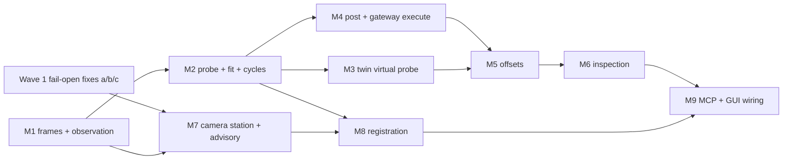

# Probing & Quality Architecture — Chudware Manufacture Overhaul

Owner: MetrologyArchitecture. Design-only: this document specifies probing and quality; it
records no implementation change by itself. Snapshot 2026-08-08.

Bound to the accepted ownership rulings: Gateway owns the controller wire/state vocabulary and the
Grbl parse seam; Twin owns deterministic emulation state under `core/twin/`; Metrology owns
measurement/probe result schemas and offset proposals; UX owns `FreshValue<T>` and every
GUI file; wave slicing and the append-only integration seams are owned by the execution plan.

**Gateway rules are cited by stable id, never by gateway section number** (review C10, which
found three of five §24 cross-references pointing at unrelated rules). Every id below names a
rule already ratified in `10_gateway.md`; `test_metrology_*` and
`contracts/manufacturing_metrology.md` key on the id, so a gateway renumbering cannot turn one
of metrology's assertions into a wrong one.

| Stable id | Rule as ratified |
|---|---|
| `GW-SEQ-SOLE-SOURCE` | `mfg_event_append` is the only way any domain obtains a stamped `seq`; a domain that mints its own is a contract-test failure |
| `GW-KIND-REGISTERED` | a `result_kind` absent from the durable-result-kind table is refused `mfg_unregistered_result_kind`, and that domain's durable surface does nothing |
| `GW-KIND-TWO-COLUMNS` | every registered kind declares **both** (a) an epoch policy `falsify\|reestablish\|epoch_invariant` and (b) its runtime invalidation triggers |
| `GW-CLOSURE-OWNED` | `mfg_event_append` takes `derived_from:[ResultRef]`; `mfg_result_invalidate` computes the transitive closure and `affected[]` is the gateway's closure, never the caller's guess. Falsification always propagates; supersession propagates only for kinds declaring `supersede_with_parent` |
| `GW-SRC-COMPUTED` | `src`/`admission` are computed by the gateway, never accepted from a caller; `probed` is settable only by transport code holding an open `ITransport` |
| `GW-CAPABILITY-TRUTH` | one `CapabilityTruth` definition (`core/device/capability.h`); a second definition is a contract-test failure |
| `GW-CAPABILITY-KIND` | any domain whose `CapabilityReport` can reach a UI MUST register a `<domain>.capability` kind — `epoch_invariant`, `supersede_with_parent:false`, `derived_from` = the cited evidence rows — else `mfg_capability_requires_durable_kind` |
| `GW-PROCFACT-FOLLOWS-PARENT` | every kind whose id ends in `procedural_fact` MUST declare `supersede_with_parent:true` |
| `GW-DOMAIN-MIRROR` | a domain-local mirror must quote the `at_seq`/`seq` the gateway returned and must never be read as a source of truth |
| `GW-FRESHVALUE-SOLE` | exactly one `FreshValue<T>` definition repo-wide (DoD 4); no second envelope |
| `GW-INVALIDATION-ENVELOPE` | one invalidation envelope `{class,reason,why,affected,at_seq,superseded_by?}` (DoD 9); consumers branch on `class`, never on an event-name table |
| `GW-FAMILY-MANUFACTURE` | one shared MCP family id `manufacture` for the whole overhaul, OFF by default until commissioning; per-tool granularity via `get_tool_options` |
| `GW-TOOL-REGISTRY-OWNER` | Gateway is the sole owner of `services/mcp/tool_registry.py` risk-class edits for the wave; other domains' rows land as data appended by that owner or in a strictly later wave |

---

## 0. The one invariant everything else serves

**A camera can never move a machine offset, and no amount of calibration changes that.**

Enforced structurally — not by documentation, and not by a runtime check somebody can
forget to call:

1. `EvidenceClass` is **never a constructor parameter**. It is derived from a fixed
   device-kind table inside the observation constructor:
   `camera → advisory`, `touch_probe|tool_setter → qualified`, `twin → simulated`.
   A caller cannot assert a class.
2. Two distinct C++ types over one wire schema. `QualifiedObservation` has no converting
   constructor from `AdvisoryObservation` and none from `SimulatedObservation`.
3. `offsets::propose` and `inspection::evaluate` take `std::span<const QualifiedObservation>`.
   Passing advisory evidence is a **compile error**, not a rejected request.
4. One deserialization choke point:
   `QualifiedObservation::from_json(const json&) -> std::optional<QualifiedObservation>`,
   returning `nullopt` unless `evidence_class=="qualified"` **and**
   `uncertainty.state=="known"` **and** `src=="probed"`.

The choke point deliberately does **not** enforce an accuracy tier. Tier is per-purpose
policy, not a structural invariant: `Q1_repeatable` is legitimate for stock registration and
illegitimate for an offset. Baking `>= Q2` into the constructor would both bar the valid Q1
use and make `tier_at_least_q2` structurally unable to fail. Class, uncertainty and `src` are
purpose-independent, so they live in the type; tier is a named stage-2 guard that genuinely
discriminates within the already-admitted set.

Advisory camera evidence has exactly two legitimate powers: it may be **displayed** with a
watermark, and it may **seed a probe plan** (search start points, expected positions,
stock-presence prechecks). It closes no loop. Per the founder decision already made,
camera-derived results are advisory *forever* until separately validated; no later wave
relaxes this.

---

## 1. Capability truth levels

Metrology composes `CapabilityTruth` **verbatim** from `core/device/capability.h`
(`GW-CAPABILITY-TRUTH`) and declares no second capability shape. The earlier per-level
`{source, freshness}` pair is **withdrawn**: `probed` is an observation `src`, not a capability
truth (`GW-SRC-COMPUTED`), and `source` survives only inside the uncertainty budget of §3,
where it is budget metadata on a different axis and never a gate value.

```json
{"level": "plan|generate|post|parse|simulate|monitor|transport|execute|safety_integration",
 "truth": "verified|declared|assumed|unsupported|not_applicable",
 "evidence_ref": ["res:<kind>:<ulid>"],
 "emulator_stage": "E0|E1|E2|E3|E4|E5|E6|none",
 "missing_level": "<level name, required whenever truth is assumed>",
 "why": "operator-readable sentence, required unless truth==verified"}
```

Consumption rules are the gateway's, unmodified: `assumed` disables an action exactly like
absent and must name `missing_level`; `max_advertised` never exceeds the ceiling of
`emulator_stage_passed`; `unsupported → not_applicable` only with an independently fresh,
subject/config-epoch-bound corroborator (§3.5); every `evidence_ref` is a seq-stamped durable
row, so a level is always traceable to a journal row.

The report is durable, not just painted: `metrology.capability` is a registered result kind
(§6.4), `epoch_invariant`, `supersede_with_parent:false`, `derived_from` = exactly the evidence
rows it cites (`GW-CAPABILITY-KIND`). Without that registration every level above `unsupported`
is refused `mfg_capability_requires_durable_kind`. The row is journaled **and** published
`FreshValue`-wrapped with `ttl_ms:null` (§3).

Table legend. **V\*** = `verified`, and only once its cited evidence rows exist — until then the
level ships `assumed` naming `missing_level`. The truth is computed from the journal; this table
says which levels are *reachable*, never which are currently true. **U** = `unsupported` with
the `why` below. No cell is `not_applicable`: a level this domain has no path to is
unsupported-with-a-reason, which is the truthful shape for a domain with no transport of its own.

| Device kind | plan | generate | post | parse | simulate | monitor | transport | execute | safety_integration |
|---|---|---|---|---|---|---|---|---|---|
| Touch probe (Grbl 1.1) | V\* | V\* | V\* | V\* | V\* | V\* | U-gw | U-gw | U-never |
| Tool setter | V\* | V\* | V\* | V\* | V\* | V\* | U-gw | U-gw | U-never |
| Fixed camera station | V\* | U-nopath | U-nopath | U-nopath | U-nopath | V\* | U-nopath | U-never | U-never |
| Twin virtual probe | V\* | V\* | U-nopath | V\* | V\* | U-nopath | U-nopath | U-never | U-never |

The three `why` texts, rendered verbatim:

- **U-gw** — "Transport and execute for this device are owned by the Gateway device lane.
  Metrology opens no transport and holds no serial handle." Metrology cites the Gateway row by
  `evidence_ref` and never re-advertises it as its own level.
- **U-nopath** — "This device kind has no program-generation, post, parse, simulate or monitor
  path in this domain."
- **U-never** — permanent, not "not yet". For `execute`: "a camera in this product is a sensor,
  never an actuator, never a guard" — and a twin can never execute by construction. For
  `safety_integration`: "metrology performs no safety function of any kind" (§12).

`execute` is never owned here. Every motion-bearing action is a Gateway `DeviceCommand`
under Gateway's exclusive command-owner lease. Metrology contains no code path that writes
bytes to a controller.

---

## 2. Accuracy tiers

Tiers are defined by **evidence that exists**, not by a table of promised numbers. Only
`A1_scaled` — the uncalibrated planar case we already ship — keeps a heuristic band,
because by construction it has nothing better.

### Advisory ladder (camera; caps at A2 forever)

| Tier | Entry condition | Reported uncertainty | Unlocks |
|---|---|---|---|
| `A0_indicative` | No valid station profile, or planarity unknown, or coverage below floor | **No numeric value emitted** (`state:"refused"`) | Presence/absence, gross classification |
| `A1_scaled` | Planar ChArUco homography; inlier ratio ≥0.80; residual rms ≤2.0 px; coverage ≥0.25; planarity CoV **known** and ≤0.25; both endpoints inside the board convex hull grown by ≤50% of the board diagonal | `U = 2·sqrt((2·resid_rms_mm)² + (0.02·L)² + (1/px_per_mm)²)` | Advisory display; seeding a probe plan; stock-presence check |
| `A2_station` | Fixed station: intrinsics + distortion, reprojection rms ≤0.5 px over ≥12 views; all metrology-relevant controls locked and read-back verified; live station profile; artifact verification inside its validity window | `U = max(2·s_artifact, 1/px_per_mm)`, where `s_artifact` comes from the station's own verification run over ≥5 field positions — **measured, never tabled** | A1 + advisory first-article screening, labelled advisory in every report |

The current code's `high` tier promises ±2% at ≥8 px/mm (`services/vision/measure.py:38-44`).
With no distortion model and no residual reporting, ±2% is not defensible at frame edges,
so `A1_scaled` replaces the tabled band with the residual-driven form above. `A2_station`
is the only camera tier allowed to quote a sub-millimetre number, and it quotes one it
actually measured on an artifact.

### Qualified ladder (probe)

| Tier | Entry condition | Unlocks |
|---|---|---|
| `Q0_unqualified` | Probe present; stylus qualification missing or expired | **Only** `stylus_qualify` and `artifact_verify` cycles. No measurements, no offsets. |
| `Q1_repeatable` | Live stylus qualification (isotropic tip radius) + repeatability study (n≥10, single direction) | Stock registration; in-process checks whose verdict may be `indeterminate`. **Writes nothing to the controller.** |
| `Q2_qualified` | Q1 + **directional** pretravel measured per axis-direction on a sphere/ring artifact of known size + ≥2-pass agreement. `machine_positioning` may remain `assumed` from the machine profile. | WCS origin offsets, tool-length offsets (both via approval); guardbanded conformance verdicts |
| `Q3_traceable` | Q2 + machine artifact check with `machine_positioning` **measured** + certified artifact carrying a certificate uncertainty + recorded environment | Q2 + permission to use the word "traceable" in a report |

**Why the machine artifact check sits at Q3, not Q2** (this moved after the execution plan
set the offset floor at Q2). For a *work offset* you probe the part in the same place you
are about to cut it, so machine positioning bias largely cancels and repeatability plus
directional pretravel are what govern. For a *conformance verdict spanning travel*, bias
does not cancel — which is why it gates the traceability claim instead. Putting the
certified-artifact requirement at Q2 would mean nobody could set a work zero with a probe
without owning a calibrated step artifact, which would push operators back to paper and
feel — strictly worse for the part. Q2 is reachable day one with a ring gauge or a
1-2-3 block, so the ≥Q2 offset floor is a real gate rather than an unsatisfiable one.

Ship promise: Q1–Q2. `Q3_traceable` is a ceiling the operator can reach with their own
certified artifact; we never assert it on their behalf.

### Simulated

`S_twin` — from `core/twin/`. Backs collision, sequencing, envelope, and no-trip
prediction verdicts about a **program**. Backs nothing about a physical workpiece. It is
not "advisory"; it is a third, disjoint class.

### Mechanical binding to UX's `src` (execution-plan ruling 3)

| Tier | `src` | May enter an approval binding |
|---|---|---|
| `A0_indicative`, `A1_scaled`, `A2_station` | `advisory` | **never** |
| `S_twin` | `simulated` | **never** (may satisfy the dry-run *preflight fact*, which is not an approval) |
| `Q0_unqualified`, `Q1_repeatable` | `probed` | **never** (below the Q2 floor) |
| `Q2_qualified`, `Q3_traceable` | `probed` | yes, with a live approval |

**Two-stage gate composition** (the project-wide correction; UX restated the same rule). Stage 1 is
UX's freshness predicate `state=="ok" && src=="probed"` — plus `truth=="verified"` on the
`execute` capability. Stage 1 is **necessary and never sufficient**: it only *admits* a
value into gate evaluation. Stage 2 is metrology's named domain guards, which decide, and which
render by name. Every entry in `guards[]` therefore carries `"stage": 1|2` so the UI can
say which stage rejected.

The case that forced this out is worth stating because an operator will otherwise read it
as a bug: a probe result at `Q1_repeatable` genuinely touched the part — `state=="ok"`,
`src=="probed"`, `evidence_class=="qualified"` — and is still barred by `tier_at_least_q2`.
The operator sentence must name both halves: *what succeeded* and *what is insufficient*.
"The probe measured this successfully, but at Q1_repeatable. An offset requires
Q2_qualified or better." Naming only the refusal is a wall; naming both is a diagnostic.

No surface may infer approvability from freshness alone, and a stage-1 pass is never
presented as a verdict.

### Promotion

No promotion path between ladders, in either direction, ever. Repeating an advisory
measurement a thousand times yields a thousand advisory measurements.

---

## 3. Schemas

Contract: `contracts/manufacturing_metrology.md`, under the existing frozen-seam policy in
`contracts/README.md` (append-only, integrator sign-off, version bump). Schema ids use the
established `aicad.<name>/1` form from `contracts/cam.md`.

Every field the GUI paints is wrapped in UX's `FreshValue<T>`, verbatim, per the project ruling and
`GW-FRESHVALUE-SOLE` — one envelope, no per-field translation table:

```jsonc
{"v": <T>|null, "state": "ok"|"unknown"|"stale"|"refused"|"unsupported",
 "t_mono_ns": <int64>, "seq": <uint64>, "age_ms": <int32>, "ttl_ms": <int32>,
 "src": "probed"|"declared"|"assumed"|"simulated"|"advisory",
 "why": "<operator-readable sentence>", "last_ok": {"v":…,"t_mono_ns":…,"seq":…}?}
```

**Durable authored rows are journaled *and* published wrapped** (the plan-wide C8 ruling). A row
that does not decay — an approval, an inspection result, a capability row, a station profile —
is appended through `mfg_event_append` for its `seq`, and the same row is published to the GUI as
`FreshValue<T>` with `ttl_ms:null` and `state:"ok"`. `ttl_ms:null` is the whole distinction: a
durable row has no wall-clock TTL, but it still carries one freshness envelope, because a UI that
paints two envelope shapes has two ways to be wrong. Nothing here is exempt from the envelope.

Mapping note, so this does not contradict "only `ok`+`probed` satisfies a preflight gate":
the measured **value** of a qualified observation carries `src:"probed"`. The per-component
`source` inside the uncertainty budget is a *different axis* — budget metadata, not a gate
value. An `assumed` budget component does not make the value `assumed`; it caps the tier
(`machine_positioning: assumed` ⇒ at most `Q2_qualified`).

Twin-sourced observations arrive at the republishing layer as `{tick, dt_ns, …}`; that
layer stamps `t_mono_ns`/`seq`/`age_ms`/`ttl_ms` and sets `src:"simulated"`. Metrology
never fabricates a wall clock for twin data and never reads a twin `t_mono_ns` the twin
itself wrote.

### 3.1 `aicad.metrology_frame_graph/1`

```jsonc
{
  "schema": "aicad.metrology_frame_graph/1",
  "frames": ["machine", "wcs:54", "wcs:54.1:3", "fixture:vise_a", "stock:s1",
             "part:doc7/body0", "tool:5/tcp", "probe:p1/mount", "probe:p1/stylus_center",
             "camera:046d_C920_A1B2/optical", "board:charuco_5x7_25mm", "station:bench1"],
  "edges": [{
    "from": "machine", "to": "wcs:54",
    "pose": {"t": [x,y,z], "r": [qx,qy,qz,qw]},
    "covariance": [[/* 6x6 */]] | null,
    "source": "probed"|"declared"|"assumed"|"simulated"|"advisory",
    "calibration_id": "sha256:…" | null,
    "established_at": {"t_mono_ns": 0, "wall": "…"},
    "valid_until": "…" | null,
    "revision": 7,
    "on_stale": "fail_closed"
  }]
}
```

`TransformGraph::resolve(from, to) -> Result<Pose, ResolveError>`:

- Shortest-hop path; ties broken by lowest total uncertainty, then lexicographic edge id —
  deterministic, so two hosts resolve identically.
- **Any** edge on the chosen path that is unknown, expired, or superseded ⇒ resolve fails
  and names the offending edge in `ResolveError.edge`. No identity fallback, no
  best-effort pose. This is the most common way a metrology stack silently lies, so it is a
  hard failure.
- Covariance composes by first-order propagation. Any edge with `covariance: null` flags
  the result `uncertainty_unknown`, and an `uncertainty_unknown` transform cannot appear in
  a `QualifiedObservation`.
- Cycles rejected at insert.

The graph is why the probe math is honest: converting a controller machine position into a
surface point requires the `probe:p1/mount → probe:p1/stylus_center` edge, which exists
only after stylus qualification. An unqualified probe cannot produce a coordinate **at
all** — not "produces a worse coordinate".

### 3.2 `aicad.metrology_observation/1`

```jsonc
{
  "schema": "aicad.metrology_observation/1",
  "id": "sha256:<canonical-json-digest>",       // content-addressed, immutable
  "supersedes": "sha256:…" | null,               // corrections are new records
  "evidence_class": "qualified"|"advisory"|"simulated",  // derived, never supplied
  "accuracy_tier": "Q2_qualified",
  "device": {"kind":"touch_probe","id":"p1","serial":"…","firmware":"…"},
  "qualification": {                             // UX ask: first-class, per-measurement
    "id": "sha256:…", "kind": "stylus_qualification",
    "established_at": "…", "expires_at": "…", "state": "live"|"expired"|"superseded"
  },
  "machine_id": "shapeoko3xl-0001",
  "run_id": "…", "cycle_id": "…",
  "method": {"name":"probe_bore_4pt","version":3},
  "frame": "wcs:54", "frame_graph_revision": 41,
  "nominal": {"kind":"circle","d":20.0,"center":[25,25,-3]},
  "value": {"kind":"circle","d":<FreshValue<double>>,
            "center":[<FreshValue>,<FreshValue>,<FreshValue>]},
  "units": "mm",
  "uncertainty": {
    "state": "known"|"unknown",
    "u_combined": 0.021, "k": 2.0, "U": 0.042, "confidence": 0.95,
    "components": [
      {"name":"repeatability","u":0.008,"dist":"normal","source":"measured","ref":"sha256:…"},
      {"name":"pretravel_bias","u":0.005,"dist":"normal","source":"measured","ref":"sha256:…"},
      {"name":"machine_positioning","u":0.015,"dist":"rect","source":"assumed","ref":"machine_profile"},
      {"name":"thermal","u":0.004,"dist":"rect","source":"assumed","ref":"20C nominal"},
      {"name":"stylus_qualification","u":0.003,"dist":"normal","source":"measured"},
      {"name":"fit_residual","u":0.006,"dist":"normal","source":"measured"},
      {"name":"transform_propagation","u":0.002,"dist":"normal","source":"measured"},
      {"name":"artifact","u":0.0,"dist":"normal","source":"assumed"}
    ]
  },
  "environment": {"temp_c": <FreshValue<double>>, "source":"unmeasured"},
  "raw_ref": {"kind":"touchset","hash":"sha256:…","n":4},
  "quality": {"fit_residual_rms":0.006,"fit_residual_max":0.011,"condition":18.3,
              "n_points":4,"dof":1,"angular_span_deg":270},
  "disposition": "informational"|"pending"|"accepted"|"rejected",
  "created_at": {"t_mono_ns":0,"wall":"…","controller_clock":"…"}
}
```

`u_combined = sqrt(Σ uᵢ²)` (GUM, components independent); `U = k·u_combined`, default
`k = 2`. A component with **no value at all** ⇒ `uncertainty.state="unknown"` ⇒ cannot be
a `QualifiedObservation`. A component present but `assumed` is permitted and caps the tier.

**`qualification` is on the measurement, not only on the device** (UX's ask). The read RPCs
additionally compute a non-stored `predates_current_qualification` boolean by comparing
`qualification.id` against the device's live qualification id, and
`mfg.metrology.invalidated` (`class:"superseded"`, `reason:"qualification_requalified"`, §6.1)
fires on re-qualification so UX can invalidate
without the operator reasoning about timestamps.

### 3.3 `aicad.metrology_probe_def/1`

```jsonc
{
  "schema": "aicad.metrology_probe_def/1",
  "id": "p1", "kind": "touch_trigger"|"tool_setter"|"tool_length"|"ohmic"|"edge_finder",
  "tool_number": 99,                  // links to the existing cam::Tool (ToolType::Probe)
  "stylus": {"ball_d":3.0,"ball_material":"ruby","effective_length":52.4,
             "shank_d":3.0,"max_deflection":1.2},
  "trigger": {"latency_ms":<FreshValue<double>>,"repeat_sigma_mm":0.008},
  "motion": {"search_feed":200,"measure_feed":25,"retract_mm":2.0,
             "max_search_mm":25.0,"overtravel_mm":3.0,"protected_rapid_feed":1500},
  "status_required": ["battery_ok","not_tripped"],   // unknown ⇒ refuse to start
  "qualification_ref": "sha256:…" | null,
  "capability": {"directions":["+X","-X","+Y","-Y","-Z"]}  // most styli cannot probe +Z
}
```

`ToolSetterDefinition` adds `z_reference_machine` (from calibration), `plunger_travel`,
`repeat_sigma_mm`, `location_machine`, `approach_clearance`.

### 3.4 `aicad.metrology_probe_result/1`

```jsonc
{
  "schema": "aicad.metrology_probe_result/1",
  "id": "sha256:…", "cycle_id": "…", "cycle": "bore_4pt",
  "evidence_class": "qualified"|"simulated",
  "status": "completed"|"faulted"|"aborted"|"rejected",
  "fault": null | {"kind":"no_trip"|"pre_tripped"|"false_trip"|"lost_feedback"
                        |"overtravel"|"unhomed"|"status_unknown"|"lease_lost",
                   "touch_seq":2,"detail":"…"},
  "touches": [{
    "seq": 0,
    "commanded_target":[x,y,z], "approach_dir":[dx,dy,dz], "feed":25,
    "trip_machine": <FreshValue<[x,y,z]>>, "trip_wcs": <FreshValue<[x,y,z]>>,
    "surface_point_machine":[x,y,z],       // after tip + pretravel compensation
    "compensation":{"ball_r":1.5,"pretravel":0.006,"applied_along":[dx,dy,dz]},
    "controller_seq":8814,"controller_ts":"…","host_t_mono_ns":0
  }],
  "fit": {"kind":"circle","params":{},"residual_rms":0.006,"residual_max":0.011,
          "condition":18.3,"n":4,"angular_span_deg":270},
  "passes": 2, "pass_agreement_mm": 0.004,
  "observation_id": "sha256:…" | null,
  "program_hash": "sha256:…", "twin_snapshot_id": "…" | null
}
```

C++ enumerators use Twin's agreed names — `ProbeNoTrip`, `ProbePreTripped`,
`ProbeFalseTrip`, `ProbeLostFeedback` — with the snake_case wire strings above, matching
repo JSON convention. One vocabulary, two spellings by layer, no translation table.

**Tip compensation, with the sign written down once.** The stylus centre travels along unit
`d`; contact occurs when the centre is `R` short of the surface; the trigger fires after
`pretravel(d)` of further travel. Therefore:

```
surface_point            = stylus_centre_at_trip + d · (R_eff − pretravel(d))
stylus_centre_at_trip    = resolve(machine, probe:<id>/stylus_center) ∘ trip_machine
```

`pretravel` is directional and comes from qualification, never from a datasheet. This gets
a golden test table over all six directions, because a sign flip here is a scrapped part.

### 3.5 `aicad.metrology_offset_proposal/1`

```jsonc
{
  "schema": "aicad.metrology_offset_proposal/1",
  "id": "sha256:…",
  "machine_id": "shapeoko3xl-0001",
  "controller_identity": "<Gateway ControllerSnapshot identity>",
  "job_id": "…", "setup_id": "…", "setup_revision": 12,
  "target": {"kind":"wcs_register","register":54,"sub":0,"axes":["X","Y"]}
          | {"kind":"tool_length_dynamic","tool_number":5}
          | {"kind":"tool_table","tool_number":5,"field":"length"},
  "current":  {"X":<FreshValue>,"Y":<FreshValue>,"Z":<FreshValue>},  // read back, never cached
  "proposed": {"X":-312.407,"Y":-198.115},
  "delta":    {"X":0.062,"Y":-0.031},
  "evidence": ["sha256:…","sha256:…"],       // qualified observations ONLY, tier >= Q2
  "qualification": {"id":"sha256:…","expires_at":"…","state":"live"},
  "computed_by": {"fn":"offsets::wcs_from_edge_pair","version":2},
  "uncertainty": {"U":0.042,"k":2.0},
  "locality": {                              // Q2 cancellation scope — see below
    "datum_location_machine": [-312.4,-198.1,-45.0],
    "cancellation_envelope_mm": {"x":150,"y":150,"z":60},
    "valid_for": ["this_setup"],             // never datum_transfer, flip, or conformance
    "basis": "machine_positioning:assumed"
  },
  "guards": [{"name":"delta_within_limit","stage":2,"verdict":"pass","limit":0.5,"actual":0.069},
             {"name":"envelope_check_performed","stage":2,"verdict":"pass","at_seq":8803},
             {"name":"spindle_off_in_program","stage":2,"verdict":"pass"},
             {"name":"tool_number_matches_program","stage":2,"verdict":"pass"},
             {"name":"controller_homed","stage":2,"verdict":"pass"},
             {"name":"keepout_check_performed","stage":2,"verdict":"pass","at_seq":8801},
             {"name":"dry_run_performed","stage":2,"verdict":"pass","at_seq":8802},
             {"name":"qualification_live","stage":2,"verdict":"pass","expires_at":"…"},
             {"name":"tier_at_least_q2","stage":2,"verdict":"pass"},
             {"name":"locality_scope_respected","stage":2,"verdict":"pass"},
             {"name":"evidence_same_machine","stage":2,"verdict":"pass"},
             {"name":"readback_verified","stage":2,"verdict":"pass"}],
  "expires_at": "…"
}
```

#### Guard audit — three checks that fail in different directions

Criterion 13 has three bullets and no two of them catch each other. Metrology runs all three.

**(i) Producer-side — could any value metrology produces ever PASS this guard?** If not, do not
define it; document the absence. **(iii) Liveness — can metrology drive it to FAIL from some
input?** If not, delete it. **(ii) Gate-side — can at least one of a gate's evidence sources pass
stage 1?** That one is owned by the approval-path owner (UX for the offset row, Gateway for the
arbiter preflight set), *not* by metrology, because unsatisfiability is a property of the gate's **source
set** and nobody who owns a single source can see the set. That is exactly how it fell between
owners: Twin correctly declined to define execute-side guards, every producer answered its own
audit truthfully, and an unsatisfiable gate survived anyway.

**Deleted because they can never FAIL:**

| Deleted guard | Why |
|---|---|
| `evidence_class_qualified` | `evidence_class` maps 1:1 onto `src` (advisory↔advisory, simulated↔simulated, probed↔qualified), so anything not `qualified` already failed stage 1's `src=="probed"`. Retires the first conjunct of UX's earlier Approve condition, which UX withdrew |
| `uncertainty_known` | Enforced structurally at the `QualifiedObservation::from_json` choke point (§0.4), so an unknown-uncertainty observation never reaches `propose` |
| `offset_kind_supported` | A capability whose `truth` is `assumed` or `unsupported` fails stage 1, so an unprobed offset kind is never admitted. Survives as a **stage-1 admission criterion** rendered `state:"unsupported"` with a non-empty `why` (rule 25) — not as a stage-2 guard |

**Deleted because it can never PASS on the first controller:**

| Deleted guard | Why |
|---|---|
| `register_writable` | Grbl 1.1 reports no per-register writability, so this could only ever be `not_applicable`, and `not_applicable` is not a pass. `readback_verified` is the check that actually proves the register took the value, so it does the work honestly |

**Re-specified from conclusive to procedural** — a real defect in the earlier draft:

`keep_out_intersection` and `dry_run_missing` were sourced from Twin's `twin_keepout_check`
and a twin-executed dry run. Twin evidence is `src=="simulated"`, which never admits at stage
1, so **neither gate could ever pass** — and both would have sailed through the liveness test,
because an unsatisfiable gate fails on *every* input. Worse, they were a simulated conclusion
acting as a gate, which quietly contradicts the decision brief's own rule that simulation
success never bypasses operator approval.

Split procedural from conclusive:

+ `keepout_check_performed` and `dry_run_performed` — **procedural facts**: "this check ran
  against *this* program hash, recorded at seq N". Gateway-recorded, `src=="probed"`, admits
  at stage 1, and genuinely fails when nobody ran it. These are the gates.
+ The dry-run's *verdict* (no collision, no predicted no-trip) and the keep-out clearance
  conclusion — **simulated conclusions**: rendered as marked context, gating nothing.

`spindle_stopped` and `tool_in_spindle_matches` had the same shape for a different reason:
Grbl has no tool-presence sensor and may not report spindle state, so telemetry-sourced they
are `not_applicable`-only and therefore unsatisfiable. Re-specified as
`spindle_off_in_program` and `tool_number_matches_program` — procedural checks against the
immutable artifact and the arbiter's tracked T-word, both satisfiable and both genuinely
failing when the program contains an `M3` or the wrong tool.

**A near-miss worth recording.** `tier_at_least_q2` would itself have been unsatisfiable for
most users had the certified-artifact requirement stayed at Q2, since a hobby machinist owns a
ring gauge but not a calibrated step artifact. Moving it to Q3 (§2) was argued on physical
grounds, but it is the same defect class: a gate nobody can satisfy gets waived on every run
until the waiver marker means nothing.

**Stage 2 has no `unknown`.** Every genuine unknown is a stage-1 rejection, so a stage-2
`unknown` could only duplicate a decision already made. Stage 2 has exactly one non-binary
status, `not_applicable`, reserved for `state:"unsupported"` inputs — and it is **not a silent
pass**: it renders by name ("spindle state is not reported by this controller") so the operator
is told the check did not happen. `unknown` means *should be reported and is not*, and holds at
stage 1; `unsupported` means *no such sensor exists*, and becomes `not_applicable`.

Also exempt, stated so the absence is deliberate: `TouchPoint` records are content-addressed
immutable joins between a trip and its cycle and cannot become false about themselves, so they
carry no validity guard.

`controller_homed`, `spindle_off_in_program` and `tool_number_matches_program` are **stage 2**,
not stage 1 as first labelled. The stage-1 question is whether the corresponding
`ControllerSnapshot` field is fresh and probed; whether the fresh probed answer says "not
homed" is a domain decision that genuinely fails. Stage-1 input failure reports separately as
`input_unavailable:<field>`, keeping the two distinguishable.

**Standing invariants, not one-time audits.** `test_metrology_offsets` drives every stage-2
guard to `fail` **and** to `pass` from some input, and asserts that `not_applicable` never
counts as a pass — so a guard reachable only as pass-or-not_applicable still fails the suite.
An audit is an act; a test is an invariant, and this defect arose precisely because a spec
(stage 1) landed after the guard lists were drafted, which will happen again.

#### Stage-1 routing, complete — and the `unsupported` bypass

Nothing inferred; every state has one destination:

| Input state | Destination |
|---|---|
| `ok` + `src=="probed"` (+ `truth=="verified"` for execute) | **admitted** to stage 2 |
| `unknown` | stage-1 reject, **fails closed** |
| `stale` | stage-1 reject, **fails closed** |
| `refused` | stage-1 reject, **fails closed** |
| `ok` with `src` in {advisory, simulated, assumed, declared} | stage-1 reject, **fails closed** |
| `unsupported` | stage-1 reject that routes to stage-2 `not_applicable`, rendered **by name**, never counted as a pass |

`unsupported` is the only non-`ok` state that does not fail closed — which makes it a
**fail-closed bypass reachable by a single field value**: a producer that cannot read a sensor
and reports `unsupported` instead of `unknown` has silently disabled a gate, and the operator
sees a plausible sentence instead of a refusal. Exactly the kind of thing introduced by
accident while making a device "work".

**Required mitigation — corroboration.** `unsupported` on a field MUST be corroborated by the
device's capability set lacking the relevant level. A field claiming `unsupported` while the
capability set says the level *is* present is a contract violation and is treated as
`unknown`, i.e. fails closed. The distinction becomes cross-checkable from two independent
places instead of self-asserted by the producer. `test_metrology_offsets` asserts this: a field
reporting `unsupported` while the corresponding capability is present **fails the suite**.

The semantic line, restated because it blurs easily: `unknown` means *this should be reported
and currently is not* — a fault, holds at stage 1, fails closed. `unsupported` means *no such
sensor exists on this device* — a permanent, corroborable absence.

#### Prerequisite vs corroborating — the complete audit

`not_applicable` applies **only** to a *corroborating* check whose sensor is absent. It never
applies to a capability the action itself requires: a missing prerequisite means the proposal
**cannot be constructed**, refused with the missing capability named, before anything reaches a
preflight table. Otherwise the bypass lets an impossible write be approved on the grounds that
checking it was not applicable — the same shape as the corroboration bypass one level up, except
this one authorizes an impossible *act* rather than skipping a *check*.

#### Tier 0 — construction refusal, before any preflight table exists

Prerequisites refuse at **construction**: not as a preflight row, not as a guard, not as
`not_applicable`. If a preflight evaluator is deciding prerequisite-vs-corroborating,
the prerequisite should already have prevented the object from existing. What Tier 0 refuses:

| Refused at construction | Because |
|---|---|
| `ProbeProgram` when `supports_probe_g38` is absent | A controller that cannot probe is not a candidate; there is nothing to approve |
| `ProbeProgram` when the stylus cannot probe a direction the cycle needs | The cycle is unbuildable, not merely unapproved |
| `ProbeProgram` when the probe is `Q0_unqualified` (except `stylus_qualify` / `artifact_verify`) | No measurement can be produced, so no measuring program exists |
| `OffsetProposal` when `offset_kinds[]` lacks the kind **this proposal's `target.kind` requires** | e.g. `tool_table` on Grbl 1.1. Capability named in the refusal |
| `OffsetProposal` when the transform chain `machine → target frame` is unresolvable | The proposed value is not computable |
| `QualifiedObservation` from advisory or simulated evidence | Compile error in-process; `nullopt` at the choke point |

`tier_at_least_q2` and `evidence_same_machine` remain as stage-2 guards, but as **defence in
depth** against a record produced elsewhere — explicitly *not* how the Tier-0 cases are meant to
be caught. A guard that happens to catch a prerequisite violation is not a substitute for
refusing to construct it.

#### Prerequisite-vs-corroborating is artifact-dependent, not a static guard property

The same guard, on the same device, classifies oppositely depending on what the artifact
requires. Metrology's case is `offset_kinds[]`: a proposal targeting only a WCS origin does not need
`tool_length_dynamic` at all, so its absence is genuinely `not_applicable`; a proposal whose
`target.kind` **is** `tool_length_dynamic` makes G43.1 a prerequisite that must refuse at
construction. So the audit is not "classify each guard once" — it is "for each guard, determine
whether **this** artifact makes the capability a prerequisite, then evaluate accordingly".

#### `not_applicable` is honest only when the ACTION does not need the thing

Not when the *sensor* for it is missing. Re-auditing metrology's own three rows against that corrected
form demoted two of them: the action does need the spindle off and the right tool, so
`not_applicable` alone would have let approval proceed with no confirmation of either.

| Requirement | Honest resolution |
|---|---|
| Spindle off | Satisfied by **either** sensor corroboration **or** `spindle_off_in_program` against the immutable artifact. `not_applicable` is never the whole answer, because the action needs it |
| Correct tool | Satisfied by **either** a tool-presence sensor **or** `tool_number_matches_program` against the arbiter's tracked T-word **or** a human setup attestation recorded in the binding |
| Fixture/workholding present | Satisfied by **either** sensor corroboration **or** an explicit human setup attestation in the binding. Never `not_applicable` with nothing in its place — that would bypass setup verification, which the brief forbids |
| Environment temperature | **Genuinely `not_applicable`.** The action does not need it: an unmeasured temperature enters the uncertainty budget as an `assumed` component and caps the tier. This is the one honest case of the three |

#### Compound checks: which part downgrades and which does not

Written down because implicitness is the hazard — this is exactly the distinction the next person
to touch the code flattens:

| Compound check | Non-downgradable part (pass/fail) | Downgradable part (may be `not_applicable`) |
|---|---|---|
| `readback_verified` | A readback was performed and the values compare | Per-register writability reporting (absent on Grbl) |
| `dry_run_performed` | A dry-run record exists for this program hash | The twin's fidelity declaration for that config |
| `qualification_live` | A qualification record exists and is unexpired | Recorded environment at qualification time |
| `envelope_check_performed` | The arbiter computed program extents against the configured envelope | Whether the envelope itself was ever *measured* (it is `declared`; surfaced as a separate visible fact) |

#### The fifth unsatisfiable row, found by applying UX's finding to metrology's own list

`envelope_after_apply` asserted "the resulting WCS keeps programmed motion inside travel". But
travel comes from `cam::Machine::travel`, a machine-profile value that is `declared` and never
`probed` — so the assertive gate could never pass stage 1. Re-specified as procedural
`envelope_check_performed`: the arbiter's computation of program extents against the configured
envelope, gateway-recorded, bound to artifact hash and seq, with the profile's `declared`
provenance surfaced as a **separate visible fact** in the binding. An unverified envelope is
weaker evidence the approver is entitled to see, not something masquerading as a passable gate.

#### Guard table carries the pass-direction question as a column

Not a one-time audit note. Every guard row in `contracts/manufacturing_metrology.md` carries
**"what must exist for this to pass, and how common is it?"** so the check happens when a guard
is *added*, not when someone next remembers to audit. `tier_at_least_q2` is the cautionary entry:
it survives only because a ring gauge is common and the certified-artifact requirement moved to
Q3. A future guard depending on, say, spindle-load reporting would be unsatisfiable for most
hobby controllers and would have to be corroborating-only or off-path.

**General rule for future states.** Any state or field making a claim about anything **other
than the sample** — the device, the environment, the configuration, or *the producer's own
fidelity* — requires an **independent** corroborating source before it may be non-blocking. If
the only witness to a limitation is the party who benefits from it being accepted, it fails
closed. Applied to metrology's one hardware-absence claim: a station reporting the camera absent must be
corroborated by the capability set lacking `monitor`; the same claim on a device reporting
`monitor` present is a contract violation rendered `unknown` — "a camera is configured for this
station but is not reporting" — a fault, not an absence. Otherwise an unplugged camera presents
as "no camera is configured" and the operator never learns one was expected.

#### Three dispositions, not two — and the enumeration for metrology

All three look similar on screen, and conflating any pair is a defect:

- **not-required-for-this-machine-class** — a property of the **class**. The check is not in the
  required set *at all* and never appears as a row.
- **`not_applicable`** — a property of a missing **sensor** on a particular device. The check *is*
  required, this device cannot report it, render by name.
- **`fail`** — missing **evidence**. The check is required, this device *can* report it, nobody
  ran it.

Routing a class-irrelevant check through `not_applicable` clutters every approval with irrelevant
rows; routing a missing sensor through not-required silently drops a required check.

The enumeration, with the reason for each rather than an assertion:

| Row | Disposition when absent | Why |
|---|---|---|
| `environment_temp_reported` | `not_applicable` | The only genuinely inapplicable row in metrology. The action does not need it; it caps the tier via an `assumed` budget component |
| Spindle off / correct tool / fixture present | never `not_applicable` | The action needs them; satisfied by sensor **or** artifact proof **or** human attestation (§ above) |
| `offset_kinds[]` for the requested `target.kind`, `supports_probe_g38`, stylus direction, transform resolvability | **Tier 0 construction refusal** | Prerequisites; the object cannot exist |
| `envelope_check_performed`, `keepout_check_performed`, `dry_run_performed`, `readback_verified` | **`fail`** | Procedural facts; absence is missing evidence, which is a failure to prove |
| `controller_homed` | **`fail`**, and absence of the field is `unknown` | Any controller that can run reports its homed state, so a missing field is a fault, not an absence |
| `qualification_live` | **`fail`** (`Q0`) | Our own record, never a device property |
| The entire probing row set on `Laser` / `Plasma` / `Waterjet` | **not-required-for-this-machine-class** | Those `cam::MachineKind` values have no stylus, no tool length and no probe-derived WCS path. The rows do not appear at all rather than appearing as `not_applicable` |

Within `Mill3` / `Mill4` / `Router` — the kinds this phase supports — the required set is uniform,
so metrology has **no** not-required-for-class rows in scope. The boundary above is stated so the first
laser workspace does not reach for `not_applicable` instead.

#### A corroborator must be bound and must itself pass stage 1

The corroboration rule is decorative without this, and it is the obvious way to comply on paper
while defeating the mitigation: **a corroborating source must be bound to the same subject and the
same configuration epoch as the claim it corroborates, and must itself pass stage 1.** A stale
capability record cannot license a current `unsupported` claim, because it proves nothing about
the present configuration. Applied:

- `Q1`–`Q3` tier ⟵ qualification record matching `probe_id` + `machine_id` + stylus config hash,
  **and** that record itself fresh and unexpired.
- `A2_station` tier ⟵ `StationVerification` under the same `calibration_id` + camera serial +
  mode, **and** itself inside its validity window.
- Camera-absent ⟵ capability set lacking `monitor`, bound to the same `device_id`, **and** that
  capability record itself passing stage 1.

An uncorroborated or unfreshened corroborator ⇒ the claim is treated as `unknown` and fails
closed.

**Render the downgrade with its reason.** When an uncorroborated `unsupported` becomes `unknown`,
the operator is told why — "reported as unsupported, but this device's capability set says the
level is present; treating as not reporting" — never merely that it failed. A silent downgrade
makes the mitigation invisible and, worse, indistinguishable from a genuine sensor fault, which is
exactly what someone later "fixes" by relaxing the check. Policy-boundary test.

#### Gate result values and waivers

Exactly: stage-1 rejected (state + `why`), stage-2 `fail` (named guard), `pass`,
`not_applicable` (named), `waived`. No stage-2 `unknown`.

`approvable` is false whenever **any** field is stage-1 rejected **or** any guard is `fail`.
`not_applicable` does not block, but it MUST appear in the result rather than being folded into
a summary — a check that did not happen is information the operator is entitled to, and
summarising it away is how it becomes invisible.

A waiver is a **durable identified act**, not a UI state: `waiver:{by, reason, at_seq}` on the
guard. That matters because of the cry-wolf argument: an unsatisfiable gate gets waived on every
run until waivers are boilerplate and a "contains waivers" marker distinguishes nothing. With
who, why and at which seq in the durable log, that pattern is *detectable after the fact* even
if an unsatisfiable gate slips past all three liveness bullets.

The routing table test is annotated as a **policy-boundary test**, so nobody later "fixes" the
failing corroboration case by relaxing the check.
#### Missing evidence is a FAIL, never `not_applicable`

The third mouth of the same bypass, distinct from mislabelling and from the prerequisite case:
routing *absent evidence* to `not_applicable`. Absence of evidence is a **failure to prove**,
not an inapplicable check. `not_applicable` exists for a device sensor that does not exist —
never for a record nobody produced. Audited rows:

| Row | Missing evidence ⇒ |
|---|---|
| `dry_run_performed` | **fail.** "No dry-run on record" is a failure to prove, and it is exactly the row someone would be tempted to call inapplicable |
| `keepout_check_performed` | **fail** |
| `qualification_live` | **fail** (device is `Q0`) |
| `readback_verified` | **fail.** A readback that was never performed is not a pass and not inapplicable |
| `evidence_same_machine` | **fail** when an observation carries no machine id |

#### Fidelity claims need independent corroboration bound to a hash

The corroboration rule generalises past `unsupported`: **any state or field making a claim about
anything other than the sample** — the device, the environment, the configuration, or *the
producer's own fidelity* — needs an independent corroborating source before it may be
non-blocking. If the only witness to a limitation or a capability is the party who benefits from
it being accepted, it fails closed.

`AccuracyTier` is exactly such a claim: it is the metrology subsystem asserting its own fidelity. So it is
corroborated, and the corroboration is **bound**, because a declaration not tied to what it
describes can be satisfied by an unrelated declaration:

- A `Q1`–`Q3` tier MUST be matched by a qualification record whose `probe_id`, `machine_id` and
  stylus configuration hash equal the observation's. An uncorroborated or mismatched tier is
  treated as `Q0_unqualified` and fails closed.
- An `A2_station` tier MUST be matched by a `StationVerification` under the same
  `calibration_id`, camera serial and mode. Uncorroborated ⇒ `A0_indicative`.

Without the hash binding this would be ceremony: today nothing structurally stops an observation
claiming `Q2_qualified` while its `qualification_ref` names a record for a different probe. Both
bindings are policy-boundary tests.

`proposed` is produced by a **pure function in `core/metrology/offsets.cpp`**. No model
output reaches it. The agent may request a cycle and explain a proposal; it cannot author
one.

**Q2 locality scope** (the execution plan's binding condition on the Q2 revision). Because
`machine_positioning` stays `assumed` at Q2, the bias-cancellation argument is **local** —
it holds only because the datum was probed near where the cut happens. So the proposal
carries that assumption forward as data, not as a footnote: `locality.datum_location_machine`
and `locality.cancellation_envelope_mm` record where cancellation was argued and over what
travel.

The `locality_scope_respected` guard **hard-refuses** a Q2 offset as the basis for anything
spanning beyond that envelope:

- datum transfer between setups,
- a flip / second-side operation,
- a large part probed at one end and cut at the other (any programmed motion exceeding
  `cancellation_envelope_mm` from the datum),
- any `Q3_traceable` conformance claim.

Each of those requires fresh evidence at the relevant location, or `Q3` with
`machine_positioning: measured`. Without this, Q2 leaks into Q3 through a chain of "it was
already approved", and the two-stage structure collapses back into one.

Worked deterministic forms:

- Edge pair → WCS origin: `origin_axis = surface_axis_machine − nominal_axis_in_wcs`.
- Bore/boss centre → WCS origin: `origin = centre_machine − nominal_centre_in_wcs`.
- Tool setter → tool length: `L_tool = z_trip_machine − z_setter_reference`, with
  `z_setter_reference` established against a master tool during setter calibration.

### 3.6 `aicad.metrology_offset_approval/1`

Binds exactly what the decision brief and criterion 5 require: `machine_identity`,
`identity_fingerprint`, `program_artifact_hash`, `proposal_id`, `job_id` + `setup_revision`,
`tool_fixture_wcs_snapshot_hash`, `preflight_evidence_ids[]`, `approver_identity`,
`exercisable_by`, `approved_at`, `expires_at`, `scope` (single-apply, non-transferable), and a
single-use `nonce` with `max_starts=1` burned in the durable log. An `identity_fingerprint`
change invalidates the approval. Validation lives in the **arbiter**, never in the MCP guard.

Apply is a Gateway `DeviceCommand offset_write` followed by a **mandatory `offset_read`
read-back compare**. Mismatch beyond `1e-4 mm` ⇒ revoke, emit `mfg.metrology.invalidated`
(`class:"falsified"`, `reason:"offset_readback_mismatch"`, §6.1), hold the machine. A write we did not verify is a write that
did not happen.

### 3.7 `aicad.metrology_inspection_plan/1` and `aicad.metrology_inspection_result/1`

```jsonc
// plan
{"schema":"aicad.metrology_inspection_plan/1","id":"…","revision":4,
 "part_ref":{"doc_id":"…","revision":"…"},"setup_id":"…",
 "characteristics":[{
   "id":"C1","feature":"bore_a","kind":"diameter",
   "nominal":20.0,"tol":{"lower":-0.05,"upper":0.05},
   "method":{"kind":"probe","cycle":"bore_4pt","min_points":4,"passes":2}
          | {"kind":"camera","station":"bench1"}   // advisory: verdict capped at indeterminate
          | {"kind":"manual"},
   "required_tier":"Q2_qualified",
   "decision_rule":{"mode":"guardband_iso14253","k":2.0}
 }]}

// result
{"schema":"aicad.metrology_inspection_result/1","plan_id":"…","plan_revision":4,
 "characteristics":[{"id":"C1","observation_id":"sha256:…","measured":20.021,
                     "deviation":0.021,"U":0.042,
                     "verdict":"pass"|"fail"|"indeterminate"|"not_measured",
                     "decision_rule_applied":{"mode":"guardband_iso14253","k":2.0},
                     "uncertainty_basis":"measured"|"assumed",
                     "why":"…"}],
 "verdict":"pass"|"fail"|"indeterminate",
 "evidence_bundle_hash":"sha256:…"}
```

Decision rules:

- `guardband_iso14253` (default): `pass` iff `|deviation| + U ≤ tol_limit`; `fail` iff
  `|deviation| − U > tol_limit`; otherwise **`indeterminate`**.
- `simple_acceptance`: requires explicit per-plan opt-in and records a risk
  acknowledgement string. Never the default.
- `relaxed(g)`: explicit guardband widening; also records an acknowledgement.

Overall verdict precedence is strict: **fail > indeterminate > pass**. No "pass with
warnings"; no path from unknown uncertainty to `pass`. A camera-method characteristic
reaches at most `indeterminate` — advisory evidence cannot accept a part. A `Q2` result
whose `machine_positioning` is `assumed` still yields pass/fail, but records
`uncertainty_basis:"assumed"` so the report is honest about what backs it.

### 3.8 `aicad.metrology_registration/1`

`StockRegistration`: probed datums (corner + top plane, or 3-2-1) → `stock:<id>` frame,
measured extents, squareness/skew, deviation from the CAM `cam::Stock` bounds, verdict.

`WorkspaceRegistration`: fixture/clamp/keep-out volumes (fixture library + probed datums),
consumed by Twin's `twin_keepout_check` for protected moves and by the
`envelope_after_apply` guard.

**Advisory seeding rule**, stated precisely because it is the seam that matters: a camera
scan may supply **search start points and expected positions**, shortening probing.
Probing establishes the frame. If the probed result disagrees with the advisory seed by
more than `seed_disagreement_limit` (default 5 mm, or 25% of the seeded dimension,
whichever is larger), the cycle **halts** and requires fresh approval — that is the check
that catches "wrong stock on the table".

### 3.9 `aicad.metrology_station_profile/1`

```jsonc
{"schema":"aicad.metrology_station_profile/1","station_id":"bench1",
 "camera":{"serial":"…","device_id":"/dev/video0","bus":"…"},
 "mode":{"w":3840,"h":2160,"fps":15,"fourcc":"MJPG"},
 "locked_controls":{"focus":0.62,"exposure":0.31,"white_balance":0.5,"gain":0.0,"zoom":0.0},
 "calibration_id":"sha256:…",          // -> aicad.metrology_camera_calibration/1
 "station_plane":{"pose":{},"working_distance_mm":410},
 "px_per_mm_map":{"min":21.4,"max":22.9,"median":22.1},
 "reference_fiducial":"board:charuco_5x7_25mm",
 "verification_ref":"sha256:…","valid_until":"…"}
```

---

## 4. Fail-closed rules

Each is a **named** guard so UX renders the reason verbatim, not a generic error.

**Refuse to start a cycle when:**

1. `controller_unhomed` — machine position unreferenced ⇒ machine-frame coordinates are
   meaningless (Grbl: no `$H` since reset).
2. `probe_status_unknown` — battery/trip status missing or stale beyond ttl.
3. `pre_tripped` — probe already tripped before the approach.
4. `qualification_expired` / `qualification_missing` — tier `Q0`; only `stylus_qualify` and
   `artifact_verify` may run.
5. `transform_unresolvable` — any edge on `machine → target frame` unknown or stale.
6. `no_command_lease` — Gateway's exclusive command owner is someone else.
7. `no_approval_binding` — no live human approval matching this exact program hash.
8. `direction_unsupported` — the cycle needs a direction the stylus cannot do.
9. `keepout_check_performed` — **procedural**: no gateway-recorded keep-out check against this
   program hash. The check's *conclusion* is a simulated verdict and gates nothing (§3.5).
10. `dry_run_performed` — **procedural**: no gateway-recorded twin dry-run against this exact
    program hash. Genuinely fails when nobody ran it, and is satisfiable because the recorded
    *fact of the run* is `src=="probed"` even though the run's verdict is `simulated`.

**Reject a result when:**

11. `no_trip` — no contact within `max_search_mm`. Always a fault; never an estimate, never
    a substituted nominal. We use `G38.2` exclusively *because* it alarms here.
12. `false_trip` — trip at ~zero travel or outside the expected window.
13. `insufficient_points` — below the cycle's minimum.
14. `ill_conditioned_fit` — circle angular span <120°, collinear plane points, or normal-
    matrix condition above limit. Refused, not reported with a large residual: the residual
    understates the error in the unconstrained direction, so reporting it would be the
    confident-wrong-number failure mode.
15. `residual_exceeded` — `fit_residual_rms` above the cycle limit.
16. `pass_disagreement` — offset-bearing cycles require ≥2 passes; disagreement beyond
    limit rejects both.
17. `feedback_stale` — controller position feedback missing/stale at trip time.
18. `clock_domain_unknown` — the trip cannot be placed on the host monotonic timeline.

**Refuse an offset when:**

19. `uncertainty_unknown`.
20. `tier_below_q2` — evidence at `Q0`/`Q1`.
21. `locality_scope_exceeded` — a `Q2` offset cited as the basis for a datum transfer, a
    flip/second-side operation, motion beyond `locality.cancellation_envelope_mm` from the
    probed datum, or a `Q3_traceable` conformance claim (§3.5).
22. `delta_exceeds_limit` — beyond `max_auto_delta` (default 1.0 mm WCS, 0.5 mm tool
    length); requires elevated approval, never silent acceptance.
23. `envelope_violation` — the resulting WCS puts programmed motion outside travel.
24. `evidence_cross_machine` / `evidence_stale_setup`.
25. `readback_mismatch` — post-write verification failed ⇒ revoke and hold.
26. `offset_kind_unsupported` — **hard fail-closed rule**: an offset kind the controller has
    not *probed* as supported is `absent-and-refused`, never assumed. Grbl 1.1 has no tool
    table, so `tool_table` on Grbl renders as `state:"unsupported"` in UX's shape with a
    non-empty `why` — never a disabled-looking-but-clickable control, and never a silent
    downgrade to a different offset kind.

**Degrade camera to `A0_indicative` (`state:"refused"`, `v:null`) when:**

27. Active mode ≠ profile mode; device serial mismatch; any locked control read-back drift
    beyond tolerance; reference-fiducial pose drift beyond threshold (the station got
    bumped); profile or calibration expired; profile file hash mismatch.
28. `planarity_unknown` — `services/vision/fiducial.py:127` currently writes
    `planarity_cov = 0.0` when no full markers resolve, which makes **unknown geometry
    score as perfectly fronto-parallel**. Fail-open; fixed in Wave 1 (§5).
29. `endpoint_outside_board` — a homography extrapolated well beyond the fiducial is where
    planar measurement goes wrong silently; refuse rather than report.

**Never:**

30. Never resume transparently after reset, hard limit, alarm, disconnect, or power loss —
    those events invalidate every live qualification and approval.
31. Never let a twin success authorize physical motion.
32. Never emit a posted program containing a move kind the post did not explicitly handle
    (§5.1).

---

## 5. Exact proposed files

### 5.0 Wave 1 — promoted out of this slice as standalone truthfulness fixes

The execution plan promoted three items to land early, alone, each with its own commit and
test. All three are the same defect class this overhaul exists to eliminate: the system
asserting something it does not know.

| Item | File | Change |
|---|---|---|
| W1-a | `services/vision/fiducial.py` | `planarity_cov` becomes `Optional[float]`; unknown stays `None` instead of `0.0` (line 127). Live fail-**open** bug. Test: unknown planarity must not score `in_plane`. |
| W1-b | `services/vision/measure.py` | Hardcoded `edge_quality:"sharp"` and `agrees_across_views:False` (lines 96-97) become measured-or-explicitly-unknown; every result stamps `evidence_class:"advisory"`. |
| W1-c | `host/src/platform/camera.h` + `camera_v4l2.cpp` / `camera_mf.cpp` / `camera_stub.cpp` | `GrabResult` gains `corrupt` **at the end** of the enum, so a corrupt V4L2 buffer stops being indistinguishable from "no frame yet". |

The richer `Detection` fields (inliers / residual / coverage / condition number) then land
in Wave 2 **on top of** the corrected `None` semantics, not underneath them.

### 5.1 New — C++ (`core/metrology/`, namespace `chudware::metrology`)

| File | Contents |
|---|---|
| `frames.h/.cpp` | `FrameId`, `Pose`, `Transform`, `TransformGraph`, staleness, covariance propagation, `ResolveError` |
| `observation.h/.cpp` | `EvidenceClass`, `AccuracyTier`, `UncertaintyBudget`, `MeasurementObservation`, `QualifiedObservation`, `AdvisoryObservation`, `SimulatedObservation`, content-addressed id minting |
| `probe.h/.cpp` | `ProbeDefinition`, `ToolSetterDefinition`, `TouchPoint`, `ProbeResult`, `ProbeFault` (`ProbeNoTrip`/`ProbePreTripped`/`ProbeFalseTrip`/`ProbeLostFeedback`), tip + pretravel compensation |
| `fit.h/.cpp` | Least-squares plane/line/circle/sphere; residuals, condition number, parameter covariance; conditioning **rejection** |
| `cycles.h/.cpp` | Deterministic cycle generators → typed moves: `surface_z`, `edge_x`, `edge_y`, `web`, `pocket`, `boss`, `bore_4pt`, `corner_inner`, `corner_outer`, `angle`, `plane_3pt`, `tool_length`, `tool_diameter`, `stylus_qualify`, `artifact_verify`, `repeatability_study` |
| `offsets.h/.cpp` | Pure offset math, the guard battery, `OffsetProposal`, `OffsetApproval`, read-back verification |
| `inspection.h/.cpp` | `InspectionPlan`, `Characteristic`, decision rules, `InspectionResult`, verdict precedence |
| `registration.h/.cpp` | `StockRegistration`, `WorkspaceRegistration`, keep-out volumes, seed-disagreement check |
| `station.h/.cpp` | `CameraCalibration`, `StationProfile`, `StationVerification`, invalidation triggers |
| `session.h/.cpp` | RPC dispatch, mirroring `core/cam/session.h/.cpp` |
| `post_probe.h/.cpp` | Probe cycle → controller dialect; Grbl 1.1 first |

Naming caution: `core/api/chudware_probe.cpp` already exists and is a **DLL-load smoke
exe**, unrelated to touch probing. Nothing from metrology lands in `core/api/` beyond appended
entry points, and nothing there is named `probe`.

### 5.2 The `MoveKind` exhaustiveness invariant

`core/cam/model.h` gains `ProbeApproach`, `ProbeTrip`, `ProbeRetract`, `ProtectedRapid`
**at the end** of `MoveKind`, plus matching `kMove` rows and `to_string`/`from_string`
entries. No field renamed or reordered. `OpType::Probe`, `ToolType::Probe` and
`tool_class()→"probe"` already exist and are reused — no enum family invented.

A grep for `MoveKind` across `core/cam`, `host/src`, `services/mcp` and `core/api` replaced the
earlier inference with verified facts, and they are worse than assumed — **the failure mode is
not a dropped move, it is a misclassified one:**

| Site | Verified behavior | Consequence for a new kind |
|---|---|---|
| `core/cam/model.cpp:102` `move_kind_from_string` | Falls back to `MoveKind::Cut` on any unknown string | An unknown `ProbeApproach` deserialized from JSON does not vanish — **it becomes a cutting move.** Strictly worse than rapiding into the part. Must become a hard error. |
| `core/cam/post.cpp:451-480` | `switch` with no `default:` clause — confirmed | Compiler exhaustiveness catches this one once the enum grows |
| `core/cam/stock_sim.cpp:119-128, 204-209, 389-400` | Classifies by **predicate**, not switch: `cutting = Cut\|\|Plunge\|\|Lead\|\|Arc`, `rapid = Rapid\|\|Retract` | The four new kinds land in **neither** bucket ⇒ no collision, gouge, holder or time accounting. Silently invisible to simulation, and **a compiler cannot catch a predicate** — each site needs an explicit per-kind decision |
| `core/cam/toolpath.cpp:266-286` | Same predicate pattern | Probe moves contribute zero length and zero time to stats |
| `core/cam/audit.cpp` | **Zero** `MoveKind` references | Dropped from the list |
| `host/src` C++ | **Zero** `MoveKind` references | No enum switch in the renderer |
| `host/src/ui/cam/cam_mirror.cpp:173, 186-196` | Reads `jstr(m,"kind","cut")` and the if/else chain terminates in a cut-class `else` | **A second, independent unknown-becomes-cut fallback in another layer and language.** An unrecognized kind renders and times as a cutting move in the backplot |

Two separate unknown-becomes-cut fallbacks — core and GUI — neither aware of the other.
Both are WS-CAM files, paired on WS-CAM's Wave 2 defect list so metrology's M2 enum change lands on
corrected semantics. Required shape: unknown string ⇒ hard error at both
`move_kind_from_string` and `cam_mirror`; predicate sites become explicit per-kind
decisions; `post.cpp` becomes compiler-exhaustive.

`test_metrology_cycles` asserts that posting a program containing an unhandled move kind
**fails**, and that all four new kinds emit — the backstop for both layers.

### 5.3 New — tests and fixtures

`core/tests/test_metrology_frames.cpp`, `_fit.cpp`, `_probe.cpp`, `_cycles.cpp`,
`_offsets.cpp`, `_inspection.cpp`, `_station.cpp`, `_registration.cpp`.

`core/tests/data/metrology/` (matching the existing `core/tests/data/<subsystem>/` layout):
`touchset_bore_d20.json`, `touchset_plane_3pt.json`, `touchset_edge_all_dirs.json`,
`stylus_qualification_ring.json`, `no_trip_fault.json`, `machine_shapeoko3xl.json`,
`inspection_plan_bracket.json`, `inspection_result_golden.json`,
`offset_proposal_golden.json`.

`contracts/fixtures/metrology/` — the same goldens, read by **both** suites so a C++ schema
change Python does not follow fails immediately.

### 5.4 New — Python

`services/vision/calibrate.py` (+ `test_calibrate.py`) — ChArUco intrinsics + distortion,
per-view and total reprojection rms, coverage map, profile writer.
`services/vision/station.py` (+ `test_station.py`) — profile load/verify, undistort,
invalidation triggers, A2 measurement.
`services/vision/artifact.py` (+ `test_artifact.py`) — reference-artifact verification.
`services/mcp/metrology_tools.py` (+ `test_metrology_tools.py`).

### 5.5 Modified — existing files

| File | Change |
|---|---|
| `core/cam/model.h` / `model.cpp` | Append-only per §5.2; `Move` gains an optional probe payload (`search_mm`, `dir`, `on_no_trip` fixed to `error`); `Tool` gains optional `probe_id`; `Operation` gains a typed `probe_cycle` id |
| `core/cam/post.h` / `post.cpp` | Probe emitter for the grbl dialect + exhaustive `MoveKind` switch. Existing dialect output byte-identical |
| `core/cam/toolpath.cpp`, `stock_sim.cpp`, `audit.cpp` | Exhaustive-switch audit (§5.2) |
| `core/cam/session.h` / `session.cpp` | Route new ops through existing dispatch |
| `services/vision/fiducial.py` | Wave 2: `Detection` gains `inlier_count`, `inlier_ratio`, `residual_rms_px`, `residual_max_px`, `coverage_frac`, `homography_condition` (keep the RANSAC `_mask` discarded at line 104); capability-probe `cv2.aruco.CharucoDetector` rather than trusting the bare import at lines 22-29 |
| `services/vision/measure.py` | Wave 2: accuracy tier, full capture provenance, endpoint-outside-hull refusal, A1 band per §2 |
| `services/mcp/cam_tools.py` | Strict probe-cycle-id guard, mirroring the existing `_resolve_tool_type` / `_resolve_extract_kind` silent-fall-through guards already in that file |
| `services/mcp/tool_registry.py` | **Not a metrology edit.** Gateway is the single owner of this file for the wave (`GW-TOOL-REGISTRY-OWNER`); metrology's rows land as data appended by that owner, or in a strictly later wave. Metrology submits the row content: each `metrology_*` tool with its risk class, all inside family `manufacture` (§10) |
| `host/src/platform/camera.h` + backends | Wave 2 (after W1-c): `CameraFrame` gains `sequence`, `device_id`, `mode_fourcc`; `lockForCapture()` must include `Zoom` or report it explicitly unlockable — a station profile is invalid if any metrology-relevant control is free |

### 5.6 Integrator-owned append-only seams — exact rows metrology needs appended

| Seam | Symbols / sections |
|---|---|
| `core/api/libchudware.h` / `libchudware.cpp` | **No new exported symbols.** DoD criterion 8 requires the public C ABI carry zero `mfg_*` symbols, so the 21 `mfg_metrology_*` methods are registered as *method-name strings* in the existing generic worker-RPC dispatch (via `core/metrology/session.cpp`, the way `core/cam/session.cpp` does), not as one exported entry point each. The only appended artifact is the method catalogue in `contracts/worker_rpc.md` |
| `core/CMakeLists.txt` | `chudware_metrology` target; 8 `test_metrology_*` registrations |
| `contracts/cam.md` | New "§8 Probe operations" section: the four `MoveKind` values, `Operation.probe_cycle`, `Tool.probe_id` |
| `contracts/reveng.md` §7 | Station profile + capture provenance additions |
| `contracts/worker_rpc.md` | 21 `mfg_metrology_*` method rows, in the per-domain section Gateway allocates in W1.1 — metrology claims no section number of its own |
| `contracts/README.md` | Index entry for `manufacturing_metrology.md` |
| `scripts/gate.sh` | 8 ctest binaries + 4 pytest files |
| `contracts/manufacturing_gateway.md` | The 15 `metrology.*` durable-result-kind rows of §6.4, each carrying both reconciliation columns, its `derived_from` roots and its `supersede_with_parent` choice. Submitted as one block for W1.1: until they land, every metrology append is refused `mfg_unregistered_result_kind` and every §1 level above `unsupported` is refused `mfg_capability_requires_durable_kind` |
| `contracts/events.md` | Exactly one event kind: `mfg.metrology.invalidated` (§6.1), plus the nine `mfg.metrology_*` lifecycle names. The withdrawn 18 per-trigger invalidation names are **not** appended |
| `contracts/manufacturing_metrology.md` | The closed `reason` enum (15 falsified + 12 superseded codes), the guard table with its pass-direction column, and the never-read status of the audit ledger |
| `services/mcp/tool_registry.py` (**applied by Gateway**) | `metrology_*` tool rows under family `manufacture`, off by default; supplied as data, not as an edit (`GW-TOOL-REGISTRY-OWNER`) |

---

## 6. APIs

```cpp
Result<Pose, ResolveError> TransformGraph::resolve(FrameId from, FrameId to) const;
std::optional<QualifiedObservation> QualifiedObservation::from_json(const json&);

ProbeProgram   cycles::generate(const ProbeCycleSpec&, const ProbeDefinition&,
                                const Machine&, const TransformGraph&);   // no motion
FitResult      fit::circle(std::span<const Vec3>, const FitOptions&);     // rejects ill-conditioned

OffsetProposal offsets::propose(const OffsetRequest&,
                                std::span<const QualifiedObservation>,    // type-enforced
                                const ControllerSnapshot&,                // Gateway's type
                                const Machine&, const TransformGraph&);
GuardReport    offsets::check(const OffsetProposal&, const ControllerSnapshot&);
ApplyOutcome   offsets::verify_applied(const OffsetApproval&, const ControllerSnapshot& after);

InspectionResult inspection::evaluate(const InspectionPlan&,
                                      std::span<const QualifiedObservation>);
```

**RPCs — `mfg_metrology_*`** (UX's prefix): `frames_get` · `frames_set_transform` ·
`frames_resolve` · `probe_library_get` · `probe_library_upsert` · `plan_cycle` · `dryrun` ·
`request_run` · `ingest_result` · `observation_get` · `observation_list` ·
`propose_offset` · `approve_offset` · `apply_offset` · `verify_offset` ·
`inspection_plan_upsert` · `inspection_run` · `inspection_result` · `register_stock` ·
`register_workspace` · `station_profile_get` · `station_verify`.

**Lifecycle events — `mfg.metrology_*`**: `cycle_started` · `touch` · `cycle_finished` ·
`observation` · `offset_proposed` · `offset_approved` · `offset_applied` ·
`inspection_result` · `station_validity`. Carried in the existing `{"id","event","data"}`
envelope (`contracts/events.md`) and appended to the run's `events.jsonl`.

**Invalidation — exactly one event, `mfg.metrology.invalidated`** (§6.1). It is the only channel
by which this domain retracts or demotes an already-painted value. No lifecycle event above may
be read as an invalidation, and there is no per-trigger event name.

### 6.1 Push invalidation — one event, class-routed

**Anything that can retroactively invalidate an already-painted value MUST emit an explicit
event.** Never a consumer poll, never a later flip to `stale`. A stale flag says "this may
be old"; it does not say "what is on screen right now is wrong", and leaving a wrong number
painted is the worst outcome available.

**One event, not a name table** (`GW-INVALIDATION-ENVELOPE`; the plan-wide C3 ruling). Everything
this domain retracts or demotes travels as the single event kind `mfg.metrology.invalidated`
carrying the DoD-9 envelope. The earlier draft stated the correct rule — consumers branch on
`class`, never on an event-name table — and then contradicted it with two per-trigger name tables
of eleven and seven names. **Those tables are withdrawn**; their content survives verbatim as the
`reason` enum below. The contradiction was not cosmetic: the consuming dispatch point is the host
lane drain (`host/src/core/engine_events.h:3`, `engine_events.cpp:907-909`, drained at
`host/src/app.cpp:3859`), and a name-keyed consumer there silently drops any name added later —
precisely the failure mode the rule was cited to prevent.

```jsonc
{"event": "mfg.metrology.invalidated",
 "data": {
   "class": "falsified" | "superseded",
   "reason": "<code from the closed enum below>",
   "why": "<operator-readable sentence>",
   "subject": "res:metrology.<kind>:<ulid>",  // the ROOT only — see §6.3
   "affected": ["res:…", "…"],                // the gateway's closure, quoted back verbatim
   "at_seq": 8814,
   "superseded_by": "res:…",                  // superseded only
   "published": {                             // fields a UI paints — FreshValue-wrapped
     "replacement": <FreshValue<T>>|null,     //   e.g. the newer offset record
     "tier_after":  <FreshValue<string>>|null //   e.g. "Q0_unqualified" after expiry
   }
 }}
```

**Which fields are wrapped, and why the split is not arbitrary** (C8). Everything under
`published` is a value the GUI paints, so it is `FreshValue<T>`-wrapped verbatim — `ttl_ms:null`
and `state:"ok"` for durable rows that do not decay. The envelope fields (`class`, `reason`,
`why`, `subject`, `affected`, `at_seq`, `superseded_by`) are plain scalars: they *are* the notice,
not a measurement, and wrapping a retraction in a freshness envelope would invite a consumer to
ask whether the retraction itself is stale — a question with no safe answer.

**Falsified is not superseded**, and they stay distinct *classes* on the one event. Merging the
two dispositions is how an invalidation channel gets trained into background noise:
re-qualification is the *common* case and withdrawal is the rare one, so a shared alarm teaches
dismissal using the frequent benign event, and then the channel whose entire job is to say "what
is on your screen right now is wrong" is worth nothing. That is this effort's core failure mode —
crying wolf about certainty — reintroduced through the mechanism meant to prevent it. `class` is
what carries alarm-vs-quiet; `reason` carries the per-trigger distinction and nothing else.

#### `class:"falsified"` — the painted value is wrong; clear it, attention-grade

| `reason` | Fires when |
|---|---|
| `observation_corrected` | The value was corrected after the fact |
| `probe_result_retracted` | A recorded cycle is withdrawn or its fault classification is corrected — the touches were not what we recorded |
| `qualification_withdrawn` | Qualification withdrawn or found bad, or invalidated by crash / overtravel / stylus change / alarm-then-power-cycle. Every measurement taken under it is now wrong, not merely old |
| `qualification_expired` | A validity window elapsed (§6.2) |
| `calibration_withdrawn` | A calibration or verification record retracted (certificate found invalid, operator withdraws a run) — the basis was never trustworthy |
| `transform_falsified` | The physical setup changed under a painted pose, or an edge was found wrong ⇒ every painted coordinate in that frame is wrong |
| `station_falsified` | Reference-fiducial drift (bump), locked-control drift, mode/serial mismatch, profile hash mismatch — the profile is wrong, not merely old |
| `registration_falsified` | Stock moved, fixture changed, or a seed-disagreement halt |
| `approval_revoked` | Approval revoked, setup revision changed, or a reset / hard limit / alarm / disconnect / power loss invalidated it |
| `offset_readback_mismatch` | Post-write `offset_read` disagrees beyond `1e-4 mm` — the machine does not hold what we painted |
| `offset_revoked_after_apply` | The approval behind an applied offset was revoked after the write |
| `current_offset_stale_after_write` | The painted *current* WCS/tool-offset value stopped being true because a new offset was written, legitimately or not (§6.2a) |
| `probe_def_incompatible` | An authored probe definition can no longer be constructed against the machine or probe it names — genuine incompatibility, never a routine bump |
| `inspection_plan_incompatible` | A plan cites a characteristic or datum that no longer exists |
| `procedural_fact_rerun_failed` | A named check re-ran against the same artifact hash and failed |

**No dependent reasons appear in this enum, deliberately.** There is no `inspection_falsified` or
`observation_falsified_by_cascade` code, because falsifying a cited observation reaches the
inspection result through the gateway's closure (§6.3), which carries the root's `class` and
`reason` to every dependent it computed. A domain that also enumerates dependent reasons is
maintaining a second, divergent copy of the dependency graph.

#### `class:"superseded"` — still true, no longer current; carries `superseded_by`, never an alarm

| `reason` | Fires when |
|---|---|
| `observation_superseded` | A newer measurement of the same feature exists. The old reading remains a true record of what was measured then |
| `probe_result_rerun` | The same cycle ran again |
| `qualification_requalified` | Routine re-qualification. A feature measured under the previous, then-valid qualification was measured correctly — renders demoted via `predates_current_qualification`, never cleared, never tinted, never an attention item |
| `calibration_recalibrated` | A workflow record replaced by a passing re-run |
| `transform_remeasured` | An edge re-measured against the same unmoved physical reality |
| `station_recalibrated` | Scheduled recalibration of a station that was fine |
| `registration_reprobed` | The same setup re-probed more precisely |
| `inspection_plan_revised` | Plan revision bump |
| `inspection_rerun` | A later run of the same plan. The old verdict remains true of the old revision |
| `offset_record_superseded` | A newer offset record exists for the same register. The prior proposal / approval / apply remains a true record of what it authorized and when (§6.2a) |
| `probe_def_upserted` | A library upsert of the same definition id |
| `capability_rederived` | The capability report re-derived from newer evidence (§1) |

**The enum is closed** and lives in `contracts/manufacturing_metrology.md`; adding a code is a
contract change with a test. Consumers **route on `class`** and may use `reason` only to select
copy: a consumer branching control flow on `reason` fails the contract test, and an unrecognised
`reason` renders its `why` verbatim rather than being dropped.

### 6.2a The classification test is "does this still assert something true"

Not "did something newer arrive". Additive found the general form and it applies cleanly to
one of metrology's paths: a **single legitimate offset write** emits *both* classes for the same
underlying edit.

- `class:"superseded"`, `reason:"offset_record_superseded"` — the prior `OffsetProposal` /
  `OffsetApproval` / apply record still truthfully records what was proposed, on what evidence,
  approved by whom, and applied when. That never stops being true, so it demotes with
  `superseded_by` and raises nothing.
- `class:"falsified"`, `reason:"current_offset_stale_after_write"` — the painted "G54 X is
  −312.407" is a claim about the machine *right now*. The moment a new value is written, that
  claim has stopped being true, so the number is cleared rather than dimmed. The root subject is
  the last `metrology.offset_apply` row for that register — the row whose value the UI painted;
  Gateway's live snapshot lane refreshes the controller's own reading under its own epoch policy.

Same edit, opposite classes, because they assert different things. Classifying by event
category rather than by this test is what produces a superseded record raising an alarm, or —
worse — a falsified current value quietly demoted while an operator reads it as live.

### 6.2 Expiry falsifies the tier claim, not the reading

UX and metrology converged here from opposite directions, and the precise wording matters. Expiry is
an admission of *ignorance*, not a finding of error: we cannot assert the probe drifted, so we
cannot assert a day-1 reading was wrong. But we also can no longer vouch for it, and a number
still painted as `Q2_qualified` behind an expired qualification is a sticky-truth bug.

So `reason:"qualification_expired"` is emitted **`class:"falsified"` and attention-grade**, and what
it falsifies is the **tier and gate-eligibility claim**, not the historical reading. Effects:
every dependent observation's `accuracy_tier` drops to `Q0`-backed and it is cleared from
every gate, proposal and approval surface; the reading itself may remain visible as a
historical record carrying `qualification.state:"expired"`. Operator sentence: "Qualification
expired — re-qualify before using these for an offset", which is distinct from withdrawal's
"Qualification was withdrawn. Measurements taken under it are not valid."

### 6.3 Seq-scoped application

Every record metrology emits — observation, probe result, proposal, approval, inspection result —
carries the `established_seq` at which it was durably appended. That number comes back from
`mfg_event_append` and from nowhere else (`GW-SEQ-SOLE-SOURCE`): metrology mints no seq, derives
none, and carries none it did not receive. Every falsification and supersession push carries
`at_seq`. A consumer applies the push **only to records with `established_seq <= at_seq`**.

This is not bookkeeping. `host/src/core/engine_events.h:3` and `engine_events.cpp:907-909`
establish that `st.rpc.drain()` runs earlier in the frame than the event tick (call site
`host/src/app.cpp:3859`), so within a single frame an RPC response is applied *before* a lane
invalidation caused by that same call — and an unscoped invalidation would clear the result
the call had just legitimately produced. Seq-scoping makes application order-independent and
idempotent, which buys three things: **no synchronous hold is needed** for invalidation
ordering, **replay is safe** (so a recovery drain cannot destroy fresh state), and
**crash-recovery drain paths become safe rather than dangerous**.

**Roots only — the gateway computes the closure** (`GW-CLOSURE-OWNED`). The earlier rule ("both
channels are transitive, and *the producer walks the graph* … one event per painted dependent,
each carrying `cascade_from`") is **withdrawn**. Two parties computing the same closure is exactly
how a dependent gets forgotten in one of them, and `affected[]` is defined as the gateway's
closure, never the caller's best guess. The division of labour:

1. **On append.** Every metrology `mfg_event_append` carries `derived_from:[ResultRef]` naming its
   **immediate** parents — never a transitive list, never a guess. §6.4 declares the `derived_from`
   roots per kind, so the edge set is contract-tested rather than remembered at each call site.
2. **On invalidation.** `mfg_result_invalidate` names **only the root subject**. Metrology does not populate
   `affected[]`; the gateway computes the transitive closure over `derived_from`, applies the
   notice to rows with `seq <= at_seq`, and returns the closure it computed.
3. **On emission.** The gateway emits the durable notices. `mfg.metrology.invalidated` is a
   **mirror** of that notice (`GW-DOMAIN-MIRROR`): it quotes the gateway's `at_seq` and `affected[]`
   verbatim, adds no row the gateway did not name, and is never read as a source of truth. If the
   mirror and the journal disagree, the journal is right and the mirror is the bug.
4. **Class propagation is the gateway's rule, not metrology's.** Falsification always propagates along
   `derived_from`; supersession propagates only for kinds that declared `supersede_with_parent`,
   which §6.4 declares explicitly per kind.

What survives from the withdrawn rule is the property that motivated it: UX still clears all four
affected surfaces rather than one, because the closure is still complete — computed once, in the
journal, instead of twice in two places that can drift.

**Audit ledger — a never-read mirror, not a second store.** Observations, proposals, approvals,
applies and inspection results are also appended to
`cache/machines/<machine_id>/metrology_ledger.jsonl` with `prev_record_hash` plus a content hash,
as tamper-evidence for audit export. Its status is exactly that of a domain mirror event
(`GW-DOMAIN-MIRROR`), and the previous draft understated it: every ledger record **quotes the
`seq` returned by `mfg_event_append` and the `at_seq` returned by `mfg_result_invalidate`
verbatim**, mints nothing, orders nothing, and is authoritative for nothing. **No code path reads
it as truth** — not a gate, not a guard, not an approval binding, not a painted value, and not
crash recovery, which reads the Gateway journal. Two contract-tested consequences:
(i) every ledger record's `seq` equals a gateway-returned `seq` for the same content hash;
(ii) no production code path opens the file for reading — only the audit-export tool and its test
do, asserted by enumerating the call sites, so a later contributor cannot quietly promote the
mirror into a source.

### 6.4 Durable result kinds — both reconciliation columns, submitted for W1.1

Submitted as one block for the durable-result-kind table in
`contracts/manufacturing_gateway.md`. This is a hard prerequisite, not paperwork: until a kind is
in that table every append of it is refused `mfg_unregistered_result_kind` and this domain's
durable surface does nothing (`GW-KIND-REGISTERED`); and without `metrology.capability`, every
level above `unsupported` in §1 is refused `mfg_capability_requires_durable_kind`
(`GW-CAPABILITY-KIND`). Every row declares **both** §-columns (`GW-KIND-TWO-COLUMNS`), its
`derived_from` roots, and its `supersede_with_parent` choice with a reason.

**Epoch policy is `epoch_invariant` on every row, and that is a consequence rather than a
preference.** Metrology constructs no probed transport — Gateway's device lane owns every
transport and every lease (§1) — so this domain holds no lane-bound state for the epoch sweep to
falsify, and its records survive a gateway restart intact. The live controller values a metrology
surface paints (machine position, current offsets) are Gateway device-lane rows under Gateway's
epoch policy, not metrology's. If metrology ever opens a transport of its own, every row below must be
re-declared and the contract test fails until it is.

| durable kind | (a) epoch policy | (b) runtime invalidation triggers | `derived_from` (immediate parents) | `supersede_with_parent` |
|---|---|---|---|---|
| `metrology.probe_def` | `epoch_invariant` | supersede `probe_def_upserted`; falsify `probe_def_incompatible` | — (human-authored intent) | **false** — an authored definition must not be silently retired by a parent bump |
| `metrology.probe_result` | `epoch_invariant` | falsify `probe_result_retracted`; supersede `probe_result_rerun` | `metrology.probe_def`, `metrology.qualification`, `metrology.transform_edge` | **false** — a record of what was measured, not a live claim |
| `metrology.observation` | `epoch_invariant` | falsify `observation_corrected`; supersede `observation_superseded` | `metrology.probe_result` (qualified path) **or** `metrology.station_profile` (advisory path), plus `metrology.qualification` and `metrology.transform_edge` | **false** — same reason |
| `metrology.qualification` | `epoch_invariant` | falsify `qualification_withdrawn`, `qualification_expired`; supersede `qualification_requalified` | `metrology.probe_result`, `metrology.calibration` | **false** — the historical record stays true; the tier claim is what expiry falsifies (§6.2) |
| `metrology.calibration` | `epoch_invariant` | falsify `calibration_withdrawn`; supersede `calibration_recalibrated` | `metrology.probe_result` or `metrology.observation` (the runs it summarises) | **false** |
| `metrology.station_profile` | `epoch_invariant` | falsify `station_falsified`; supersede `station_recalibrated` | `metrology.calibration` (intrinsics + verification) | **false** |
| `metrology.transform_edge` | `epoch_invariant` | falsify `transform_falsified`; supersede `transform_remeasured` | `metrology.observation`, `metrology.calibration` | **false** |
| `metrology.registration` | `epoch_invariant` | falsify `registration_falsified`; supersede `registration_reprobed` | `metrology.observation`, `metrology.transform_edge` | **false** |
| `metrology.offset_proposal` | `epoch_invariant` | supersede `offset_record_superseded`; **no root falsify trigger of its own** — falsification reaches it only through the closure from its cited evidence | `metrology.observation`, `metrology.procedural_fact`, `metrology.transform_edge` | **false** — a record of what was proposed |
| `metrology.offset_approval` | `epoch_invariant` | falsify `approval_revoked`; supersede `offset_record_superseded` | `metrology.offset_proposal` | **false** — a record of what was authorised |
| `metrology.offset_apply` | `epoch_invariant` | falsify `offset_readback_mismatch`, `offset_revoked_after_apply`, `current_offset_stale_after_write`; supersede `offset_record_superseded` | `metrology.offset_approval` | **false** — a record of what was written and when |
| `metrology.inspection_plan` | `epoch_invariant` | falsify `inspection_plan_incompatible`; supersede `inspection_plan_revised` | — (human-authored intent) | **false** |
| `metrology.inspection_result` | `epoch_invariant` | supersede `inspection_rerun`; falsification reaches it only through the closure from its cited observations | `metrology.inspection_plan`, `metrology.observation` | **true** — a verdict is current only for the plan revision it cites; it stays *true* of that revision, which is why it demotes rather than clears |
| `metrology.procedural_fact` | `epoch_invariant` | falsify `procedural_fact_rerun_failed` | the artifact subject it was computed against (`art:<program_hash>`), plus `metrology.probe_def` where the check names a cycle | **true** — mandatory (`GW-PROCFACT-FOLLOWS-PARENT`); a stale fact keeping a level `verified` is a fabricated-competence path |
| `metrology.capability` | `epoch_invariant` | supersede `capability_rederived`; falsification reaches it only through the closure from cited evidence, which is the mechanism that drops the level | `metrology.qualification`, `metrology.calibration`, `metrology.station_profile`, `metrology.procedural_fact` | **false** — mandatory (`GW-CAPABILITY-KIND`); a capability row re-derives from its own evidence and never inherits |

Subjects are `res:metrology.<kind>:<ulid>` bound to the `art:`/`job:`/`res:` namespace the gateway
enforces at append. `metrology.procedural_fact` carries the gateway's
`ProceduralFact{check_name, artifact_hash, config_epoch, snapshot_id?, at_seq, outcome}` shape and
is tagged `admission:"procedural_fact"` by the gateway, never by metrology (`GW-SRC-COMPUTED`) — it backs
`dry_run_performed`, `keepout_check_performed` and `envelope_check_performed` (§3.5), and it can
never satisfy an execute-side subject.

---

## 7. Controller and twin integration dependencies

### Gateway (blocking M4/M5)

- `DeviceCommand` kinds `probe_cycle_run`, `offset_read`, `offset_write`.
- Exclusive command-owner lease per machine; lease loss mid-cycle ⇒ `lease_lost` fault.
- `ControllerSnapshot` fields metrology binds to: identity, homed/referenced state, machine position
  + freshness, alarm state, last probe report, active WCS register, current offsets,
  spindle state, tool in spindle.
- `ControllerEvent` for the trip, retaining the raw vendor payload.
- **Metrology consumes `chudware::device::grbl_protocol.h`'s `parse_probe` / `parse_status` /
  `parse_line`** and parses no controller bytes itself — the same seam Twin's
  `test_twin_grbl.cpp` gates.
- Capability flags `supports_probe_g38`, `offset_kinds[]`
  (`wcs_register` | `tool_length_dynamic` | `tool_table`), each probed, never assumed.
- Gateway's approval-envelope type name, which metrology cites rather than defining its own.
- **Journal seam, blocking every metrology durable surface**: `mfg_event_append` (the only source of
  `seq` — `GW-SEQ-SOLE-SOURCE`), `mfg_result_invalidate` (called with the **root subject only**;
  the gateway returns the closure), `derived_from:[ResultRef]` accepted on every append, and the
  §6.4 kind block accepted into the W1.1 durable-result-kind table. Without those rows the durable
  surface does nothing and §1's capability report cannot be advertised at all.
- Gateway-emitted per-dependent invalidation notices. Metrology emits none of its own beyond the mirror
  event of §6.1 (`GW-DOMAIN-MIRROR`).
- Gateway-computed `src`/`admission` (`GW-SRC-COMPUTED`), including the
  `admission:"procedural_fact"` tagging of `dry_run_performed`, `keepout_check_performed` and
  `envelope_check_performed`.

### Grbl 1.1 specifics (first controller per the decision brief)

- **`G38.2` exclusively** for measurement — it alarms on no-contact, which is exactly the
  fail-closed behavior we want. `G38.3` (no error on no-contact) is **prohibited** in
  generated probe programs.
- `[PRB:x,y,z:success]` via Gateway's `parse_probe`; `success == 0` is `no_trip`, never a
  coordinate.
- Work offsets via **`G10 L2 P<n>`** with a computed absolute, never `G10 L20`. `L20`
  derives the offset from *current position*, which makes the write racy against residual
  motion; `L2` is position-independent and therefore deterministic and reproducible.
- Grbl has **no tool table**. Tool length lands as `G43.1` dynamic offset emitted in the
  program, or folded into the WCS Z. `tool_table` is absent-and-refused (§4 rule 26).
- Refuse every cycle when the controller has not homed since reset.
- FluidNC / grblHAL inherit this path; proprietary controllers stay post/file-only.

### Twin (blocking M3; a hard precondition for every real run)

- Virtual touch probe emitting metrology's `ProbeResult` with `evidence_class:"simulated"`,
  `src:"simulated"`, `twin_snapshot_id` set, via
  `chudware::twin::GrblEmulatorTransport` (`SnapshotSource::Emulated`,
  `transport_kind="virtual"`, `execute` absent, no command lease).
- Injectable faults `ProbeNoTrip`, `ProbePreTripped`, `ProbeFalseTrip`,
  `ProbeLostFeedback`.
- `twin_keepout_check` against `WorkspaceRegistration` volumes.
- Deterministic ticks, so a dry-run is reproducible and can attach to the approval as
  preflight evidence.
- `dry_run_performed` is a start-refusal guard: **no probe program reaches a real machine
  without a gateway-recorded twin dry-run for that exact program hash.** Note the split — the
  gate is the recorded procedural fact, not the twin's verdict, because a gate sourced from a
  `src=="simulated"` conclusion could never pass stage 1 and would be waived on every run.

### Perception

Consumes metrology observation ids as advisory evidence foreign keys and reuses
`services/vision/{fiducial,calibrate,station}.py`. Emits nothing qualified.

---

## 8. Calibration and artifact workflows

| Workflow | Inputs | Accept criteria | Validity | Invalidated by |
|---|---|---|---|---|
| **Stylus qualification** | Datum sphere or ring gauge of certified size; ≥5 points (sphere) / ≥8 in 2 planes (ring) | Residual rms ≤ limit; fitted-vs-certified size resolves `R_eff` and directional pretravel | 30 days | Stylus change, crash/overtravel, battery change, alarm-then-power-cycle, re-home after alarm |
| **Repeatability study** | ≥10 single-direction touches on a rigid flat | Reports mean, sample `s`, `2s` | 30 days | As above |
| **Tool setter calibration** | Master tool of known length | Residual ≤ limit; yields `z_reference_machine` | 30 days | Setter moved, re-home, alarm |
| **Machine artifact check** (unlocks Q3) | Certified step/length artifact, ≥3 orientations | Bias + linearity vs certificate; converts `machine_positioning` from `assumed` to `measured` | 90 days | Mechanical service, crash, re-home after alarm |
| **Camera intrinsics** | ≥12 ChArUco views spanning FOV, all controls locked, one mode | Reprojection rms ≤0.5 px; coverage ≥60% of image area across ≥3 depth bands | 90 days | Refocus, mode change, serial change, lens touched |
| **Station registration** | Calibrated camera fixed; board on platen; solvePnP | Plane fit residual within limit | Tied to verification | Any §4 rule 27 trigger |
| **Station verification** (sets A2's `U`) | Certified scale/gauge at ≥5 field positions | `U = max(2·s_artifact, 1/px_per_mm)`; max abs error within declared bound | 7 days | Any §4 rule 27 trigger |

Every workflow emits an immutable, content-addressed record referenced by `calibration_id`
on transform edges, by `ref` on uncertainty components, and by `qualification.id` on every
measurement. An expired record does not degrade gracefully — it drops the device to `Q0` /
`A0`.

---

## 9. Tests and synthetic fixtures

Deterministic; no hardware, no network, seeded RNG only.

**C++**

- `test_metrology_frames` — compose/invert round-trip; unknown edge ⇒ resolve fails and
  *names the edge*; stale edge ⇒ fails; covariance propagation checked against a seeded
  Monte-Carlo reference; cycle insert rejected; tie-break determinism.
- `test_metrology_fit` — synthetic circle/plane/sphere with seeded Gaussian noise: params
  within tolerance, `residual_rms ≈ σ`. Adversarial cases **must be rejected**: circle over
  a 90° arc, three near-collinear plane points, duplicate points.
- `test_metrology_probe` — golden table of tip compensation over all six approach
  directions with known `R` and `pretravel`, pinning the §3.4 sign convention.
- `test_metrology_cycles` — each cycle id yields the expected typed move sequence; every
  move inside the envelope; every `ProbeTrip` has finite `search_mm` and
  `on_no_trip == error`; generation with a `Q0` probe refused; **posting a program with an
  unhandled `MoveKind` fails** and all four new kinds emit (§5.2).
- `test_metrology_offsets` — golden proposals from golden observations, plus **one test per
  guard** proving it fires: oversized delta, envelope violation, wrong tool in spindle,
  expired qualification, `Q1` evidence, locality scope exceeded (datum transfer, flip, motion
  beyond the cancellation envelope, and a Q3 conformance claim on Q2 evidence — four cases),
  cross-machine evidence, unhomed controller, `tool_table` on Grbl, read-back mismatch ⇒
  revoke. Advisory and simulated evidence are **not** guard tests — they are a compile-fail
  assertion plus a `from_json` choke-point test, because a guard for them could never fire.
- `test_metrology_offsets` also drives every stage-2 guard to `pass`, asserts `not_applicable`
  never counts as a pass, and asserts that a field reporting `unsupported` while the matching
  capability is present **fails** (the corroboration rule, §3.5).
- `test_metrology_invalidation` — **exactly one** invalidation event kind exists in the domain's
  emitted set (`mfg.metrology.invalidated`), asserted by enumerating the event names so a later
  per-trigger name fails the suite; `class` routing for every `reason` in both §6.1 enums, and an
  **unknown** `reason` still routes on `class` and renders its `why` rather than being dropped;
  `at_seq` scoping (an invalidation with `at_seq = 10` must **not** clear a result established at
  `seq = 11`); idempotence (replaying the same invalidation twice changes nothing); and
  **root-only naming** — `mfg_result_invalidate` is called with the root subject and an empty
  `affected[]`, while the mirror event's `affected[]` and `at_seq` equal the gateway's return
  values verbatim. A domain-computed closure fails this test.
- `test_metrology_capability` — the report composes `CapabilityTruth` from
  `core/device/capability.h` with no local re-declaration (grep-assert: no second capability
  shape, no `probed` used as a truth value); advertising any level above `unsupported` without a
  registered `metrology.capability` kind is refused `mfg_capability_requires_durable_kind`;
  falsifying one cited evidence row produces a fresh capability row and drops the affected level,
  so no path leaves a level `verified` on falsified evidence.
- `test_metrology_ledger` — every ledger record's quoted `seq`/`at_seq` equals the
  gateway-returned value for the same content hash; the `prev_record_hash` chain verifies; and no
  production call site opens the ledger for reading (call-site enumeration), so the mirror cannot
  be promoted into a source by a later contributor.
- `test_metrology_inspection` — guardband arithmetic exactly at the boundary
  (`|dev| + U == limit`); `uncertainty.state=="unknown"` ⇒ `indeterminate`; verdict
  precedence fail > indeterminate > pass; a property test asserting **no input produces
  `pass` with unknown uncertainty**.
- `test_metrology_station` — each invalidation trigger fires individually; an expired
  profile drops to `A0` and emits `state:"refused"` with non-empty `why`.
- `test_metrology_registration` — stock frame from a probed corner; advisory seed
  disagreement beyond limit halts.

**Python**

- `test_calibrate.py` — synthesize a virtual pinhole camera with known `K` and distortion,
  feed **analytically projected ChArUco correspondences** (no image files, no binary
  fixtures); assert recovered `K` within tolerance and rms <0.5 px. Skipped when `cv2` is
  absent, matching the existing optional-OpenCV pattern.
- `test_station.py` — invalidation matrix; A2 `U` derived from a synthetic verification run.
- `test_vision.py` (extend) — `planarity_cov is None` must **not** score `in_plane`;
  endpoints outside the board hull refused; inlier/residual/coverage in provenance;
  `evidence_class == "advisory"` on every path.
- `test_metrology_tools.py` — the MCP surface exposes **no** apply/approve tool, asserted by
  enumerating the registry so adding one later fails the suite; unknown and mis-cased probe
  cycle ids rejected with an actionable message, mirroring the existing `cam_tools.py`
  guard tests; **every tool registers through `view(mcp, "manufacture")`** — grep-assert that no
  second family id appears in the module — and the family is absent from the default-enabled set,
  so this surface ships off.

Cross-language: `contracts/fixtures/metrology/*.json` are read by both suites, so a C++
schema change Python does not follow fails immediately.

---

## 10. GUI and agent entry points

### GUI — UX-owned files; metrology claims none

1. **Probing panel** — `host/src/ui/manufacture/inspectors.cpp` (probe-routine inspector +
   library), feeding the Floor page's Verification tab. The mandatory twin dry-run renders
   as a preflight gate row that is `unknown` until the dry-run fact arrives, and unknown
   fails closed. `no_trip` gets its own chip and its own sentence — never a zero, never
   collapsed into unknown.
2. **Offset proposal review** — `host/src/ui/manufacture/approval_dialog.cpp`, second
   dialog mode; human-only, no agent path, no keyboard default-accept. Renders current /
   proposed / delta / uncertainty / cited observation ids, and lists every failed guard by
   name with Approve disabled and the reason adjacent to the button, not in a tooltip.
   Expired stylus qualification is a hard disable, not a warning.
3. **Inspection results** — three chips, pass / fail / indeterminate, with indeterminate as
   its own visual class: not a warning glyph on a pass, not amber-on-green.
4. **Station panel** — calibration wizard, validity badge, persistent advisory caption on
   every camera-derived number, plus the SYNTHETIC watermark when the frame is synthetic
   (`CameraFrame::synthetic`).

Tiers print verbatim — `A0_indicative` … `Q3_traceable`, `S_twin` — with hover definitions,
never remapped to other adjectives.

### Agent — MCP, `services/mcp/metrology_tools.py`, family `manufacture`

Registered through `view(mcp, "manufacture")`: the one shared family for the entire overhaul
(`GW-FAMILY-MANUFACTURE`), **off by default until commissioning**. The earlier draft named no
family at all, and an unnamed family defaults **on** — which would have shipped this surface
enabled alongside the motion-class tools. Granularity stays where every other domain puts it, in
the existing per-tool `get_tool_options` toggles; there is no second family id and no
metrology-specific opt-out. The registry rows are applied by the single owner of
`services/mcp/tool_registry.py` (`GW-TOOL-REGISTRY-OWNER`); metrology supplies row content, not an edit.

Exposed: `metrology_probe_plan`, `metrology_probe_dryrun`, `metrology_probe_request_run`,
`metrology_observations`, `metrology_propose_offset`, `metrology_explain_proposal`,
`metrology_inspection_plan`, `metrology_inspection_result`, `metrology_measure_photo`
(advisory, stamped as such).

**Deliberately absent: no agent-callable approve or apply** — now a plan-wide invariant.
Asserted by a test, not merely by omission. `metrology_probe_request_run` submits a
*request* to the Gateway queue with the active single-use approval nonce, and is refused
unless a live human approval already binds that exact program hash. The deterministic
arbiter revalidates the full binding, starts, burns the nonce (`max_starts=1`), and logs it.
That is the decision brief's approved-job autonomy: a human approves the immutable setup,
then the arbiter may start, hold, monitor and notify. The agent may also request hold or
abort. It may never start without that per-job approval, and never resume after
alarm/disconnect/reset, jog, home, zero, override, unlock, or issue a safety command.

---

## 11. Migration order



M1 is the gate — nothing else compiles without frames and observations. **M7 goes wide in
Wave 2 alongside M1/M2** (Planner's slicing) on a disjoint file set
(`services/vision/*.py`, `host/src/platform/camera.*`) from M2–M6 (`core/metrology/*`,
`core/cam/*`). M3 needs Twin; M4 needs Gateway. §5.2's exhaustive-switch work ships **with**
the `MoveKind` change in M2, never after.

---

## 12. Non-goals

Deliberate, each for a reason.

- **No CMM-grade or ISO 10360 performance-verified metrology claim.** We run no
  acceptance/reverification tests, so we do not get the vocabulary.
- **No traceability assertion out of the box.** `Q3_traceable` is a ceiling the operator can
  reach with their own certified artifact; we never claim it for them.
- **No full GD&T evaluation** — no datum reference frames, no MMC/LMC, no composite
  position. Size, position, plane, circle with simple limits only. The schema reserves a
  `gdt` slot so adding it later is not a break.
- **No camera-based tool setting, no vision guarding, no vision E-stop, ever.**
- **No PTZ / motorized / agent-positioned camera.** The control enum stays imaging-only;
  adding motion would need a safety boundary we are not building.
- **No stereo, structured light, or 3D-scan metrology** in this phase.
- **No 5-axis probe cycles and no rotary-axis calibration** — Mill3/Router only, matching
  the Shapeoko-first rollout.
- **No autonomous re-machining loop.** A measured deviation never auto-edits a toolpath; it
  produces a proposal a human dispositions.
- **No thermal compensation model.** Temperature is recorded when available and enters the
  budget as a component; we do not correct with it.
- **No OPC UA GMS result import** yet — the observation schema is deliberately
  shape-compatible so it can be added without a break.
- **No safety function of any kind.** Probe overtravel protection is the hardware's and the
  controller's job. Nothing here substitutes for E-stop or interlocks.

---

## 13. Review closure — B7, B9, B10 (metrology), B12, C3, C8

Each row is a reconciliation of this document against the ratified gateway text or DoD v4. No
product scope changed: the tiers, guard set, Tier-0 rows, workflows and non-goals are the same
ones already accepted.

| Finding | Required correction (review) | Where applied here | Result |
|---|---|---|---|
| **B7** — metrology re-declares `CapabilityTruth`, using `probed` as a truth value | Adopt `CapabilityTruth` verbatim from `core/device/capability.h`; `{source, freshness}` survives only inside the uncertainty budget | §1 rewritten (verbatim type, `V*`/`U` reachability table, three `why` texts); §2's stage-1 clause now reads `truth=="verified"`; §3.5's deleted-guard row now reads `truth` | The per-level `{source, freshness}` shape is withdrawn; `probed` appears only as an observation `src`. One capability definition batch-wide |
| **B9a** — metrology computes its own invalidation closure | Supply `derived_from[]` on every append, name only the root subject, let the gateway emit the closure and per-dependent notices | §6.3 "Roots only — the gateway computes the closure" (four-point division of labour); §6.4 declares `derived_from` per kind; §7 Gateway dependency list | "The producer walks the graph" and the per-dependent `cascade_from` events are withdrawn; `affected[]` is quoted from the gateway, never computed |
| **B9b** — a second durable store outside the single-writer journal | Keep the ledger only as a tamper-evidence mirror quoting the gateway's `seq`/`at_seq`, never read as truth | §6.3 "Audit ledger — a never-read mirror", with two contract-tested consequences; `test_metrology_ledger` (§9) | The ledger mints nothing, orders nothing, and no production path reads it — exactly the status `GW-DOMAIN-MIRROR` grants a domain mirror |
| **B10** (metrology's quarter) — durable kinds absent from the W1.1 table, so appends and capability are refused | Submit a kind table carrying both reconciliation columns plus a `<domain>.capability` kind before W1.1 closes | §6.4: 15 `metrology.*` kinds, each with (a) epoch policy, (b) runtime triggers, `derived_from` roots and `supersede_with_parent`; §5.6 seam row into `contracts/manufacturing_gateway.md` | Includes `metrology.capability` (`supersede_with_parent:false`, mandatory) and `metrology.procedural_fact` (`true`, mandatory). Every row is `epoch_invariant`, with the no-probed-transport reason stated |
| **B12** (metrology's third) — no MCP family named, so the surface would ship enabled | Register through `view(mcp, "manufacture")`, keeping granularity via `get_tool_options` | §10 Agent section; §5.5 and §5.6 `tool_registry.py` rows (data, applied by Gateway); `test_metrology_tools.py` (§9) | Shared family, off by default, no second family id, no file-ownership collision |
| **C3** — invalidation dispatch specified five different ways | One invalidation event per domain carrying the DoD-9 envelope; `class` carries alarm-vs-quiet, `reason` the per-trigger distinction | §6 event list; §6.1 rewritten to one event plus two closed `reason` enums; call sites in §3.2, §3.6, §6.2 and §6.2a updated | 18 event names → 1 event (`mfg.metrology.invalidated`) + 27 reason codes. No dependent reason codes exist, because dependents arrive through the closure |
| **C8** — capability/durable rows wrapped by some domains, never-wrapped by another | A durable authored row is journaled **and** published wrapped, `ttl_ms:null` and `state:"ok"` for rows that do not decay | §3 durable-rows paragraph; §1's capability row; §6.1's `published` block and the envelope-vs-payload split | Painted values stay `FreshValue`-wrapped; the notice fields themselves stay plain scalars, so nobody can ask whether a retraction is stale |

**Still open and owned elsewhere:** B16. The "Guard audit" (ii) bullet assigns the whole-source-set
unsatisfiability audit for run-approval rows to the approval-path owner, and UX's row set is not
readable in the corpus. That obligation stays open against UX (or against Gateway, if it is
reassigned in writing); nothing in this document can discharge it.
