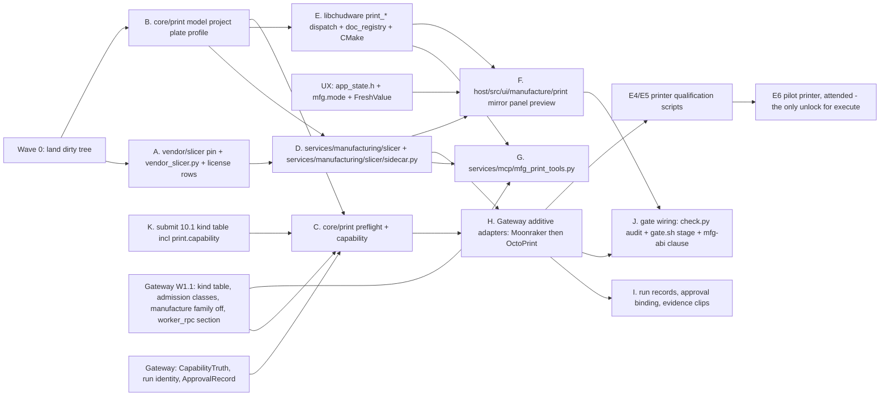

# Additive Manufacturing — Architecture Contract & Execution Plan

**Owner:** AdditiveArchitecture · **Wave:** design-only, 2026-08-08.

Domain names, corrected against the project path/prefix ruling (`GW-PATHS-ROOTS`): wire RPC
`mfg_print_*`, events `mfg.print.*`, MCP family `manufacture`, contract
`contracts/manufacturing_print.md`, doc schemas `chudware.print_*/1`, document extension
`.print+`, C++ namespace `chudware::print`, GUI tree `host/src/ui/manufacture/print/`, service
tree `services/manufacturing/slicer/`, fixtures `fixtures/mfg/print/`. The **one** ratified
exception is the public `libchudware` C ABI, whose sixteen authoring methods keep `print_*`
because DoD 16 forbids an `mfg_*` symbol there (§5, §12, §14.3).

Consumed verbatim, never redefined:
- **Gateway** (`contracts/manufacturing_gateway.md`) — device identity, capability-set type and
  enum strings, run identity, `ApprovalRecord` (incl. `program_artifact_hash`),
  `ControllerSnapshot`/`ControllerEvent` + its additive extension slot, event envelope,
  idempotent command ids, multi-client leases, alarm enum.
- **UX `FreshValue<T>`** — `{v, state, t_mono_ns, seq, age_ms, ttl_ms, src, why, last_ok?}`,
  the single external/UI/event value shape per the project ruling. `v == null` unless
  `state=="ok"`; `last_ok` never gates; a sequence gap flips fields to `unknown`, never to last
  value; `age_ms > ttl_ms` renders stale regardless of `state`. A durable authored row is
  journaled **and** published wrapped, with `state:"ok"` and `ttl_ms:null` for rows that do not
  decay — the envelope is not a telemetry-only shape. **Two-stage gating:** Stage 1 admits under
  exactly two named classes (`GW-ADMIT-CLASSES`) — `probed_evidence`
  (`state=="ok" && src=="probed"`, plus `CapabilityTruth.truth=="verified"` for an execute-side
  subject) and `procedural_fact` (a seq-stamped recorded computation bound to an `art:`/`job:`/
  `res:` subject, never admissible for an execute-side subject). Admission only **ADMITS** a value
  into gate evaluation; failing Stage 1 fails the gate closed, always. Stage 2 (domain, additive) —
  the named guards of §8.2 decide pass/fail and render **by name**. A Stage-1 pass is never a
  verdict, and approvability is never inferred from freshness alone. No second envelope, no
  per-field translation table.
- **Gateway `CapabilityTruth`** (`core/device/capability.h`) — composed verbatim, never
  redefined; truth ∈ `verified|declared|assumed|unsupported|not_applicable`, and `probed` is an
  observation `src`, never a truth value (§10).
- **UX `AppState::mfg.mode`** (Offline-Simulation vs Live Machine).

**Authoring vs device, held absolutely** (execution-plan ruling 3): every additive method —
`mfg_print_*` on the wire, `print_*` in the C ABI — is document/authoring/slice/preflight/
artifact. **No additive method may open a transport, take a lease, upload, or start anything**,
and as of this revision that is asserted structurally by the strengthened `mfg-abi` smoke rather
than inferred from a prefix (`GW-ABI-NO-DEVICE-ENTRY`, §12). `print_run_link` links to a run; it
does not create one. Anything touching a device is an `mfg_run_*` / `mfg_device_*` call into
gatewayd.

**Gateway rules are cited by stable rule id, never by section number.** Gateway's numbering moved
during the review pass and three domains ended up citing rules that had renumbered underneath
them, so every reference below names the rule rather than its location. `test_mfg_contracts.cpp`
keys on the same ids.

| rule id | the rule |
|---|---|
| `GW-ADMIT-CLASSES` | Stage 1 admits under exactly two named classes, `probed_evidence` and `procedural_fact`; each Stage-2 guard declares which it accepts |
| `GW-ADMIT-NO-PROC-EXEC` | a `procedural_fact` can never satisfy an execute-side subject or an approval-bound device guard |
| `GW-PROV-SRC-COMPUTED` | `src`/`admission` are computed by the gateway, never accepted from a caller; `probed` is settable only by transport code inside the daemon holding an open `ITransport` |
| `GW-PROV-VIRTUAL-SIM` | any endpoint the fixture manifest records as virtual, emulated, recorded or loopback forces `src:"simulated"` regardless of transport kind |
| `GW-CORROB-BOUND-INDEP` | a corroborator must be bound to the same subject and config epoch, be independently fresh, and originate from a different source or lane |
| `GW-SEQ-SOLE-STAMP` | `mfg_event_append` is the only way any domain obtains a stamped durable `seq`; a domain that mints its own is a contract-test failure |
| `GW-KIND-REGISTRY` | until a result kind is in the gateway's table, every append of it is refused `mfg_unregistered_result_kind` |
| `GW-KIND-TWO-COLUMNS` | every registered kind declares both an epoch policy and its runtime invalidation triggers |
| `GW-KIND-PROC-FOLLOWS-PARENT` | every `*procedural_fact` kind declares `supersede_with_parent: true`; shipped-artifact kinds declare it false |
| `GW-CAP-TRUTH-TYPE` | `CapabilityTruth` is defined once, in `core/device/capability.h`; a second definition is a contract-test failure |
| `GW-CAP-DURABLE-KIND` | a domain advertising any level above `unsupported` without a registered `<domain>.capability` kind is refused `mfg_capability_requires_durable_kind` |
| `GW-CAP-STAGE-CEILING` | no capability level may exceed the highest emulator/hardware stage actually passed; `execute` requires E6 on a pilot machine |
| `GW-INVAL-GATEWAY-CLOSURE` | `mfg_result_invalidate` computes the transitive closure over `derived_from`; `affected[]` is the gateway's, never the caller's guess |
| `GW-INVAL-ONE-EVENT` | one invalidation event per domain carrying `class` + `reason`; the gateway's own two-name pair is the single ratified exception |
| `GW-SUBJECT-NS` | subjects are namespaced `art:`/`job:`/`res:`/`dev:`, and each guard declares `accepts{subject_ns, admission}` |
| `GW-TIER0-PREREQ` | Tier-0 register rows are always `class:"PREREQ"`, total over action × artifact_kind × machine_class, and rendered at the action entry point |
| `GW-FAMILY-MANUFACTURE` | one shared MCP family id `manufacture` covers the entire overhaul, off by default until commissioning |
| `GW-PATHS-ROOTS` | GUI only under `host/src/ui/manufacture/**`; cross-domain services under `services/manufacturing/**`; domain engines at `core/<domain>/**`; fixtures under `fixtures/mfg/**`; RPC/events `mfg_*`/`mfg.*` |
| `GW-ABI-NO-DEVICE-ENTRY` | the public `libchudware` C ABI carries no `mfg_*` symbol **and** no transport, lease, run, approval or device-command entry point regardless of prefix |

---

## 1. Why additive is a sibling domain, not a CAM enum

This is the load-bearing decision; everything else follows. Grounded in `core/cam/model.h`
(read 2026-08-08, 447 lines) and `services/mcp/cam_tools.py`.

| CAM type | Why an additive value cannot live in it |
|---|---|
| `MachineKind` (`Mill3…Waterjet`) | `Machine` is a subtractive envelope: `rapid_xy`/`rapid_z`/`max_rpm`/`min_rpm`/`tool_change_s`/`has_flood`/`has_through`/`kerf`/`rotary_axis`. An FFF printer has extruders, nozzle diameters, filament diameters, bed/chamber heaters, MMU units, non-rectangular build volumes (delta, belt) and exclusion regions. `MachineKind::FDM` would inherit ~14 meaningless fields and supply none of the ~20 it needs. |
| `ToolType` (24 values) | Every value is a cutter or probe; `Tool` carries `flutes`, `corner_radius`, `flute_length`, `shoulder_length`, `holder_diameter`, `taper_angle`. An extruder shares none of them. Worse, `tool_class(ToolType)` routes into the cutting-data DB for feeds/speeds — a `ToolType::Extruder` would resolve to *some* cutting class and produce a surface-speed-derived RPM for a device with no spindle. |
| `OpType` (30 values) | A CAM operation is per-feature (pocket this region, drill these points) with ~80 subtractive parameters. A print "operation" is a whole-plate slice with per-object overrides and modifier meshes. There is no per-feature additive op to model. |
| `Move` / `Toolpath` | `Move` is `{kind, to, ccw, center, feed, spindle_rpm, dwell_s}`, held by value in `std::vector<Move>`. Extrusion needs E, flow, line width, layer index, per-move temperature and fan. Adding those costs **every** milling toolpath the memory on every job forever — and still would not represent the artifact, because the artifact is opaque G-code from a third-party process, not moves we computed. |
| `Job` / `Setup` | `Setup` binds `Machine` + `Stock` + `WCS` + `model_bodies` + `operations`. A plate binds a build volume + placed instances + three profile bundles. `Stock` and `WCS` have no additive meaning; a plate has no work-offset register. |

**The decisive one — silent enum fallthrough.** `services/mcp/cam_tools.py` carries a 40-line
comment block and two hand-written guards (`_resolve_tool_type`, `_resolve_extract_kind`) that
exist *only* because `core/cam/model.cpp`'s `tool_type_from_string` does
`lookup_rev(kTool, s, ToolType::EndmillFlat)` — an unknown value becomes a flat endmill and the
call reports success. Measured in that file: `"ball"` → `endmill_flat`, `"DRILL"` →
`endmill_flat`. Adding printer values to `kTool`/`kMachine` widens exactly that blast radius: a
printer typo would silently become a 3-axis mill with carbide feeds.

**Consequence for the additive core:** `chudware::print` enum resolvers return
`std::optional<T>` (or throw) and never default, and `print_vocabulary` publishes the live id
set so the MCP layer validates strictly against the engine rather than a stale mirror. The
`cam_tools.py` lesson applied at the source instead of patched downstream.

**Second decisive reason:** slicing is not toolpath generation we own — it is an out-of-process
AGPL program. Routing it through `cam_generate` would make an AGPL binary a hidden dependency
of the CAM kernel and bury an arms-length process boundary inside an enum branch. The boundary
must be visible in the architecture.

---

## 2. File tree

```
core/print/                              # OCCT-free, nlohmann::json, headless-testable (cam pattern)
  model.h  model.cpp                     # atoms, enums (optional-returning resolvers), FreshValue<T> binding
  project.h  project.cpp                 # PrintProject, revision, undo/redo, .print+ persistence
  plate.h  plate.cpp                     # Plate, PlateInstance, arrange, containment
  profile.h  profile.cpp                 # Printer/Material/Process profiles: typed projection + raw_bundle
  artifact.h  artifact.cpp               # PrintArtifact, SliceRequest canonicalization + request_id
  gcode_parse.h  gcode_parse.cpp         # flavor detect, layer index, toolchanges, pauses, unsupported cmds
  preflight.h  preflight.cpp             # deterministic gates, freshness-aware, fail-closed
  capability.h                           # additive capability truth-level projection
  session.h  session.cpp                 # doc-registry session (core/cam/session.h pattern)

services/manufacturing/slicer/           # sidecar orchestration (Python — subprocess + files)
  __init__.py
  sidecar.py                             # spawn, timeout, process-tree kill, cancel, result.json
  argv.py                                # per-pinned-tag argv builder + feature probe (the ONLY version-fragile file)
  plate3mf.py                            # plate -> 3MF (geometry, per-instance transforms, per-object config)
  profiles.py                            # owned profile bundles -> process/filament/printer .ini
  provenance.py                          # SliceProvenance assembly + artifact hashing
  progress.py                            # tolerant stderr progress parse (unknown, never interpolated)
  test_sidecar_contract.py  test_golden_slices.py  test_provenance.py

fixtures/mfg/print/                      # ratified fixtures root; every entry is manifest-marked virtual
  fake_slicer.py                         # argv-contract-honoring fake binary
  fake_moonraker.py  fake_octoprint.py   # printer-lane E4/E5 fixtures (additive spec, Gateway-run)
  goldens/                               # owned golden projects + expected invariants

services/manufacturing/slicer/sidecar.py                   # separate process, one job in flight (services/sim/job_worker.py pattern)

services/mcp/mfg_print_tools.py  test_mfg_print_tools.py

host/src/ui/manufacture/print/
  print_mirror.h  print_mirror.cpp       # typed rows + cached geometry; no ImGui, no renderer (cam_mirror pattern)
  print_panel.h   print_panel.cpp        # Begin/End-free body draws (cam_panel pattern)
  print_preview.h print_preview.cpp      # world-space layer batches for the existing color FBO

vendor/slicer/
  SLICER_VENDOR.lock                     # the pin (§4.3)
  patches/NNNN-<subject>.patch           # patch queue, in-tree and reviewable (hard cap 12)
  profiles/                              # OWNED preset bundles — the first customization seam
  NOTICES/                               # AGPL-3.0 text, MODIFICATIONS.md + SOURCE_OFFER templates

scripts/vendor_slicer.py                 # --pin / --verify / --rebase / --source-bundle (vendor_omp.py pattern)

core/tests/test_print_model.cpp  test_print_preflight.cpp  test_print_kinds.cpp
core/tests/test_print_capability.cpp  test_print_gcode_parse.cpp  test_print_invalidation.cpp

contracts/manufacturing_print.md
```

**The fork repository is out-of-tree.** Slicer source is never vendored into this repo — only
the pin, the patch queue, our profiles and the notices. The source boundary is as visible in
the filesystem as it is in the process table.

### Existing files modified (collision list; serialized by the execution plan)

`core/CMakeLists.txt` (source block ~L278; 6 new ctest targets) · `core/api/libchudware.cpp`
(method table ~L4105, appended after the `cam_*` block) · `core/hostd/doc_registry.cpp` (~L45
read-only method list) · `services/mcp/server.py` (2 lines at ~L361) ·
`host/src/ui/tool_panel_tables.h` **and** `tool_panel_tables.snapshot.json` — **generated;
regenerated via `tools/gen_tool_panel_tables.py`, never hand-edited, pair moves in one commit** ·
`host/src/ui/ribbon_def.cpp` (new "3D Print" group only) · `host/src/ui/widgets/ribbon.cpp`
(tooltips) · `host/src/core/app_state.h`/`.cpp` (one `PrintUiState print;`) ·
`host/src/ui/viewport_panel.cpp` (one draw call site) · `host/src/ui/scenarios.cpp`
(`CHUDWARE_SHOT=print`) · `host/CMakeLists.txt` · `contracts/worker_rpc.md` (append **only** to
the section Gateway allocates to additive in W1.1 — no section number is claimed here) ·
`contracts/README.md` · `contracts/licenses.md` · `contracts/license_debt.md` ·
`scripts/check.py` · `scripts/gate.sh`.

**Not edited by additive, though additive depends on them:** `services/mcp/tool_registry.py`
(Gateway is the single owner for the wave; additive's risk rows land as data that owner appends),
`services/agent/config.py` (Gateway's `manufacture`-family-default edit, a hard predecessor of
additive's MCP wave), and `contracts/manufacturing_gateway.md` (Gateway records additive's
C-ABI naming exception there).

Shared-file collisions, per the execution plan: `app_state.h/.cpp`, `ribbon_def.cpp`,
`viewport_panel.cpp`, `scenarios.cpp` with UX (UX lands `app_state.h` + `mfg.mode` first);
`tool_panel_tables.*` with Twin. `host/src/ui/manufacture/**` is UX's shell — additive owns only
the `print/` subdirectory of it and calls UX's entry points rather than reimplementing them.

**Not touched:** `core/cam/**`, `host/src/ui/cam/**`, `services/mcp/cam_tools.py`,
`services/manufacturing/gateway/**` (Gateway's adapter tree; additive supplies its family spec as
data).

---

## 3. Durable schemas

All persist through `nlohmann::json`, round-trip in tests, cross the libchudware C ABI, and
store in `.print+` — `core/cam/model.h`'s design note applied unchanged. Lengths mm,
temperatures °C, times seconds, mass grams. Every field the GUI paints or an event carries is
wrapped in UX's `FreshValue<T>`. For a **durable authored row** — artifact, slice result,
preflight, run link, capability — the row is journaled through `mfg_event_append` *and* published
wrapped, with `state:"ok"` and `ttl_ms:null`, because such a row does not decay on a wall clock.
Journaled and wrapped, never one or the other: the envelope carries the sequence-gap semantics,
`ttl_ms:null` says it is not a telemetry sample, and `seq` is always the gateway's
(`GW-SEQ-SOLE-STAMP`).

### 3.1 `chudware.print_project/1` — the document

```
PrintProject { id, name, units="mm", revision:int,
               printer:   ProfileRef,
               materials:[ProfileRef],        // index == extruder index
               process:    ProfileRef,
               plates:    [Plate],
               artifacts: [PrintArtifact],    // append-only within the doc
               runs:      [PrintRunLink] }    // append-only join records

ProfileRef  { kind:"printer"|"material"|"process", id, rev:int, bundle_sha256 }
```

`revision` bumps on every edit (the `cam_apply_ops` pattern) and is the invalidation key the
GUI mirror watches.

### 3.2 Plate

```
Plate         { id, name, build_volume: BuildVolume,   // snapshot of the printer profile's volume
                instances:[PlateInstance], sequential_print:bool, arrange_seed:int }

PlateInstance { id, source: SourceRef, transform: Trs,  // translate/rotate/scale, not a bare 4x4
                extruder:int, overrides: json,          // per-object preset overrides, opaque
                modifiers:[{kind:"modifier"|"support_enforcer"|"support_blocker",
                            mesh_sha256, transform}] }

SourceRef     { kind:"doc_body"|"mesh_file", doc_id?, body_id?, path?,
                mesh_sha256, tess_tol_mm }
BuildVolume   { shape:"rect"|"circular"|"polygon", x,y,z, origin_center:bool,
                polygon:[Vec2], exclusions:[{min,max}] }
```

`mesh_sha256` is mandatory, including for `doc_body` sources: the tessellated mesh handed to
the slicer *is* the input, and reproducibility depends on hashing what was actually sent, not
the parametric feature tree that produced it.

### 3.3 Profiles — identity we own, semantics the sidecar owns

```
PrinterProfile { id, name, vendor, model, rev, bundle_sha256, inherits?,
                 build_volume: BuildVolume,
                 extruders:[{index, nozzle_mm, filament_mm, max_temp_c, offset:Vec3}],
                 bed:{heated, max_temp_c}, chamber:{heated, max_temp_c},
                 gcode_flavor:"marlin"|"marlin2"|"klipper"|"reprap"|"smoothie"|"repetier",
                 supports_arcs, supports_bgcode, firmware_retraction,
                 kinematics:"cartesian"|"corexy"|"delta"|"belt",
                 raw_bundle: json }                       // opaque, never interpreted

MaterialProfile { id, name, rev, bundle_sha256, inherits?, extruder_hint?,
                  typed:{nozzle_temp_c, first_layer_nozzle_temp_c, bed_temp_c,
                         first_layer_bed_temp_c, fan_pct, retract_mm, density_g_cm3,
                         diameter_mm, max_volumetric_mm3_s},
                  raw_bundle: json }

ProcessProfile { id, name, rev, bundle_sha256, inherits?,
                 typed:{layer_height_mm, first_layer_height_mm, wall_count, infill_pct,
                        infill_pattern, supports:"none"|"everywhere"|"buildplate",
                        brim_mm, raft_layers, seam_position},
                 raw_bundle: json }
```

**Discipline: we do not re-model the slicer's preset key space (~1200 keys).** We own identity,
revision, hash, inheritance and a *small typed projection* of the keys we ourselves read
(preflight limits, UI, estimates). Everything else is `raw_bundle`, passed through untouched.
This is what keeps the upstream-rebase cost bounded: an upstream key rename cannot break a
schema that never mentioned it.

### 3.4 `chudware.slice_request/1` — content-addressed

```
SliceRequest { request_id,                 // sha256 of the canonical JSON of everything below
               project_id, project_rev, plate_id,
               sidecar_build_id,
               profiles:[ProfileRef],
               instances:[{id, mesh_sha256, transform, extruder, overrides,
                           modifiers:[{kind, mesh_sha256, transform}]}],
               overrides:{k:v},
               output:{format:"gcode"|"bgcode"|"3mf", thumbnails:[{w,h}]},
               determinism:{strip_timestamps:true, seed?} }
```

Canonicalization is normative and unit-tested: keys sorted, floats in a fixed 17-significant-digit
round-trip form, instances sorted by `id`. `request_id` **must** be stable under key reordering
and **must** change under any semantic change. It is the cache key, the working-directory name,
the preview-geometry key, and half of the audit trail.

### 3.5 Result, artifact, provenance

```
SliceResult { request_id, status:"ok"|"failed"|"cancelled",
              artifact?: PrintArtifact,
              diagnostics:[{severity:"info"|"warn"|"error", code, message, instance_id?}],
              duration_ms, exit_code, stderr_tail, seq }        // seq: establishing sequence

PrintArtifact { artifact_id,               // == sha256 of the artifact FILE BYTES
                path, format, bytes, produced_at, request_id,
                provenance: SliceProvenance,   // REQUIRED, never optional
                stats: PrintStats, gcode: GcodeMeta,
                seq, superseded_by? }      // seq: establishing sequence (Gateway-stamped)

SliceProvenance { sidecar:{ name:"prusaslicer", upstream_tag, upstream_commit_sha,
                            patch_queue_sha, build_id, binary_sha256,
                            license:"AGPL-3.0-or-later",
                            corresponding_source_url, corresponding_source_sha256 },
                  pin_status:"pinned"|"unpinned",
                  profiles:[ProfileRef], inputs:[{instance_id, mesh_sha256}],
                  request_id, host:{os, arch}, started_at, finished_at }

PrintStats { estimated_time_s, filament_mm:[], filament_g:[], layer_count, max_z_mm,
             first_layer_height_mm, bbox:{min,max}, per_extruder_temp_c:[],
             field_source:{<field>:"slicer_comment"|"parsed"|"unknown"} }

GcodeMeta  { flavor_detected, layer_z:[], layer_byte_offset:[],
             toolchanges:[{layer, from, to}], pauses:[{layer, code}],
             unsupported:[{line, word}], parse_status:"ok"|"partial"|"unknown" }
```

**`artifact_id` is the sha256 of the file bytes** — never a path, a name, or the request id. It
is Gateway's `program_artifact_hash` (independently named the same thing), the executable
identity an approval binds, and the value verified after upload wherever the device supports a
checksum. **The bytes must be final and immutable before an approval request may reference
them**: a slice writes to `out/<request_id>.<ext>.part`, is hashed, then atomically renamed;
nothing may append to or rewrite an artifact after its `artifact_id` exists.

`SliceProvenance` is **required, not optional** — it is what makes the hash meaningful, and
without it a reproducibility claim is unfalsifiable. `PrintStats.field_source` exists because
the slicer's own summary comments and our own parse disagree in the field; a number whose
origin we cannot name is `unknown`, not a guess.

### 3.6 Run link — thin, because Gateway owns runs

```
PrintRunLink { run_id,                     // GATEWAY's run identity; we mint nothing
               artifact_id, request_id, project_id, project_rev, plate_id,
               approval_id, device_id, created_at }
```

Plus an immutable on-disk record, `<app_data>/print/runs/<run_id>.jsonl`, following
`chudware.subagent.raw/1` exactly (the section `contracts/worker_rpc.md` already devotes to it):
line 1 is a `chudware.print_run/1` header carrying every bound identity, and every later line is
one record with a monotonically increasing **`record_index`**. Never rewritten, truncated,
summarized or pruned.

**`record_index` is not a `seq`.** It is a file-local ordinal with no cross-domain meaning, used
only to detect a truncated or reordered file. Additive mints no durable sequence: every record a
UI may paint additionally carries the `seq` returned by `mfg_event_append` against the row's
registered kind (§10.1), because that append is the only way any domain obtains a stamped `seq`
(`GW-SEQ-SOLE-STAMP`). Additive's earlier "monotonically increasing `seq`" spelling created a
second `seq` namespace over the same run — precisely the ordering ambiguity DoD 9's
`seq <= at_seq` scoping depends on not existing. Offered to Gateway; if Gateway prefers to own the
file, additive emits the join record into Gateway's and keeps none.

### 3.7 Media — discovery only, never pixels

```
MediaSourceRef { media_id, device_id, kind:"mjpeg"|"snapshot"|"rtsp"|"webrtc"|"none",
                 stream_url, snapshot_url, rotation,
                 discovered_from:"moonraker_webcams"|"octoprint_settings"|"prusalink_probe"|"manual",
                 credentials_ref, transport_secure:bool, verified_at }
```

`EvidenceClip` is **PerceptronArchitecture's record, not additive's** — the ring buffer, retention
decision and truncation truth live in one slice, so splitting it would fork the source of
truth. Additive owns only the identity fields it carries verbatim —
`{clip_id, run_id, device_id, trigger_event_id, t_start, t_end, sha256, retention_class}` —
content-addressed, immutable and run-bound, with corrections emitting a new record carrying
`supersedes`. Perception adds `{truncated, media_id, transport_secure, synthetic, bytes, codec}`.

Camera bytes never enter an additive schema. Frames are Perception/UX territory; Perception
consumes `MediaSourceRef` as its sole frame source and never re-derives discovery.

---

## 4. The sidecar

### 4.1 Boundary — what crosses it

**Files in, G-code out. Nothing else, ever.**

1. Never link `libslic3r`. Never `dlopen` it. The only linkage is process spawn plus files.
2. Inputs are one 3MF plus three `.ini` bundles on disk; outputs are one artifact file, PNG
   thumbnails and text logs. No shared memory, no socket protocol, no structure mirroring
   engine internals. (FSF guidance is explicit that *semantics* matter as much as mechanism: an
   intimate RPC mirroring internals argues for a combined work; coarse files and argv argue for
   separate works.)
3. The binary is **replaceable** — `CHUDWARE_SLICER_BIN` or a settings path overrides it, and
   pointing it at a stock upstream PrusaSlicer of the pinned version must still work. Only
   fork-only features degrade, and they degrade by name.
4. Zero copied slicer source anywhere in this repo. Gate-enforced (§7 / §12).

Transforms and per-object overrides are baked into the **3MF**, not argv — argv is the
version-fragile surface, 3MF is a stable format the fork already round-trips. This confines
upstream CLI churn to one file, `services/manufacturing/slicer/argv.py`.

### 4.2 Working-directory contract

Per request, `<app_data>/print/slice/<request_id>/`:

```
request.json                 # chudware.slice_request/1 — the canonical bytes that produced request_id
plate.3mf                    # geometry + instance transforms + per-object config
process.ini filament.ini printer.ini
cmd.txt                      # the exact argv, verbatim, for audit
out/<request_id>.gcode|.bgcode        # written as .part, hashed, then atomically renamed
out/thumbnails/*.png
stdout.log  stderr.log
result.json                  # chudware.slice_result/1 — written by OUR wrapper, never the slicer
```

The directory *is* the audit record: given `request_id` alone, anyone can reproduce the exact
invocation. `cmd.txt` exists because "we think we passed these flags" is not evidence.

Wrapper responsibilities (`services/manufacturing/slicer/sidecar.py`): spawn with a timeout; kill the whole
**process tree** on timeout or cancel, never just the parent; stream tolerant progress; hash the
output; write `result.json`. A non-zero exit is `status:"failed"` with `stderr_tail` — never a
fabricated success. A progress line we cannot parse is `state:"unknown"` with a `why` — never an
interpolated percentage.

### 4.3 Pin, patches, update mechanics

`vendor/slicer/SLICER_VENDOR.lock` (shape mirrors `OMP_VENDOR.lock`):

```json
{ "upstream": "https://github.com/prusa3d/PrusaSlicer.git",
  "tag": "version_2.9.6", "commit_sha": "...",
  "fork_url": "...", "fork_commit_sha": "...",
  "patch_queue": [{"file":"patches/0001-….patch","sha256":"…","subject":"…","added":"…"}],
  "patch_queue_sha": "…", "build_id": "…",
  "license": "AGPL-3.0-or-later",
  "artifacts": { "linux-x86_64":  {"binary_sha256":"…","size":…,
                                   "corresponding_source_url":"…","corresponding_source_sha256":"…"},
                 "windows-x86_64":{ … } } }
```

Upstream baseline at design time: **PrusaSlicer 2.9.6, released 2026-06-25**
(`AGPL-3.0-or-later` per the source notice; GitHub reports the legacy `AGPL-3.0` identifier).

`scripts/vendor_slicer.py`, mirroring `scripts/vendor_omp.py` including its
non-zero-exit-on-drift contract:

- `--pin --tag <t>` — record upstream tag/commit, rebuild the lock.
- `--verify` — every patch hash matches, every lock field non-empty. CI / pre-build gate.
- `--rebase --tag <t>` — replay the patch queue onto a new tag, report conflicts per patch, run
  the golden slices, and only then update the lock.
- `--source-bundle` — produce the release artifacts of §4.5.

**Customization order is a hard rule, enforced in review:** owned profiles → custom G-code
macros → post-processing script → *only then* an engine patch. Patch budget is a **hard cap of
12**, gate-enforced; exceeding it is a design failure to be resolved by moving the change into a
profile or upstreaming it. One topic commit per patch, with an owner; no formatting or vendor
sweeps; generally useful fixes are upstreamed so the patch can be dropped.

**Feature probing and degradation.** `services/manufacturing/slicer/argv.py` probes the binary (`--help` +
version) keyed by `binary_sha256`, caching `{structured_manifest, bgcode, arcs,
per_object_config, …}`. Any fork-only addition (e.g. a `--chudware-manifest <path>` flag
emitting structured slice stats) **must** have a documented fallback — here, parsing the G-code
trailer — so a stock binary still works.

**Pin mismatch fails closed, visibly.** `mfg_print_sidecar_status` reports `{present, path,
binary_sha256, reported_version, pinned_tag, matches_pin, features, license,
corresponding_source_url}`. Slicing with an unpinned binary requires an explicit
`allow_unpinned:true`; the artifact provenance is stamped `pin_status:"unpinned"`, rendered
amber-neutral (provenance, not fault) as *"Sliced with an unpinned slicer build — approval
cannot be reused. This run needs fresh approval."*, and it forces fresh human approval. Never
silent.

**Code and profile updates are separate streams.** Upstream ships printer profiles through its
own configuration wizard on a different cadence from code; ours are owned files under
`vendor/slicer/profiles/` with their own `rev` and `bundle_sha256`.

### 4.4 Why PrusaSlicer, and what was rejected

Per the slicer-strategy research (checked 2026-08-08): `libslic3r` has no independent release train,
no stable ABI and no compatibility policy — consuming it means pinning the whole application
source. CuraEngine is architecturally the cleanest headless engine (console CLI, `slice` verb,
Conan packaging, alpha `0.1.0-alpha` gRPC plugin slots) but is **also AGPL**, so it buys no
licensing relief, and its settings/profile contract is not Prusa's — reaching Prusa workflow
parity over CuraEngine is a product rewrite, not an embedding task. OrcaSlicer (2.4.2) and Bambu
Studio (2.7.1.62) are very-high-churn deep forks carrying additional GPL-3.0 components and an
optional non-free networking plugin. In-process linking of any of them makes a combined-work
conclusion substantially more likely.

### 4.5 Licensing release artifacts — a checkable artifact, not a prose promise

Produced by `scripts/vendor_slicer.py --source-bundle` for **every distributed build**, and
verified by `scripts/check.py`:

1. `chudware-slicer-<tag>+<patch_queue_sha>-src.tar.zst` — complete corresponding source:
   upstream tree at `commit_sha`, patch queue applied, all build scripts, dependency sources and
   lockfiles. Archived and retained for at least the required availability period.
2. `SOURCE_OFFER.txt` — written offer (≥3 years) with URL and sha256.
3. `MODIFICATIONS.md` — per-patch subject, author and date (AGPL §5(a) modification notices).
4. `THIRD_PARTY_NOTICES.txt` — including the full AGPL-3.0 text.
5. In-product: Help → About → "Slicer source" opens `corresponding_source_url`, **and**
   `mfg_print_sidecar_status` returns it so any network or API surface can expose it — the §13 posture
   should a modified slicer ever be reachable remotely. A visible link, not a buried legal page.
6. `contracts/licenses.md` — a dependency row: *PrusaSlicer fork · AGPL-3.0-or-later · FFF
   slicing · **subprocess-only, never linked or bundled into libchudware**, replaceable binary,
   corresponding source archived per build* — matching the ngspice / LibreDWG / OpenFOAM
   isolation posture already recorded there.
7. `contracts/license_debt.md` — open items for (a) the AGPL fork and its corresponding-source
   obligation, to be met before any distribution of the sidecar, and (b) the §13
   network-source obligation should the modified slicer ever be exposed as a service.

*Not legal advice; process separation is not a guaranteed copyleft firewall. Counsel review is a
named prerequisite before distributing any build that bundles the slicer sidecar, recorded in the debt register rather than
assumed away.*

---

## 5. RPC surface

Two families, split on the axis the repo already uses: cheap synchronous document state in C++,
crash-isolating subprocess work in a dedicated Python worker (`contracts/worker_rpc.md` §3's
stated rationale for the sim worker — "it never touches live document state, so a crash cannot
corrupt a session").

**Prefix ruling applied, and the single exception recorded.** `GW-PATHS-ROOTS` puts RPC and
events at `mfg_*`/`mfg.*`, so the additive **wire** surface is `mfg_print_*` / `mfg.print.*` —
MCP tools and slice-worker methods both take the prefix, and the bare `print_*` RPC prefix this
document previously used is withdrawn. The **public `libchudware` C ABI keeps `print_*`**, and
that is a ratified exception rather than residual drift: DoD 16 forbids any `mfg_*` symbol in the
public C ABI, so renaming those sixteen methods would create precisely the violation the naming
ruling exists to protect. The exception — and the authoring-only ABI placement it encodes — is
written into `contracts/manufacturing_gateway.md`, where the naming ruling lives, rather than
being left as a local habit. The safety property that the old prefix was silently standing in for
is now mechanized prefix-independently by the strengthened `mfg-abi` smoke (§12):
**no `libchudware` entry point may open a transport, take a lease, upload, run, approve or command
a device, whatever it is called** (`GW-ABI-NO-DEVICE-ENTRY`).

### 5.1 C++ core — `core/api/libchudware.cpp`, appended after the `cam_*` block

Sixteen methods, all authoring/preflight/artifact, all spelled `print_*` for the DoD-16 reason
above. **None opens a transport, takes a lease, uploads, or starts** — and as of this revision
that is asserted structurally by `mfg-abi`, not inferred from the name.

| method | params → result |
|---|---|
| `print_new` | `{name?, printer_profile?}` → `{doc_id, revision, tree}` |
| `print_apply_ops` | `{doc_id, base_revision, ops:[…]}` → `{revision, tree}` (undoable batch, cam pattern) |
| `print_undo` / `print_redo` | `{doc_id}` → `{revision, tree}` |
| `print_tree` | `{doc_id}` → `{revision, tree}` — project/plates/instances/profiles/artifacts/runs |
| `print_describe` | `{doc_id}` → dense counts (read-only) |
| `print_close` | `{doc_id}` → `{closed}` |
| `print_plate_arrange` | `{doc_id, plate_id, seed?}` → `{revision, tree}` — deterministic |
| `print_plate_validate` | `{doc_id, plate_id}` → `{issues:[{code, severity, instance_id?, detail}]}` |
| `print_profile_list` / `print_profile_get` | `{kind?}` / `{kind, id, rev?}` |
| `print_preflight` | `{doc_id, plate_id, artifact_id, device_snapshot}` → `PrintPreflight` (pure function of a snapshot handed in; opens nothing) |
| `print_artifact_list` / `print_artifact_get` | `{doc_id}` / `{doc_id, artifact_id}` |
| `print_run_link` | `{doc_id, run_id, artifact_id, approval_id, device_id}` → the immutable join record (links, never starts) |
| `print_vocabulary` | `{}` → every enum id set (the strict-validation source for MCP) |

`core/hostd/doc_registry.cpp`'s read-only method list gains `print_describe`, `print_tree`,
`print_artifact_list`.

### 5.2 Slice worker — `services/manufacturing/slicer/sidecar.py`

Separate process, spawned on demand, one job in flight, `job_id` correlates events, structured
error envelope — verbatim the §3 sim-worker shape. Methods carry the wire prefix, because a
worker method is not a `libchudware` exported symbol and DoD 16 does not reach it.

| method | params → result |
|---|---|
| `mfg_print_sidecar_status` | `{}` → `{present, path, binary_sha256, reported_version, pinned_tag, matches_pin, features, license, corresponding_source_url}` |
| `mfg_print_slice` | `{request: SliceRequest, allow_unpinned?}` → streams `mfg.print.slice_progress` → `SliceResult` |
| `mfg_print_slice_cancel` | `{job_id}` → `{cancelled}` — kills the process tree |
| `mfg_print_gcode_parse` | `{path}` → `GcodeMeta` |
| `mfg_print_gcode_preview` | `{path, layer_from, layer_to}` → layer polyline batches |

**A contract section, not a section number.** Additive appends to whichever
`contracts/worker_rpc.md` section Gateway allocates to it when it publishes the per-domain
allocation in W1.1. This document claims no number, because two documents previously claimed §7
for different content and a numbering collision is not something a domain can resolve locally.

### 5.3 MCP — `services/mcp/mfg_print_tools.py`, family `manufacture`

`mfg_print_new_project` · `mfg_print_add_plate` · `mfg_print_place_body` ·
`mfg_print_arrange_plate` · `mfg_print_set_profile` · `mfg_print_slice` ·
`mfg_print_artifact_info` · `mfg_print_gcode_stats` · `mfg_print_preflight` ·
`mfg_print_run_status` (read-only view of a linked run record).

**Family: `manufacture`, and only that one** (`GW-FAMILY-MANUFACTURE`). Every tool above registers
through `view(mcp, "manufacture")` — the one shared family id covering the entire Manufacture
surface, so Settings → AI → Tools carries a single honest toggle rather than one per domain that
drift apart. Additive previously named **no** family at all, and an unlisted family defaults
**on**, so this surface would have shipped enabled. Per-tool granularity is preserved exactly as
every other domain preserves it — through the existing `get_tool_options` per-tool toggles, never
through a second family.

Two mechanisms this slice depends on but does not own: the family default itself
(`DEFAULT_TOOL_FAMILIES` plus `DEFAULT_OFF_TOOL_FAMILIES` in `services/agent/config.py`) is
Gateway-owned W1.1 work and a **hard predecessor** of additive's MCP wave — additive never edits
that file; and additive's risk-class rows land as data appended by Gateway, the single owner of
`services/mcp/tool_registry.py` for the wave.

**There is no `mfg_print_start`, no `mfg_print_stage_artifact`, and no device-touching tool in the
additive namespace at all.** Staging an artifact and starting a run are gateway `mfg_run_*` /
`mfg_device_*` calls, not authoring calls — upload and start are device commands that must be
separately authorized. `services/mcp/test_mfg_print_tools.py` asserts the absence by enumerating
the registered surface, so the boundary cannot rot.

This is a namespace boundary, **not** an advisor-only posture. Approved-job autonomy is a real
supported path: once a human has approved an immutable job, the agent MAY start it by calling
the gateway with that approval's **active single-use nonce**, and the deterministic arbiter then
revalidates the full binding, starts, burns the nonce (`max_starts=1`) and logs it. The agent may
also request hold or abort. What it can never do is start without a per-job human approval, mint
or extend an approval, reuse a burned nonce, resume after an alarm/disconnect/reset, or jog,
home, zero, override, unlock, bypass an interlock or issue any safety command. The `manufacture`
family stays disabled until explicit machine commissioning.

So the invariant is not "the model cannot act" but "the model cannot *authorize*": the agent
proposes and may execute an already-authorized immutable job, while deterministic code and
hardware own every authorization and state transition. Expressing that as an absent tool in the
authoring namespace plus a nonce-gated gateway call is stronger than a guard inside an
`mfg_print_start` that could be bypassed.

Every enum-valued parameter validates strictly against `print_vocabulary` unioned with a
mirrored table (the `cam_tools.py` `_tool_type_vocabulary` pattern), rejecting unknowns with a
message naming the accepted set. No aliasing to a "near" value.

---

## 6. Execution: Moonraker, then OctoPrint

**Gateway owns the adapter code and the one-command-owner arbiter.** This section is the
additive family spec Gateway implements, plus the vendor→normalized mapping tables, which are
additive's to supply as data.

### 6.1 Family rules

- **`stage` and `start` are two separately authorized commands, always.** Never Moonraker's or
  OctoPrint's print-on-upload flag; never PrusaLink's `Print-After-Upload`. Combined upload+start
  is duplicate-start-prone and cannot be bound to an approval (Gateway has rejected it
  independently). Approval sits between staging and starting, and it binds an artifact already
  on the device with a verified hash.
- Remote name is `chudware-<artifact_id[:16]>.gcode` — content-addressed staging, so re-staging
  is idempotent and a name collision is a hash collision.
- `start`/`pause`/`resume`/`cancel` are **commands, not state transitions**. Persist the command
  id, issue once, confirm by observed state. **Never blind-retry `start` or `cancel` after a
  timeout** — reconcile via `snapshot()`; if state is ambiguous, emit `unknown` and fail closed.
- `snapshot()` is always authoritative; `subscribe()` is an optimization. Reconcile periodically
  and after every reconnect.
- Vendor raw state and error payloads are retained alongside normalized fields.
- Emergency stop is a **distinct capability**, never bundled with cancel, and even where present
  (Klipper `emergency_stop`, Marlin M112) it is *not* a substitute for a physical E-stop or
  interlock. `safety_integration` is not claimed for any additive device.

### 6.2 Moonraker (first) — Klipper v0.13.0 + Moonraker @ `d5ee171`, GPL-3.0

Multipart upload with optional SHA-256 verification, print-after-upload **off**. Control via
REST or JSON-RPC `printer.print.{start,pause,resume,cancel}`. Telemetry via
`printer.objects.subscribe` over WebSocket: `print_stats`, `virtual_sdcard`, `extruder*`,
`heater_bed`, `toolhead`, `fan`, and filament switch/motion sensors **when configured** (absent ⇒
`state:"unsupported"`, not `false`). Webcam URLs come from the webcams endpoint — URLs only;
Moonraker is not a media transport. Native Apprise notifications exist, but product
notifications are driven from our durable normalized event log, not from the printer.

### 6.3 OctoPrint (second) — 1.11.8, AGPL-3.0

`POST /api/files/local` multipart with `select` and `print` both false; `POST /api/job` for
start / cancel / restart / pause(resume). `GET /api/printer` and `/api/job` are the
reconciliation authority. The SockJS push channel (`current`, `history`, `event`) carries an
explicit upstream "this interface may change" warning, so it is isolated behind the adapter and
is never authoritative. `FilamentChange` is inferred from M600/M701/M702 sent *through*
OctoPrint and is **not** emitted for printer-SD prints ⇒ OctoPrint's runout capability is
partial and must be reported as such.

### 6.4 PrusaLink (third, capability-probed) and Marlin (deferred)

There is no single PrusaLink: Python PrusaLink 0.8.2 (`Freeware` package metadata) for older i3;
embedded Link in Buddy firmware v6.6.3 (GPL-3.0) for MINI/MK3.5/MK3.9/MK4/XL/CORE; SLA
separately. The only public spec is `1.0.0-draft` (AGPL-3.0), declaring Digest auth, while Buddy
v6.6.3 source also accepts `X-Api-Key`. Polling only — no documented push. Camera routes exist
in the draft but not in Buddy v6.6.3's v1 route selector; Buddy3D is separate, **unencrypted**
LAN RTSP. Therefore: probe `/api/version`, auth schemes, routes and response shapes — never
branch on a product name — and support only an explicitly lab-certified model/firmware matrix.
Prusa Connect is cloud and is **not** a local adapter; its public SDK is printer→cloud, not a
consumer API. Direct Marlin serial is deferred (§13).

Every adapter is an independent clean protocol client written from public documentation. Nothing
GPL/AGPL/`Freeware` is copied, bundled, linked or modified into the product tree.

### 6.5 Alarm mapping (additive supplies the table; Gateway owns the enum)

| Source | Raw | → Gateway alarm class |
|---|---|---|
| Klipper | `shutdown` | firmware fault — fresh approval required to resume |
| Klipper | `print_stats.state == "error"` + `message` | job fault |
| Moonraker | Klippy disconnected / not ready | controller offline |
| any | transport unreachable | transport offline |
| OctoPrint | `Error` / `Offline` / `PrintFailed` | firmware fault / controller offline / job fault |
| OctoPrint | `FilamentChange` (host-sent M600 only) | material attention (partial coverage) |
| Klipper | filament sensor triggered | material attention |
| PrusaLink | `ERROR` / `ATTENTION` | job fault / material attention |

Five states stay distinct because they need different UX and different retry policy: transport
offline, controller/host offline, firmware error, material attention/runout, and visual quality
anomaly (advisory, Perception's).

---

## 7. Webcam / telemetry separation

- The printer adapter **never carries pixels**. Discovery yields `MediaSourceRef` (URLs and
  metadata); media is fetched on a separate path with its own rate limit and budget. OctoPrint's
  own setup documentation warns that webcam bandwidth on an underpowered host degrades print
  quality — sharing the control lane is a print-quality bug, not just a design smell.
- Media never gates a state transition. Camera-derived anything is `monitor` at most, never
  `safety_integration`, and carries `src:"advisory"` — which UX's Stage-1 admission predicate
  (`state=="ok" && src=="probed"`) already bars from every preflight gate and approval binding.
  It cannot even reach a Stage-2 guard.
- Retention: short rolling buffer plus event-centric evidence clips, not continuous recording.
  Clips are immutable, content-addressed and run-bound, and the record is Perception's
  (`EvidenceClip`, §3.7); Perception's pull worker holds an independent rate/bytes budget and
  backpressures to snapshot polling rather than ever competing with the control lane.
- `transport_secure:false` (e.g. Buddy3D RTSP) is surfaced, not hidden.
- Vision-based failure detection is Perception's, not additive's (§13).

---

## 8. Monitoring, approval, and the run record

### 8.1 Telemetry

`AdditiveSnapshotExt` — the payload for Gateway's named extension slot on `ControllerSnapshot` —
carries per-extruder nozzle temp+target, bed and chamber temp+target, active extruder, filament
used mm/g, layer index and count, fan/flow/speed factors, job progress and remaining-time
estimate. **Every field is a `FreshValue<T>`.** Missing or stale ⇒ `unknown` with a `why`; a
sequence gap flips affected fields to `unknown`, never to last value; `last_ok` renders demoted
and gates nothing. We extend Gateway's snapshot; we never mint a parallel one.

Slice progress (`mfg.print.slice_progress`) is **best-effort and declared so in the contract** —
a tolerant parse of the sidecar's stderr, rendered as a progress readout only, never in an
evidence row and never in a gate; a failed parse renders `unknown` with a `why`, never an
interpolated number or a stuck bar. The evidence-grade fact is `mfg.print.artifact_ready`,
carrying `{artifact_id = sha256(bytes), request_id, provenance}` on the authoritative lane with
full sequence/gap semantics. **Only that hash-bearing fact may enter an approval binding.**

### 8.2 Preflight — deterministic, outside the model

```
PrintPreflight { admitted:[{field, stage1:"admitted"|"rejected",
                            admission:"probed_evidence"|"procedural_fact"|null,
                            state, src, why}],
                 guards:[{guard, status:"pass"|"fail"|"not_applicable",
                          admission, detail, waiver?:{by, reason, at_seq}}],
                 rejected_stage: 1|2|null, approvable:bool,
                 bound_to:{artifact_id, project_rev, profile_revs, identity_fingerprint,
                           config_epoch},
                 seq }                 // Gateway-stamped at durable append; never minted here
```

`status` is exactly `pass | fail | not_applicable`. **A waiver does not become a status** — a
waived guard still reads `fail`, with `waiver:{by, reason, at_seq}` recorded beside it, so the
durable log shows "failed, waived by X for reason Y at seq N" rather than a status that conceals
what was waived. That is what makes the unsatisfiable-gate pattern (waived every single run until
waivers are boilerplate) *visible* after the fact to anyone reading the log, instead of invisible.

**What actually gates is a gateway-recorded procedural fact.** The additive core computes the
report, but the gating object is "preflight report bound to `artifact_id` A and revisions R,
recorded at `seq` N" — appended durably by Gateway under the `print.preflight` kind (§10.1) and
admitted as **`admission:"procedural_fact"`** (`GW-ADMIT-CLASSES`), bound to the artifact hash.
It is **not** `src:"probed"`. `probed` is settable only by transport code inside the daemon
holding an open `ITransport` (`GW-PROV-SRC-COMPUTED`), and an arbiter computation over artifact
bytes and a declared profile has no transport; the earlier additive claim of `src:"probed"` for
this row is withdrawn. A report that was never recorded gates nothing, and a recomputation
against an edited project is a different report with a different binding. No simulated or
estimated conclusion is ever the gating object — and `procedural_fact` admission can never
satisfy an execute-side subject (`GW-ADMIT-NO-PROC-EXEC`), so the printer's `execute` capability
stays a Tier-0 prerequisite below rather than something a recorded computation could supply.

**Tier 0 — construction refusal, BEFORE any preflight table exists.** Rows below register through
`tier0::registerRows("print", …)` and are always `class:"PREREQ"`, total over
action × artifact_kind × machine_class, and rendered at the action entry point
(`GW-TIER0-PREREQ`). `not_applicable` applies **only** to a *corroborating* check whose sensor is
absent — **never** to a capability the action itself requires. Without that line, the
`unsupported` route lets an impossible action be approved on the grounds that checking it was not
applicable, which is worse than skipping a check: it authorizes the arbiter to attempt something
the device cannot accept.

So a missing **prerequisite** capability means the proposal **cannot be constructed**. It is
refused at construction with the missing capability named, and nothing reaches a preflight table:

| prerequisite | absence means |
|---|---|
| device `execute` capability | no print-run request can be constructed for that device — a monitor-only printer is not a candidate, refused by name, never a preflight row |
| output format support (`supports_bgcode` for a `bgcode` request; the printer's `gcode_flavor` for the requested flavor) | no `SliceRequest` can be constructed for that pairing. `flavor_match` remains as a Stage-2 guard for defence in depth against an artifact produced elsewhere, but it is not how this case is meant to be caught |
| device `transport` capability | the artifact cannot be staged, so no run request exists to approve |

**Tier 0 must be INEXPRESSIBLE, not INVISIBLE.** A failed gate explains itself — row, named
guard, reason. A Tier 0 refusal produces **no row**, because the point is that the object never
exists, so the operator sees only an absence: no button, no queue entry, nothing to hover. Absence
does not explain itself, and the reasonable conclusion is that the software is broken or a step was
missed — the disabled-without-reason anti-pattern we banned everywhere else (`assumed` must disable
*and name* the missing level), reintroduced by an otherwise-correct architectural layer. It is also
the one failure class where the operator cannot even ask the right question, so they retry, restart
or route around — and routing around is precisely how a prerequisite gets pressured into becoming a
guard later, which is the mechanism by which this whole structure erodes.

So every Tier 0 entry above is **rendered at the action entry point with the missing prerequisite
named** — not as a preflight row, since the refusal correctly never reaches preflight, but as a
visible named explanation where the operator tried to act. The register above IS that list; each
entry has a sentence:

| refusal | rendered at the entry point as |
|---|---|
| device `execute` absent | "Cannot create a run for this device: `execute` capability is absent (monitor-only). This device is not a run candidate." |
| device `transport` absent | "Cannot stage this artifact: `transport` capability is absent. Nothing can be sent to this device." |
| output format unsupported | "Cannot slice to bgcode for this printer: its firmware does not support binary G-code. Choose G-code output or a different printer." |
| `pause_handling_supported` absent | "This artifact commands a filament-change pause that this printer cannot honour. It cannot be run here." |
| `multi_extruder_supported` absent | "This artifact commands a tool change and this printer has one extruder. It cannot be run here." |

And the closing rule for this whole section: **a guard that happens to catch a prerequisite
violation is not a substitute for refusing to construct it.** One that catches the right case for
the wrong reason is more dangerous than a missing guard, because it produces evidence that the
design works.

**Prerequisite-vs-corroborating is NOT a static property of a guard — it depends on the
ARTIFACT.** Two additive prerequisites exist only for artifacts that need them, and for artifacts
that do not they are not a `not_applicable` row either: they are simply not in the required set
(*not-required-for-this-artifact*, which is the artifact-scoped form of
not-required-for-this-class). Both are decided from `GcodeMeta`, which we already parse:

| artifact-dependent prerequisite | when it applies | absence means |
|---|---|---|
| `pause_handling_supported` | `GcodeMeta.pauses` is non-empty (the artifact commands M600 / filament-change stops) | the artifact is unrunnable on that device — refuse at construction, naming the capability. When `pauses` is empty there is no row at all |
| `multi_extruder_supported` | `GcodeMeta.toolchanges` is non-empty | same. A single-extruder artifact produces no row |

This is the same shape as a toolchange-strategy prerequisite on the subtractive side: an artifact
that commands a change the device cannot perform is not a gate question, it is an object that
should never have been constructed. `extruder_count_check_performed` remains as defence in depth
against an artifact produced elsewhere, but it is explicitly not how this case is meant to be
caught — a guard that happens to catch a prerequisite violation is not a substitute for refusing
to construct it.

**`not_applicable` is a property of a downgradable SUB-CONDITION, never of a whole gate.** "This
gate may be not_applicable" is precisely the flattening the next person performs, so every compound
check names both halves explicitly. Additive has **zero** whole conditions eligible for
`not_applicable` and **three** downgradable sub-conditions:

| compound check | non-downgradable part (pass/fail only) | downgradable SUB-CONDITION (`not_applicable`, rendered by name) |
|---|---|---|
| `artifact_staged` | the file is present on the device under its content-addressed name | the checksum verification, on a device with no checksum support |
| `build_plate_confirmed` | a plate is confirmed, by sensor **or** human attestation | *which* witness corroborates it — a device with no plate sensor uses attestation, never `not_applicable` |
| `filament_available` | that the artifact's E-axis requirement was parsed at all (missing ⇒ `fail`) | the comparison **against device-reported remaining**, on a device with no filament sensor |

**Audit of every `not_applicable` sub-condition, classified `prerequisite | corroborating` and
whether that classification is ARTIFACT-DEPENDENT.** The artifact-dependence column matters: a
table recording only a static classification invites exactly the error that produced the
toolchange-strategy defect. All three are corroborating; none is a prerequisite; so there is no
live bypass here:

| `not_applicable` sub-condition | classification | artifact-dependent? | why it is safe |
|---|---|---|---|
| `filament_available`'s comparison against device-reported remaining, on a device with no filament sensor | **corroborating** | no — no artifact makes a filament *sensor* a prerequisite | the print does not *require* a sensor. Its absence downgrades a corroborating sub-condition without touching whether the action is possible |
| the checksum sub-condition of `artifact_staged`, on a device with no checksum support | **corroborating** | no | staging and starting work without a checksum; it corroborates that the right bytes landed. **The presence of the file itself is a prerequisite and is never `not_applicable`** — `artifact_staged` is `pass`/`fail` on that question |
| the witness for `build_plate_confirmed`, on a device with no plate sensor | **corroborating** (the *plate itself* is a prerequisite) | no | the prerequisite is satisfied by human attestation instead; only the choice of witness downgrades, and never to nothing |

By contrast, `pause_handling_supported` and `multi_extruder_supported` **are** artifact-dependent,
and both are prerequisites — which is why they live in Tier 0 and can never appear as a
`not_applicable` row at all.

**Missing evidence is a FAIL, never `not_applicable`.** This is a *third* mouth of the same
bypass, distinct from mislabelling and from the prerequisite case: `not_applicable` exists for a
device sensor that **does not exist**, not for evidence that was never produced. Absence of
evidence is a failure to prove. Audited row by row:

| row | if the evidence is missing |
|---|---|
| `artifact_parsed` | `parse_status:"unknown"` (no parse performed, or unreadable) is **`fail`** — never `not_applicable` |
| `artifact_staged` | no evidence the file is on the device is **`fail`** |
| `artifact_staged` checksum sub-condition | device *supports* checksums but did not return one → **`fail`** (missing evidence). Only a device with no checksum support at all yields `not_applicable` |
| `filament_available` | device *has* a sensor but has not reported → `state:"unknown"` → Stage-1 reject, **fails closed**. Only a device with no sensor yields `not_applicable` |
| `first_layer` | artifact omits the first-layer command → **`fail`** |
| `pin_status` | `binary_sha256` unreadable → `state:"unknown"` → Stage-1 reject, **fails closed** |

**Corroboration must be bound, not ceremonial, and it must be independent.** The general rule:
any state making a claim about anything **other than the sample** — the device, the producer's own
fidelity, the environment, the configuration — requires an *independent* corroborating source
before it may be non-blocking. If the only witness to a limitation is the party that benefits from
that limitation being accepted, it fails closed. Additive's two applications:

- An `unsupported` device field is corroborated by the device's capability set lacking that level,
  and the corroboration is bound to the same `identity_fingerprint` + capability-set snapshot the
  field came from. A declaration not tied to the configuration it describes could be satisfied by
  an unrelated declaration, which is corroboration in name only.
- `pin_status` is a claim about **our own producer**, so it is never taken from the sidecar's
  self-report. The sidecar's `--version` string is not evidence — a fork can print anything. The
  corroborating source is `vendor/slicer/SLICER_VENDOR.lock`: we hash the binary ourselves and
  compare against the lock's `binary_sha256` and `patch_queue_sha`. Same for the feature probe,
  which is keyed by `binary_sha256` and may never be the basis of a non-blocking gate row.

**Stage 1 — complete routing table, both admission classes.** Nothing here is inferred, because
the one exception below is a fail-closed bypass if left implicit. Gateway names exactly two
admission classes (`GW-ADMIT-CLASSES`) and additive uses both. Subjects are namespaced and each
guard declares `accepts{subject_ns, admission}` (`GW-SUBJECT-NS`), so admissibility is a
mechanism rather than prose:

| input | admission class | routing |
|---|---|---|
| `state=="ok"` && `src=="probed"` (plus `CapabilityTruth.truth=="verified"` for an execute-side subject) | `probed_evidence` | **ADMITTED** to Stage 2 |
| a seq-stamped `ProceduralFact{check_name, artifact_hash, config_epoch, snapshot_id?, at_seq, outcome}` bound to an `art:`/`job:`/`res:` subject, where the guard's `accepts.admission` lists it | `procedural_fact` | **ADMITTED** to Stage 2 |
| that same `ProceduralFact` offered for an **execute-side** subject | — | **REFUSED BY NAME** (`GW-ADMIT-NO-PROC-EXEC`) — a computation never stands in for device evidence |
| `state=="unknown"` | — | Stage-1 reject, **fails closed** |
| `state=="stale"` | — | Stage-1 reject, **fails closed** |
| `state=="refused"` | — | Stage-1 reject, **fails closed** |
| `state=="ok"` with `src` in {`advisory`, `simulated`, `assumed`, `declared`} | — | Stage-1 reject, **fails closed** — including every endpoint the fixture manifest marks virtual, emulated, recorded or loopback, which is forced to `simulated` regardless of transport kind (`GW-PROV-VIRTUAL-SIM`) |
| `state=="unsupported"` | — | Stage-1 reject that **routes to Stage-2 `not_applicable`**, rendered by name, never counted as a pass |

`unsupported` is the **only** non-ok state that does not fail closed. Saying so explicitly is
what keeps "failing Stage 1 always fails closed" true rather than self-contradictory. And a
`declared` profile value is inadmissible on its own — which is exactly why the five guards below
are recorded procedural facts rather than values read straight off a profile.

**Stage 2 has no `unknown` status.** Every genuine `unknown` is a Stage-1 rejection, so an
`unknown` at Stage 2 could only ever duplicate a decision already made. `not_applicable` is
**not a silent pass**: it renders by name ("filament remaining is not reported by this device"),
so the operator is told the check did not happen rather than shown a green row.

**The semantic line, and why it needs a cross-check.** `unknown` means "this SHOULD be reported
and currently is not" — a fault; it holds the job at Stage 1. `unsupported` means "no such sensor
exists on this device" — a permanent, *corroborable* absence.

Because `unsupported` is the one state that does not fail closed, **mislabelling `unknown` as
`unsupported` converts a blocking gate into a non-blocking named row** — a fail-closed bypass
reachable by a single field value, and exactly the kind of thing introduced by accident while
making a device "work". The operator would see a plausible sentence instead of a refusal.

**Required mitigation — corroboration.** An `unsupported` field MUST be corroborated by the
device's capability set lacking the relevant level. A field claiming `unsupported` on a device
whose capability set says the level IS present is a **contract violation** and is treated as
`unknown` — fail closed. The distinction is then cross-checkable from two independent places
instead of self-asserted by the producer, which is consistent with capability entries already
carrying their own `source` and freshness. Asserted in the suite: a field reporting `unsupported`
while the corresponding capability is present must FAIL the tests.

**Gate result values are exactly:** Stage-1 rejected (state + `why`) · Stage-2 `fail` (named
guard, optionally carrying a `waiver` beside it — never instead of it) · `pass` ·
`not_applicable` (named).

**Standing rule for any future non-ok state.** `unsupported` is the only state whose meaning is a
claim about the **device** rather than about the **reading** — `ok`, `unknown`, `stale` and
`refused` all describe the sample; `unsupported` describes the hardware. That is simultaneously
why it is the only state that *can* be corroborated from a second source (the capability set) and
why it is the only one a producer can get wrong in a way that **looks like success**. So: if a
proposed new non-ok state makes a claim about the device rather than about the sample, it requires
a corroborating source before it may be non-blocking. A device-claim state that is self-asserted
by a single producer and does not fail closed is a fail-closed bypass by construction, whatever
it is called. Check any new state against that test before adding it.

**Stage 2 guards.** Each renders by name, so "fresh probed telemetry, still cannot approve" reads
as policy rather than a bug. The table carries the **pass-direction question as a column**, so the
check happens when a guard is *added* rather than when someone next remembers to audit.

**A live defect this audit found in the additive design.** Five guards as originally specified compared
an artifact fact against a **printer/material/process profile** value — and a profile is
`declared`, never `probed`. A conclusive gate sourced from a declared value can never pass Stage 1,
so all five were unsatisfiable, exactly the `machine_envelope` shape. They are re-specified as
**procedural** facts: the arbiter's computation against the configured profile, gateway-recorded,
bound to `artifact_id` and `seq`. The profile's `declared` provenance is surfaced as a **separate
visible fact in the binding** — an unverified build volume is weaker evidence the approver is
entitled to see, not something masquerading as a passable gate.

**Corrected against `GW-PROV-SRC-COMPUTED`: these rows are not `src:"probed"`.** An earlier draft
asserted `probed` for the recorded computation. That is structurally impossible, and it would also
have been the only row set in the batch claiming `probed` without a transport. The corrected shape
is `admission:"procedural_fact"` with whatever `src` the gateway derives for the inputs —
`declared` for the profile values — which is what makes the row simultaneously honest and
admissible.

*Procedural guards (arbiter-computed, gateway-recorded, `admission:"procedural_fact"`, bound to
artifact hash + `config_epoch` + `seq`). Absence of the recorded computation is MISSING EVIDENCE
and therefore `fail`, never `not_applicable`.*

| guard | what is recorded | `src` of its inputs | can it pass? |
|---|---|---|---|
| `volume_check_performed` | instance extents computed against the configured build volume and exclusions | `declared` (profile build volume), surfaced as declared in the binding | yes — the computation is ours and always runnable |
| `extruder_count_check_performed` | extruders the artifact commands vs the device's extruder count | `probed` where the adapter reports the count, else `declared` from the profile and surfaced as declared | yes |
| `flavor_check_performed` | artifact flavor (parsed from bytes) vs the configured flavor | `declared` (configured flavor) | yes |
| `temp_limit_check_performed` | every commanded nozzle/bed/chamber temperature vs configured limits | `declared` (profile limits) | yes |
| `material_compat_check_performed` | material profile temps vs the assigned extruder's configured range | `declared` (both profiles) | yes |

Each recorded row is a `print.procedural_fact` (§10.1) carrying
`{check_name, artifact_hash, config_epoch, at_seq, outcome}` with `supersede_with_parent:true`, so
a re-slice or a profile bump can never leave a stale fact holding a gate open or a level
`verified`.

*Discriminating guards. The `admission` column names the Stage-1 class each is admitted under
(`GW-ADMIT-CLASSES`). Four of these read local bytes rather than a device, so they are
`procedural_fact` too — `probed` is never asserted for a value no transport produced
(`GW-PROV-SRC-COMPUTED`).*

| guard | admission | condition | discriminates within the admitted set because… | can it pass? |
|---|---|---|---|---|
| `artifact_parsed` | `procedural_fact` | `GcodeMeta.parse_status == "ok"` | a **partial** parse is a successfully produced result — the recorded fact exists and `parse_status` is domain content, not freshness. Do not collapse `partial` into `state:"unknown"`; that would kill this guard | yes — a clean parse is the normal case |
| `artifact_immutable` | `procedural_fact` | bytes finalized, no `.part` in flight, file re-hashes to `artifact_id` | an artifact record can be current and recorded while the file underneath it changed | yes |
| `first_layer` | `procedural_fact` | the artifact commands a first-layer height and bed temperature, neither degenerate | a property of artifact **content** — a real, admitted G-code can omit the command or command 0 | yes |
| `pin_status` | `procedural_fact` | the producing binary matched the pin, verified by *us* hashing the binary against `SLICER_VENDOR.lock` — never the sidecar's own `--version` | the recorded hash comparison discriminates purely within admitted values; a self-report would not, which is why this is a fact we compute rather than one we accept | yes |
| `artifact_staged` | `probed_evidence` | present on the device under its content-addressed name; checksum verified where supported | an upload can complete and land wrong bytes or none | yes |
| `filament_available` | **compound** — `procedural_fact` (artifact's parsed E-axis requirement) + `probed_evidence` (device-reported remaining) | parsed requirement ≤ device-reported remaining. `not_applicable` only when the device has no sensor at all | two independently sourced numbers compared | yes on the two adapters we ship first — **but this is structurally the `tier_at_least_q2` shape**, a guard whose satisfiability depends on hardware many users lack. It survives only because filament reporting is common on Moonraker/OctoPrint AND its absence is corroborating. Both could change |
| `build_plate_confirmed` | **either** `probed_evidence` (device plate-presence/type sensor) **or** `procedural_fact` (a durably recorded human setup attestation) | satisfied by either witness | plate presence is a **prerequisite of the action**; only the *sensor* is corroborating. Most printers have no plate sensor, so a sensor-only gate would be unsatisfiable — and `not_applicable` with nothing in its place would let a print be approved with no plate confirmation of any kind, bypassing setup verification | yes, via attestation on any device |

None of these is an execute-side subject, and none could become one: the printer's `execute`
capability is a Tier-0 prerequisite, not a guard, and `procedural_fact` may never satisfy it
(`GW-ADMIT-NO-PROC-EXEC`).

**Three dispositions, not two.** All three look similar on screen and conflating any pair is a
defect:

| disposition | property of | additive example |
|---|---|---|
| **not-required-for-this-class** | the machine **class** — the check is not in the required set at all and never appears as a row | `filament_available` and `build_plate_confirmed` are not in the required set for a resin/SLA class (out of scope this wave, but the class distinction is why they are class-scoped rather than universal) |
| **`not_applicable`** | a missing **sensor** on a particular device — the check is required, this device cannot report it, rendered by name | filament remaining on a printer with no filament sensor; the checksum sub-condition of `artifact_staged` on a device without checksum support |
| **`fail`** | missing **evidence** — the check is required, this device can report it, nobody ran it | any procedural `*_check_performed` with no recorded computation; a device that supports checksums but returned none |

**Corroboration must be bound to the same subject and epoch, must be independently sourced, and
must itself pass Stage 1** (`GW-CORROB-BOUND-INDEP`). An `unsupported` device field is
corroborated by the capability set lacking that level; the corroborating record must carry the
same `device_id` and `identity_fingerprint`, must be `state:"ok"` itself, and must not originate
from the same source or lane as the claim. Binding and independence are two separate axes: a
corroborator from the *same* config epoch is correctly bound, and it is the *source/lane* that
must differ. A stale or unknown capability record cannot license a non-blocking state — it proves
nothing about the present configuration. An unbound, unfreshened or same-lane corroborator is the
obvious way to comply on paper while defeating the mitigation.

**Render the corroboration failure with its reason.** When an uncorroborated `unsupported` is
downgraded to `unknown`, the operator is told why — *"reported as unsupported, but this device's
capability set says the level is present; treating as not reporting"* — never merely that it
failed. A silent downgrade makes the mitigation invisible and indistinguishable from a genuine
sensor fault, which is precisely what someone later "fixes" by relaxing the check. Annotated as a
policy-boundary test.

`approvable` is true only when **every field is Stage-1 admitted AND no guard is `fail`**.
`not_applicable` does not block, but it is displayed. Stage-1 admission is never by itself a
verdict, and `rejected_stage` always names which stage — and which field or guard — refused, so
the operator is told what to fix rather than that something is wrong.

**The preflight verdict is a computed, bound value, never an authored one.** A `PrintPreflight`
is bound to `{artifact_id, project_rev, printer/material/process profile revs, device
identity_fingerprint}` and carries its establishing `seq`. It flips to `unknown` — not to its
last value — the moment any of those move, and the Live view reads **only** the verdict frozen
into the approval binding, never a verdict recomputed against the editable project. A verdict
word never renders without its guard set beside it, and a `not_applicable` guard renders on the
face of the row rather than being folded into a green summary.

**Capability never outruns the emulator progression, and nothing physical executes before E6.**
Additive `execute` is not advertised for a device family until that family's stage has actually
passed, and the hardware-free stages do not reach `execute` at all: OctoPrint's bundled virtual
printer and `fake_moonraker` fault injection qualify **protocol** at E4/E5, and only a pilot
printer, attended, at **E6** unlocks `execute` (`GW-CAP-STAGE-CEILING`). Until then the level is
`assumed` with `missing_level:"execute"`, which disables the action exactly like absent and names
why. The earlier §10 sentence — "Moonraker/OctoPrint `transport`+`execute` are `probed` after a
successful handshake" — is **struck**: a handshake yields `transport` evidence under the stage
ceiling and raises nothing by itself, and any virtual, emulated, recorded or loopback endpoint
yields `src:"simulated"` (`GW-PROV-VIRTUAL-SIM`), so no hardware-free fixture can raise any level
at all. Virtual qualification is a precondition for *attempting* E4, never a substitute for it.

### 8.2.1 Push invalidation — one event, two classes

Any retroactive path that can change a value the GUI has **already painted** emits an explicit
event immediately. We never rely on a consumer poll and never rely on flipping a later update
to `stale`: a stale flag says "this may be old", it does not say "what is on screen right now
is wrong".

**One event name for the whole domain: `mfg.print.invalidated`** (`GW-INVAL-ONE-EVENT`). The
earlier additive design split the cases across five distinct event names; that is **withdrawn**.
The consuming dispatch point is the host lane drain (`host/src/core/engine_events.h`,
`engine_events.cpp`, and the `host/src/app.cpp` call site), and a name-keyed consumer there
silently drops any name added later — the exact failure mode the split was meant to prevent,
relocated into the consumer. Consumers branch on `class`, so a future trigger that forgets to set
`class` fails immediately instead of falling outside a name-matching table.

**The cry-wolf argument that motivated the split is already satisfied by `class`.** Merging alarm
and quiet would still be a safety defect: if a supersession raised the same alarm as a
falsification, the GUI would tell an operator their artifact was wrong when it was not, and within
a week invalidations get dismissed reflexively. That separation survives intact — it is carried by
a field rather than by a name. `class` carries alarm-vs-quiet; `reason` carries the per-trigger
distinction.

Envelope, verbatim from DoD 9:
`{class:"falsified"|"superseded", reason, why, affected:[ids], at_seq, superseded_by?}`.

**(A) `class:"falsified"` — the value is wrong; clear the surface.** Alarm-class.

| `reason` | trigger | what the consumer must clear |
|---|---|---|
| `artifact_bytes_changed` | artifact file missing or moved, its bytes no longer hash to `artifact_id`, or a staged remote copy removed from the device | the artifact row, its stats, any approval binding referencing it, any preview keyed to its `request_id` |
| `sidecar_pin_changed` | the slicer binary at the configured path changes `binary_sha256`, retroactively falsifying a prior `pin_status:"pinned"` claim | the provenance badge on every artifact produced by the previous binary in this session |
| `preview_request_id_changed` | a plate/instance/profile edit changes `request_id`, so the painted geometry describes a plate configuration that no longer exists | the viewport preview geometry — dropped, never dimmed |

**(B) `class:"superseded"` — the value remains true but is no longer current; update the row.**
Never alarm-styled; carries `superseded_by`.

| `reason` | trigger | what the consumer does |
|---|---|---|
| `artifact_resliced` | a re-slice produces a newer artifact for the same plate | mark the prior artifact row `superseded_by: <new artifact_id>`. The prior bytes and provenance **remain true**, so this is emphatically not a falsification |
| `profile_rev_bumped` | a printer/material/process profile revision bumps while an artifact, approval or run references the prior `rev` | mark rows bound to the old `rev` with `superseded_by: <new rev>`. The old rev's values are still accurate about that rev; an approval bound to it stays validly bound |

`reason` is a closed set, contract-tested against these two tables: adding a trigger means adding
a `reason`, never an event name. Gateway's own `mfg.result.falsified` / `.superseded` pair is the
single ratified two-name exception in the batch and is explicitly not a precedent for a domain.

**Additive names only the root subject.** `mfg_result_invalidate` is called with the root subject
and a `reason`; the **gateway** computes `affected[]` as the transitive closure over the
`derived_from` edges additive supplied at append time (§10.1) and emits the per-dependent notices.
Additive never assembles `affected[]` itself — a producer walking its own dependency graph is
exactly how a dependent row gets forgotten (`GW-INVAL-GATEWAY-CLOSURE`).

**Seq-scoping — mandatory, and it replaces any synchronous hold.** Every additive result that
can later be retracted (`print.slice_result`, `print.artifact`, `print.preflight`, preview
geometry keyed to a `request_id`) carries the `seq` at which it was established — returned by
`mfg_event_append`, which is the only way any domain obtains a stamped `seq`
(`GW-SEQ-SOLE-STAMP`). Every falsification or supersession carries `at_seq`, and the consumer
applies it **only to results with `seq <= at_seq`**.

This is not a nicety. `host/src/core/engine_events.h` / `engine_events.cpp` and the
`host/src/app.cpp` call site establish that `st.rpc.drain()` runs earlier in the frame than the
event tick, so within a single frame an RPC response is applied *before* a lane invalidation
caused by that same call — and an unscoped invalidation would clear the result the call had
just legitimately produced. Seq-scoping makes application order-independent and idempotent,
with three consequences additive takes advantage of: no producer-side synchronous hold is
required for ordering (the earlier "emits synchronously" requirement is **dropped**, retained
only as promptness, not as an ordering mechanism); replaying an invalidation is safe; and
crash-recovery drain paths become safe rather than dangerous.

`PrintRunLink` records are **exempt by construction** — immutable joins between a run, an
artifact hash and a request hash, none of which can become false. Stated explicitly so nobody
later adds an invalidation path to them out of symmetry.

**Guard audit — three checks, and they are separately owned.** All three fail in different
directions and none catches the others.

*(i) Producer-side — could any value additive produces ever PASS this guard?* **Additive's.** If no,
the guard is not defined and the absence is documented below with reasoning. An unsatisfiable
guard is *maximally* drivable to fail, so check (iii) would certify it with a clean bill of
health. It is worse than a dead guard: it blocks approval forever, therefore gets waived on
every run; reason strings become boilerplate, the "contains waivers" marker stops distinguishing
anything, and the durable log accumulates unanimous consent to a gate nobody could satisfy — the
cry-wolf failure relocated from the alarm channel into the gate channel, disguised as the most
safety-conscious row on the screen. All twelve additive guards — 5 procedural + 7 discriminating —
can pass on real inputs. Five earlier guards that could NOT were re-specified as procedural rather
than kept (§8.2), and one (`build_plate_confirmed`) exists only because a sensor-only formulation
would have been unsatisfiable.

*(ii) Gate-side — can at least one of a gate's evidence sources pass Stage 1?* **Not additive's, and
deliberately so.** Unsatisfiability is a property of a gate's whole *source set*, and nobody who
owns a single source can see the set — which is exactly how a gate can sit unsatisfiable on the
approval path while every producer has answered its own audit truthfully. This check belongs to
the approval-path owner: Gateway for the arbiter-side preflight set, UX for the run-approval
rows. The twelve guards in §8.2 **are** additive's contribution to the arbiter-side preflight set,
and each supplies a Stage-1-admissible source under a named class: nine under `procedural_fact`
(artifact bytes, document data and our own binary hash, gateway-recorded and bound to
`artifact_id` + `config_epoch`), one under `probed_evidence` (`artifact_staged`), and two compound
(`filament_available`, `build_plate_confirmed`). None is sourced from a simulated or estimated
conclusion, and none offers a `procedural_fact` for an execute-side subject
(`GW-ADMIT-NO-PROC-EXEC`). That statement is input to Gateway's (ii) audit; it does not discharge
it.

*(iii) Liveness — can it ever FAIL?* **Additive's.** A guard that can never fail is indistinguishable
from one that is broken, and it dilutes the named-guard rendering Stage 2 depends on. All twelve
guards can fail on real inputs, and `test_print_invalidation.cpp` drives each to `fail` so this
is a standing invariant rather than a one-time act.

**Procedural, never conclusive.** No additive guard is sourced from a simulated or estimated
*conclusion*. Applied concretely inside `filament_available`: it gates on the filament total
**we parsed from the artifact's own E-axis** (a procedural fact about bytes we read), never on
the slicer's summary comment, and a `PrintStats.field_source` of `"unknown"` for that field makes
it ungateable rather than a guess. `estimated_time_s` gates nothing at all — it is context. The
slicer's `simulate` capability produces estimates for display, and an estimate never becomes an
approval input.

**Deliberately absent guards, with reasons, so nobody re-adds them out of symmetry:**

| absent guard | why it must not exist |
|---|---|
| `provenance_present` | `SliceProvenance` is mandatory on `PrintArtifact`, so an artifact cannot exist without it — the check could never fire. The only gateable provenance question is `pin_status`. |
| `safety_integration_present` | no additive device claims `safety_integration` (§10), so this could never pass. Defining it would falsely imply additive participates in a safety gate it can never reach. |
| `estop_available` | pause/cancel is not an emergency stop, and even Klipper's `emergency_stop` is not an interlock substitute. A guard asserting an E-stop capability could never honestly pass for an additive device. |
| `slice_simulation_clean` | a simulated conclusion gating an approval would violate the rule that simulation success never bypasses operator approval. The procedural equivalent — did a slice actually run against *this* request hash — is already carried by `artifact_parsed` + `artifact_immutable`. |

### 8.3 Approval binding and re-approval

Bound into Gateway's `ApprovalRecord`: `{artifact_id (= their `program_artifact_hash`),
request_id, project_id, project_rev, plate_id, printer/material/process profile ids+revs,
sidecar_build_id, pin_status, preflight[]}` — plus Gateway's machine identity and
`identity_fingerprint`, approver identity, expiry, `exercisable_by`, and a single-use nonce with
`max_starts=1` burned in the durable log. A fingerprint change invalidates every approval bound
to it. The artifact bytes must be final and immutable before the request is made.

**Approval validation lives in the arbiter, never in the MCP guard.** Additive contributes the
binding payload and the preflight report; it does not re-check the approval anywhere on the
authoring side. A validation living in an MCP tool would be a guard an agent's caller could route
around, and duplicating it would create two answers that can disagree — the arbiter is the single
place that revalidates the full binding, burns the nonce and logs it.

Fresh approval is required after **any** of: a change to any bound identity; device disconnect;
firmware error or shutdown; power loss; a pause exceeding the profile's max hold; a filament
change. **There is no resume path at all** across reset, alarm, hard limit, disconnect or power
loss — the run goes `failed` or `aborted`, and only a brand-new authored run with a *fresh*
approval binding may follow. Not a discouraged path; an absent one. A `pin_status:"unpinned"`
artifact can never reuse a prior approval, and a burned nonce can never be replayed.

### 8.4 Immutable run record

`<app_data>/print/runs/<run_id>.jsonl` — append-only, header line `chudware.print_run/1` carrying
every bound identity. Never rewritten, never pruned. Given a run id, the exact artifact bytes, the
exact slice request, the exact profile revisions and the exact slicer build that produced it are
all permanently recoverable.

**Ordering, corrected (`GW-SEQ-SOLE-STAMP`).** The per-line ordinal is **`record_index`**, a
file-local integer with no cross-domain meaning, used only to detect a truncated or reordered
file. It is not a `seq`, and additive mints none. Every line a UI may paint additionally carries
the `seq` returned by `mfg_event_append` against the row's registered kind (§10.1); a line whose
`seq` did not come back from an append is a contract-test failure. The earlier
"`seq`-monotonic" spelling of this file is withdrawn.

---

## 9. GUI boundaries

Mirrors the CAM split exactly, so there is one convention rather than two. Two owners, one
surface, an explicit function seam: additive owns `host/src/ui/manufacture/print/**`; UX's
`host/src/ui/manufacture/**` shell *calls* these entry points and reimplements nothing. **There
is no `host/src/ui/print/` tree** — production GUI additions live only under
`host/src/ui/manufacture/**` (`GW-PATHS-ROOTS`), and additive claims the `print/` subdirectory of
it rather than a sibling canvas. The earlier `host/src/ui/print/` spelling is withdrawn.

- `print_mirror.h/.cpp` — `PrintMirror` parses `print_tree` / `mfg_print_slice` responses into
  typed rows plus cached geometry. Depends only on `nlohmann::json`; touches neither ImGui nor the
  renderer. `cam_mirror.h`'s stated contract, unchanged.
- `print_panel.h/.cpp` — Begin/End-free body draws: `drawPrintProjectBody(AppState&)`,
  `drawPrintPlateBody(AppState&)`, `drawPrintOutputBody(AppState&)`,
  `printHandleCommand(AppState&, const std::string& cmd)`.
- `print_preview.h/.cpp` — `printActivePlatePreview()` returns **world-space batches** drawn by
  `host/src/ui/viewport_panel.cpp` inside the existing renderer color FBO, exactly like
  `camActiveBackplot()` / `camStockBoxSegments()`, with `printPreviewGen()` as the cache key. No
  `ImDrawList` geometry, no private framebuffer, no 3D child window.
- **Every painted durable row is journaled AND wrapped.** A durable authored row this panel paints
  (`print.slice_result`, `print.artifact`, `print.preflight`, `print.run_link`,
  `print.capability`) carries the `seq` returned by `mfg_event_append` (`GW-SEQ-SOLE-STAMP`) *and*
  is published inside `FreshValue<T>` with `state:"ok"` and `ttl_ms:null`, because an authored
  durable row does not decay on a wall clock. Journaled **and** wrapped, never one or the other:
  the envelope is how the mirror learns a row went `unknown` on a sequence gap, and `ttl_ms:null`
  is how it learns the row is not a telemetry sample.
- **Invalidation:** preview geometry is keyed by `request_id`. Any plate edit, transform change
  or profile-revision bump yields a different `request_id`, for which no geometry exists —
  geometry is *dropped*, not dimmed, because a dimmed stale preview is still a geometry claim.
  Stale preview becomes structurally impossible rather than merely discouraged.
- **Mode gating:** preview is Offline-Simulation content, gated on UX's `AppState::mfg.mode`. In
  Live Machine mode the viewport shows live/last-known machine state.
- Ribbon: a new "3D Print" group in the existing Manufacture tab (`host/src/ui/ribbon_def.cpp`),
  tooltips in `host/src/ui/widgets/ribbon.cpp`. The existing CAM Output group is untouched.

---

## 10. Capability matrix

Additive composes **`CapabilityTruth` verbatim from `core/device/capability.h`** and defines
nothing of its own (`GW-CAP-TRUTH-TYPE`; a second definition is a contract-test failure). The
truth vocabulary is `verified | declared | assumed | unsupported | not_applicable`. **`probed` is
not a truth value** — it is an observation `src` on a `FreshValue`. The earlier additive spelling
`{source: probed|declared|assumed, freshness}` is **withdrawn**, together with `– not claimed`,
which was never a member of the vocabulary.

Per device the report is Gateway's `CapabilityReport`
`{device_id|domain_id, levels:{<level>: CapabilityTruth}, max_advertised, emulator_stage_passed}`,
each `CapabilityTruth` carrying
`{level, truth, evidence_ref:["res:<kind>:<ulid>"], emulator_stage, missing_level, why}`.
`assumed` disables the action exactly like absent and **must** name `missing_level`; every
non-`verified` truth carries a `why`; `evidence_ref` entries are seq-stamped durable rows, so no
additive level traces to anything but a journal row.

| Actor | plan | generate | post | parse | simulate | monitor | transport | execute | safety_integration |
|---|---|---|---|---|---|---|---|---|---|
| Slicer sidecar (PrusaSlicer fork) | unsupported | verified | verified | unsupported | verified | unsupported | unsupported | unsupported | unsupported |
| Our G-code parser (`core/print/gcode_parse`) | unsupported | unsupported | unsupported | verified | unsupported | unsupported | unsupported | unsupported | unsupported |
| Moonraker / Klipper | declared | unsupported | unsupported | unsupported | unsupported | verified ≤ stage passed | verified ≤ stage passed | **assumed** (`missing_level:"execute"`) until E6 | unsupported |
| OctoPrint 1.11.8 | declared | unsupported | unsupported | unsupported | unsupported | verified ≤ stage passed | verified ≤ stage passed | **assumed** (`missing_level:"execute"`) until E6 | unsupported |
| PrusaLink (certified matrix only) | declared | unsupported | unsupported | unsupported | unsupported | assumed | assumed | **assumed** (`missing_level:"execute"`) until E6 | unsupported |
| Direct Marlin serial | unsupported | unsupported | unsupported | unsupported | unsupported | unsupported | unsupported | unsupported | unsupported |
| Media source / perception | unsupported | unsupported | unsupported | unsupported | unsupported | unsupported | unsupported | unsupported | unsupported |

Every `unsupported` cell carries a `why` — "no direct serial transport this wave" for Marlin
(§13 non-goal 4); "frames are Perception's; additive supplies `MediaSourceRef` only" for the media
row; "the slicer is an out-of-process authoring tool with no device path" for the sidecar's device
levels. A level additive does not claim is `unsupported` with a reason, which is the shape every
other no-device-path domain in the batch uses — never `not_applicable`, which would need a
corroborator none of these can supply.

**Nothing here is raised by a handshake, and nothing physical executes before E6.** Corrected
against `GW-CAP-STAGE-CEILING`:

| claim | ceiling |
|---|---|
| a successful Moonraker/OctoPrint handshake | yields `transport` **evidence** only, and only up to the highest emulator stage that lane has actually passed. It raises no level by itself. The earlier sentence "`transport`+`execute` are `probed` only after a successful handshake" is **struck** |
| virtual qualification (OctoPrint virtual printer, `fake_moonraker`, recorded Moonraker fixture lane) | a **precondition for attempting E4**, never a level. Any endpoint the fixture manifest records as virtual, emulated, recorded or loopback forces `src:"simulated"` (`GW-PROV-VIRTUAL-SIM`), so a hardware-free fixture cannot produce Stage-1-admissible execute-side evidence at all |
| printer `execute` | `assumed` with `missing_level:"execute"` and a `why` until **E6 on a pilot printer, attended**. No wave, adapter or fixture may advertise it earlier, and `max_advertised` never exceeds `emulator_stage_passed` |
| `safety_integration` | `unsupported` with a `why` for every additive device, this wave and by design (§13 non-goal 10) |

Slicer levels are `verified` with `evidence_ref` naming the durable `print.procedural_fact` row
that hashed the binary against `SLICER_VENDOR.lock`, so the UI copy "Execute unavailable — the
slicer sidecar reports generate/post/simulate only" is backed by a journal row rather than by a
`--version` string the fork could print. Partials worth naming in the UI are carried as the
level's `why` rather than as a third glyph: OctoPrint runout is host-sent M600 only and absent for
SD prints; PrusaLink push is absent (polling only) and camera support is per-generation.

### 10.1 Durable result kinds — additive's submission for the W1.1 table

`GW-KIND-REGISTRY`: until a kind is in the gateway's table, every append of it is correctly
refused `mfg_unregistered_result_kind` and additive's durable surface does nothing.
`GW-CAP-DURABLE-KIND`: additive advertises levels above `unsupported`, so without
`print.capability` its capability registration is refused `mfg_capability_requires_durable_kind`.
Both columns required by `GW-KIND-TWO-COLUMNS` are declared for every row.

| kind | (a) epoch policy | (b) runtime invalidation triggers | `supersede_with_parent` | `derived_from` | painted where |
|---|---|---|---|---|---|
| `print.slice_result` | `epoch_invariant` | the sidecar binary's `binary_sha256` changes, falsifying the `pin_status` claim the row carries | `false` — a record of what was produced, not a live claim | `[]` | output panel, diagnostics list |
| `print.artifact` | `epoch_invariant` | file missing or moved, bytes no longer hash to `artifact_id`, staged remote copy removed ⇒ `falsified`; a re-slice of the same plate ⇒ `superseded` | `false` — a shipped artifact is a historical record | `[res:print.slice_result:<ulid>]` | artifact rows, stats, provenance badge |
| `print.procedural_fact` | `epoch_invariant` — the computation is over an immutable artifact hash and a named `config_epoch`, so a process restart cannot change its truth | parent artifact falsified/superseded; a referenced profile revision bumps; re-run against a new `config_epoch` | **`true`**, mandatory for every `*procedural_fact` kind (`GW-KIND-PROC-FOLLOWS-PARENT`) — a stale fact must never keep a level `verified` after the check it cites was re-run | `[res:print.artifact:…, res:print.capability:…]` | the five `*_check_performed` guard rows |
| `print.preflight` | `reestablish` — the report cites live device telemetry (`artifact_staged`, `filament_available`), which a lane epoch invalidates | any bound input moves: `artifact_id`, `project_rev`, profile revs, device `identity_fingerprint`; any cited procedural fact superseded | `true` — a claim about *current* approvability | `[res:print.artifact:…, res:print.procedural_fact:…, res:print.capability:…]` | preflight table, approval dialog |
| `print.run_link` | `epoch_invariant` | **none** — an immutable join between a run id, an artifact hash and a request hash, none of which can become false (§8.2.1) | `false` | `[res:print.artifact:<ulid>]` | run history |
| `print.capability` | `epoch_invariant` | any cited evidence row falsified or superseded ⇒ re-derive and append a fresh capability row | `false` (`GW-CAP-DURABLE-KIND` clause 2) | the evidence rows the report cites | the capability truth table of §10 |
| `print.media_source` | `reestablish` — discovery is re-run against the device each epoch | device reconfigured, endpoint unreachable, `transport_secure` changes | `false` | `[]` | camera-source list; consumed by Perception |

Additive **mints no `seq`** for any of them: every row is stamped by `mfg_event_append`
(`GW-SEQ-SOLE-STAMP`). Additive also names only the **root subject** on `mfg_result_invalidate`
and never populates `affected[]` — the gateway computes the transitive closure over
`derived_from` (`GW-INVAL-GATEWAY-CLOSURE`), so additive cannot forget a dependent row and cannot
substitute a best guess for the closure.

---

## 11. Dependency order



| Wave | Work | Blocked on | Parallel with |
|---|---|---|---|
| 1.1 | **K** submit the §10.1 durable-result-kind table (seven kinds, both columns, incl. `print.capability`) to Gateway | nothing — it is data, not code | A, B |
| 1 | **A** pin/lock/vendor script/license rows · **B** `core/print` model+project+plate+profile | nothing | each other |
| 2 | **D** sidecar + slice worker · **E** RPC dispatch + CMake + doc_registry | A, B | each other |
| 2 | **C** preflight + capability | Gateway publishing `CapabilityTruth`, `ApprovalRecord`, run identity **and** the two Stage-1 admission classes; K accepted | D, E |
| 3 | **G** MCP tools · **F** GUI mirror/panel/preview | G ← D, E and Gateway's `manufacture`-family-default edit · F ← E, D and UX's `app_state.h`+`mfg.mode` | each other |
| 3 | **H** additive adapters (Gateway's tree, additive family spec) | C, D | F, G |
| 4 | **I** run records, approval binding, evidence clips | H | — |
| 4 | **J** `scripts/check.py` audit + `gate.sh` stage + the `mfg-abi` clause of §12 | F, H | I |
| 5.2 | **E4/E5** printer qualification, `scripts/qualify_print_e{4,5}.sh`, excluded from `gate.sh` | H | — |
| 6+ | **E6** pilot printer, attended — the only step that unlocks `execute` | E4/E5 | — |

Critical path: Gateway's W1.1 amendment (kind table, admission classes, `manufacture` family
default, `contracts/worker_rpc.md` section allocation) → C → H → I. A, B and K start immediately.
Shared-file serialization (UX first on `app_state.h`; `tool_panel_tables.*` regenerated, never
hand-edited; `services/mcp/tool_registry.py` Gateway-owned, additive's risk rows appended by that
owner) is sequenced by the execution plan.

---

## 12. Tests, gates, and smokes

**No test asserts source text or plumbing.** Each defends an observable contract that a
plausible bug breaks.

**Convention: a test that encodes a POLICY boundary rather than a correctness property carries
the reason in a comment beside the assertion, including what it must NOT be tightened into.** A
policy written only in a plan does not stay a paragraph — it gets frozen into an assertion, and
thereafter every attempt to implement the actual product decision looks like someone weakening a
safety test. Three additive tests carry such annotations: `test_mfg_print_tools.py` (namespace
boundary, *not* advisor-only — an agent may start an approved job through a nonce-gated `mfg_*`
call), `test_print_invalidation.cpp`'s guard-liveness leg (a guard reachable only as
`pass`/`not_applicable` must fail the suite — do not "fix" it by widening the pass set), and the
`class` assertions on `mfg.print.invalidated` (a supersession must never be emitted with
`class:"falsified"`, however convenient reusing the alarm styling would be).

### C++ (`core/tests/`, registered in `core/CMakeLists.txt`)

- `test_print_model.cpp` — every schema round-trips; enum resolvers **reject** unknown strings
  (the direct regression against the `cam_tools.py` silent-fallthrough class); `request_id` is
  stable under key reordering and float round-trip, and changes under any semantic change
  (transform epsilon, override value, profile rev, sidecar build). Plus: a run-record line carries
  `record_index`, and any additive-assigned field named `seq` fails the suite
  (`GW-SEQ-SOLE-STAMP`).
- `test_print_preflight.cpp` — the full Stage-1 routing table is exercised row by row:
  `unknown`/`stale`/`refused`, and `ok` with `src` in {advisory, simulated, assumed, declared},
  each yield `rejected_stage: 1` and fail closed; only `unsupported` routes to Stage-2
  `not_applicable`. The `procedural_fact` admission class is exercised in **both** directions: a
  seq-stamped `ProceduralFact` bound to an `art:`/`res:` subject is admitted for the five
  procedural guards, and the same fact offered for an execute-side subject is **refused by name**
  (`GW-ADMIT-NO-PROC-EXEC`). A fully admitted input can still be refused by a named Stage-2 guard,
  with `rejected_stage: 2` naming it. **The corroboration assertion is the important one: a field
  reporting `unsupported` while the device's capability set says the level IS present must FAIL
  the suite** — that is the fail-closed bypass reachable by a single field value, and it is
  treated as `unknown`. `approvable` is false whenever any field is Stage-1 rejected or any guard
  is `fail`; `not_applicable` does not block but must appear in the result; an `unpinned` artifact
  cannot reuse an approval; a non-finalized artifact fails `artifact_immutable`.
- `test_print_invalidation.cpp` — every retroactive path emits **exactly one** event,
  `mfg.print.invalidated`, carrying the DoD-9 envelope, and every assertion is on `{class,
  reason}` rather than on an event name (`GW-INVAL-ONE-EVENT`). Falsified:
  `reason:"artifact_bytes_changed"` when an artifact file is deleted or corrupted;
  `reason:"sidecar_pin_changed"` when the slicer binary is swapped;
  `reason:"preview_request_id_changed"` when a plate edit changes `request_id`. Superseded:
  `reason:"artifact_resliced"` with `superseded_by` on a re-slice of the same plate;
  `reason:"profile_rev_bumped"` with `superseded_by` when a referenced profile revision moves.
  Five negative assertions carry the safety properties: a re-slice **never** emits
  `class:"falsified"`; no consumer branches on an event name, so a `reason` added later cannot
  fall outside a name-matching table and be silently dropped at the host lane drain; no path
  retracts an already-painted value via a later `stale` flip or a consumer poll; **an invalidation
  with `at_seq` = N never clears a result established at `seq` > N** — asserted by replaying an
  invalidation against a newer result and against itself twice, proving order-independence and
  idempotence rather than relying on a hold; and additive never populates `affected[]` itself —
  it names the root subject and the assertion is that the gateway's closure came back
  (`GW-INVAL-GATEWAY-CLOSURE`). Plus: **every one of the twelve guards in §8.2 is driven to `fail`
  by some input** (the no-guard-that-cannot-fire audit as a standing invariant rather than a
  one-time act, since the dead-guard defect arose because Stage 1 was specified *after* the guard
  lists were drafted and that ordering will recur). A `not_applicable` result never counts as a
  pass for this purpose, and a guard reachable only as `pass`/`not_applicable` fails the suite.
- `test_print_capability.cpp` — additive composes `CapabilityTruth` from
  `core/device/capability.h` and declares no second shape: the suite fails if any additive header
  defines a truth or source enum of its own (`GW-CAP-TRUTH-TYPE`), and fails if any additive
  capability cell carries the string `probed` as a *truth* value. A device advertising `monitor`
  without `execute` cannot be handed a run; the sidecar never reports `transport`/`execute`; an
  `assumed` level behaves exactly like absent and names `missing_level`. **Ceiling assertions
  (`GW-CAP-STAGE-CEILING`):** a successful Moonraker/OctoPrint handshake raises `execute` to
  nothing — it stays `assumed` with `missing_level:"execute"` until `emulator_stage_passed ==
  "E6"`; a lane whose endpoint the fixture manifest marks virtual, emulated, recorded or loopback
  reports `src:"simulated"` and therefore raises no level at all (`GW-PROV-VIRTUAL-SIM`); and
  `max_advertised` never exceeds `emulator_stage_passed`.
- `test_print_gcode_parse.cpp` — flavor detection, layer indexing, toolchange and M600 extraction
  on owned fixtures; a truncated/garbage file yields `parse_status:"unknown"`, never a partial
  lie.
- `test_print_kinds.cpp` — each of the seven kinds in §10.1 declares **both** columns required by
  `GW-KIND-TWO-COLUMNS`; `print.procedural_fact` without `supersede_with_parent:true` is rejected
  `mfg_procedural_fact_must_follow_parent`; an append of an unregistered kind is refused
  `mfg_unregistered_result_kind`; and falsifying one evidence row cited by `print.capability`
  produces a fresh capability row and drops the affected level — no path where a level stays
  `verified` on falsified evidence.

### Sidecar (`services/manufacturing/slicer/`)

- `test_sidecar_contract.py` against **`fixtures/mfg/print/fake_slicer.py`** (a Python binary
  honoring our argv contract): argv shape, working-directory layout, `cmd.txt` fidelity, timeout
  kills the **process tree**, cancel mid-slice, non-zero exit ⇒ `status:"failed"` (never
  fabricated success), unparseable progress ⇒ `unknown` (never interpolated), `artifact_id` equals
  the sha256 of the produced bytes, `.part` is never hashed or exposed.
- `test_golden_slices.py` — owned golden projects under `fixtures/mfg/print/goldens/`: single
  material; multimaterial with toolchanges; supports; per-object overrides; a non-manifold mesh; a
  model exceeding the build volume. Asserts **deterministic invariants** — layer count, max Z,
  toolchange count, filament within tolerance, bbox — **not file hashes**, because timestamps and
  emission order vary. Gated on `CHUDWARE_SLICER_BIN`, which is one of DoD 1's five already
  documented SKIPs; additive adds **no new normal-gate SKIP** beyond it.
- `test_provenance.py` — provenance is complete and hash-consistent and **never optional**; an
  unpinned binary stamps `pin_status:"unpinned"`; corresponding-source URL and hash present on
  every artifact; `--source-bundle` produces all five release artifacts of §4.5.

### Virtual printers (`fixtures/mfg/print/**` — additive spec, run by Gateway's qualification scripts)

Emulator-first progression, per the printer-monitoring research (`90_research_printers.md`). **None of these raises a capability
level.** Every endpoint below is recorded in the fixture manifest as virtual, so
`GW-PROV-VIRTUAL-SIM` forces `src:"simulated"`; they qualify protocol handling, and E6 on a pilot
printer remains the only thing that unlocks `execute`.

- **OctoPrint's bundled virtual printer** is the first real target — serial framing,
  checksums/line numbers, resends, temps, SD, pause/resume, disconnect, errors. It has
  explicitly **no physical motion, thermal or safety plant**, so it validates protocol, not
  process.
- `fixtures/mfg/print/fake_moonraker.py` — HTTP + WebSocket implementing upload / print / pause /
  resume / cancel and `notify_status_update` for `print_stats` / `virtual_sdcard` / temps, with
  fault injection: disconnect mid-print, Klipper `shutdown`, 401, duplicate command id, upload
  checksum mismatch, clock jump, sequence gap.
- `fixtures/mfg/print/fake_octoprint.py` — deterministic CI counterpart to the bundled virtual
  printer.
- All three run **only** from `scripts/qualify_print_e{4,5}.sh`, never from `scripts/gate.sh`. An
  unrun stage pins the level at `assumed` with `missing_level` named — which is not a SKIP, and is
  why additive contributes zero new normal-gate SKIPs.
- Klipper batch mode is inspection-only; simulavr is an ATmega+Klippy rig, not a Moonraker
  appliance. Prusa has **no supported local conformance emulator** — precisely why PrusaLink is
  third and capability-probed.
- `test_print_run_records.py` — the on-disk record is append-only and **`record_index`-monotonic**
  under concurrent writers, and every line a UI may paint additionally carries the gateway `seq`
  returned by `mfg_event_append`; a line carrying a locally minted `seq` fails the suite. A
  mutation attempt is rejected; fresh approval is required after injected alarm / disconnect /
  resume; a blind `start` retry after timeout never occurs; upload never carries a start flag.

### MCP and GUI

- `services/mcp/test_mfg_print_tools.py` — every additive tool registers through
  `view(mcp, "manufacture")` and through no other family (`GW-FAMILY-MANUFACTURE`), asserted by
  reading the registration rather than the tool list; strict enum rejection naming the accepted
  set; **no `mfg_print_*` tool opens a transport, uploads, or starts a device**, asserted by
  enumerating the registered surface. Deliberately *not* asserted: that an agent can never start a
  run — it can, through a nonce-gated `mfg_run_start` once a human has approved the job (§5.3).
  The invariant under test is the namespace boundary, not advisor-only behaviour, so this test
  must not be tightened into one that would fail the chosen product path.
- `host/src/ui/scenarios.cpp` — a `CHUDWARE_SHOT=print` headless scenario adopting a canned
  `print_tree` + slice result, proving that `host/src/ui/manufacture/print/**`'s mirror, plate body
  and viewport preview render without a live daemon.

### ABI (`mfg-abi` — Gateway's smoke, additive's clause)

DoD 16's gate is lexical as written ("`libchudware` exports contain no `mfg_` symbol"), and
additive's sixteen authoring methods are spelled `print_*`, so a prefix match notices nothing
about them either way. The gate is strengthened to the property that actually matters
(`GW-ABI-NO-DEVICE-ENTRY`), which mechanizes §0's own sentence instead of trusting a name:

1. **Regardless of prefix**, no `libchudware` C ABI entry point may open or hold a transport, take
   or renew a lease, upload or stage bytes to a device, start / hold / abort / resume a run, mint
   or validate an approval, burn a nonce, or issue any device command. Asserted by walking the
   exported method table and failing any entry whose translation unit links a transport symbol,
   `core/device/**`, or `core/manufacturing/journal.*`.
2. The existing lexical clause stays: no `mfg_` symbol in `libchudware`. That is precisely **why**
   additive's C ABI keeps the `print_*` spelling (§5.1) — renaming those sixteen to `mfg_print_*`
   would create the DoD-16 violation the gate exists to prevent.
3. Both clauses, and the authoring-only ABI placement they encode, are recorded in
   `contracts/manufacturing_gateway.md`, so the naming exception lives where the naming ruling
   lives rather than only in this document.

### Gate wiring (`scripts/check.py`, `scripts/gate.sh`)

**Fatal, not warning** — this is the mechanism that enforces the AGPL process boundary instead
of relying on everyone remembering it:

1. No `libslic3r` / `CuraEngine` / `Slic3r::` symbol reference anywhere outside
   `services/manufacturing/slicer/` and `vendor/slicer/`. **Fails the fast gate.**
2. `scripts/vendor_slicer.py --verify` — every patch hash matches the lock, every lock field
   non-empty, patch count ≤ 12.
3. Release-artifact check: for a build marked distributable, all five §4.5 artifacts exist with
   matching hashes and a non-empty user-facing source URL.
4. `tools/gen_tool_panel_tables.py --check` already gates the generated
   `tool_panel_tables.h`/`.snapshot.json` pair; the print rows go through it.
5. Path/prefix check (`GW-PATHS-ROOTS`): no `host/src/ui/print/`, no `services/slicer/`, no
   `services/gateway/`, and no additive MCP tool, worker method or event outside `mfg_print_*` /
   `mfg.print.*`.

**Zero new normal-gate SKIPs.** The only additive skip is the pre-existing DoD-1
`CHUDWARE_SLICER_BIN`; the E4/E5 printer stages are excluded from `gate.sh` behind
`scripts/qualify_print_e{4,5}.sh`, and an unrun stage pins the level at `assumed` with the missing
level named.

### Smoke (the proof, not a test file)

Slice a real golden plate with the pinned sidecar → inspect the working directory → parse the
artifact → run preflight against `fake_moonraker` → stage → observe that start is **refused**
without an approval → approve **under Gateway's `emulated` machine class**, whose required set is
declared separately and for which `src:"simulated"` is admissible *for that class only* → start →
kill the fake mid-print → observe the run goes `unknown` / fail-closed and that resume demands a
fresh approval → read the run JSONL back and recover the exact artifact hash, request, profile
revisions and slicer build.

The second half of the smoke is the refusal, and it is asserted rather than observed in passing:
**the same artifact, approval and fixture offered against the `fdm_printer_open` machine class is
refused**, because a virtual endpoint types `simulated` (`GW-PROV-VIRTUAL-SIM`) and no
execute-side subject on a physical class can be satisfied from it. Physical execute stays
unreachable until E6 on a pilot printer, attended.

---

## 13. Non-goals (deliberate)

1. **No new `MachineKind`, `ToolType` or `OpType` values.** `core/cam/model.h` unchanged;
   `core/cam/**` and `host/src/ui/cam/**` untouched.
2. **No in-process slicing, ever, under the current license posture.** `libslic3r` and
   CuraEngine are never linked or `dlopen`ed. Gate-enforced, fatally.
3. **FFF only.** `process_kind` is extensible, but SLA/mSLA/resin, powder bed (SLS/MJF),
   DED/WAAM and binder jetting are out of this wave — schema hooks, no implementation.
4. **No direct Marlin serial transport.** Serial framing, line numbers/checksums/resends, command
   queues, compile-time feature variance and host-vs-SD continuity stay OctoPrint's job until a
   concrete use case requires otherwise.
5. **No Prusa Connect, no Bambu cloud, no Bambu non-free networking plugin.** Local APIs only.
6. **No continuous video recording and no cloud media upload.** Short rolling buffer plus
   event-centric evidence clips.
7. **No vision-based print-failure detection and no evidence-clip storage.** Spaghetti /
   detachment / warping detection, the media ring buffer, retention and truncation truth, and
   the `EvidenceClip` record are all PerceptronArchitecture's. Additive supplies
   `MediaSourceRef` and the clip identity fields only, and never camera bytes.
8. **No device contact from the additive namespace.** No `mfg_print_start`, no
   `mfg_print_stage_artifact`, and no additive method — `mfg_print_*` on the wire or `print_*` in
   the C ABI — that opens a transport, takes a lease, uploads or starts. This is a namespace
   boundary, not an advisor-only posture: approved-job autonomy is supported through nonce-gated
   `mfg_*` calls (§5.3), and the boundary is now mechanized prefix-independently by `mfg-abi`
   (§12) rather than trusted to a name. What is genuinely out of scope for any caller, agent or
   human, through any namespace: resume after alarm/disconnect/reset, jog, home, zero, override,
   unlock, interlock bypass, and any safety command.
9. **No re-modelling of the slicer's preset key space.** Typed projection plus opaque
   `raw_bundle`.
10. **No `safety_integration` claim for any additive device**, and no representation that
    pause/cancel is an emergency stop.
11. **No fork of OrcaSlicer or Bambu Studio**, and no deep GUI fork of PrusaSlicer — a thin patch
    queue over a pinned tag, run as a sidecar.
12. **No print farm.** One command owner per device, one run at a time per device; cross-device
    scheduling is out of this wave.
13. **No twin for FFF.** `core/twin/` is TwinArchitecture's and is Grbl/subtractive this wave.
14. **No second freshness envelope, no per-field translation table.** `FreshValue<T>` verbatim.
15. **No mutation of any CAM RPC, MCP tool, or GUI surface.**

---

## 14. Review closure — exact corrected paths, prefixes and kinds

Every row below is a reconciliation applied in this revision against
the architecture plan review. Nothing here changes accepted product scope: additive
remains in scope exactly as accepted, and physical execution stays deferred behind E6.

### 14.1 Findings closed in this document

| finding | what was wrong | what this document now says | where |
|---|---|---|---|
| **B4** | printer `execute` specified three incompatible ways (handshake / virtual qualification / E6) | a handshake yields `transport` **evidence** under the stage ceiling and raises no level; virtual qualification is a precondition for attempting E4; `execute` stays `assumed` with `missing_level:"execute"` until **E6 on a pilot printer, attended** | §8.2, §10, §11, §12 |
| **B6** | five procedural guards claimed `src:"probed"` for an arbiter computation | those rows carry `admission:"procedural_fact"`; their `src` is whatever the gateway derives (`declared` for profile inputs); `probed` remains settable only by in-daemon transport code | §8.2 |
| **B7** | additive re-declared capability as `{source: probed\|declared\|assumed, freshness}` with `– not claimed` as a third value | `CapabilityTruth` composed verbatim from `core/device/capability.h`; truth ∈ `verified\|declared\|assumed\|unsupported\|not_applicable`; `– not claimed` → `unsupported` + `why`; "probed after handshake" → `verified` + `evidence_ref`, under B4's ceiling | §10 |
| **B8** | additive minted its own durable `seq` in the run file | the file-local ordinal is renamed `record_index`; every row a UI may paint takes its `seq` from `mfg_event_append` and is journaled there | §3.6, §8.4, §9, §10.1, §12 |
| **B10** (additive half) | additive had submitted no durable-result-kind table, so every append would be refused and its capability registration rejected | seven kinds declared with both `GW-KIND-TWO-COLUMNS` columns, including `print.capability`; submitted as W1.1 work item **K** | §10.1, §11 |
| **B12** (additive half) | additive named no MCP family, and an unlisted family defaults **on** | every additive tool registers through `view(mcp, "manufacture")`; granularity via the existing `get_tool_options` per-tool toggles; the family-default mechanism itself stays Gateway-owned and is a hard predecessor of additive's MCP wave | §5.3, §11, §12 |
| **C1** | `host/src/ui/print/`, `print_*` RPC prefix, `services/gateway/**`, `services/slicer/**` | corrected in §14.2 and §14.3 | §0, §2, §5, §9, §11, §12 |
| **C2** | the DoD-16 ABI gate is lexical, so sixteen `print_*` C ABI methods bypass it by construction | `mfg-abi` asserts the C ABI carries no transport, lease, run, approval or device-command entry point **regardless of prefix**; the authoring-only placement and the `print_*` exception are recorded in `contracts/manufacturing_gateway.md` | §5.1, §12 |
| **C3** | additive split invalidation across five event names | **one** `mfg.print.invalidated` carrying the DoD-9 envelope; `class` carries alarm-vs-quiet, `reason` carries the per-trigger distinction; consumers branch on `class`, never on a name table | §8.2.1, §12 |
| **C8** | freshness wrapping vs durable authored rows was ruled three ways across the batch | a durable authored row is journaled **and** published wrapped, with `state:"ok"` and `ttl_ms:null` for rows that do not decay | §3, §9, §10.1 |

### 14.2 Corrected paths

| was | is |
|---|---|
| `host/src/ui/print/**` | **`host/src/ui/manufacture/print/**`** |
| `services/slicer/**` | **`services/manufacturing/slicer/**`** |
| `services/slicer/testing/fake_slicer.py` | **`fixtures/mfg/print/fake_slicer.py`** |
| `services/slicer/goldens/**` | **`fixtures/mfg/print/goldens/**`** |
| `services/gateway/**` (virtual printers, additive's spec) | **`fixtures/mfg/print/**`** for the fixtures; **`services/manufacturing/gateway/**`** for Gateway's adapter code |
| `services/mcp/print_tools.py` | **`services/mcp/mfg_print_tools.py`** |
| `services/mcp/test_print_tools.py` | **`services/mcp/test_mfg_print_tools.py`** |
| `core/print/**` | unchanged — `core/<domain>/**` is explicitly permitted by `GW-PATHS-ROOTS` |
| `services/manufacturing/slicer/sidecar.py` | unchanged — the shipped slicer sidecar is the existing separate-process worker; only its RPC method names change (§14.3) |
| `vendor/slicer/**` | unchanged — a vendor pin/patch/notices tree, not a service tree |
| `core/tests/test_print_*.cpp` | unchanged, plus the new `test_print_kinds.cpp` |
| `contracts/manufacturing_print.md` | unchanged |

### 14.3 Corrected prefixes

| surface | prefix | why |
|---|---|---|
| events | `mfg.print.*` | already compliant; now exactly **one** invalidation event on it, `mfg.print.invalidated` |
| MCP tools | **`mfg_print_*`** | `GW-PATHS-ROOTS`: RPC/events stay `mfg_*`/`mfg.*` |
| slice-worker RPC (`services/manufacturing/slicer/sidecar.py`) | **`mfg_print_*`** | same ruling; a worker method is not a `libchudware` symbol, so DoD 16 does not bite |
| `libchudware` C ABI (the sixteen authoring methods) | **`print_*`** — ratified exception | DoD 16 forbids an `mfg_*` symbol in the public C ABI, so renaming these would *create* the violation. Recorded in `contracts/manufacturing_gateway.md`, and mechanized prefix-independently by the strengthened `mfg-abi` (§12) so the exception costs no safety |
| document schemas | `chudware.print_*/1` | unchanged — a document schema id is not an RPC name |
| document extension | `.print+` | unchanged |
| C++ namespace | `chudware::print` | unchanged |
| MCP family | **`manufacture`** | one shared family for the whole Manufacture surface, off by default until commissioning |

### 14.4 Durable result kinds registered

`print.slice_result` · `print.artifact` · `print.procedural_fact` · `print.preflight` ·
`print.run_link` · `print.capability` · `print.media_source`.
Full two-column declarations, `supersede_with_parent` and `derived_from` in §10.1.

### 14.5 Deliberately not closed here

Named so the omission reads as ownership rather than oversight. **B1 / B2 / B3 / B5** (Stage-1
admission classes, the corroboration rule, what the hardware-free E0–E3 gate proves,
virtual-endpoint provenance) are Gateway text that this document consumes and cites by rule id.
**B11** (the `manufacture`-family default) is Gateway's `services/agent/config.py` edit and a hard
predecessor of additive's MCP wave. **B13** (`contracts/worker_rpc.md` section allocation) is
Gateway's W1.1 publication, which §5.2 now defers to instead of claiming a number. **B14**
(`services/mcp/tool_registry.py`) is Gateway-owned; additive's risk rows land as data that owner
appends. **B16** (UX's run-approval row set) is the input to §8.2.1's audit check (ii), which
additive explicitly does not own.
