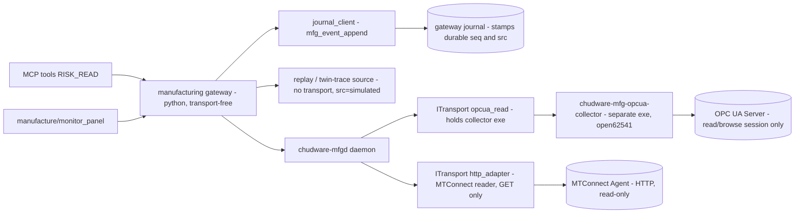

# Read-Only Industrial Monitoring Architecture

Owner: `MonitoringArchitecture`. Design-only. Status: implementation-ready.
**Amended 2026-08-08** to close the architecture plan review's findings C4 and C8 and to adopt the late
Gateway corrections; the amendment is itemized in §15 and every citation now uses the stable rule ids of §0.

Inputs read: `services/mcp/daemon_bridge.py`, `services/mcp/tool_registry.py`, `host/src/ui/status_bar.cpp`,
`contracts/events.md`, `contracts/worker_rpc.md`, the manufacturing-breadth research,
`00_decisions.md`, `01_definition_of_done.md`; for the amendment, the architecture plan review and
`10_gateway.md` as read-only evidence.

Path/naming ruling applied (project-wide, plus `GatewayDesignRecovery` corrections): production GUI additions live
only under `host/src/ui/manufacture/**` — no `ui/mfg`, no new canvas; cross-domain services live under
`services/manufacturing/**`; fixtures under `fixtures/mfg/**`; RPCs/events stay `mfg_*` / `mfg.*`;
`host/src/ui/cam/**` remains the offline-CAM owner and is not touched by this lane.

Gateway cross-references in this document are **stable rule ids**, never gateway section numbers (§0).

---

## 0. Stable rule-id references (closes review C10 for this lane)

Gateway is minting the register in its §25; the ids below are Gateway's own tokens and are what this lane's
contract tests key on (`test_capability_truth.py`, `test_invalidation.py`, `test_readonly_surface.py`,
`test_tier0_rows.py`). No other line of this document cites a gateway section number, because gateway
numbering moved twice during the design rounds and §20's contract tests are specified per rule. The right-hand
column is traceability only — if Gateway renames a token, this table is the single place that changes.

| rule id | rule as ratified | gateway text today |
|---|---|---|
| `MFG-SEQ-1` | `mfg_event_append` is the only source of a durable `seq`; minting, guessing, deriving or carrying an unstamped seq is a contract-test failure | §24 rule 1 |
| `MFG-SRC-3` | the gateway computes `src` and `admission`; neither is ever accepted from a caller | §24 rule 3 |
| `MFG-SRC-1` | `src` derives from `(transport_kind, endpoint_is_physical)`, not from transport kind alone | §3.2 |
| `MFG-SRC-2` | an endpoint recorded in the fixture manifest as virtual, emulated, recorded or loopback forces `src:"simulated"` regardless of transport kind | §3.2 |
| `MFG-ROTRANSPORT-1` | `ITransport` splits into `IReadTransport` (no `write()`, absent not overridden) and commanding `ITransport`; a read-only collector is a real in-daemon transport | §24.5 |
| `MFG-ROTRANSPORT-2` | a probed read-only observation may be admitted at Stage 1 **only for the subject it directly measures**; never self- or same-source/same-lane corroboration, never a fingerprint-bound substitute, never a command path | §24.5 refinement |
| `MFG-ADMIT-1` | Stage 1 admits exactly two classes, `probed_evidence` and `procedural_fact` | §10.1 |
| `MFG-ADMIT-2` | `procedural_fact` admission can never satisfy an execute-side subject or an approval-bound device guard | §10.1 |
| `MFG-CORROB-1` | binding and independence are separate axes: a corroborator MUST be bound to the same subject and config epoch, MUST be independently fresh, and MUST NOT originate from the same source or lane as the claim | §10.1 |
| `MFG-FRESH-1` | `FreshValue<T>` has one definition and one encoder (`core/manufacturing/fresh_value.h`); a second envelope is a contract-test failure | §3.2 |
| `MFG-FRESH-2` | every painted numeric or enum field is published wrapped in a `FreshValue<T>` | §15 |
| `MFG-FRESH-3` | on a durable authored/derived row `ttl_ms:null` means "does not decay", so `state:"ok"` is correct and permanent; on a telemetry lane `ttl_ms:null` means "publication interval unknown", so the row renders `state:"unknown"` with a `why`. A lane may never use the first meaning to keep a decaying value `ok` | §25 (rule text in §15) |
| `MFG-KIND-1` | every durable result kind declares both columns — epoch policy and runtime invalidation triggers | §24.1 |
| `MFG-KIND-2` | a kind absent from the registered table is refused `mfg_unregistered_result_kind`, so the domain's durable surface does nothing | §24.3(iii) |
| `MFG-EPOCH-1` | the epoch-sweep policy vocabulary (`falsify` / `retain_as_last_ok` / `epoch_invariant` / `reestablish`) with `falsify` as the default | §24.1 |
| `MFG-MONCOND-1` | `monitor_condition` is `falsify + retain_as_last_ok`, never `reestablish` | §24.10 |
| `MFG-PFFLIP-1` | a `procedural_fact` may flip only `plan\|generate\|post\|parse\|simulate` | §24.3(i) |
| `MFG-PFPARENT-1` | every `procedural_fact` kind MUST declare `supersede_with_parent` | §24.7 |
| `MFG-CAPKIND-1` | any domain whose `CapabilityReport` can reach a UI MUST register a `<domain>.capability` durable kind | §24.11(1) |
| `MFG-CAPKIND-2` | a capability kind declares `supersede_with_parent:false` — it re-derives from its own evidence and never inherits | §24.11(2) |
| `MFG-CAPKIND-3` | advertising any level above `unsupported` without a registered capability kind is refused `mfg_capability_requires_durable_kind` | §24.11(4) |
| `MFG-SUBJNS-1` | permitted subject namespaces are declared at registration; an out-of-set append is refused `mfg_subject_namespace_not_permitted` | §24.8 |
| `MFG-TIER0-1` | Tier-0 prerequisite rows register through `mfg_tier0_register`, atomically and idempotently, with a gateway-run totality check | §24 rule 5 |
| `MFG-SKIP-1` | zero new normal-gate SKIPs; an absent optional prerequisite is **excluded** into an opt-in qualification script, with an asserting test that `gate.sh` never invokes it, and pins the capability level at `assumed` with the missing level named — a SKIP advertises a hole in the normal gate, exclusion does not | §25 (points at §20, §24.4, §24.10) |
| `MFG-FAM-2` | one shared MCP family id `"manufacture"` across all ten domains | §17 |
| `MFG-FAM-1` | the family default-off mechanism in `services/agent/config.py` is gateway-owned and lands in W1.1 | §17 / W1.1 |
| `MFG-SECT-1` | Gateway allocates one `contracts/worker_rpc.md` section per domain; **monitoring gets §8**, gateway keeps §7 | §2 allocation |
| `MFG-SUB-1` | the `contracts/events.md` §5 subscription-lane amendment is gateway-owned (W4.1) | §15 |
| `MFG-OBS-1` | the `observer` client kind is gateway-owned (W4.1) | §7 |
---

## 1. Posture and one-sentence claim

This lane ships **observation only**. It advertises exactly one capability level — `monitor` — and hard-codes
`transport`, `execute`, `safety_integration` to the literal `"unsupported"`. MTConnect lands first because the
standard is one-way by construction (MTConnect's own introduction states it does not control machines); typed
read-only OPC UA lands second because generic OPC UA *does* carry write and method surfaces that must be
structurally amputated rather than merely unused.

Copy allowed by this lane: `telemetry-only`. Copy forbidden: `supported`, `connected to machine`, `machine state`,
`safe`, `monitored stop`, `certified`.

**Ordering is a safety decision, not a convenience.** MTConnect exercises the whole canonical model, seq/time/
quality mapping, freshness envelope, replay harness and read-only gate against a protocol that has no write verb to
get wrong. OPC UA then reuses a proven model and only has to prove amputation.

---

## 2. Process boundary (why not hostd)

DoD v4 §16 forbids `mfg_*` symbols in the public `libchudware` C ABI and requires gateway/device execution to be a
separate service/process. Therefore:

- Collection **transports** run inside the manufacturing daemon (`chudware-mfgd`), never in `chudware-hostd` and
  never behind a `libchudware` export. See the `ITransport` correction immediately below — it moves MTConnect
  collection out of the Python layer.
- MCP reaches monitoring through the **gateway** client, **not** `services/mcp/daemon_bridge.py`. `daemon_bridge`
  stays hostd-only; its shape is the template to copy, not the transport to reuse — newline-delimited JSON, one
  `threading.Lock`, reconnect-once-on-EOF, `hello {client, pid, proto}` handshake, spawn cooldown with doubling
  backoff (`SPAWN_COOLDOWN_S` → `SPAWN_COOLDOWN_MAX_S`), `_SPAWNED` child reaping.
- The OPC UA collector is a **further** out-of-process executable (§4.2) so `open62541` (MPL-2.0, file-level
  obligations) never links into the core libraries, and so the read-only symbol gate has one concrete binary to
  inspect.



**Durable `seq` is stamped by the gateway at journal append.** This lane never mints one and never quotes an
`at_seq` it did not receive from the journal (`GatewayDesignRecovery` binding 1). Concretely, every durable
monitoring row is written with `mfg_event_append{domain_id:"mfg.monitor", kind, subject, result_kind, body, raw?,
admission?}` through the **gateway-owned** helper `services/manufacturing/rpc/journal_client.py`. That helper is
not copied per domain, and minting a local seq is a contract-test failure (`MFG-SEQ-1`).

### 2.1 Read-only transports (`MFG-ROTRANSPORT-1` — slot granted structurally)

Gateway split the transport interface rather than granting a policy exemption, which is the stronger answer:

```
IReadTransport { open, close, poll, kind }        // no write() — the method does not exist
ITransport : IReadTransport { write }             // the command lease is defined over ITransport ONLY
```

- **MTConnect collection is a daemon-hosted `IReadTransport` of kind `http_adapter`**, not a Python HTTP client.
- **The OPC UA collector executable is a daemon-hosted `IReadTransport` of kind `opcua_read`** (new
  `TransportKind` value), held open for the session lifetime; its NDJSON is transport output, not a Python-authored
  record.
- Both are **provably incapable of commanding — there is no `write()` to call** — and because the command lease is
  defined over `ITransport`, a read-only transport never takes, holds or contends for a device command lease. The
  "one command owner per device" invariant is untouched by any number of concurrent observers.
- **A read-only transport yields `src="probed"` only for a physical endpoint** (`MFG-SRC-1`). Provenance is derived
  from `(transport_kind, endpoint_is_physical)`, never from transport kind alone: `http_adapter` against a real
  MTConnect agent on a real machine is `probed`, while `http_adapter` against anything the fixture manifest records
  as virtual, emulated, recorded or loopback is `simulated` (`MFG-SRC-2`) — same transport class, different
  provenance, no exception path. So `monitor: verified` is reachable from a real machine and unreachable from a
  fixture, which is the whole point; had this stayed a Python collector it would have been capped at `declared` and
  live telemetry would have been config-grade assertion.
- **`origin` is the physicality flag, not a comment.** `endpoint_is_physical` is `origin == "live"` **and** a
  manifest entry that does not mark the endpoint virtual/emulated/recorded/loopback; `replay_fixture`,
  `twin_trace` and `loopback_emulator` each force `simulated` with no way to argue. One mechanism, one field, and
  the gateway still computes the value (`MFG-SRC-3`) — this lane supplies `origin` and the manifest, never `src`.
- **Everything transport-free stays Python** in `services/manufacturing/monitor/`: canonical model, adapter/mapping
  tables, quality and unit derivation, sequence-continuity analysis, replay, the six read-only RPCs, the Tier-0
  rows, the read-only guard. Pure functions over bytes the transport already fetched — deterministic, fixture-
  testable, and structurally unable to set `src`.
- **Replay and twin-trace sources hold no transport at all**, so they are `simulated` twice over — once because
  there is no transport to derive `probed` from, once because `MFG-SRC-2` would force it anyway if a future
  contributor routed a replay through the HTTP reader to "test the real path". Redundant on purpose: the second
  rule is the one that survives that refactor.

A contract test asserts `services/manufacturing/monitor/**` constructs no socket/HTTP client and never writes
`src`; a second asserts both collectors implement `IReadTransport` and appear in no lease-holder set.
A third asserts the endpoint-physicality derivation directly: for every fixture in the manifest, and for a
loopback MTConnect agent reached over real HTTP, the published `src` is `simulated` — that case is the negative
that makes `MFG-SRC-2` live rather than decorative, and it is the same assertion
`test_replay_determinism.py` already makes for replay rows.

### 2.1.1 Stage-1 admission — refined rule (supersedes the earlier blanket exclusion)

Gateway's refinement (`MFG-ROTRANSPORT-2`), now that monitoring owns probed transports: **a probed monitor
observation MAY be admitted at Stage 1 for the subject it directly measures.** The earlier "monitoring never
satisfies an execute-side gate" phrasing was correct only while monitor was capped at `declared`, and this
document no longer claims it.

A monitor row enters Stage 1 as **`admission:"probed_evidence"`** (`MFG-ADMIT-1`) and never as
`procedural_fact` — this lane produces observations, not named-check facts, so `MFG-ADMIT-2` is vacuous here by
construction. The class is computed by the gateway, not declared by this lane (`MFG-SRC-3`).

Five limits remain. Four are subject-binding limits rather than freshness limits; the fifth is provenance:

1. **Corroboration binding and independence are separate axes** (`MFG-CORROB-1`). When a monitor observation
   serves as a corroborator it MUST be bound to the **same subject and the same config epoch** as the claim — a
   corroborator from a different epoch is not a corroborator — and it MUST come from a **different source and
   lane**. So it may never corroborate itself, and one MTConnect agent's two data items are one witness, not two:
   same lane, same source. The earlier phrasing here ("nor another observation from the same source or config
   epoch") conflated the two axes and, read literally, made corroboration unreachable; the two-axis rule is the
   ratified one and this lane states it that way.
2. It may **not substitute for the device lane's own `ControllerSnapshot`** where a gate is bound to the
   approval's machine fingerprint. That is a subject-binding requirement; a perfectly fresh observation still
   fails it.
3. It may **never touch a command path**: `mfg_run_start` never depends on a monitor lane, in any configuration.
4. Non-probed observations (`simulated` from replay/twin-trace, `declared` from profile/config, `advisory`) remain
   inadmissible at Stage 1, unchanged.
5. **Only a physical endpoint produces probed evidence, and only for what it directly measures** (`MFG-SRC-1`,
   `MFG-SRC-2`). A virtual, emulated, recorded or loopback endpoint is `simulated` however real its transport is,
   so no fixture, replay, twin trace or loopback agent can reach Stage 1 — and a physical source's admissibility
   still stops at the subject its own sensor measured.

`evidence_eligible` therefore means "probed **from a physical endpoint**, good, timestamped, gap-free, and
admissible **for its own measured subject**" — the binding and independence checks stay with the gate, which is
the only party that knows what the other corroborators are.

### 2.2 Durable result kinds this lane registers (`MFG-KIND-1`, two-column rule)

Every kind MUST declare **both** axes; declaring one is a schema rejection. They are independent: a kind can be
`epoch_invariant` and still be falsified mid-epoch. The four telemetry kinds are the batch's only `falsify` rows,
which is the rule working as intended — this lane owns probed transports, so it owns transport-bound evidence,
while domains with no probed transport are entirely `epoch_invariant`. The fifth kind, `monitor_capability`, is
required by `MFG-CAPKIND-1` and detailed below.

| `result_kind` | subject | (a) epoch policy | (b) runtime invalidation triggers |
|---|---|---|---|
| `monitor_observation` | `src:{source_id}:{item_key}` | `falsify` + `retain_as_last_ok` — the value clears while `FreshValue.last_ok` is retained display-only, so a restart can only downgrade to `stale`/`unknown` and never re-assert `ok` | source config hash change; confirmed sequence gap (buffer roll / failed `Republish`); certificate trust revoked; profile remap (supersede, not falsify); identity-derivation change (supersede) |
| `monitor_condition` | `src:{source_id}:{item_key}` | `falsify` + `retain_as_last_ok` (`MFG-MONCOND-1`) — transition history retained display-only, value clears, severity renders **`unavailable`** and never `cleared`. **Corrected from `reestablish`**, which is the label an earlier close-out of this document carried: `reestablish` licenses the gateway to re-derive and re-assert a condition nobody observed, and the gateway cannot consult the source during a sweep — the exact fail-open the sweep exists to prevent. Reconnect is **normal runtime**, not an epoch policy: the collector appends a NEW row with a new seq and the retained row gets `superseded_by` pointing at it | newer transition for the same subject (supersede); source config hash change; trust revoked |
| `monitor_source_state` | `src:{source_id}` | `falsify`, **explicitly NO `retain_as_last_ok`** — renders `unknown` with `why="lane epoch changed"`. Retention is prohibited here and the prohibition is load-bearing: `source_state` IS the liveness indicator a consumer checks before trusting anything else, so a display-only "connected" for a source that provably is not would be a sticky-online claim about the present that nothing can downgrade. An observation's `last_ok` is honest (a real measured value, timestamped, marked not-current); a source-state's would not be | trust revoked; profile/version detected unsupported; egress denied; transport closed or `poll` failure |
| `monitor_sequence_gap` | `src:{source_id}` | `epoch_invariant` and terminal — a recorded gap is historical fact and is never reconciled away | superseded only by a later contiguous run; never falsified |
| `monitor_capability` | `src:{source_id}` | `epoch_invariant`, `supersede_with_parent` explicitly **false** (`MFG-CAPKIND-2` — a capability row re-derives from its own evidence and never inherits) | any cited `derived_from` row falsified or superseded ⇒ re-derive and append a fresh capability row; stage regression; `read_only_proof` artifact hash change; profile-support change; trust-state change |

`retain_as_last_ok` is exactly the "downgrade, never re-assert" property and needs no new invalidation class.

Retention is therefore **not** uniform across this lane's kinds, and that asymmetry is deliberate:
`monitor_observation` and `monitor_condition` retain (a past measurement stays honest when labelled not-current),
`monitor_source_state` must not (a past liveness claim does not), and `monitor_sequence_gap` is terminal so the
question does not arise. A contract test asserts `retain_as_last_ok` is false for `monitor_source_state`, because
"make it consistent with the others" is exactly the well-intentioned change that would reintroduce the
sticky-online failure.

Rows are appended with `admission` **unset by this lane** and `derived_from[]` populated: an observation derives
from its `monitor_source_state` row and its topology/probe row, so `mfg_result_invalidate` computes the
**transitive closure** (`MFG-KIND-1`) and `affected[]` is the gateway's answer, never this lane's best guess.
Falsification propagates along `derived_from`; supersession does not, and this lane declares
`supersede_with_parent` on nothing. The gateway derives the admission class — `probed_evidence` for a physical
source, nothing admissible for a simulated one (`MFG-SRC-3`, `MFG-ADMIT-1`) — and this lane never claims
`procedural_fact`, because it produces observations rather than named-check facts.

**Subject namespace (`MFG-SUBJNS-1`).** This lane declares exactly one permitted namespace at registration:
**`src:`**. It never appends under `dev:` — the device lane owns that — nor under `art:`/`job:`/`run:`/`appr:`/
`res:`. An out-of-set append is refused `mfg_subject_namespace_not_permitted`, and every approval-bound device
guard additionally requires `subject.device_id == approval.machine.device_id` with fingerprint equality, so a
fresh probed `src:` observation is refused **by name** at such a guard rather than by anyone's good judgement.
That mechanizes limit 2 of §2.1.1 and answers the cross-lane concern directly: the five limits of §2.1.1 are
no longer the only thing standing between a probed observation and a domain that did not earn it.

Of the other two supersede-with-parent rules, one is vacuous and one now bites. **Vacuous:** no kind here ends in
`procedural_fact`, so the mandatory `supersede_with_parent:true` never applies — this lane emits no procedural
facts. **Bites:** `monitor_capability` IS a capability kind, so the converse rule applies and
`supersede_with_parent` is explicitly `false` — a capability row re-derives from its own evidence and never
inherits. Under `MFG-CAPKIND-2` the supersede-with-parent choice for derived rows is the owning domain's, declared with a
reason: this lane declares it **false everywhere**, because a monitor row is a direct measurement rather than a
derivation of another row, so there is no parent whose supersession should carry it forward.

### 2.3 `monitor_capability` — the CapabilityReport is journaled (`MFG-CAPKIND-1`)

Found batch-wide by `PnpArchitecture` applying the capability converse back at Gateway, and it lands squarely on
this lane: DoD v4 §10 requires a gateway-stamped durable row for **every** durable result a UI may paint, not only
telemetry — and this lane's `CapabilityReport` is painted by the Monitor panel and returned by both
`mfg_monitor_source_list` and `mfg_monitor_source_describe`. It advertised `monitor: verified`, a level above
`unsupported`, with no durable row behind it. That is the same fabricated-competence shape as a stale procedural
fact: a claim on screen that no journal row can invalidate.

- **`derived_from`** = exactly the rows the report cites: the source's `monitor_source_state` row, the stage
  evidence row named by `evidence_ref` (`res:monitor_stage:…`), the `read_only_proof` gate-artifact row, and the
  probed observation row(s) that justify `monitor: verified`.
- When any cited row is falsified or superseded, this lane **re-derives and appends a fresh `monitor_capability`
  row**; the gateway's closure makes the previous one non-current. A level therefore cannot outlive the evidence
  under it.
- Registration is enforced, not disciplined (`MFG-CAPKIND-3`): advertising any level above `unsupported` without a
  registered capability kind is refused `mfg_capability_requires_durable_kind`, and an unregistered kind is refused
  `mfg_unregistered_result_kind` (`MFG-KIND-2`) so the durable surface simply does nothing until the kind is in the
  table. (A domain reporting every level `unsupported` with a `why` needs no capability kind, since it paints no
  claim that can go stale — that exemption does not apply here, because `monitor` reaches `verified`.) This lane's
  registration is accepted for W1.1 as the fifth kind, so `monitor_capability` is a **registered** kind, not a
  proposed one.
- **Published wrapped, not only journaled** (`MFG-FRESH-2`, `MFG-FRESH-3`): the capability row is a durable row a
  UI paints, so it is journaled **and** published inside `FreshValue<MonitorSourceCapability>` with
  `ttl_ms:null` — it does not decay with wall-clock age, it is invalidated by the closure (§3.5).
- **Contract test:** falsify one cited evidence row and assert both that a new `monitor_capability` row appears
  **and** that the affected level drops — `monitor` falls to `assumed` with `missing_level` named. There must be
  no path on which `monitor` stays `verified` over falsified evidence. The concrete case to exercise is
  revoking certificate trust mid-session: `monitor_source_state` falsifies, the closure reaches the capability
  row, and the panel must stop claiming `verified` in the same frame it stops claiming `ok`.

---

## 3. Canonical device / observation model

New package `services/manufacturing/monitor/`. All records are plain dataclasses whose `to_json()` produces
sorted-key, fixed-format output (determinism requirement, §9.3).

### 3.1 `ObservationRecord` (`services/manufacturing/monitor/model.py`)

| field | type | rule |
|---|---|---|
| `obs_id` | str | `"{source_id}:{device_key}:{item_key}:{src_seq}"`; stable and replay-reproducible |
| `source_id` | str | canonical source id (§3.4) |
| `device_key` | str | canonical device id, stable across agent/server restart |
| `item_key` | str | canonical data-item id, stable across namespace reindex |
| `canonical_kind` | enum | `axis_position` `axis_feedrate` `axis_load` `spindle_speed` `spindle_load` `execution_state` `controller_mode` `program_name` `program_block` `program_comment` `tool_id` `tool_life` `part_count` `temperature` `power` `availability` `door_state` `coolant_state` `emergency_stop_state` `alarm` `asset` `other` |
| `value_kind` | enum | `sample` \| `event` \| `condition` \| `asset` |
| `v_num` / `v_text` / `v_json` | float\|null / str\|null / any\|null | exactly one non-null when `quality=="good"`; all null otherwise |
| `unit` | str\|null | canonical token |
| `unit_src` | str\|null | verbatim source unit token (`nativeUnits`, `EUInformation.displayName`) |
| `converted_from` | `{unit,factor,offset}`\|null | non-null whenever we converted; never convert silently |
| `t_src_utc_ns` | int\|null | source timestamp, ns UTC; the local clock is **never** substituted |
| `t_server_utc_ns` | int\|null | protocol server timestamp when distinct |
| `src_seq` | int\|null | verbatim protocol sequence (§7) |
| `seq` | int\|null | **gateway-stamped at journal append**; null until appended, and a null `seq` is never painted or cited |
| `quality` | enum | `good` \| `uncertain` \| `bad` \| `unavailable` |
| `quality_src` | str | verbatim evidence: `"0x80340000 BadNodeIdUnknown"`, `"UNAVAILABLE"`, `"Condition/Fault"` |
| `schema` | `SourceSchema` | §3.3 — never erased |
| `raw` | dict | verbatim source attributes + vendor extension elements/fields, unpruned |
| `raw_ref` | str\|null | sidecar path when `raw` exceeds `RAW_INLINE_CAP` (16 KiB), mirroring the `events.md` `raw (≤16 KB, full text on disk)` precedent |
| `src` | enum | exactly `probed` \| `declared` \| `assumed` \| `simulated` \| `advisory`, **computed by the gateway from `(transport_kind, endpoint_is_physical)`** and never chosen by the adapter (`MFG-SRC-1`, `MFG-SRC-3`): `serial`/`tcp`/`websocket`/`http_adapter`/`opcua_read` on a **physical** endpoint → `probed`; the same transport kinds on a virtual, emulated, recorded or loopback endpoint → `simulated` (`MFG-SRC-2`); `emulator` transport → `simulated`; profile/config facts → `declared`; camera/model output → `advisory`. `assumed` is a `CapabilityTruth` value and never appears on an observation |
| `origin` | enum | `live` \| `replay_fixture` \| `twin_trace` \| `loopback_emulator`. **Authoritative for endpoint physicality**, not a comment: `endpoint_is_physical` is `origin == "live"` AND a fixture-manifest entry that does not mark the endpoint virtual/emulated/recorded/loopback. It still never sets `src` — it is the input the gateway derives `src` from, which is what makes one mechanism cover replay, twin traces and loopback agents alike |
| `evidence_eligible` | bool | `src=="probed" and quality=="good" and t_src_utc_ns is not None and not gap` — and `src=="probed"` already implies a physical endpoint, so no separate physicality term is needed here |

`src` carries **only** the five contract values so no consumer has to learn a monitoring-specific vocabulary;
`origin` keeps the operational distinction (a fixture replay and a loopback emulator are both `src="simulated"`
but must be distinguishable in the panel and in incident review) **and** supplies the physicality bit the gateway
needs, so the two purposes live in one field rather than two that can disagree. `evidence_eligible` exists so no
consumer re-derives DoD v4 §5: a `simulated`/`advisory`/`declared`/`assumed` observation is structurally incapable
of Stage-1 admission. A **probed** observation — necessarily from a physical endpoint — is admissible for the
subject it directly measures, under the five limits of §2.1.1.

### 3.2 `ConditionRecord`

`{cond_id, source_id, device_key, item_key, severity: "normal"|"warning"|"fault"|"unavailable",
native_code, native_severity, qualifier, text, t_src_utc_ns, src_seq, seq, schema, raw,
transition: "raised"|"changed"|"cleared"|"unavailable", src, origin}`

Conditions are **read-only forever**: no acknowledge, confirm, reset or clear field exists anywhere in the model
or the RPC surface, because every one of those is a device write.

### 3.3 `SourceSchema` — source-schema retention

`{protocol: "mtconnect"|"opcua"|"replay", protocol_version, schema_version, profile, namespace_uri,
namespace_index_at_read, device_uuid, agent_instance_id, sender, node_id, browse_path, node_class, data_type,
extension_namespaces:[str]}`

- `profile` is a full human string: `"MTConnect Devices 2.0"`, `"OPC 40501-1 MachineTool 1.02"`,
  `"OPC 40210 GMS 1.0"`.
- `namespace_index_at_read` records the index we *observed*; resolution is always by `namespace_uri`, and a cached
  index is never reused after reconnect (§10.2).
- Unknown/vendor extension namespaces are recorded and their payload survives verbatim in `raw`. Erasing a vendor
  extension is a defect, not a simplification.

### 3.4 Topology and identity (`identity.py`)

Content-derived, restart-stable keys:
- `source_id = "src_" + sha256(f"{protocol}|{endpoint_canonical}|{configured_label}")[:12]`
- `device_key = "dev_" + sha256(f"{source_id}|{device_uuid or device_name}")[:12]`
- `item_key   = "itm_" + sha256(f"{device_key}|{stable_item_ident}")[:12]`, where `stable_item_ident` is the
  MTConnect DataItem `id` (or `name` when `id` is absent) or the OPC UA `browse_path` under the typed profile —
  never a raw numeric `nodeId`, never a namespace index.

`MonitorDevice{device_key, name, uuid, kind, model, serial, components:[MonitorComponent], schema}` and
`MonitorDataItem{item_key, canonical_kind, value_kind, unit, unit_src, sub_type, schema, interval_ms_source}`.

Changing the identity derivation is a **superseding** event, never a falsifying one (§8).

### 3.5 The single external freshness shape, and how durable rows are published (closes review C8)

The gateway publisher wraps **every** record — telemetry and durable alike — in the sole external shape
`FreshValue<T>{v, state, t_mono_ns, seq, age_ms, ttl_ms, src, why, last_ok?}` (DoD v4 §4, `MFG-FRESH-1`,
`MFG-FRESH-2`). This lane never invents a second envelope, never exposes `t_src_utc_ns` as the freshness clock,
and never returns a bare record. There is no "durable rows are unwrapped" exception in this lane: a durable
authored or derived row is journaled **and** published wrapped (`MFG-FRESH-3`). Wrapping is what carries `seq`,
`src` and `why` to the panel; the journal is what makes the row invalidatable. Dropping either half is how a
capability claim ends up on screen with nothing able to retract it.

**Decaying rows — `monitor_observation`, `monitor_condition`, `monitor_source_state`.** `state` derivation
(`model.to_fresh_value`):

| state | condition |
|---|---|
| `ok` | `quality=="good"` and `t_src_utc_ns` present and `age_ms <= ttl_ms` and no sequence gap and session healthy |
| `stale` | otherwise-ok but `age_ms > ttl_ms`; `v` is null and `last_ok` is **display-only** |
| `unknown` | `quality in {uncertain,bad,unavailable}`, OR sequence gap, OR missing source timestamp, OR session lost, OR `ttl_ms` not derivable |
| `refused` | security/profile refusal: untrusted certificate, policy below floor, unsupported profile or version, egress denied |

`ttl_ms` is derived, never guessed: `max(1000, 3 * effective_interval_ms)`, where `effective_interval_ms` is the
OPC UA `RevisedPublishingInterval`/`RevisedSamplingInterval` or the MTConnect poll interval actually in use.
**If no interval is known, `ttl_ms` is null and `state` is `unknown`** — fail closed, no default TTL.

**Non-decaying rows — `monitor_capability`, `monitor_sequence_gap`.** These are durable facts about an epoch, not
samples: no publishing interval exists for them, and wall-clock age says nothing about whether they are still
true. They publish with **`ttl_ms:null` and `state:"ok"`** while their evidence stands, and they leave `ok` only
through the invalidation closure — a cited row falsified or superseded drops the capability row to `unknown` with
a `why` naming the falsified evidence, and a re-derived row replaces it (§2.3). `age_ms` is still stamped and
still rendered, because "measured 40 minutes ago" is useful context; it is simply not a decay input.

**The two meanings of `ttl_ms:null` are distinguished by kind, not by comment**, which is what `MFG-FRESH-3`
ratifies as a rule separate from `MFG-FRESH-2`:

| kind class | `ttl_ms` | `state` when nothing is wrong | `ttl_ms:null` means |
|---|---|---|---|
| decaying telemetry | derived from the real interval; null only when no interval is known | `ok` while `age_ms <= ttl_ms` | **interval unknown ⇒ `state:"unknown"`**, fail closed |
| non-decaying durable | always null | `ok` | **does not decay**; only the closure can move it off `ok` |

Two contract tests keep those apart, and each fails on a plausible mistake rather than on plumbing:
`test_model.py` asserts no `monitor_observation` or `monitor_condition` is ever published with `ttl_ms is None`
and `state == "ok"` (the fail-open a default TTL would create), and `test_capability_truth.py` asserts every
published `monitor_capability` and `monitor_sequence_gap` carries `ttl_ms is None` and is never `stale` (the
false-alarm a borrowed telemetry TTL would create, which would make a true capability row rot on the clock).

---

## 4. Proposed files (exact)

### 4.1 `services/manufacturing/monitor/`

| file | contents |
|---|---|
| `__init__.py` | package marker; exports `model` names only (no client construction at import) |
| `model.py` | `ObservationRecord`, `ConditionRecord`, `MonitorDevice`, `MonitorComponent`, `MonitorDataItem`, `MonitorSourceCapability`, `SourceSchema`, `Quality`, `Src`, `Origin`, `to_fresh_value()`, `RAW_INLINE_CAP` |
| `identity.py` | `source_id()`, `device_key()`, `item_key()`, `IdentityEpoch` |
| `seqmap.py` | `SeqMapper`: src-sequence continuity, gap detection, `instance_epoch` reconciliation, `GapNotice`. **Mints no seq** — it hands rows to `journal_client.mfg_event_append` and reads back the gateway-stamped `seq` |
| `quality.py` | `mtconnect_quality()`, `opcua_statuscode_quality()`; the §7 mapping tables as data, not code paths |
| `units.py` | `canonicalize_unit(unit_src) -> (unit, converted_from|None)`; UNECE Rec-20 + MTConnect `nativeUnits` tables; an unknown unit passes through unconverted with `unit=None` |
| `config.py` | `MonitorSourceConfig` loader. **No field can express a write** (§5 layer 4). Operator-authored endpoint allowlist only |
| `mtconnect/request_plan.py` | pure planner for the `http_adapter` transport: which of `/probe`, `/current`, `/sample?from=…` to fetch next, `nextSequence` follow, backoff schedule, byte/time caps. **Builds request descriptors; performs no I/O** — the daemon transport executes them (§2.1) |
| `mtconnect/xml_decode.py` | hardened streaming XML → raw dicts (DTD/entity/network resolution disabled; depth, element-count and byte caps) |
| `mtconnect/probe_model.py` | `/probe` → `MonitorDevice` tree + `MonitorDataItem` set |
| `mtconnect/adapter.py` | raw dicts → `ObservationRecord`/`ConditionRecord`; `raw` retention; `canonical_kind` mapping table |
| `opcua/collector_bridge.py` | spawn/supervise the collector exe, parse its NDJSON, map to canonical records |
| `opcua/profiles/machine_tools.py` | `OPC 40501-1` browse-path → `canonical_kind` table |
| `opcua/profiles/machinery.py` | `OPC 40001-1` identification/state subset |
| `opcua/profiles/gms.py` | `OPC 40210` measurement-result subset (import and retain only) |
| `opcua/profile_registry.py` | profile+version → mapping-table resolution; unsupported ⇒ `refused`, never best-effort |
| `readonly_guard.py` | `FROZEN_METHODS`, `FORBIDDEN_PARAM_KEYS`, `FORBIDDEN_SYMBOLS`, `FORBIDDEN_METHOD_PATTERN`, `assert_readonly_surface()` |
| `replay.py` | deterministic fixture player (protocol fixtures **and** recorded twin traces); synthetic monotonic clock; stamps `src="simulated"` with the correct `origin` |
| `service.py` | the six RPC methods (§6.1), registered into the gateway dispatch table |
| `evidence.py` | `evidence_eligible()` + the Tier-0 register rows this lane contributes (§11.3) |

Tests, same directory per project convention: `test_model.py`, `test_seqmap.py`, `test_quality.py`,
`test_units.py`, `test_mtconnect_adapter.py`, `test_mtconnect_gaps.py`, `test_mtconnect_hardening.py`,
`test_opcua_mapping.py`, `test_opcua_security.py`, `test_readonly_surface.py`, `test_replay_determinism.py`,
`test_capability_truth.py`, `test_invalidation.py`, `test_tier0_rows.py`.

### 4.2 `services/manufacturing/monitor/collector_opcua/` (separate executable)

| file | contents |
|---|---|
| `main.cpp` | NDJSON stdio loop with exactly four verbs: `open`, `subscribe`, `poll`, `close`. No other verb exists |
| `readonly_client.h/.cpp` | the **only** TU permitted to include `open62541` client headers; declares only `readAttribute`, `browse`, `translateBrowsePath`, `createSubscription`, `createMonitoredItem`, `publish`. No write/call/node-management wrapper is declared anywhere |
| `statuscode.h/.cpp` | `UA_StatusCode` → `{quality, quality_src}` |
| `security.h/.cpp` | policy floor, trust list, certificate load, hostname/URI/validity/revocation checks, quarantine of rejected certs |
| `profile_probe.h/.cpp` | read the server namespace array + companion-spec version node; refuse on mismatch |
| `CMakeLists.txt` | own target `chudware-mfg-opcua-collector`; MPL-2.0 notice + corresponding-source artifacts |

Integrator-owned append (one line, not applied by this lane):
`add_subdirectory(services/manufacturing/monitor/collector_opcua)` in the top-level `CMakeLists.txt`.

### 4.3 Host GUI (`host/src/ui/manufacture/**` only)

| file | contents |
|---|---|
| `host/src/ui/manufacture/monitor_state.h` | `MonitorMirror`: sources, devices, items, last `FreshValue` per item, condition ring, replay flag, `aggregate` counters. **Written only by the authoritative `mfg.monitor.*` event drain** |
| `host/src/ui/manufacture/monitor_panel.h/.cpp` | `ui::drawMonitorPanel(AppState&)` — read-only: source list, device tree, item table (value / state / age / ttl / seq / `quality_src`), condition log, `SourceSchema` column, raw-extension inspector popover, replay banner |
| `host/src/ui/status_bar.h` | **proposed** monitor-status seam; the Parts Library token currently reads its owned queue directly |
| `host/src/ui/status_bar.cpp` | fill the currently-empty `Workspace::Manufacture` arm of the `wsTok` switch (`status_bar.cpp:347-364`) and add the warn tint branch (`status_bar.cpp:384-392`) |

`host/src/ui/cam/**` is untouched; no new canvas or panel host is created — the monitor panel docks in the existing
Manufacture workspace surface.

Proposed status-bar seam (`extern`, default `nullptr`, so the token would read
"not configured" until a monitor owner assigns it); this is not a shipped hook:

```cpp
// status_bar.h — [workspace-tabs seam] read-only monitoring token.
struct MonitorToken { std::string text; int kind; };  // kind: 0 dim, 1 ok, 2 warn
extern bool (*monitorStatusToken)(MonitorToken& out);
```

```cpp
// status_bar.cpp, inside the existing wsTok switch
case AppState::Workspace::Manufacture: {
    MonitorToken mt;
    if (monitorStatusToken && monitorStatusToken(mt)) { wsTok = mt.text; wsTokKind = mt.kind; }
    else wsTok = "Monitor: not configured";
    break;
}
```

**No standalone status-bar state machine.** `monitorStatusToken` is a pure formatter over `MonitorMirror`, and the
mirror is mutated in exactly one place: the drain of authoritative `mfg.monitor.source_state` /
`mfg.monitor.sample` / `mfg.monitor.invalidated` events. The host performs no polling, no timing, no aggregation
of its own, and derives no state the gateway did not publish — so the token cannot disagree with the panel or
outlive an invalidation.

Token text is specified, not left to the implementer:

| situation | text | tint |
|---|---|---|
| no source configured | `Monitor: not configured` | dim (`kind 0`) |
| all sources fresh | `Monitor: 4/4 live` | `statusOk` (`kind 1`) |
| any stale/unknown | `Monitor: 3/4 live · 1 unknown` | `statusWarn` (`kind 2`) |
| replay/twin-trace active | `Monitor: REPLAY (<fixture_id>)` | `statusWarn`, **never** `statusOk` |
| source refused | `Monitor: refused — untrusted certificate` | `statusWarn` |
| events not yet drained this epoch | `Monitor: unknown` | `statusWarn` |

The existing block supports only `statusOk`-or-dim, so `kind == 2` requires a three-line additive `statusWarn`
branch in that same block; that change stays in this lane's diff. **Blank is never a state** — an unknown source
paints the word `unknown`.

### 4.4 MCP surface — `services/mcp/mfg_monitor_tools.py`

Registered as `register_mfg_monitor_tools(tool_registry.view(mcp, "manufacture"))` — the single shared family id
for the entire overhaul across all ten domains (`MFG-FAM-2`). The wire prefix stays `mfg_*` / `mfg.*`, but the
user-facing/config family is the existing product term **Manufacture**. One honest Settings → AI → Tools toggle
covers the whole manufacturing surface instead of six that drift apart; per-tool toggles retain granularity. The
family string is the only shared registry state this lane touches; risk classes stay per-tool.

| tool | maps to | risk | why |
|---|---|---|---|
| `list_monitor_sources` | `mfg_monitor_source_list` | `RISK_READ` | auto: `list_` ∈ `_READ_PREFIXES` |
| `describe_monitor_source` | `mfg_monitor_source_describe` | `RISK_READ` | auto: `describe_` prefix |
| `get_monitor_observation` | `mfg_monitor_observe` | `RISK_READ` | auto: `get_` prefix |
| `list_monitor_conditions` | `mfg_monitor_observe` (conditions slice) | `RISK_READ` | auto: `list_` prefix |
| `load_monitor_replay` | `mfg_monitor_replay_load` | `RISK_WRITE` | **deliberately not overridden** |

No `_RISK_OVERRIDES` entry is added: the existing classifier already yields the right answer for all five, and
`load_monitor_replay` falling through to the fail-safe `RISK_WRITE` default is the honest classification — it
mutates local gateway state and contacts no device. `test_capability_truth.py` pins these five exact risk classes
so a future classifier change cannot silently promote a monitor tool.

`describe_monitor_source` returns `MonitorSourceCapability` verbatim, including the all-`unsupported` action
levels, so a model cannot infer a command path from a monitoring result.

The `"manufacture"` family is **OFF by default** in `agent.tool_families` until commissioning, so `enable_tools`
cannot silently self-add any manufacturing surface; per-tool granularity stays available through the existing
`get_tool_options` toggles. `tool_registry.deny_reason` already refuses a disabled family before any risk check
runs, so a disabled family is a hard stop rather than a risk downgrade. **This lane relies on that property; it
does not implement it.** The default-off mechanism in `services/agent/config.py` is gateway-owned and lands in
W1.1 (`MFG-FAM-1`), ahead of this lane's MCP wave, because an unlisted family defaults **on** — so registering
into `"manufacture"` before that edit exists would ship the surface enabled. This lane's W2 therefore has
`MFG-FAM-1` as a hard predecessor, and `test_capability_truth.py` asserts the family reads disabled in a default
config so the dependency fails loudly rather than silently.

**Motion/safety tool classes: absence, not denial.** This lane contributes **zero** motion-class tools and zero
entries to `_SAFETY_TOOLS` (which stays deliberately empty). There is no monitor tool for approve, resume, jog,
home, zero, unlock, override, interlock bypass or E-stop — those surfaces do not exist here at all, which is a
stronger property than a guard that denies them.

### 4.5 Fixtures — `fixtures/mfg/monitor/**` (§9)

### 4.6 New gate script — `scripts/mfg_monitor_readonly_gate.sh`

New file, not an edit to an maintainer-owned gate. Maintainer-owned append: one invocation line in
`scripts/gate.sh`. The script:
1. runs `test_readonly_surface.py`;
2. if `chudware-mfg-opcua-collector` is built, runs `nm -uC` over it and fails on any
   `readonly_guard.FORBIDDEN_SYMBOLS` match;
3. when the collector is absent there is **nothing to inspect and nothing to skip**: the surface tests still run
   and still pass, and `test_capability_truth.py` — which always runs — pins the OPC UA `monitor` level to
   `assumed` with `missing_level`. Honesty is preserved by the capability pin, not by a gate SKIP.

**Sidecar discovery and SKIP budget (`MFG-SKIP-1`).** This lane adds **zero** new `gate.sh` SKIPs, keeping the
documented list at the DoD-1 five (OCCT, runtime venv, emsdk, `CHUDWARE_SLICER_BIN`, optional twin binary) —
matching Gateway's corrected batch-wide tally of zero. The symbol check is part of the collector's own build/test
target, so it runs whenever the collector exists and simply has no subject when it does not. The optional stage
servers (cppagent demo agent for E1, open62541/umati sample server for E2) are **excluded** from `scripts/gate.sh`
rather than reported as a SKIP: they run only from the opt-in qualification scripts
`scripts/qualify_monitor_e1.sh` and `scripts/qualify_monitor_e2.sh`, and their absence pins the affected capability
level at `assumed` with `missing_level` named. A missing sidecar therefore degrades fixture richness and the
advertised level, never gate coverage, because every W1-W4 test is fixture-driven and hardware-free by
construction.

**Exclusion is asserted, not assumed** (`MFG-SKIP-1`). `test_readonly_surface.py` reads `scripts/gate.sh` and
`scripts/mfg_monitor_readonly_gate.sh` and asserts neither invokes `scripts/qualify_monitor_e1.sh` or
`scripts/qualify_monitor_e2.sh`, directly or through a wrapper, and that neither emits a SKIP token for a
monitoring step. That is the difference the rule turns on: a SKIP advertises a hole in the normal gate, an
exclusion does not — so the exclusion has to be a checked property rather than an intention, or the next
contributor "helpfully" wires the qualification script into the gate and reintroduces the hole with a green run.

**No gate-resident sidecar variable is introduced, and none may be added later without amending DoD 1.** The
earlier note here offered `CHUDWARE_MTCONNECT_AGENT_BIN` as an "established idiom" to fall back on; that is
withdrawn, because a gate-resident discovery variable is precisely a sixth documented SKIP and DoD 1 enumerates
five. If a future contributor wants the demo agent inside `gate.sh`, the correct move is to keep it excluded and
pin the level (`MFG-SKIP-1`) — an `assumed` level with the missing level named is visible in the capability
report, whereas a SKIP is visible only in gate output nobody reads twice. `scripts/mfg_monitor_readonly_gate.sh`
contains no `CHUDWARE_*_BIN` discovery block at all, and a contract test greps it for one so the withdrawal is
enforced rather than remembered.

---

## 5. Strict impossibility of command / write / method surfaces

Five independent layers, each separately testable and separately able to fail (DoD v4 §8 guard liveness).

**Layer 1 — protocol choice.** MTConnect first precisely because the standard has no write verb; the agent is
one-way. Nothing to amputate, so the canonical model, freshness envelope, replay harness and gate get proven
against a protocol that cannot regress into control.

**Layer 2 — link-level amputation (OPC UA).** `readonly_client.cpp` is the only TU allowed to include `open62541`
client headers and declares no write/call/node-management wrapper. Gate-enforced forbidden undefined symbols:

```
UA_Client_writeValueAttribute   UA_Client_writeAttribute_async   UA_Client_write*
UA_Client_Service_write         UA_Client_call                   UA_Client_call_async
UA_Client_Service_call          UA_Client_addVariableNode        UA_Client_addObjectNode
UA_Client_addMethodNode         UA_Client_addReference           UA_Client_deleteNode
UA_Client_deleteReference       UA_Server_new                    UA_Server_run
UA_PubSub*Writer*               mosquitto_publish                MQTTClient_publishMessage
```

`UA_Server_*` is forbidden so this lane can never become a server and expose a command surface *inbound*; PubSub
writer symbols are forbidden so a future PubSub option cannot become a publisher; MQTT publish symbols are
forbidden because MTConnect-over-MQTT is a legitimate agent input and its client must be subscribe-only.

**Layer 3 — session level.** OPC UA sessions are opened with read/browse intent only; the client never requests or
asserts write user rights. `BadUserAccessDenied` on a read maps to `refused` and is never retried with an elevated
identity. The MQTT subscriber has no publish call site.

**Layer 4 — configuration and RPC schema.** `MonitorSourceConfig` has no field able to carry a node to write, a
method to invoke, a value, or a target state. The RPC layer freezes both the method set and the parameter
vocabulary:

```python
FROZEN_METHODS = frozenset({
    "mfg_monitor_source_list", "mfg_monitor_source_describe", "mfg_monitor_observe",
    "mfg_monitor_stream_open", "mfg_monitor_stream_close", "mfg_monitor_replay_load"})

FORBIDDEN_METHOD_PATTERN = (r"(write|call|method|invoke|command|exec|set_|start|stop|reset|"
                            r"ack|acknowledge|confirm|override|jog|home|zero|unlock|resume)")

FORBIDDEN_PARAM_KEYS = frozenset({
    "value", "values", "write", "node_to_write", "method", "method_id", "arguments",
    "input_arguments", "command", "target_state", "ack", "acknowledge", "confirm",
    "reset", "override", "feed_override", "spindle_override", "program", "gcode"})
```

`test_readonly_surface.py` asserts the served set **equals** `FROZEN_METHODS` (not "is a subset"), that no served
name matches `FORBIDDEN_METHOD_PATTERN`, and that no declared parameter name is in `FORBIDDEN_PARAM_KEYS`. A test
double registering `mfg_monitor_write_value` must be rejected — that negative case is what makes the guard live
rather than vacuous.

**Layer 5 — arbiter isolation and connection kind.** `services/manufacturing/monitor/**` imports nothing from the
arbiter or any device-command module; an AST assertion enforces it. The single device command owner accepts no
input originating in the monitor lane. An appended `observer` `hello` client kind (§6.4) lets a connection declare
itself read-only, and the gateway filters an observer connection's dispatch table down to `FROZEN_METHODS` — so
even a compromised in-process caller on an observer connection has no command method to reach.

**Explicitly refused conveniences**, each of which would be a write: alarm acknowledge/confirm/reset, "clear
condition", program upload/download, tool-data or offset write-back, feed/spindle override, remote
start/hold/abort/resume, OPC UA `Call`, node management, and MTConnect SHDR *producer* mode — we never pretend to
be a machine's data source.

---

## 6. RPC and event contract additions (append-only, maintainer-applied)

### 6.1 `contracts/worker_rpc.md` §8 "Manufacturing monitor (read-only)" (allocated, `MFG-SECT-1`)

Served by `services/manufacturing/monitor/service.py` inside the manufacturing gateway — not `services/worker_main.py`,
not hostd. Same wire format (newline-delimited JSON, structured error envelope). Every method is read-only; the set
is frozen and contract-tested. Every `at_seq` is the gateway journal's stamp.

**Section number is Gateway's allocation, not this lane's claim.** An earlier draft here proposed "new §7", which
collided with Gateway's own `## 7. Manufacturing gateway (mfg_*)`. Gateway allocates one section per domain in
W1.1 and monitoring's is **§8**; this lane appends there and nowhere else, and cites the allocation rather than a
number it picked.

| method | params → result |
|---|---|
| `mfg_monitor_source_list` | `{}` → `{sources:[MonitorSourceCapability], at_seq}` |
| `mfg_monitor_source_describe` | `{source_id}` → `{source:MonitorSourceCapability, devices:[MonitorDevice], items:[MonitorDataItem], schema:SourceSchema, at_seq}` |
| `mfg_monitor_observe` | `{source_id, device_key?, item_keys?:[str], include_raw?:bool=false, include_conditions?:bool=true}` → `{observations:[FreshValue<ObservationRecord>], conditions:[FreshValue<ConditionRecord>], at_seq}` |
| `mfg_monitor_stream_open` | `{source_id, item_keys?:[str], interval_ms?:int}` → `{stream_id, effective_interval_ms, ttl_ms, at_seq}`; then streams `mfg.monitor.*` |
| `mfg_monitor_stream_close` | `{stream_id}` → `{closed:bool}` |
| `mfg_monitor_replay_load` | `{fixture_id, speed:"instant"\|"realtime", seed?:int}` → `{source_id, fixture_id, fixture_sha256, frames, src:"simulated", origin, at_seq}` |

`mfg_monitor_replay_load` takes a **fixture id resolved against the fixture manifest**, never a caller-supplied
filesystem path — a model must not be able to make the gateway read an arbitrary file.

### 6.2 `contracts/events.md` — `mfg.monitor.*` event kinds (section per Gateway's allocation, `MFG-SECT-1`)

| kind | data |
|---|---|
| `mfg.monitor.sample` | `{source_id, stream_id, at_seq, observations:[FreshValue<ObservationRecord>]}` |
| `mfg.monitor.condition` | `{source_id, stream_id, at_seq, condition:FreshValue<ConditionRecord>, transition}` |
| `mfg.monitor.source_state` | `{source_id, state, why, at_seq, security:{mode, policy, trust_state}, profile_supported, aggregate:{live, total, unknown, refused}}` |
| `mfg.monitor.invalidated` | `{class:"falsified"\|"superseded", reason, why, affected:[ids], at_seq, superseded_by?}` |

`aggregate` is on the event on purpose: it is what the status-bar token renders, so the token consumes authoritative
gateway-computed counters instead of deriving them host-side.

### 6.3 Required rule amendment — long-lived subscription lane (`MFG-SUB-1`, gateway-owned)

`contracts/events.md` §5 currently forbids emitting events after the final response line. A monitoring stream
contradicts that on the request lane. The amendment is **Gateway's to own and land in W4.1** (`MFG-SUB-1`) — its
own `mfg_device_subscribe` and `mfg_event_subscribe` depend on the same rule, so a monitoring-authored version
would be a second claimant on one contract file. Shape required: a *subscription lane* whose events carry a
`stream_id` issued by `mfg_monitor_stream_open`, remain valid until `mfg_monitor_stream_close` or a lane-epoch
change, and are seq-stamped at journal append. This lane does not apply the amendment and does not need to be its
author; it needs it to exist before W2 ships streaming. Absent it, wave 2 ships **poll-only** via
`mfg_monitor_observe` with the panel polling — a real degradation, stated rather than papered over.

### 6.4 Required enum append — `observer` client kind (`MFG-OBS-1`, gateway-owned)

`contracts/worker_rpc.md` §5.1 lists `gui|mcp|agent|test|control`; `observer` is appended by **Gateway in W4.1**,
not by this lane, because the gateway's own lease model and its observer-cannot-reach-a-write-dispatch-path
property depend on the same enum. The decision brief requires observers to be read-only and
capability-negotiated; the connection kind is where that becomes enforceable rather than aspirational (layer 5),
and layer 5's dispatch-filter test is this lane's acceptance check on Gateway's append.

---

## 7. Sequence, time and quality mapping

### 7.1 MTConnect

| source artifact | canonical target | rule |
|---|---|---|
| `sequence` attribute | `src_seq` | verbatim |
| `Header@nextSequence` / `firstSequence` / `lastSequence` | gap detection | the next fetch must start at the previous `nextSequence`; a `firstSequence` above it means the agent buffer rolled and data was **lost** ⇒ gap |
| `Header@instanceId` | `SeqMapper.instance_epoch` | change ⇒ agent restarted ⇒ new sequence space ⇒ falsify (§8) |
| `timestamp` (ISO-8601 UTC) | `t_src_utc_ns` | strict parse; missing/unparseable ⇒ `quality=unavailable`, `state=unknown`. The local clock is **never** substituted |
| value literal `UNAVAILABLE` | `quality=unavailable`, `state=unknown`, `why="source reported UNAVAILABLE"` | the most common honest-unknown case |
| `Condition` element `Normal` | `severity=normal`, `quality=good` | |
| `Condition` element `Warning` | `severity=warning`, `quality=uncertain` | |
| `Condition` element `Fault` | `severity=fault`, `quality=bad` | |
| `Condition` element `Unavailable` | `severity=unavailable`, `quality=unavailable` | |
| `nativeCode` / `nativeSeverity` / `qualifier` | `ConditionRecord` fields + `raw` | verbatim; never collapsed into one message string |
| `<Errors><Error errorCode=…>` | `source_state` degraded, `why` carries `errorCode` | `OUT_OF_RANGE` on `/sample` is a buffer-roll signal, not a transport error |
| HTTP non-200 / timeout / TLS failure | `state=unknown` (`refused` for TLS/trust) | backoff; `last_ok` display-only |
| `nativeUnits` | `unit_src` + `converted_from` | conversion recorded, never implicit |
| `subType` (`ACTUAL`/`COMMANDED`/`TARGET`) | `MonitorDataItem.sub_type` | an `ACTUAL` and a `COMMANDED` position are different items and are never merged |

### 7.2 OPC UA

| source artifact | canonical target | rule |
|---|---|---|
| `StatusCode` top two bits | `quality` | `Good`→`good`, `Uncertain`→`uncertain`, `Bad`→`bad` |
| `StatusCode` hex + symbolic name | `quality_src` | verbatim, always |
| `BadNodeIdUnknown`, `BadNotReadable`, `BadOutOfService`, `BadWaitingForInitialData`, `BadTooManyMonitoredItems`, `UncertainInitialValue`, `UncertainLastUsableValue`, `UncertainSubstituteValue` | mapped with an operator-readable `why` | each gets its own sentence |
| `BadUserAccessDenied`, `BadSecurityChecksFailed`, `BadCertificate*` | `state=refused` | not `unknown`, and never retried with a different identity |
| `SourceTimestamp` | `t_src_utc_ns` | preferred clock |
| `ServerTimestamp` | `t_server_utc_ns` | display fallback; a null `SourceTimestamp` leaves the value `ok`-capable but `evidence_eligible=false`, `why="no source timestamp"` |
| `NotificationMessage.SequenceNumber` | `src_seq` | per-subscription; a gap triggers `Republish`; a failed `Republish` is confirmed loss ⇒ gap |
| `KeepAliveCount` exceeded | `state=stale` then `unknown` | never "assume still running" |
| session lost / `BadSessionIdInvalid` / `BadSecureChannelClosed` | `state=unknown` + epoch bump | reconnect re-browses; cached namespace indices discarded |
| `RevisedPublishingInterval` / `RevisedSamplingInterval` | `ttl_ms` input | the server's revision wins over our request |
| `EUInformation{namespaceUri, unitId, displayName, description}` | `unit_src` + `raw` | UNECE Rec-20 `unitId` retained; conversion recorded |
| namespace array | `SourceSchema.namespace_uri` + `namespace_index_at_read` | resolve by URI every session |
| companion-spec version node | `SourceSchema.profile` | a version outside the supported table ⇒ `refused` |

### 7.3 Sequence continuity and durable seq (`seqmap.py`)

`SeqMapper` holds `{source_id → (instance_epoch, last_src_seq)}` and answers one question: is the protocol
sequence continuous? On a detected gap it emits a `GapNotice` naming the affected `item_key`s; the publisher forces
`state=unknown` for those items and pushes `mfg.monitor.invalidated` immediately (producers push, never wait for
polling — DoD v4 §9). **Durable `seq` and every `at_seq` come from `mfg_event_append`**, so falsified/superseded
scoping stays coherent with every other durable result a UI may paint. Invalidations are pushed with
`mfg_result_invalidate{domain_id:"mfg.monitor", class, reason, why, affected[], superseded_by?}`, whose returned
`at_seq` is the only value this lane ever quotes in a notice.

---

## 8. Invalidation semantics

| event | class | rationale |
|---|---|---|
| MTConnect `instanceId` change | `falsified` | the agent restarted; sequence space and buffer are new, so prior continuity claims are false. Rows with `seq <= at_seq` clear |
| OPC UA session re-established with a different `ServerState`/start time | `falsified` | same reasoning |
| Confirmed data loss (buffer roll, failed `Republish`) | `falsified`, root subject = the affected `src:{source_id}:{item_key}` rows | named per item, never the whole source; the gateway expands the closure |
| New sample for the same `item_key` | `superseded`, `superseded_by=<new obs_id>` | retained, points forward, **no alarm** |
| Profile remap / identity-derivation change re-deriving canonical ids | `superseded` | history stays readable |
| Certificate trust revoked mid-session | `falsified` + `state=refused` | the identity that vouched for the data is gone |

Envelope is exactly `{class, reason, why, affected:[ids], at_seq, superseded_by?}`; notices apply only to rows
with `seq <= at_seq`. This lane names only the **root subject** on `mfg_result_invalidate` — `affected[]` in the
delivered notice is the gateway's transitive closure over `derived_from`, not this lane's enumeration.
Falsification propagates along `derived_from`; supersession does not, since this lane sets
`supersede_with_parent:false` everywhere (§2.2).

---

## 9. Replay fixtures and determinism

`fixtures/mfg/monitor/` with `manifest.json`
(`{fixture_id: {path, sha256, expected_output_sha256, description, license, source, origin}}`) and a `NOTICE`.

### 9.1 MTConnect

| fixture | defends |
|---|---|
| `mtconnect/probe_demo.xml` | topology extraction, `device_uuid`, component nesting, `SourceSchema.profile` |
| `mtconnect/current_running.xml` | happy path `ok`, units, `sub_type` split |
| `mtconnect/sample_seq_contiguous.jsonl` | `nextSequence` follow; journal `seq` monotonicity |
| `mtconnect/gap_buffer_roll.jsonl` | `firstSequence > nextSequence` ⇒ gap ⇒ `unknown` + `falsified` |
| `mtconnect/instance_restart.jsonl` | `instanceId` change ⇒ epoch reconciliation ⇒ `falsified` |
| `mtconnect/unavailable_burst.xml` | `UNAVAILABLE` ⇒ `unknown`, never last-good-as-current |
| `mtconnect/clock_skew_backwards.jsonl` | non-monotonic source timestamps do not corrupt freshness |
| `mtconnect/missing_timestamp.xml` | missing `timestamp` ⇒ `unknown`; local clock not substituted |
| `mtconnect/condition_fault_then_normal.jsonl` | `raised`→`cleared` transitions with no ack path anywhere |
| `mtconnect/vendor_extension.xml` | unknown extension namespace survives verbatim in `raw` |
| `mtconnect/schema_version_mismatch.xml` | unsupported schema version ⇒ `refused`, not best-effort |
| `mtconnect/xxe_entity.xml` | **must be refused** — XML-hardening guard liveness |
| `mtconnect/oversize_payload.xml` | byte cap enforced; bounded memory |
| `mtconnect/errors_out_of_range.xml` | `<Errors>` handling; `why` carries `errorCode` |

### 9.2 OPC UA — recorded collector NDJSON (no live server needed)

`opcua/mt_running.jsonl`, `statuscode_uncertain.jsonl`, `bad_nodeid_unknown.jsonl`,
`user_access_denied.jsonl` (⇒ `refused`), `keepalive_only.jsonl`, `publish_seq_gap.jsonl`,
`republish_failed.jsonl`, `namespace_reindex.jsonl` (index moves; URI resolution keeps `item_key` stable),
`session_lost_reconnect.jsonl`, `cert_rejected.jsonl` (⇒ `refused` + quarantine), `policy_none_remote.jsonl`
(⇒ `refused`), `profile_version_unsupported.jsonl`, `no_source_timestamp.jsonl` (⇒ `evidence_eligible=false`),
`eu_information_units.jsonl`.

### 9.3 Twin-trace source (adopted from `TwinDesignRecovery`)

A recorded twin trace is a **`MonitorSourceCapability` this lane owns**, not a twin-emitted observation: Twin keeps
tick-domain `SensorSample`/`VirtualFrame` internally and emits no `ObservationRecord`. `replay.py` reads
`fixtures/mfg/monitor/twin/<trace>.jsonl` and stamps `src="simulated"`, `origin="twin_trace"`,
`SourceSchema.protocol="replay"`, `evidence_eligible=false`. This gives the panel and the predictive-model lane a
dense, deterministic monitor source with zero risk of a simulated value being mistaken for probed evidence.

### 9.4 Determinism contract

`replay.py` drives a synthetic monotonic clock from the fixture, so `t_mono_ns`, `age_ms` and the journal-stamped
`seq` sequence are reproducible. `test_replay_determinism.py` asserts the canonical JSON output hash equals
`manifest.expected_output_sha256` for every fixture — byte-identical across runs, platforms and Python minor
versions (sorted keys, fixed float formatting). Every replay observation is `src="simulated"` and
`evidence_eligible=false`, so a fixture can never satisfy a Stage-1 gate.

### 9.5 Provenance and licensing

MTConnect demo-derived XML is attributable to the Apache-2.0 `mtconnect/cppagent` demo data; `NOTICE` records
license, upstream URL and commit. `cppagent` is used **only** as an optional out-of-process fixture generator /
demo source — never linked, never embedded. No GPL/AGPL artifact enters this lane.

---

## 10. Connection security

### 10.1 MTConnect
- HTTPS **required** for any non-loopback endpoint. Plain HTTP is allowed only for `127.0.0.1`/`::1`, and then the
  source is `src="simulated"`, `origin="loopback_emulator"`, with a visible panel banner.
- Explicit CA bundle or pinned certificate fingerprint per source; the system trust store is not implicitly trusted.
- Redirect following **disabled** — a redirect can move the endpoint out of the allowlist.
- Endpoints come only from an operator-authored allowlist in `MonitorSourceConfig`; a URL is never accepted from
  model output or an MCP parameter.
- Response byte cap, read timeout, per-source request-rate cap, bounded in-memory buffer.
- XML hardened: DTD processing off, entity expansion off, no network or external entity resolution, element-depth and
  element-count caps. `xxe_entity.xml` proves the guard fails when it should.
- `nextSequence` monotonicity checked; a regression is a buffer roll, not something to silently follow.

### 10.2 OPC UA
- Security-policy floor `Basic256Sha256` with `SignAndEncrypt` for non-loopback. `None` is permitted only on
  loopback and forces `src="simulated"`, `origin="loopback_emulator"` plus capability degradation.
- Application instance certificate and private key live in the gateway-owned directory at `0600`; the collector runs
  with no filesystem write access beyond its own log.
- Server certificates are validated for chain, hostname/application-URI match, validity window and revocation.
  **No auto-accept.** A rejected certificate is quarantined by fingerprint and surfaced as the named Tier-0
  prerequisite `monitor_source_trusted`; approving it is a *local operator trust decision*, never a device command,
  and never reachable by a model.
- User identity is a certificate or username/password from the OS keychain-backed secret store. Credentials are
  never written to config JSON and never appear in `raw`, logs or events; RPCs return `endpoint_redacted`.
- Message limits set explicitly (`MaxMessageSize`, `MaxChunkCount`, `MaxArrayLength`, `MaxStringLength`) so a
  hostile server cannot exhaust the collector.
- Namespace indices resolved by URI every session; companion-spec profile/version checked against
  `profile_registry`; a mismatch ⇒ `refused` with a readable `why`, never a partial best-effort mapping.
- Outbound-only: the collector opens no listening socket; reverse-connect and PubSub subscription are out of scope
  for waves 1-4. Per-source egress allowlist (`host:port`), deny by default.
- Ordinary OPC UA security is **not** functional safety. OPC UA Part 15 (Safety) is out of scope and no UI string
  may imply otherwise.

---

## 11. Capability truth and Tier-0 prerequisites

### 11.1 `MonitorSourceCapability` composes `CapabilityTruth`

`GatewayDesignRecovery` owns `CapabilityTruth` in `core/device/capability.h` and `CapabilityReport`. This lane
**composes** them and never re-declares the level list:

```
CapabilityTruth { level(one of the 9 DoD names), truth: verified|declared|assumed|unsupported|not_applicable,
                  evidence_ref (res:kind:ulid — a seq-stamped journal row), emulator_stage: E0..E6|none,
                  missing_level (required when truth==assumed), why (required unless truth==verified) }
CapabilityReport { domain_id, levels{}, max_advertised, emulator_stage_passed }
```

`MonitorSourceCapability` = source identity + security + profile + `read_only_proof` + one `CapabilityReport`,
published inside `FreshValue<MonitorSourceCapability>` with `ttl_ms:null` (§3.5) and journaled as a
`monitor_capability` row (§2.3) — the example below is the `v` of that envelope, for a **physical** source at E3:

```json
{
  "source_id": "src_…", "label": "Cell 3 Mazak", "protocol": "mtconnect",
  "endpoint_redacted": "https://mtc.cell3.local:5000/…",
  "state": "ok|stale|unknown|refused", "why": "…",
  "report": {
    "domain_id": "mfg.monitor", "max_advertised": "monitor", "emulator_stage_passed": "E3",
    "levels": {
      "plan":      {"truth": "unsupported", "why": "monitoring never plans"},
      "generate":  {"truth": "unsupported", "why": "monitoring never generates NC"},
      "post":      {"truth": "unsupported", "why": "monitoring never posts"},
      "parse":     {"truth": "unsupported", "why": "telemetry decode is not NC program parsing"},
      "simulate":  {"truth": "unsupported", "why": "no process model in this lane"},
      "monitor":   {"truth": "verified", "evidence_ref": "res:monitor_stage:01J…", "emulator_stage": "E3"},
      "transport": {"truth": "unsupported", "why": "read-only observer; no transfer surface exists"},
      "execute":   {"truth": "unsupported", "why": "read-only observer; no command surface exists"},
      "safety_integration": {"truth": "unsupported", "why": "no safety function; OPC UA Part 15 out of scope"}
    }
  },
  "security": {"mode": "tls_pinned", "policy": "Basic256Sha256/SignAndEncrypt",
               "cert_fingerprint": "…", "trust_state": "approved|quarantined",
               "user_identity_kind": "certificate"},
  "profile_supported": true, "profile_why": "OPC 40501-1 MachineTool 1.02",
  "read_only_proof": {"gate": "mfg_monitor_readonly_gate", "at_seq": 1841, "artifact_sha256": "…"}
}
```

Corrections this reconciliation applied to the earlier draft: the truth vocabulary is
`verified|declared|assumed|unsupported|not_applicable` (**not** `probed` — `probed` is an observation `src`, not a
capability truth), and `parse` is now `unsupported` with a `why` rather than an inflated claim, because decoding
MTConnect XML or an OPC UA address space is not NC-program parsing.

- `transport`, `execute`, `safety_integration` are **literal constants** in `model.py`, never computed, each with a
  mandatory `why`. A domain with no device path reports them `unsupported` **with a why — never
  `not_applicable`**. A contract test asserts this for every fixture and every live source.
- `unsupported` is never rewritten to `not_applicable` by this lane (`MFG-CORROB-1`): that re-read requires a
  corroborator bound to the same subject and config epoch, independently fresh, and from a different source and
  lane — which monitoring cannot supply about execution, since it has no execution evidence of any kind.
- `monitor` is `verified` only for items actually read this epoch **from a physical endpoint** (`MFG-SRC-1`,
  `MFG-SRC-2`) with a seq-stamped `evidence_ref`; `declared` for spec-derived topology, or for items read only
  from a loopback/virtual/replay endpoint, with no probed observation yet; and `assumed` before any stage passes.
  `assumed` carries `missing_level` and disables downstream actions exactly like absent while naming what is
  missing.
- `read_only_proof` binds the capability claim to the gate artifact that proved the amputation, and the whole
  report is journaled as a `monitor_capability` row citing its evidence in `derived_from` (§2.3) — so a level
  cannot outlive the evidence under it, and the binding is enforced by the closure rather than by review.
- **`monitor` can never be flipped to `verified` by a `procedural_fact`** (`MFG-PFFLIP-1`): a procedural fact may
  flip only `plan|generate|post|parse|simulate`. `monitor`, `transport`, `execute` and `safety_integration`
  require fresh **probed** evidence plus the emulator-stage ceiling, and can never be raised by `procedural_fact`,
  `simulated`, `declared`, `advisory` or `assumed`. This lane emits no procedural facts at all, so the rule is
  vacuous here by construction — recorded because it is the property a future contributor would most plausibly
  break.

### 11.2 Emulator/hardware stages and the advertisement ceiling (DoD v4 §18; closes review C4)

Gateway's ceiling rule: `E0-E3 → monitor`, `E4-E5 → transport`, `E6 → execute`, and `safety_integration` is never
unlocked by any stage. This lane's ceiling is therefore **`monitor`, structurally** — it never reaches E4, so it
can never advertise `transport` or `execute` even by accident.

A stage passing is a *ceiling*, not evidence. Two conditions must both hold before a level reads `verified`: the
stage ceiling permits it, **and** a probed observation from a physical endpoint stands behind it. E1 and E2 run
against loopback demo servers, so under `MFG-SRC-2` everything they produce is `simulated` — they qualify the
decode/mapping/security path and unlock nothing on their own, exactly as virtual qualification raises nothing on
the printer lane. `monitor: verified` therefore requires E3.

| stage | content | evidence it produces | highest truth it supports |
|---|---|---|---|
| E0 | fixture and twin-trace replay only, no network | `simulated` | `monitor: assumed`, `missing_level: "monitor"`, `max_advertised: none` |
| E1 | local out-of-process cppagent demo agent on loopback | `simulated` (`MFG-SRC-2`: loopback endpoint) | `monitor: declared` for the MTConnect decode path, `max_advertised: none` |
| E2 | open62541 example / umati sample server on loopback, typed profile | `simulated` (`MFG-SRC-2`) | `monitor: declared` for the OPC UA typed path, `max_advertised: none` |
| E3 | read-only pilot against one named lab machine with controller/firmware/option record | `probed` (physical endpoint) | `monitor: verified`, that named profile only, `max_advertised: monitor` |

`max_advertised` never exceeds `emulator_stage_passed`, and it also never exceeds what probed evidence supports —
whichever is lower wins.

**No stage is a gate SKIP (`MFG-SKIP-1`).** The earlier wording here — "E1/E2 are skippable with a documented
absent prerequisite, and a skip pins the level at `assumed`" — is withdrawn: it contradicted §4.6 and the batch's
zero-SKIP tally, and a "documented absent prerequisite" is a DoD-1 slot this lane has no claim on. Correct
reading: E1/E2 are **excluded** from `scripts/gate.sh` and run only from `scripts/qualify_monitor_e{1,2}.sh`;
absence of a stage server pins the affected level at `assumed` with `missing_level` named, never a SKIP. There is
no configuration of this lane in which a normal gate run reports a monitoring SKIP, and `test_capability_truth.py`
asserts the pin directly so the honest degradation is visible in the capability report rather than in gate output.

### 11.3 Tier-0 register rows contributed

Shipped as a declarative table `services/manufacturing/monitor/tier0.py` and registered at domain init through the
gateway-owned helper `services/manufacturing/rpc/journal_client.py` →
`mfg_tier0_register{domain_id:"mfg.monitor", schema_version, rows[]}` (`MFG-TIER0-1`; the helper is never
copied per domain). Registration is atomic and idempotent per `(domain_id, action, prerequisite,
hash(applies_when))`: a partially invalid batch registers nothing and returns per-row reasons, and any `class`
other than `PREREQ` is rejected. The gateway runs the `action × artifact_kind × machine_class` totality check and
returns uncovered tuples; this lane treats a non-empty `totality.missing` as a build failure rather than a warning.
Rows use Gateway's type in `core/manufacturing/tier0.h`. `class` is **always `PREREQ`**: a whole-action
prerequisite can never be `not_applicable`, missing evidence fails, and refusal renders at the action entry point
before any proposal exists. Gateway owns the type, the totality check and the rendering contract; this lane owns
only the rows.

| prerequisite | artifact_dependent | applies_when | why (rendered) | missing_level | remedy |
|---|---|---|---|---|---|
| `monitor_source_configured` | yes | any machine_class; artifact_kind = machine identity | "No monitoring source configured for this machine" | — | configure an MTConnect agent endpoint; or a typed OPC UA endpoint |
| `monitor_source_trusted` | yes | sources with a TLS/OPC UA endpoint | "Source certificate not approved (fingerprint …)" | — | operator approves the quarantined fingerprint locally |
| `monitor_profile_supported` | yes | opcua sources; mtconnect schema versions | "Source profile <p> v<x> is not in the supported table" | — | pick a supported profile version; or extend `profile_registry` |
| `monitor_stage_e1_passed` | no | all | "Monitoring capability is assumed; stage E1 (decode-path qualification) has not passed" | `monitor` | run `scripts/qualify_monitor_e1.sh` against the loopback demo agent — excluded from `gate.sh`, never a SKIP (`MFG-SKIP-1`) |
| `monitor_evidence_eligible` | yes | any action consuming telemetry as evidence | "Telemetry is simulated/advisory/uncorroborated and cannot serve as evidence" — a loopback, virtual or replay endpoint is `simulated` however real its transport is (`MFG-SRC-2`) | — | attach a `probed` observation from a **physical** endpoint: good quality, gap-free, source-timestamped, and measuring the subject in question |

The Monitor panel renders `monitor_source_configured` at its own entry point — an empty table is never an
acceptable rendering of "not configured". A downstream guard that also catches one of these is defense in depth,
never a substitute. Missing evidence **fails**; it is never `not_applicable`.

---

## 12. Waves

| wave | scope | proof | non-negotiable exit |
|---|---|---|---|
| **W1** | `model`, `identity`, `seqmap`, `quality`, `units`, `readonly_guard`, `replay`, `evidence`; fixture manifest + all synthetic and twin-trace fixtures; `test_model/seqmap/quality/units/readonly_surface/replay_determinism/capability_truth` | no network at all | frozen method set and forbidden symbol/param tables exist and their negative cases fail; determinism hashes green; `src` enum is exactly the five contract values |
| **W2** | MTConnect: `request_plan`, `xml_decode`, `probe_model`, `adapter`, the daemon-hosted `http_adapter` `IReadTransport`, `service.py` (six methods), `mfg_monitor_tools.py`, `manufacture/monitor_state.h`, `manufacture/monitor_panel.*`, status-bar seam + Manufacture token + warn tint, MTConnect fixtures, stage E1 | replay-driven panel render + poll-path smoke | XXE/oversize/gap/unavailable fixtures all refuse or go `unknown`; panel never paints blank for unknown; token derives solely from drained events; the Python package provably constructs no socket and never writes `src`; the transport implements `IReadTransport` and holds no command lease |
| **W3** | OPC UA: `collector_opcua/**`, the `opcua_read` `IReadTransport`, `collector_bridge`, `profiles/**`, `profile_registry`, security, OPC UA NDJSON fixtures, `scripts/mfg_monitor_readonly_gate.sh`, stage E2 | `nm -uC` over the built collector | zero forbidden symbols; `policy_none_remote`, `cert_rejected`, `user_access_denied` all ⇒ `refused` |
| **W4** | invalidation + epoch reconciliation end to end through `mfg_event_append`/`mfg_result_invalidate`, all **five** durable result kinds including `monitor_capability` and its `derived_from` re-derivation, `mfg_tier0_register` with a clean `totality.missing`, guard-liveness negatives, waiver-rate visibility, capability↔stage binding, `read_only_proof` wiring | invalidation fixtures + Tier-0 registration round-trip + the §2.3 capability falsification test | falsify clears and supersede retains, both scoped to `seq <= at_seq` using gateway-stamped seq; a `monitor_source_state` row never survives a lane epoch as `ok` and never retains `last_ok`; revoking certificate trust drops `monitor` from `verified` to `assumed` in the same closure that marks the source `unknown`; every guard demonstrably passes for one input and fails for another |

Every wave: `scripts/gate.sh` green, the as-built map in `docs/manufacturing/README.md` and the relevant developer docs updated in
the same green commit (DoD v4 §20).

Three exits added by this amendment pass, one per closed finding, because a correction nobody tests is a
correction that comes back:

- **W1** additionally proves provenance and TTL semantics: every manifest fixture and a real-HTTP loopback agent
  publish `src=="simulated"` (`MFG-SRC-2`); no `monitor_observation`/`monitor_condition` is ever published with
  `ttl_ms is None and state == "ok"`; every `monitor_capability`/`monitor_sequence_gap` is published with
  `ttl_ms is None` and is never `stale` (§3.5, `MFG-FRESH-3`).
- **W2** additionally requires `MFG-FAM-1` (gateway's `services/agent/config.py` default-off edit) to have landed,
  asserted by a test that reads the family as disabled in a default config, and asserts
  `scripts/mfg_monitor_readonly_gate.sh` contains no `CHUDWARE_*_BIN` discovery block (`MFG-SKIP-1`).
- **W3/W4** additionally assert that a normal `scripts/gate.sh` run reports **zero** monitoring SKIPs with the
  stage servers absent, and that the affected level reads `assumed` with `missing_level` named instead (§11.2).

---

## 13. Dependencies on peers

| peer | needed from them |
|---|---|
| `GatewayDesignRecovery` | the `IReadTransport` split in `core/device/transport.h` plus the `http_adapter` and new `opcua_read` `TransportKind` slots (§2.1) — without them monitoring is capped at `declared`; `mfg_event_append` (with `derived_from[]`) / `mfg_result_invalidate` (transitive closure) / `mfg_tier0_register` plus the gateway-owned `services/manufacturing/rpc/journal_client.py`; **registration of the five durable result kinds in §2.2/§2.3** — the four telemetry kinds with both policy columns and the `retain_as_last_ok` flag (set on observation and condition, prohibited on source_state), plus `monitor_capability` per §24.11 — else appends are refused `mfg_unregistered_result_kind` or `mfg_capability_requires_durable_kind`; durable `seq` stamping and `src`/`admission` computation; lane-epoch reconciliation; the `FreshValue<T>` publisher; `CapabilityTruth`/`CapabilityReport` in `core/device/capability.h`; the Tier-0 row type in `core/manufacturing/tier0.h` and the totality check; gateway RPC dispatch registration; the `events.md` §5 subscription-lane amendment (§6.3); the `observer` client-kind append (§6.4) |
| `TwinDesignRecovery` | recorded twin-trace artifact format; Twin emits no `ObservationRecord` and this lane wraps traces as its own `simulated` source (§9.3) |
| `TurningArchitecture`, `CuttingProcessArchitecture`, `RobotArchitecture`, `PnpArchitecture` | consume `FreshValue<ObservationRecord>` and `MonitorSourceCapability` read-only; do **not** re-map MTConnect/OPC UA independently; treat `evidence_eligible=false` as context only. Note the §2.1.1 refinement: a **probed** observation is now Stage-1 admissible for the subject it directly measures, but it never corroborates a sibling from the same source/config epoch and never substitutes for a fingerprint-bound `ControllerSnapshot` — do not widen it past its own measured subject |
| Integrator | the two contract appends, `add_subdirectory(services/manufacturing/monitor/collector_opcua)`, and the `scripts/gate.sh` invocation line |

Additionally owed by `GatewayDesignRecovery`, all of it gateway-owned text this lane only cites: the stable
rule-id register (gateway §25, 39 ids), whose `MFG-FRESH-3` and `MFG-SKIP-1` rows carry the durable-row wrapping
clause and the zero-SKIP/exclusion rule this lane depends on; the
`contracts/worker_rpc.md` section allocation that gives this lane **§8** (`MFG-SECT-1`); the
`contracts/events.md` §5 subscription-lane amendment (`MFG-SUB-1`) and the `observer` client kind (`MFG-OBS-1`),
both in W4.1; the family default-off mechanism in `services/agent/config.py` in W1.1 (`MFG-FAM-1`), a hard
predecessor of this lane's W2; and the `endpoint_is_physical` input to `src` derivation (`MFG-SRC-1`/`MFG-SRC-2`)
with the fixture-manifest virtual/emulated/recorded/loopback flag it reads, without which this lane's `origin`
field has nothing to feed.

One phrasing correction for consumers reading the table above: the row for the four CAM/PnP/robot peers still
says a monitor observation "never corroborates a sibling from the same source/config epoch". Read it as §2.1.1
limit 1 (`MFG-CORROB-1`): same **subject and config epoch** is required of a corroborator, and **different source
and lane** is what independence means. Same source ⇒ not a corroborator; different epoch ⇒ not a corroborator
either.

If the subscription-lane amendment is declined, W2 degrades to poll-only via `mfg_monitor_observe` and
`mfg.monitor.*` events are emitted only within one request's lifetime.

---

## 14. Non-goals (explicit)

1. **No write of any kind**: no OPC UA write/`Call`/node management, no MTConnect SHDR producer, no MQTT publish,
   no alarm acknowledge/confirm/reset, no offset/tool/program write-back, no override, no
   start/hold/abort/resume.
2. **No inbound surface**: never an OPC UA server, never a listening socket, never reverse-connect.
3. **No safety claim**: OPC UA Part 15 (Safety), safety-rated communication, guarding, interlock and E-stop
   functions are entirely out of scope. Displaying a machine's reported E-stop state is not performing one.
4. **No certification claim**: no OPC Foundation certification, no logo use, no "certified" string. An SDK's
   certification does not certify an application built from it.
5. **No copyleft coupling**: `cppagent` is an optional out-of-process fixture generator; `open62541` lives in a
   separate executable with file-level MPL compliance. No GPL/AGPL code, weights or datasets.
6. **No command-path dependency and no self-corroboration**: `mfg_run_start` never depends on a monitor lane, a
   monitor observation never corroborates itself or a sibling from the **same source or lane**, and it never
   substitutes for the device lane's `ControllerSnapshot` where a gate is fingerprint-bound (§2.1.1). A
   corroborator must be bound to the same subject and config epoch and come from a different source and lane
   (`MFG-CORROB-1`). What it *may* do, since it now owns probed read-only transports on **physical** endpoints, is
   be admitted at Stage 1 for the subject it directly measures.
7. **No historian**: bounded ring buffer plus fixture/twin-trace replay only. No long-term archival, no cloud
   export, no telemetry egress in these waves.
8. **No vendor-specific proprietary adapters**, controller options or license procurement. A machine without an
   MTConnect agent or a typed OPC UA server is simply `not configured`.
9. **No perception/camera fusion and no predictive-model input plumbing** in this lane.
10. **No new GUI canvas**: `host/src/ui/manufacture/**` only; `host/src/ui/cam/**` is untouched; the status bar
    gains a formatter over an event-fed mirror, never a local state machine.
11. **Not the machine's state authority**: the deterministic arbiter owns device state. Monitoring is an
    independent observation that may disagree; when it does, the arbiter wins and monitoring reports `unknown`
    rather than asserting.
12. **No probed evidence from a non-physical endpoint**: a loopback demo agent, an OPC UA sample server, a fixture
    replay and a twin trace are `simulated` however real the transport carrying them is (`MFG-SRC-2`), so no
    hardware-free stage can raise a level to `verified` or satisfy a Stage-1 gate.
13. **No new normal-gate SKIP, and no gate-resident sidecar discovery variable** (`MFG-SKIP-1`, §4.6, §11.2).

---

## 15. Review closure (architecture plan review)

Every row below is a reconciliation of statements already in the accepted corpus. No product scope changed: all
six read-only monitoring surfaces, both protocols, all four waves, all five durable kinds and the four E-stages
remain exactly as accepted.

| finding | required correction | applied where | what changed in this document |
|---|---|---|---|
| **C4** — §11.2 still said E1/E2 are gate-skippable | read "excluded from `gate.sh` behind `scripts/qualify_monitor_e{1,2}.sh`; absence pins the level at `assumed` with the missing level named — not a SKIP", matching §4.6 | §11.2, §4.6, §11.3 row `monitor_stage_e1_passed`, non-goal 13 | the skippable sentence is **withdrawn** and replaced by exclusion + capability pin; §4.6's `CHUDWARE_MTCONNECT_AGENT_BIN` fallback is withdrawn too, since a gate-resident discovery variable is a sixth DoD-1 SKIP; a contract test greps the gate script for one |
| **C8** — capability rows FreshValue-wrapped by three domains, never-wrapped by PnP | one ruling: a durable authored row is journaled **and** published wrapped, `ttl_ms:null` + `state:"ok"` for rows that do not decay | §3.5 (rewritten), §2.3, §11.1 preamble | durable rows are explicitly published wrapped; the two meanings of `ttl_ms:null` are separated by kind class in a table, with `MFG-FRESH-3` proposed as their own rule id and two contract tests — one per fail direction — pinning them |
| Gateway late correction — no gate SKIPs, optional qualifications only | zero new `gate.sh` SKIPs batch-wide | §4.6, §11.2, non-goal 13 | already zero; the two remaining SKIP-shaped hedges (E1/E2 "skippable", the sidecar env-var idiom) are removed, so no reading of this document yields a SKIP |
| Gateway `MFG-MONCOND-1` — `monitor_condition` is `falsify + retain_as_last_ok`, not `reestablish` | adopt the relabel | §2.2 table row | the row now cites `MFG-MONCOND-1` and names `reestablish` as the withdrawn label with the fail-open it would license, so the old label cannot be reinstated as a "simplification" |
| Gateway `MFG-CAPKIND-1/2/3` — every UI-painted `CapabilityReport` needs a registered capability kind | register `monitor_capability` | §2.2 (fifth kind), §2.3 | registration is stated as **accepted for W1.1**, not proposed; `MFG-KIND-2`'s `mfg_unregistered_result_kind` and `MFG-CAPKIND-3`'s `mfg_capability_requires_durable_kind` are both named as the enforcement points |
| Gateway `MFG-SRC-1/2` (review B5) — provenance from `(transport_kind, endpoint_is_physical)` | virtual/replay endpoints always `simulated`; physical read-only transports produce probed evidence only for the directly measured subject | §2.1, §2.1.1 limit 5, §3.1 `src`/`origin`/`evidence_eligible`, §11.1, §11.2, §11.3, non-goal 12 | `origin` becomes the authoritative physicality input feeding gateway `src` derivation (one mechanism, not two); the E-stage table is corrected so E1/E2 loopback servers support at most `monitor: declared` and `verified` requires E3 on a physical machine; the §11.1 example moves to E3 |
| Gateway `MFG-CORROB-1` (review B2) — binding vs independence are separate axes | corroborator: same subject and config epoch, independently fresh, different source/lane | §2.1.1 limit 1, §11.1, §13 note, non-goal 6 | the old "same source **or** config epoch" phrasing (which made corroboration unreachable) is replaced by the two-axis rule in all four places this lane stated it |
| Gateway `MFG-ADMIT-1/2` (review B1) — two named admission classes | monitor rows are `probed_evidence`; never `procedural_fact` | §2.1.1, §2.2 | the admission class is named and attributed to gateway computation; `MFG-ADMIT-2` is recorded as vacuous here because this lane emits no procedural facts |
| Gateway `MFG-FAM-1/2` (review B11/B12) — shared family, gateway-owned default-off | family `"manufacture"`; the `services/agent/config.py` mechanism is gateway-owned in W1.1 | §4.4, §12 W2 exit, §13 | this lane records that it **relies on** the mechanism rather than providing it, makes `MFG-FAM-1` a hard predecessor of its MCP wave, and adds a default-config assertion so the dependency fails loudly |
| Gateway `MFG-SECT-1`/`MFG-SUB-1`/`MFG-OBS-1` (review B13) — contract ownership | one `worker_rpc.md` section per domain; the events §5 lane rule and `observer` kind are gateway-owned | §6.1, §6.2, §6.3, §6.4, §13 | the "proposed new §7" claim (which collided with gateway's §7) becomes the allocated **§8**; the two rule amendments are reassigned to Gateway W4.1 with this lane's tests as the acceptance checks |
| **C10** — cross-reference drift on the load-bearing §24 rules | normalize citations; key contract tests on stable rule ids | new §0 + every citation in the document | every gateway cross-reference is now a stable rule id; the only section numbers left in this document are §0's traceability column, so a gateway renumbering cannot invalidate an assertion here |

Every id cited here is final in gateway §25 — `MFG-FRESH-3` and `MFG-SKIP-1` were raised by this lane during the
amendment and adopted verbatim, `MFG-FRESH-3` as a row separate from `MFG-FRESH-2` and `MFG-SKIP-1` with the
"asserting test that `gate.sh` never invokes the qualification script" clause this document implements in §4.6
and §11.2. If a token is ever renamed, §0 is the only place in this document that changes.
