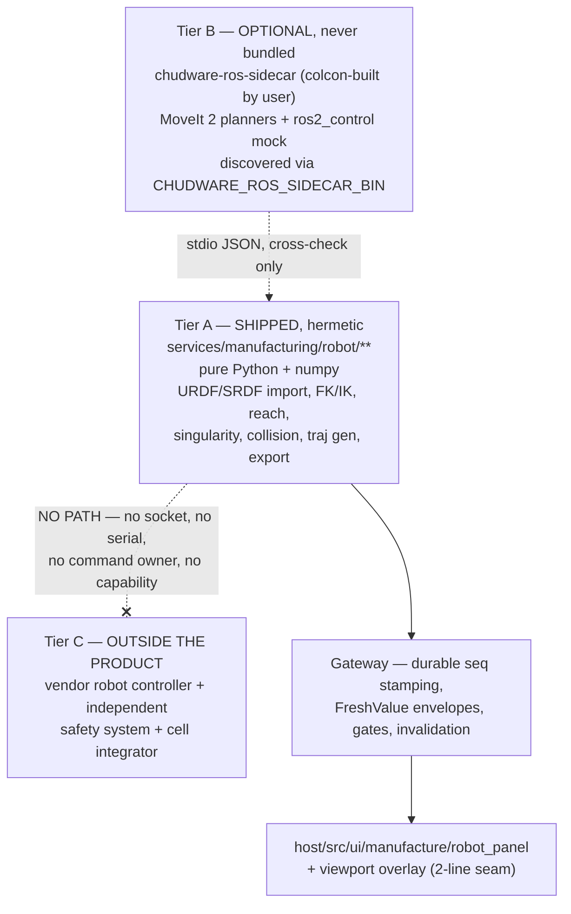

# Manufacturing Robot Architecture — ROS 2 / MoveIt Offline Planning

Design-only.
Authority: `00_decisions.md` + `01_definition_of_done.md` (v4 supersedes
every earlier amendment). Path ruling applied: production GUI only under
`host/src/ui/manufacture/**`; cross-domain service root `services/manufacturing/**`; domain engines
`core/<domain>/**`; RPC/events stay `mfg_*` / `mfg.*`; `host/src/ui/cam/**` remains offline-CAM
owner and is touched only through named seams.

Evidence base actually read: `core/mate/mate.h`, `services/mcp/server.py`,
`services/mcp/tool_registry.py`, `host/src/ui/viewport_panel.cpp`, `contracts/worker_rpc.md`,
the twin-reuse audit and the manufacturing-breadth research. Two supporting reads were taken to make
file/API claims exact rather than guessed: `host/src/ui/cam/cam_mirror.h`,
`host/src/render/overlays.h` (declarations only), `contracts/cam.md`, `contracts/events.md`,
`contracts/licenses.md` (BOM table shape). Anything not directly observed is marked
`[INFERENCE]` or `[TO CONFIRM]`.

---

## Citation convention — stable gateway rule ids

Gateway rules are cited here by **stable rule id**, never by gateway section number. The review found
three domains already drifted onto stale `§24.x` numbers pointing at unrelated rules, and the gateway
numbering moved again during the amendment pass, so a section-number citation is not a durable
reference. Each id below is bound to the rule's *content* and, where the gateway has one, to the
wire-level refusal code — a refusal code cannot drift because the daemon returns it verbatim.
Contract tests key on these ids, not on section numbers.

| id | rule as cited in this document |
|---|---|
| `GW-SEQ-1` | the Gateway journal is the sole durable-`seq` authority; `mfg_event_append` stamps every `seq` a UI may paint, and a domain-minted, guessed, derived or copied `seq` is a contract-test failure |
| `GW-KIND-2` | a `result_kind` must already be registered in the durable-result-kind table or the append is refused `mfg_unregistered_result_kind` |
| `GW-KIND-COLUMNS` | every registered kind declares **both** epoch policy **and** runtime invalidation triggers; declaring one column alone is a schema rejection |
| `GW-KIND-REASON` | `supersede_with_parent` on a derived-artifact kind is the owning domain's call **provided the kind table carries a one-line declared reason** |
| `GW-PF-FOLLOWS-PARENT` | a kind whose id ends in `procedural_fact` MUST set `supersede_with_parent:true`, else `mfg_procedural_fact_must_follow_parent` |
| `GW-CAP-NO-INHERIT` | a `*capability` kind MUST NOT set `supersede_with_parent`; a capability row re-derives from its own evidence and never inherits a parent's status |
| `GW-SRC-3` | `src` and `admission` are computed by the gateway and never accepted from a caller; `probed` is settable only by transport code inside the daemon holding an open `ITransport` |
| `GW-ADMISSION-CLASSES` | Stage 1 has exactly two admission classes — `probed_evidence` (`state=="ok" && src=="probed"`) and `procedural_fact` (a seq-stamped `ProceduralFact` row bound to an `art:`/`job:`/`res:` subject) — and `procedural_fact` can never satisfy an execute-side subject |
| `GW-PF-SCOPE-4` | a `procedural_fact` may flip only `plan` \| `generate` \| `post` \| `parse` \| `simulate` to `verified`; `monitor` \| `transport` \| `execute` \| `safety_integration` require fresh probed evidence plus the stage ceiling |
| `GW-CLIENT-5` | `services/manufacturing/rpc/journal_client.py` is gateway-owned and is imported, never vendored or re-implemented per domain |
| `GW-JOURNAL-ONLY-6` | `chudware-mfgd --journal-only` gives an offline domain a real `seq`; it opens no transport, registers no device, and adds no gate SKIP because it is hardware-free |
| `GW-NO-ABI-7` | gateway calls cross the bridge the domain already calls; no new `libchudware` C ABI symbol and no new native build surface |
| `GW-CLOSURE` | `mfg_result_invalidate` computes the transitive closure over the `derived_from[]` edges declared at append; the caller names only the root subject and never populates `affected[]` |
| `GW-SUBJECT-NS` | a domain declares its permitted subject namespaces at registration; an out-of-set append is refused `mfg_subject_namespace_not_permitted` |
| `GW-GUARD-ACCEPTS` | every Stage-2 guard declares `accepts{subject_ns:[…], admission:[…]}` and `gates::evaluate` refuses out-of-set evidence **by name** |
| `GW-TYPES-OWNED` | `CapabilityTruth` / `CapabilityReport` (`core/device/capability.h`) and the Tier-0 `PREREQ` register row (`core/manufacturing/tier0.h`) are gateway-owned; domains compose them and re-declare nothing |
| `GW-TIER0-REGISTER` | `mfg_tier0_register` is atomic and idempotent per `(domain_id, action, prerequisite, hash(applies_when))`, runs the totality check over `action × artifact_kind × machine_class`, and owns the rendering contract |
| `GW-CAP-KIND-REQUIRED` | a domain advertising any level above `unsupported` MUST have a registered `<domain>.capability` durable kind, else registration is refused `mfg_capability_requires_durable_kind`; an all-`unsupported` domain is exempt |
| `GW-CAP-DERIVED-FROM-EVIDENCE` | a capability row's `derived_from[]` is **every evidence row the report cites**, so no level can outlive the evidence under it |
| `GW-FRESHVALUE-PUBLISH` | `FreshValue<T>{v,state,t_mono_ns,seq,age_ms,ttl_ms,src,why,last_ok?}` is the sole external freshness shape, and **every** field a UI paints crosses wrapped in it — including a durable authored row, which is journaled first and then published wrapped with `state:"ok"` and `ttl_ms:null` when it does not decay |
| `GW-EMULATOR-CEILING` | no advertised level may exceed what the highest stage actually passed unlocks: E0–E3 → `monitor`, E4–E5 → `transport`, E6 → `execute`; `safety_integration` is never unlocked by any stage |
| `GW-FAMILY-MANUFACTURE` | one shared MCP family id `"manufacture"` covers the whole overhaul and is OFF by default; the enabling mechanism (`DEFAULT_TOOL_FAMILIES` + `DEFAULT_OFF_TOOL_FAMILIES` in `services/agent/config.py`) is Gateway-owned in W1.1 and is a hard predecessor of every domain's MCP-registration wave |
| `GW-RISK-TABLE-OWNER` | Gateway is the sole owner of the `services/mcp/tool_registry.py` risk-class edit for the batch, in one wave; every other domain's rows land as **data** the owner applies |
| `GW-READONLY-TRANSPORT` | the monitoring/observer transport split: an `IReadTransport` has no `write()` method, so a read-only collector is provably incapable of commanding and never takes or contends for a command lease |
| `GW-ZERO-NEW-SKIP` | the batch adds **zero** new normal-gate SKIPs; an absent optional prerequisite pins the level at `assumed` with the missing level named, or is excluded from `gate.sh` behind an opt-in qualification script — never reported as a SKIP and never read as a pass |

---

## 1. What this wave is, in one paragraph

An **offline robot-cell planner and analyser**. It imports URDF/SRDF, canonicalises it into a
versioned cell document, models frames/TCP/payload with explicit provenance, computes
reachability / singularity / collision, generates and previews a time-parameterised trajectory,
exports that trajectory as a **non-executable** offline artifact, and optionally cross-checks
itself against a user-installed ROS 2/MoveIt sidecar plus a `ros2_control` **mock-controller** CI
run. It has **no command path to any robot**, at any layer, by construction. The manufacturing-breadth research
placed ROS 2/MoveIt in the `NEXT` tranche as *"URDF/SRDF import, reachability/collision analysis,
trajectory preview/export and mock-controller CI ... keep all physical execution behind the vendor
robot controller and independent safety system until Later"*. This design implements exactly that
sentence and nothing past it.

---

## 2. The sidecar boundary (the load-bearing decision)

Three tiers, with a hard process boundary between each.



### 2.1 Tier A — in-tree, hermetic, shipped

`services/manufacturing/robot/**`, **pure Python + numpy**, out-of-process from `libchudware`.

Rationale, each point traceable:

- **DoD #16**: the public `libchudware` C ABI carries no `mfg_*` symbols, and Gateway/device
  execution remains a separate service/process boundary. Putting the robot kernel in Python means
  there is *no* new exported native symbol to argue about and *no* new native target.
- **DoD #1**: `scripts/gate.sh` must be green with SKIPs only for documented absent prerequisites,
  and per the final project ruling this wave adds **no new normal-gate SKIP at all** (`GW-ZERO-NEW-SKIP`). A hermetic Python
  kernel with numpy (already a BOM dependency) needs neither OCCT, nor emsdk, nor a twin binary,
  nor ROS. Stages E0–E3 are dependency-free by construction (E3's cross-check runs from a recorded
  transcript fixture, not a binary). The live ROS sidecar runs **only** from the opt-in
  `scripts/qualify_robot_e3.sh`, which `gate.sh` never calls — and
  `test_qualification_not_in_gate.py` asserts that.
- **DoD #17 / licence posture**: zero new bundled or linked dependency, so nothing new enters the
  core libraries' licence surface. ROS/MoveIt stay entirely subprocess-side.
- **The twin-reuse audit** explicitly warns against reusing `solve_mates` as a runtime integrator
  ("*Reuse the transform/residual math, not `solve_mates` as the runtime plant integrator*"). We
  reuse the **rotation formulation**, not the solver.

**Reuse from `core/mate/mate.h`, precisely.** The mate seam parameterises each floating body as
translation in **mm** plus an **absolute rotation vector** `w` in Rodrigues / exp-map coordinates
(`core/mate/mate.h:3-7`), and exposes `unit`, `rodrigues`, `mat_to_rotvec` (`:88-90`). The robot
cell adopts *that* pose convention verbatim so a robot frame and an assembly mate frame are the
same kind of object and can be composed without a conversion table. `services/manufacturing/robot/
rotation.py` is a Python mirror of those three functions. `test_rotation_parity.py` is **hermetic**:
it checks the Python implementation against `fixtures/mfg/robot/expected/rotation_vectors.json`,
golden triples generated once from the C++ convention and committed. The live `mate_cli` cross-check
(`core/mate/mate.h:87,96`) moves to `scripts/qualify_robot_e3.sh`, so no gate SKIP is introduced.
We do **not** call `solve_mates`, and we do **not** introduce a
second rotation convention.

**Frame/unit conversion happens exactly once, at import.** URDF is metres with `rpy` in the
fixed-axis XYZ convention, i.e. `R = Rz(yaw) · Ry(pitch) · Rx(roll)`. The importer composes that
matrix, converts it via `mat_to_rotvec`, multiplies translations by 1000, and records
`unit_source:"m"`, `rotation_source:"urdf_rpy_fixed_xyz"` on every frame. Downstream code sees only
mm + rotvec. Twin-reuse audit mismatch #5 (frame/unit incompatibility) is closed by this single
normalisation point, not by scattered conversions.

### 2.2 Tier B — optional out-of-process ROS 2 / MoveIt sidecar

Source lives in-tree so it is reproducible and auditable, but it is **not built by any Chudware
CMake target and not present in any release artifact**:

```
services/manufacturing/robot/sidecar_ros/          # ament_cmake package `chudware_ros_bridge`
  package.xml
  CMakeLists.txt                                   # colcon-built by the USER, in THEIR ROS install
  src/bridge_main.cpp                              # stdio JSON <-> MoveIt / controller_manager
  src/moveit_plan.cpp                              # OMPL + Pilz LIN/PTP wrappers
  src/mock_run.cpp                                 # ros2_control mock_components run driver
  config/mock_controllers.yaml                     # mirrored ideal command->state controllers
  README.md                                        # build instructions + licence notice
```

- **Discovery**: `CHUDWARE_ROS_SIDECAR_BIN` env var, else absent. Exactly the established repo
  pattern for optional non-bundled binaries (`CHUDWARE_NGSPICE`, `OPENMVS_BIN`, `COLMAP_BIN`,
  `CHUDWARE_SLICER_BIN`). Never auto-downloaded, never on a network path, never spawned implicitly.
- **Wire protocol**: the same newline-delimited JSON over stdio as `contracts/worker_rpc.md`
  protocol 2 (`{"id",…,"method","params"}` → `{"id","event","data"}`* →
  `{"id","ok","result"|"error"}`), with the structured error envelope of `doc_ops.md §5`. Sidecar
  methods are namespaced `ros_*` and are **never** surfaced as `mfg_*`: `ros_ping`,
  `ros_load_cell`, `ros_plan`, `ros_mock_run`, `ros_shutdown`. `ros_ping` returns
  `{pong, sidecar_version, ros_distro, moveit_version, planners:[…], protocol:2}`; a major-protocol
  mismatch is a refusal, not a degradation.
- **What it may do**: propose plans and run a mock controller. **What it may not do**: be the sole
  source of any gate-passing evidence, and be advertised as anything above `simulate`.
  The manufacturing-breadth research records MoveIt's own docs saying collision/smoothing checks *can be
  disabled* and that normal Linux is not well suited to hardware control; a planner collision check
  is not a safety-rated protective function.
- **MoveIt Servo is excluded outright** — it is a realtime streaming controller, i.e. exactly the
  execution surface this wave refuses.
- **Absence is normal, and it is the default.** Every consumer degrades to
  `FreshValue{state:"unknown", v:null, why:"ros_sidecar_absent: opt-in qualification only"}`, and
  the `robot_sidecar_crosscheck` / `robot_mock_run_accepted` corroborating gates become
  `not_applicable`. Nothing in the normal gate reaches for the sidecar, so nothing in the normal
  gate skips.

### 2.3 Tier C — vendor controller + safety system

Outside the product. Per the manufacturing-breadth research, ISO 10218-2:2025 puts cell-level risk assessment on
the **application/cell integrator**; ROS-Industrial's own framing is that it *combines* ROS
high-level capability with the low-level reliability and safety of industrial controllers rather
than replacing them. Section 8 below states the enforcement mechanisms that keep Tier C
unreachable from our code.

---

## 3. Exact files

### 3.1 New — Python service (Tier A engine + RPC surface)

| file | contents |
|---|---|
| `services/manufacturing/robot/__init__.py` | package marker; exports `WORKER_METHODS` |
| `services/manufacturing/robot/rotation.py` | `unit`, `rodrigues`, `mat_to_rotvec`, `compose`, `invert`, `rpy_fixed_xyz_to_matrix` — Python mirror of the `core/mate/mate.h:88-90` convention |
| `services/manufacturing/robot/urdf.py` | URDF parse → `RobotChain`; `xml.etree.ElementTree` with entity/DTD hardening; `package://` + `file://` + relative mesh resolution via `mesh_root` |
| `services/manufacturing/robot/srdf.py` | SRDF parse → groups, group states, end effectors, virtual joints, `disable_collisions` pairs (**enumerated, never silently applied**) |
| `services/manufacturing/robot/cell.py` | `aicad.robot_cell/1` build/validate/canonicalise/hash; frame graph; TCP; payload; environment obstacles |
| `services/manufacturing/robot/mesh_io.py` | STL/OBJ/DAE load via `trimesh` (already in BOM) → deterministic triangle soup + per-mesh AABB + content hash |
| `services/manufacturing/robot/kinematics.py` | FK (product of exponentials), geometric Jacobian, damped-least-squares IK, joint-limit clamping |
| `services/manufacturing/robot/reach.py` | voxel reachability map (`aicad.robot_reach/1`) |
| `services/manufacturing/robot/singularity.py` | Jacobian SVD → σ_min, κ, manipulability; guard-banded classification |
| `services/manufacturing/robot/collide.py` | AABB-BVH broad phase + deterministic triangle-pair narrow phase; self-collision + environment; separation distance |
| `services/manufacturing/robot/trajectory.py` | waypoint → per-joint trapezoidal time parameterisation; blend/approach/retract classification; backplot arrays |
| `services/manufacturing/robot/export_traj.py` | `aicad.robot_traj/1` JSON, flat CSV, `trajectory_msgs/JointTrajectory` YAML; provenance sidecar |
| `services/manufacturing/robot/sidecar.py` | `CHUDWARE_ROS_SIDECAR_BIN` discovery, stdio client, transcript recorder/replayer, version handshake. **Reached only from the opt-in qualification script**; no normal-gate path calls it |
| `services/manufacturing/robot/capability.py` | **composes** `CapabilityTruth`/`CapabilityReport` from `core/device/capability.h` (Gateway-owned, `GW-TYPES-OWNED`) for `domain_id="robot"`; declares the Tier-0 rows in Gateway's row shape; Stage-1/Stage-2 gate tables. Re-declares **no** level list and **no** truth vocabulary |
| `services/manufacturing/robot/tier0.py` | the **declarative** Tier-0 row table for `domain_id="robot"` (`GW-TYPES-OWNED`, registered through the gateway-owned helper per `GW-CLIENT-5`), registered at domain init |
| `services/manufacturing/robot/evidence.py` | `mfg.robot.*` event construction, `FreshValue` wrapping, falsified/superseded notices |
| `services/manufacturing/robot/determinism.py` | canonical ordering, output quantisation, state hashing, fixed-seed LCG |
| `services/manufacturing/robot/store.py` | content-addressed analysis/plan/reach artifact store under the app cache |
| `services/manufacturing/robot/worker_methods.py` | `WORKER_METHODS` dict registering every `mfg_robot_*` method (same registration idiom as `services/worker_main.py`'s `drawing.WORKER_METHODS`, `contracts/worker_rpc.md:251`) |
| `services/manufacturing/robot/smoke_offline.py` | end-to-end smoke: import → reach → plan → analyse → export ×3 → print capability + gate + evidence tables |

### 3.2 New — MCP tool surface

| file | contents |
|---|---|
| `services/mcp/robot_tools.py` | `register_robot_tools(mcp)` — the ten tools in §5.2 |

### 3.3 New — optional sidecar source (not built by Chudware)

`services/manufacturing/robot/sidecar_ros/**` as listed in §2.2.

### 3.4 New — GUI (production, `host/src/ui/manufacture/**` only)

| file | contents |
|---|---|
| `host/src/ui/manufacture/robot_mirror.h` | `RobotJointRow`, `RobotLinkRow`, `RobotGroupRow`, `RobotTcpRow`, `RobotPayloadRow`, `RobotBackplot`, `class RobotMirror`, plus the painted-row types of §6.2 — `RobotCellSummary`, `RobotReachSummary`, `RobotAnalysisConclusion`, `RobotPlanSummary`, `RobotTrajExportProvenance`, `RobotMockRunRecord`, `RobotSidecarStatus` — each held **only** as a `FreshValue<T>`, never as a bare value |
| `host/src/ui/manufacture/robot_mirror.cpp` | JSON → typed rows + cached GL geometry. Depends only on `nlohmann::json`; touches neither ImGui nor the renderer — the exact contract `host/src/ui/cam/cam_mirror.h:1-3` states for `CamMirror` |
| `host/src/ui/manufacture/robot_panel.h` | `class RobotPanel` + the three viewport free functions in §5.4 |
| `host/src/ui/manufacture/robot_panel.cpp` | panel implementation + all overlay/HUD drawing |

`RobotBackplot` deliberately mirrors `CamBackplot` (`host/src/ui/cam/cam_mirror.h:52-68`) field for
field in structure, because the renderer path it feeds is the same one:

```cpp
struct RobotBackplot {
    // Flat GL_LINES batches in WCS millimetres, one per motion class.
    std::vector<float> joint, linear, blend, approach, retract;
    std::vector<float> jointT0, linearT0, blendT0, approachT0, retractT0;
    std::vector<float> jointT,  linearT,  blendT,  approachT,  retractT;
    std::vector<float> jointDir, linearDir, blendDir, approachDir, retractDir;
    std::vector<float> frameTriads;     // TCP + base + workobject triads (drawSegments)
    std::vector<float> linkWireframe;   // per-link collision-geometry edges at the scrub pose
    std::vector<float> reachHull;       // reachable-voxel boundary edges (optional)
    double totalTime = 0;
    float minx=0, miny=0, minz=0, maxx=0, maxy=0, maxz=0;
    bool empty() const;
    void clear();
};
```

### 3.5 Existing files touched, and the exact seam

| file | edit | why it is minimal |
|---|---|---|
| `host/src/ui/viewport_panel.cpp` | **+1 include, +2 call sites.** Include `"manufacture/robot_panel.h"` beside the existing `"cam/cam_panel.h"` (`:26`). Inside the existing native-overlay pass, immediately after the CAM block that ends at `:2640-2641`, add `if (inManufacture && ui::robotPreviewActive()) ui::robotDrawViewportGeometry(st, renderer);`. In the screen-space pass, beside `:2867-2869`, add `if (inManufacture && ui::robotHudActive()) ui::robotDrawViewportHud(st, vr0, ImVec2(vr1.x - vr0.x, vr1.y - vr0.y));` | Byte-for-byte the shape of the existing CAM seam (`ui::camSimHudActive()` / `ui::camDrawViewportHud`). All logic lives in `robot_panel.cpp`. |
| `host/src/render/overlays.h` / `.cpp` | **no change** | Everything needed already exists: `drawSegments` (`:66`), the time-scrubbed prefix/suffix path `drawCamSegments` (`:72`), `drawCamToolMarker` (`:79`), `drawTriangles` (`:86`). `drawCamSegments` is a generic *time-scrubbed segment batch* — the `Cam` prefix is pre-existing naming, and reusing it costs zero churn in a shared file. Trajectory scrub is precisely a completed-prefix / pending-suffix range draw over an end-time array. |
| `services/mcp/server.py` | **+2 lines** in the registration block: `from services.mcp.robot_tools import register_robot_tools` then `register_robot_tools(_reg.view(mcp, "manufacture"))`, placed with the other Manufacture families near the CAM registration (`:362-365`) | Exactly the established idiom used by all ~50 existing families. |
| `services/mcp/tool_registry.py` | **not edited by robot** — the two `_RISK_OVERRIDES` rows (`:64-70`) are handed to Gateway, sole owner of this file's risk-class edit for the batch (`GW-RISK-TABLE-OWNER`) | See §5.2 — two tools persist artifacts and must be tightened to `RISK_WRITE` despite read-shaped names; five concurrent appenders would each break the others' unchanged-`classify_risk` assertion. |
| `services/agent/config.py` | **not edited by robot.** The edit is exactly as analysed in §3.7 — **+1 entry** in `DEFAULT_TOOL_FAMILIES` (`:589-593`) and **+1 new** `DEFAULT_OFF_TOOL_FAMILIES = ("manufacture",)` consulted in the `else` branch of `get_tool_families` (`:1004-1005`) — but it is **Gateway-owned in W1.1** and lands before any MCP wave (`GW-FAMILY-MANUFACTURE`) | **Required, not cosmetic** — see the trap in §3.7. Robot's wave is not first, so robot cannot own the file that decides whether *every* domain's surface ships enabled. |
| `host/CMakeLists.txt` | **+2 source entries** (`robot_panel.cpp`, `robot_mirror.cpp`) | No new target, no new dependency, no new link, no C ABI symbol. Top-level/root CMake is untouched. |
| `services/worker_main.py` (or the doc-worker method registry that consumes `WORKER_METHODS`) | **+1 registration line** for `services.manufacturing.robot.worker_methods.WORKER_METHODS` | Same idiom `contracts/worker_rpc.md:251` documents for `drawing.WORKER_METHODS`. `[TO CONFIRM]` the exact registration call site in `services/worker_main.py`; the pattern is contract-documented, the line number was not read for this design. |

### 3.6 New — fixtures (synthetic, project-owned)

```
fixtures/mfg/robot/
  make_fixtures.py                   # generates every URDF/SRDF/STL below, deterministically
  synth6r.urdf  synth6r.srdf         # 6R articulated arm, OUR OWN DH parameters
  synth_scara.urdf  synth_scara.srdf # RRPR — prismatic-joint coverage
  synth_gantry.urdf  synth_gantry.srdf # PPP+fixed — rank-deficient-Jacobian coverage
  selfcollide.urdf                   # guaranteed self-collision at named config `q_hit`
  cell_env_obstacle.json             # environment obstacle set
  broken_missing_collision.urdf      # in-group link with visual but NO collision geometry
  broken_unsupported_joint.urdf      # `planar` joint
  broken_no_limits.urdf              # revolute joint with no <limit>
  broken_srdf_no_groups.srdf         # SRDF with zero planning groups
  broken_xxe.urdf                    # external-entity payload (hardening test)
  meshes/*.stl                       # generated boxes/cylinders
  sidecar_mock_run_synth6r.jsonl     # recorded Tier-B transcript for hermetic replay
  expected/*.json                    # golden quantised state hashes + gate tables
```

**No vendor robot description is ever vendored** — not `ur_description`, not `franka_description`,
not `moveit_resources`, even though several are permissively licensed. Every fixture is generated
by `make_fixtures.py` from our own numbers. This keeps the FK closed-form oracle ours (see §7) and
keeps the licence BOM empty of third-party robot data.

### 3.7 The tool-family trap, and the two scripts

The project ruling is that the shared `manufacture` family is **OFF by default until commissioning**.
Reading `services/agent/config.py` shows that is *not* achievable by omission, and the reason is
worth stating because getting it wrong ships an enabled manufacturing surface:

- `DEFAULT_TOOL_FAMILIES` (`:589-593`) does not contain `manufacture`.
- `is_tool_family_enabled` returns **`True` for an unknown family** (`:1013-1017`). So registering
  tools under a family that is not in the list leaves them **silently enabled**.
- Adding `manufacture` to the list is necessary but still not sufficient: with nothing configured,
  `get_tool_families` falls to `else: out[fam] = True` (`:1004-1005`) — also **enabled**.

Therefore two edits are required, and `test_manufacture_family_default_off.py` asserts both:
add `"manufacture"` to `DEFAULT_TOOL_FAMILIES`, and add
`DEFAULT_OFF_TOOL_FAMILIES = ("manufacture",)` consulted in that `else` branch.

**Ownership, corrected: robot found this, Gateway owns it.** Seven domains register into the family,
and if any MCP wave lands before the config edit the entire Manufacture surface ships **enabled by
default** — including Gateway's three motion-class request tools. Robot's wave is not first, so the two
`services/agent/config.py` edits and `test_manufacture_family_default_off.py` move to **Gateway in
W1.1**, as a hard predecessor of every domain's MCP-registration wave including robot's
(`GW-FAMILY-MANUFACTURE`). Robot keeps the analysis credit and asserts the resulting property from the
outside (§7); it makes neither edit. The mechanism itself is unchanged — the finding was that omission
does not achieve default-off, and that finding is what Gateway now carries. A code-level
default-off set is chosen over shipping `agent.tool_families.manufacture = false` in the default
config, because a stale or user-edited config file cannot silently re-enable it. When
`agent.role_tools` is configured the existing union logic (`:1002-1003`) already yields `False`
unless a role lists the family, so that path needs no change. Per-tool toggles keep granularity via
the existing `get_tool_options` surface, so nothing is lost by the family being off.

Two new scripts, neither referenced by `gate.sh`:

| script | role |
|---|---|
| `scripts/qualify_robot_e3.sh` | **opt-in only.** Live ROS-sidecar cross-check + `ros2_control` mock run + the `mate_cli` rotation cross-check. Requires `CHUDWARE_ROS_SIDECAR_BIN`. Never called by `gate.sh`; `test_qualification_not_in_gate.py` greps `scripts/gate.sh` to prove it |
| `services/manufacturing/robot/smoke_offline.py` | the dependency-free end-to-end smoke described in §7 |

---

## 4. Data model

Five new versioned schemas. All are plain JSON, unknown keys ignored by consumers, producers never
remove or retype a field — the convention `contracts/cam.md §2` already sets.

**Durable `seq` is never minted by this subsystem.** Every `at_seq` field below is stamped by the
**Gateway journal at append** (`GW-SEQ-1`). Robot producers
submit a result with no `seq`, the journal appends and stamps, and the stamped row is what a UI may
paint. Producers therefore cannot invent an ordering, and lane-epoch / process-start reconciliation
stays in one place (DoD #10). Likewise `src` is **derived by the Gateway from typed transport
provenance** (`GW-SRC-3`), never asserted by us: `emulator → simulated`, `profile/config → declared`,
`camera/model → advisory`, and only real device transports (`serial|tcp|websocket|http_adapter`)
yield `probed`. The robot subsystem has **no transport**, so it can only ever produce `simulated`
and `declared` evidence — which is exactly why no robot artifact can pass an execute-side Stage 1.

### 4.1 `aicad.robot_cell/1`

```jsonc
{
  "schema": "aicad.robot_cell/1",
  "cell_id": "cell_7f3a…",
  "name": "synth6r cell",
  "cell_hash": "sha256:…",          // canonical hash over EVERYTHING below (see §6.4)
  "source": {
    "urdf": {"path": "...", "sha256": "…", "bytes": 20481},
    "srdf": {"path": "...", "sha256": "…", "bytes": 1204},
    "meshes": [{"uri": "package://…/link1.stl", "resolved": "...", "sha256": "…"}],
    "unit_source": "m",             // converted ONCE at import; everything below is mm
    "rotation_source": "urdf_rpy_fixed_xyz"
  },
  "parse_report": {
    "parse_ok": true,
    "unsupported": [],              // e.g. [{"kind":"joint_type","name":"j5","value":"planar"}]
    "warnings": [],
    "dtd_or_entity_rejected": false
  },
  "links":  [{"id":"link1","parent_joint":"j1","visual":[…],"collision":[{"mesh_hash":"…","tris":840,"aabb":[6]}],"inertial":{"mass_kg":3.7,"com":[3],"inertia":[9]}|null}],
  "joints": [{"id":"j1","type":"revolute","parent":"base_link","child":"link1",
              "origin":{"t":[3],"w":[3]},"axis":[3],
              "limit":{"lower_rad":-3.14,"upper_rad":3.14,"velocity":3.15,"effort":150.0}|null,
              "declared_order":0}],
  "frames": [{"id":"tcp0","parent":"flange","t":[3],"w":[3],
              "kind":"base|world|joint|link|flange|tcp|mount|workobject|fixture|camera",
              "provenance":"declared|imported|measured|calibrated",
              "source":"urdf|srdf|user|probe|calibration","at_seq":118}],
  "groups": [{"id":"arm","base":"base_link","tip":"flange","joints":["j1",…,"j6"],
              "kind":"chain|joints|links","resolved":true,
              "group_states":[{"name":"home","joints":{…}}]}],
  "self_collision_filter": [
    {"a":"link1","b":"link2","source":"srdf_disable_collisions","reason":"Adjacent","suppressed_pairs":1}
  ],
  "tcps": [{"id":"tcp0","parent_link":"flange","t":[3],"w":[3],
            "mass_kg":1.2,"com":[3],"inertia":[9]|null,
            "calibration":{"method":"4point|6point|external","at":"2026-08-08T…","residual_mm":0.18,
                           "uncertainty_mm":0.25,"by":"…"}|null,
            "provenance":"declared|measured|calibrated"}],
  "payloads": [{"id":"pl_grip_part","mass_kg":2.4,"com":[3],"inertia":[9]|null,
                "grasp":{"tcp":"tcp0","t":[3],"w":[3]},
                "declared_robot_limit_kg":5.0,
                "provenance":"declared|measured"}],
  "environment": [{"id":"table","kind":"box|mesh","t":[3],"w":[3],"dims":[3]|{"mesh_hash":"…"},
                   "provenance":"declared|imported"}],
  "capability": { /* §6.1 */ },
  "at_seq": 118          // stamped by the gateway journal at append; NEVER minted here
}
```

**Frame graph is a graph with provenance**, per abstraction #2 of the manufacturing-breadth research. A frame whose
`provenance` is `declared` can be composed and previewed, but every *accuracy* claim derived from
it is labelled `advisory` and cannot satisfy any gate — see §6.3.

**Payload is a declared constraint only.** It participates in exactly two checks: mass ≤
`declared_robot_limit_kg`, and inclusion of the payload's collision hull in collision analysis.
`dynamics` is a permanently `unsupported` capability level: we never claim torque feasibility,
motor saturation, or gravity-compensation validity. Stating this is not a limitation to hide — it
is the difference between an honest planner and a fabricated one.

### 4.2 `aicad.robot_reach/1`

```jsonc
{
  "schema": "aicad.robot_reach/1", "reach_id": "…",
  "depends_on": {"cell_hash":"…","group":"arm","tcp":"tcp0","payload":null,"params_hash":"…"},
  "grid": {"frame":"base_link","lo":[3],"hi":[3],"res_mm":25.0,"nx":40,"ny":40,"nz":32},
  "orientations": {"set":"icosphere","subdiv":1,"rolls":4,"count":168,"seed":"fixed"},
  "voxels_rle": [[0,512,"unreachable"],[512,64,"reachable"],…],
  "counts": {"reachable":8123,"reachable_with_collision":902,"unreachable":42311,"indeterminate":88},
  "guard_band": {"ik_residual_mm":0.05,"clearance_mm":0.5},
  "state_hash": "sha256:…", "src": "simulated", "at_seq": 121
}
```

`indeterminate` is a first-class outcome, never rounded into a boolean. This is the direct answer
to the twin-reuse audit's determinism finding that borderline `floor/ceil` + libm rounding can flip
counts between builds.

### 4.3 `aicad.robot_analysis/1`

One envelope for both analysis kinds, discriminated by `kind: "singularity" | "collision"`.

```jsonc
{
  "schema": "aicad.robot_analysis/1", "analysis_id": "…", "kind": "singularity",
  "depends_on": {"cell_hash":"…","group":"arm","tcp":"tcp0","payload":"pl_grip_part","params_hash":"…"},
  "subject": {"joints":[6]} /* or */ {"trajectory_id":"…","samples":412},
  "singularity": {
    "thresholds": {"sigma_min":0.01,"kappa_max":200.0,"guard_band_frac":0.15},
    "worst": {"sample":207,"sigma_min":0.0074,"kappa":341.2,"manipulability":1.9e-4,
              "verdict":"singular","type":"unknown"},
    "per_sample_rle": [[0,180,"ok"],[180,52,"near_singular"],[232,4,"singular"],…],
    "counts": {"ok":356,"near_singular":52,"singular":4,"indeterminate":0}
  },
  "collision": null,
  "state_hash": "sha256:…", "src": "simulated", "at_seq": 124
}
```

For `kind:"collision"`:

```jsonc
"collision": {
  "guard_band_mm": 0.5, "tolerance_mm": 0.01,
  "contacts": [{"sample":88,"a":"link3","b":"table","depth_mm":1.9,"point":[3]}],
  "min_separation_mm": {"value":-1.9,"sample":88,"a":"link3","b":"table"},
  "filtered_pairs_considered": 14,      // SRDF-disabled pairs, REPORTED not hidden
  "filtered_pairs_that_would_have_hit": [{"a":"link1","b":"link2","samples":3,"source":"srdf"}],
  "geometry_completeness": {"in_group_links":6,"with_collision_geometry":6,"missing":[]},
  "counts": {"clear":401,"contact":11,"indeterminate":0}
}
```

`filtered_pairs_that_would_have_hit` matters: an SRDF `disable_collisions` entry is a *modelling
assertion by whoever wrote the SRDF*. Silently honouring it while reporting "collision-free" is the
fabrication mode this field exists to prevent.

### 4.4 `aicad.robot_plan/1`

```jsonc
{
  "schema": "aicad.robot_plan/1", "plan_id": "…",
  "depends_on": {"cell_hash":"…","group":"arm","tcp":"tcp0","payload":"pl_grip_part","params_hash":"…"},
  "planner": {"owner":"chudware_tier_a","algorithm":"joint_interp|cartesian_lin|blend",
              "version":"1","crosscheck":{"owner":"ros_sidecar","planner":"ompl:RRTConnect",
                                          "sidecar_version":"…","agreed":true}|null},
  "goals": [{"kind":"joint|cartesian","joints":[6]|null,"pose":{"t":[3],"w":[3]}|null,
             "tcp":"tcp0","tolerance":{"pos_mm":0.5,"ang_deg":0.5},"blend_mm":0.0}],
  "waypoints": [{"joints":[6],"t_ns":0,"class":"approach"}],
  "samples":   {"dt_ns":8000000,"n":412,"q":[[…]],"qd":[[…]],"qdd":[[…]]},
  "limits_used": {"source":"urdf_limit|user_override","vel":[6],"acc":[6],"jerk":null},
  "time_parameterisation": {"method":"per_joint_trapezoidal","jerk_limited":false,
                            "torque_checked":false},
  "duration_s": 3.296,
  "analysis": {"collision_analysis_id":"…","singularity_analysis_id":"…"},
  "state_hash": "sha256:…", "src": "simulated", "at_seq": 129
}
```

`torque_checked:false` is written by the producer, not by a reviewer's memory. `jerk_limited:false`
likewise. A field that says "we did not check this" is worth more than a silent omission.

### 4.5 `aicad.robot_traj/1` and `aicad.robot_mockrun/1`

```jsonc
{ "schema": "aicad.robot_traj/1", "traj_id": "…", "plan_id": "…",
  "not_for_execution": true,
  "reason": "offline_planner_only: no execute capability, no vendor post, no safety integration",
  "joint_names": ["j1",…], "points":[{"t_ns":0,"q":[6],"qd":[6],"qdd":[6]}],
  "frames": {"base":"base_link","tcp":"tcp0"},
  "provenance": {"cell_hash":"…","plan_hash":"…","capability_at_export":{…},
                 "emulator_stage":"E3","exported_at_seq":131,"exporter_version":"1"} }
```

```jsonc
{ "schema": "aicad.robot_mockrun/1", "run_id": "…", "plan_id": "…",
  "sidecar": {"version":"…","ros_distro":"…","controller_manager":"…"},
  "controllers": [{"name":"joint_trajectory_controller","type":"…","state":"active"}],
  "hardware": {"plugin":"mock_components/GenericSystem","ideal_mirror":true},
  "result": {"accepted":true,"goal_status":"SUCCEEDED","reported_error_max":0.0,
             "samples":412,"wall_s":3.4},
  "proves": ["controller_configuration_loads","trajectory_msg_accepted","joint_names_match",
             "limits_not_rejected_by_controller"],
  "does_not_prove": ["dynamics","following_error","tracking_accuracy","timing_determinism",
                     "safety_function","real_hardware_behaviour"],
  "src": "simulated", "at_seq": 137 }   // src derived, at_seq stamped — both gateway-owned
```

The `proves` / `does_not_prove` pair is machine-readable and rendered in the GUI verbatim.
The manufacturing-breadth research cites the `ros2_control` docs calling mock components *"trivial
simulations"* with ideal command-to-state mirroring; encoding that in the artifact stops a green
mock run from silently becoming a competence claim.

---

## 5. APIs

### 5.1 Worker RPCs — `mfg_robot_*`

Served by `services/manufacturing/robot/worker_methods.py::WORKER_METHODS`. All use the structured
error envelope. Nothing here exists as a `libchudware` C ABI symbol (DoD #16).

| method | params → result |
|---|---|
| `mfg_robot_cell_import` | `{urdf_path, srdf_path?, name?, unit?="m", mesh_root?}` → `aicad.robot_cell/1` |
| `mfg_robot_cell_describe` | `{cell_id, detail?="summary"\|"full"}` → cell projection + `FreshValue<RobotCapabilityLevels>` |
| `mfg_robot_pose_fk` | `{cell_id, group, joints:[n], tcp?}` → `{link_poses:{id:{t,w}}, tcp_pose:{t,w}, jacobian:{sigma_min,kappa,manipulability}}` |
| `mfg_robot_pose_ik` | `{cell_id, group, target:{t,w}, tcp?, seed?:[n], seed_set?="ordered"}` → `{solutions:[{joints,residual_mm,residual_deg,iters,limits_ok}], status:"ok"\|"no_solution"\|"limit_blocked", seeds_tried}` |
| `mfg_robot_reach_map` | `{cell_id, group, box:{lo,hi}, res_mm, orientations:{subdiv,rolls}, tcp?, payload?}` → `aicad.robot_reach/1`; streams `mfg.robot.analysis_progress` |
| `mfg_robot_singularity_scan` | `{cell_id, group, joints?\|trajectory_id?, thresholds?}` → `aicad.robot_analysis/1` |
| `mfg_robot_collision_check` | `{cell_id, group, joints?\|trajectory_id?, guard_band_mm?, include_filtered_report?=true}` → `aicad.robot_analysis/1` |
| `mfg_robot_plan_preview` | `{cell_id, group, goals:[…], options?:{blend_mm, vel_scale, acc_scale, crosscheck?}}` → `aicad.robot_plan/1`; streams progress |
| `mfg_robot_traj_export` | `{plan_id, path, format:"json"\|"csv"\|"ros_yaml"}` → `{path, sha256, provenance_path, not_for_execution:true}` |
| `mfg_robot_mock_run` | `{cell_id, plan_id, options?:{controller?, timeout_s?}}` → `aicad.robot_mockrun/1` or refusal `ros_sidecar_absent` |
| `mfg_robot_capability_report` | `{cell_id?}` → `{levels, emulator_stage, tier0_register, stage1, stage2, waivers, why}` |

Refused method names — reserved and permanently unimplemented, so a future agent cannot "add the
obvious next one": `mfg_robot_jog`, `mfg_robot_home`, `mfg_robot_enable`, `mfg_robot_servo_on`,
`mfg_robot_program_load`, `mfg_robot_program_start`, `mfg_robot_stop`, `mfg_robot_reset`,
`mfg_robot_connect`, `mfg_robot_stream`. `test_no_execution_surface.py` (§7) asserts none exists.

### 5.2 MCP tools — family `"manufacture"`

Registered `register_robot_tools(_reg.view(mcp, "manufacture"))` — the single shared family for the
whole manufacturing overhaul, per the final project ruling: the wire prefix stays `mfg_*` / `mfg.*`, but
the user-facing/config family id is the existing product term **Manufacture**. The family is OFF by
default, and default-off is established by the Gateway-owned `services/agent/config.py` edit in W1.1,
not by this registration (`GW-FAMILY-MANUFACTURE`, §3.7). Risk classes verified
against `services/mcp/tool_registry.py:33-83`.


| tool | signature | risk | how the class is reached |
|---|---|---|---|
| `import_robot_cell` | `(urdf_path, srdf_path="", name="", unit="m", mesh_root="")` | `EXTERNAL` | `_EXTERNAL_PREFIXES` contains `import_` (`:33`) — reads arbitrary disk paths |
| `describe_robot_cell` | `(cell_id, detail="summary")` | `READ` | `_READ_PREFIXES` `describe_` (`:35`) |
| `list_robot_groups` | `(cell_id)` | `READ` | `_READ_PREFIXES` `list_` |
| `describe_robot_capability` | `(cell_id="")` | `READ` | `_READ_PREFIXES` `describe_` |
| `query_robot_pose` | `(cell_id, group, joints=None, target=None, tcp="")` | `READ` | `_READ_PREFIXES` `query_`; pure compute, persists nothing |
| `check_robot_collision` | `(cell_id, group, joints=None, trajectory_id="", guard_band_mm=0.5)` | `READ` | `_READ_PREFIXES` `check_`; pure compute |
| `check_robot_singularity` | `(cell_id, group, joints=None, trajectory_id="")` | `READ` | `_READ_PREFIXES` `check_`; pure compute |
| `query_robot_reach` | `(cell_id, group, box, res_mm=25.0, subdiv=1, rolls=4, tcp="", payload="")` | `WRITE` | **`_RISK_OVERRIDES` append** — the `query_` prefix would classify `READ`, but this persists a reach-map artifact. Overrides are checked first (`:75-76`), so this is a legitimate tightening. |
| `draft_robot_plan` | `(cell_id, group, goals, blend_mm=0.0, vel_scale=1.0, acc_scale=1.0, crosscheck=False)` | `WRITE` | **`_RISK_OVERRIDES` append** — `draft_` would classify `READ`; it persists a plan artifact. |
| `export_robot_trajectory` | `(plan_id, path, format="json")` | `EXTERNAL` | `_EXTERNAL_PREFIXES` `export_` |
| `request_robot_mock_run` | `(cell_id, plan_id, controller="", timeout_s=60.0)` | `EXTERNAL` | `_EXTERNAL_PREFIXES` `request_` — spawns a subprocess |

`services/mcp/tool_registry.py` has one owner for the batch — **Gateway**, in a single wave
(`GW-RISK-TABLE-OWNER`) — because five domains otherwise append to the same table concurrently and
each can break the others' "`classify_risk` unchanged for every pre-existing tool" assertion. Robot
appends nothing to that file; these two rows are handed over as **data** for the owner to apply, and
that unchanged-`classify_risk` assertion is the shared acceptance check:

```python
    # Robot (offline) — both names carry a read-shaped prefix but PERSIST a durable
    # artifact (reach map / plan) into the analysis store, so tighten to WRITE.
    # Overrides are consulted before the prefix classifier, so this wins.
    "query_robot_reach": RISK_WRITE,
    "draft_robot_plan": RISK_WRITE,
```

Per DoD #15, motion/safety risk is explicit-membership and safety actions have no model allow path:
there is no robot tool at any risk class that commands a device, so the model's allow-list can
never reach one.

### 5.3 Python engine signatures (Tier A)

```python
# cell.py
def build_cell(urdf_path: str, srdf_path: str | None = None, *, name: str = "",
               unit: str = "m", mesh_root: str | None = None) -> dict: ...
def canonical_hash(cell: dict) -> str: ...
def validate_cell(cell: dict) -> dict:            # -> parse_report
    ...

# kinematics.py
def fk(cell: dict, group: str, q: Sequence[float], *, tcp: str | None = None) -> dict: ...
def jacobian(cell: dict, group: str, q: Sequence[float], *, tcp: str | None = None) -> "np.ndarray": ...
def ik(cell: dict, group: str, target: dict, *, tcp: str | None = None,
       seed: Sequence[float] | None = None, max_iters: int = 200,
       damping: float = 1e-3, tol_mm: float = 1e-3, tol_deg: float = 1e-3) -> dict: ...
#   NO time_budget_ms parameter EXISTS. Passing one is an invalid_op refusal.

# reach.py
def reach_map(cell: dict, group: str, box: dict, res_mm: float,
              orientations: dict, *, tcp=None, payload=None, on_progress=None) -> dict: ...

# singularity.py
def singularity_scan(cell, group, *, q=None, trajectory=None, thresholds=None) -> dict: ...

# collide.py
def collision_check(cell, group, *, q=None, trajectory=None,
                    guard_band_mm=0.5, tolerance_mm=0.01) -> dict: ...
def separation(cell, group, q, pair: tuple[str, str]) -> float: ...

# trajectory.py
def plan_preview(cell, group, goals, *, options=None, on_progress=None) -> dict: ...
def backplot(plan: dict) -> dict:                  # -> RobotBackplot-shaped arrays
    ...

# export_traj.py
def export(plan: dict, path: str, fmt: str) -> dict: ...   # fmt in {json, csv, ros_yaml}

# sidecar.py
def sidecar_status() -> dict: ...                  # -> FreshValue<RobotSidecarStatus>
def sidecar_plan(cell, group, goals, *, timeout_s=60.0) -> dict: ...
def sidecar_mock_run(cell, plan, *, controller=None, timeout_s=60.0) -> dict: ...
def replay_transcript(path: str) -> dict: ...      # hermetic CI path

# capability.py
def capability_levels(cell: dict | None) -> dict: ...
def tier0_register() -> list[dict]: ...
def stage2_checks(cell, *, plan=None) -> list[dict]: ...
```

### 5.4 C++ GUI API

```cpp
// host/src/ui/manufacture/robot_panel.h
namespace ui {

class RobotPanel {
public:
    void draw(AppState& st);                       // docked Manufacture panel
    bool hasCell() const;
    const RobotMirror& mirror() const;
    double scrubTime() const;                      // seconds into the previewed trajectory
    bool   scrubPlaying() const;
private:
    RobotMirror mirror_;
    // ... panel state only; no renderer, no GL
};

// --- the ONLY three symbols viewport_panel.cpp references ---
bool robotPreviewActive();                          // a plan is loaded AND preview is enabled
bool robotHudActive();
void robotDrawViewportGeometry(AppState& st, const Renderer& renderer);
void robotDrawViewportHud(AppState& st, ImVec2 origin, ImVec2 size);

}  // namespace ui
```

`robotDrawViewportGeometry` body, in terms of existing renderer calls only:

```cpp
const auto& bp = panel().mirror().backplot();
const double t  = panel().scrubTime();
const bool  run = panel().scrubPlaying();
const auto& pal = ui::palette;
auto klass = [&](const std::vector<float>& seg, const std::vector<float>& end,
                 const std::vector<float>& dir, const float rgba[4], float w) {
    if (!seg.empty()) st.overlays->drawCamSegments(renderer.camera(), seg, end, t, run, rgba, w);
    if (!dir.empty()) st.overlays->drawTriangles(renderer.camera(), dir, rgba, false);
};
klass(bp.joint,    bp.jointT,    bp.jointDir,    pal.camRapid, 1.0f);
klass(bp.linear,   bp.linearT,   bp.linearDir,   pal.camCut,   1.6f);
klass(bp.blend,    bp.blendT,    bp.blendDir,    pal.camLead,  1.2f);
klass(bp.approach, bp.approachT, bp.approachDir, pal.camLead,  1.0f);
klass(bp.retract,  bp.retractT,  bp.retractDir,  pal.camRapid, 1.0f);
if (!bp.linkWireframe.empty()) st.overlays->drawSegments(renderer.camera(), bp.linkWireframe, pal.simMesh, 1.0f, false);
if (!bp.frameTriads.empty())   st.overlays->drawSegments(renderer.camera(), bp.frameTriads,   pal.accent,  2.0f, true);
if (!bp.reachHull.empty())     st.overlays->drawSegments(renderer.camera(), bp.reachHull,     pal.camStock, 1.0f, false);
float tcp[3];
if (ui::robotTcpPoseAt(t, tcp)) st.overlays->drawCamToolMarker(renderer.camera(), tcp, pal.camTool);
```

`[TO CONFIRM]` the exact palette role names beyond `camRapid`/`camCut`/`camLead`/`camStock`/
`camTool`/`simMesh`/`accent`, all of which are observed in `viewport_panel.cpp:2567-2640`. If a
dedicated robot role set is wanted, it is a `ui::Palette` append, not a renderer change.

Ribbon: a **Robot** group on the existing Manufacture tab (Import Cell · Reach · Analyse · Plan ·
Export · Mock Run · Capability). `[TO CONFIRM]` the Manufacture ribbon registration file — reading
ribbon sources was outside the read set for this design. The requirement is fixed: no ribbon control is
named or behaves like jog / home / enable / start / stop / reset.

---

## 6. Truth machinery

### 6.1 Capability truth (DoD #2, #18) — composed, not re-declared

`capability.py` **composes** the Gateway-owned types and re-declares nothing (`GW-TYPES-OWNED`):

- `CapabilityTruth` (`core/device/capability.h`) = `{level (the nine DoD names), truth ∈
  verified|declared|assumed|unsupported|not_applicable, evidence_ref (res:kind:ulid naming a
  seq-stamped journal row), emulator_stage ∈ E0..E6|none, missing_level (required when assumed),
  why (required unless verified)}`.
- `CapabilityReport` = `{domain_id, levels{}, max_advertised, emulator_stage_passed}`.
- Robot registers `domain_id = "robot"`.

The ceiling rule is Gateway's, not ours (`GW-EMULATOR-CEILING`): `max_advertised` may never exceed what
`emulator_stage_passed` unlocks — E0–E3 → `monitor`, E4–E5 → `transport`, E6 → `execute`, and
`safety_integration` is **never** unlocked by any stage. Robot's highest hardware-free stage is E3,
so its ceiling is `monitor` — and it deliberately **stops one rung lower, at `simulate`**, because
it defines no observation producer.

| level | truth | `evidence_ref` | `why` / `missing_level` |
|---|---|---|---|
| `parse` | `verified` once the journal row exists for this `cell_hash`; `declared` until then | `res:robot_cell_parse:<ulid>` | URDF/SRDF parsed, unsupported constructs enumerated |
| `plan` | `verified` on a journalled plan row | `res:robot_plan:<ulid>` | joint + Cartesian-LIN + blend only |
| `generate` | `verified` on a journalled sample row | `res:robot_traj_samples:<ulid>` | kinematic only |
| `post` | `verified` on a journalled export row | `res:robot_traj_export:<ulid>` | offline artifact only — **not** a vendor-controller program |
| `simulate` | `verified` on journalled analysis rows | `res:robot_analysis:<ulid>` | no dynamics, no process physics, no safety validation |
| `monitor` | **`unsupported`** | — | `why:"robot_subsystem_defines_no_observation_producer; monitoring domain owns ObservationRecord read-only"` |
| `transport` | **`unsupported`** | — | `why:"no_device_transport_exists_in_robot_subsystem"` |
| `execute` | **`unsupported`** | — | `why:"no_vendor_controller_qualification; emulator ceiling E3"` |
| `safety_integration` | **`unsupported`** | — | `why:"cell_integrator_owns_iso10218_2_risk_assessment; never unlocked by any emulator stage"` |

The last four are `unsupported` **with a `why`**, never `not_applicable` and never a bare "absent" —
Gateway's rule for a domain with no device path. `device_command_owner` is `null` with a `why`.
A level stays `declared` until its `evidence_ref` names a real seq-stamped journal row; `assumed`
disables actions exactly like `unsupported` and must name its `missing_level`.

**What a `ProceduralFact` may and may not flip (`GW-PF-SCOPE-4`).** A `procedural_fact` row may flip
only `plan | generate | post | parse | simulate` to `verified`. `monitor | transport | execute |
safety_integration` require fresh **probed** evidence plus the emulator-stage ceiling and can never
be flipped by `procedural_fact`, `simulated`, `declared`, `advisory` or `assumed`. That rule and this
design coincide exactly: the five levels robot can drive to `verified` are precisely those five, and
the four it reports `unsupported` are precisely those four. Robot has no probed transport, so the
second group is unreachable by construction rather than by policy — `test_capability_truth.py`
asserts a `procedural_fact` submitted against any of the four is refused.

Emulator progression (DoD #18), robot-specific:

| stage | content | hardware-free | in normal gates |
|---|---|---|---|
| E0 | URDF/SRDF parse + canonicalise + hash | yes | yes |
| E1 | FK/IK/Jacobian/reach/singularity/collision | yes | yes |
| E2 | trajectory generation + offline export + our own replay | yes | yes |
| E3 | cross-check + mock-run adaptation **from the recorded transcript fixture** | yes | yes |
| E3-live | the same against a real ROS sidecar | needs `CHUDWARE_ROS_SIDECAR_BIN` | **no** — opt-in `scripts/qualify_robot_e3.sh` only |
| E4–E6 | vendor dry run / pilot cell | **not reached** | **never claimed** |

Splitting E3 from E3-live is what lets the wave reach E3 in the normal gate with zero new SKIP: the
adapter, evidence path and cross-check logic are exercised against committed bytes, and only the
live handshake needs a binary. `test_capability_truth.py` asserts the ceiling and the four
`unsupported` rows.

### 6.2 `FreshValue<T>` — sole external shape (DoD #4)

`FreshValue<T>{v, state, t_mono_ns, seq, age_ms, ttl_ms, src, why, last_ok?}`; `v` is null unless
`state=="ok"`; last-good is display-only; a sequence gap forces `unknown`. `seq` is Gateway-stamped
(`GW-SEQ-1`) and `src` is Gateway-derived from typed transport provenance (`GW-SRC-3`, §4 preamble) —
this subsystem asserts neither. There is exactly one envelope in the batch and robot defines no second
one, nor an unwrapped painting path beside it.

**Every row a UI paints crosses wrapped, including the durable authored ones
(`GW-FRESHVALUE-PUBLISH`).** A durable authored row is **journaled first and published wrapped**: the
append stamps its `seq`, and the publisher then emits it as a `FreshValue<T>` with `state:"ok"`, `v`
populated, that same stamped `seq`, `src` gateway-derived, and **`ttl_ms:null`** — the explicit encoding
of *"this row does not decay; it is superseded or falsified, never aged out"*. `age_ms` is informational
for these rows and no consumer branches on it.

**Wrapping does not move persistence identity into the envelope.** A durable robot row is still
identified by `seq` + `revision` + `artifact_hash` — `revision` being the artifact's own schema/version
field from §4 and `artifact_hash` its content hash — invalidation is still scoped by `seq <= at_seq`
(§6.5), and nothing keys, joins, supersedes or invalidates on `age_ms`, `t_mono_ns` or `ttl_ms`. The two
axes are independent: *decay* is a wall-clock property that only one robot row has, *identity* is a
journal property that every durable row has.

Robot rows a UI may paint. `T` names the typed row set `RobotMirror` (§3.4) parses; the durable kind
column is the registered kind from §6.5 that the row is published from:

| row | `T` | `src` (derived) | `ttl_ms` | durable kind published from |
|---|---|---|---|---|
| `robot.capability` | `CapabilityReport` | `declared` — a config/profile fact | `null` | `robot_capability` |
| `robot.cell.summary` | `RobotCellSummary` (links, joints, groups, TCPs, unsupported constructs, `unit_source`, `rotation_source`) | `declared` — authored URDF/SRDF | `null` | `robot_cell` |
| `robot.reach.summary` | `RobotReachSummary` (reachable / unreachable / `indeterminate` counts, `res_mm`) | **`simulated`** | `null` | `robot_reach` |
| `robot.conclusion.<kind>` | `RobotAnalysisConclusion{verdict, counts, indeterminate}` | **`simulated`** — emulator provenance | `null` | `robot_analysis` |
| `robot.plan.summary` | `RobotPlanSummary` | **`simulated`** | `null` | `robot_plan` |
| `robot.traj.export` | `RobotTrajExportProvenance` (cell+plan hash, capability snapshot, `not_for_execution`) | **`simulated`** | `null` | `robot_traj` |
| `robot.mockrun` | `RobotMockRunRecord{proves, does_not_prove}` | **`simulated`** | `null` | `robot_mockrun` |
| `robot.sidecar` | `RobotSidecarStatus` | `declared` when handshaked; `unknown` when absent (the default) | **non-null** | none — an out-of-process binary's liveness is the one robot value whose truth decays with wall time, and it is not a durable authored artifact |

`robot_panel.cpp` therefore has no bare-number read path, and it cannot age an authored artifact out by
clock either: a durable row leaves the screen only when the gateway's closure falsifies it (cleared) or
supersedes it (retained, greyed, forward-pointed — §6.5). `robot.capability` is the row that motivated
the ruling, because it is simultaneously a durable journaled row (`robot_capability`, §6.5) and a painted
one, so it must be **both** journaled and wrapped. Wrapping changes only what a panel *reads*: the four
device-side levels stay `unsupported` with a `why` whatever envelope carries them, and no envelope field
can raise a level (`GW-PF-SCOPE-4`, `GW-EMULATOR-CEILING`).

**There is no `probed` robot row, and this design does not claim one.** An earlier draft asserted
`src:"probed"` for "procedural fact" rows. `GW-SRC-3` makes that structurally impossible,
not merely discouraged: `probed` is settable only by transport code inside the daemon holding an
open `ITransport`, so a pure-Python domain **cannot** produce probed evidence. The correction
matters, and the mechanism it replaces the claim with is Gateway's named one.

DoD #14's procedural-fact allowance is satisfied through the **only** sanctioned route:
`ProceduralFact{check_name, artifact_hash, config_epoch, snapshot_id?, at_seq, outcome}`, submitted
via `mfg_event_append(..., admission:"procedural_fact")`. The journal assigns `at_seq`; we supply
content only. That row states *"check `robot_plan_collision_free` ran against `cell_hash=H` at
`config_epoch=E`, outcome `clear`"* — a fact about our own process that the gateway itself
witnessed. The *conclusion* ("this trajectory is collision-free") remains an ordinary
`src:"simulated"` row and is admissible to nothing execute-side, ever.

`test_freshvalue_shape.py` proves all three halves: no robot producer can emit `src:"probed"`, every
robot `ProceduralFact` carries `admission:"procedural_fact"`, and an execute-side Stage 1 refuses
every row in the table above.

### 6.3 Tier-0 construction refusal (DoD #6)

Rows live in `services/manufacturing/robot/tier0.py` as a **declarative table** and are registered
at domain init through the gateway-owned helper
`services/manufacturing/rpc/journal_client.py::register_tier0` (`GW-CLIENT-5` — that helper is
gateway-owned and is **not** copied per domain), which calls
`mfg_tier0_register{domain_id:"robot", schema_version, rows[]}` (`GW-TIER0-REGISTER`). Registration is atomic and
idempotent per `(domain_id, action, prerequisite, hash(applies_when))`: a partially invalid batch
registers nothing and returns per-row reasons, and any `class` other than `PREREQ` is rejected.
Gateway owns the type (`core/manufacturing/tier0.h`, `GW-TYPES-OWNED`), the totality check over
`action × artifact_kind × machine_class`, and the rendering contract; the response's
`totality.missing[]` is what tells us we forgot a tuple. `class` is **always `"PREREQ"`** — a whole
action prerequisite can never be `not_applicable`, missing evidence fails, and the refusal renders
at the action entry point before any proposal exists. Durable `seq` for an offline domain comes from
`chudware-mfgd --journal-only`, which opens no transport, registers no device, and adds no gate SKIP
because it is hardware-free (`GW-JOURNAL-ONLY-6`). No new C ABI symbol and no native build surface:
these are gateway RPCs over the bridge we already call (`GW-NO-ABI-7`).

Row shape: `{action, prerequisite, class:"PREREQ", artifact_dependent, applies_when{artifact_kind[],
machine_class[]}, why, missing_level?, remedy[]}`.

| # | `action` | `prerequisite` | `artifact_dependent` | `why` | `remedy[]` |
|---|---|---|---|---|---|
| T0-R1 | any robot action | a cell exists with `parse_ok` | yes | `no_cell` | `["import_robot_cell"]` |
| T0-R2 | any robot action | zero unsupported joint types in the planning group | yes | `unsupported_joint_type: j5=planar` | `["replace planar joint with revolute/prismatic","re-import"]` |
| T0-R3 | `draft_robot_plan`, `check_robot_collision`, `query_robot_reach` | every in-group link has collision geometry | yes | `missing_collision_geometry: link4` — never assumed empty | `["add <collision> to link4","re-import"]` |
| T0-R4 | `draft_robot_plan`, `query_robot_reach`, `export_robot_trajectory` | every in-group joint has position + velocity limits | yes | `no_joint_limits: j3` | `["add <limit> to j3","or declare a user limit override"]` |
| T0-R5 | Cartesian goal, reach, IK | a TCP is declared with a resolvable parent link | yes | `no_tcp` | `["declare a tool centre point"]` |
| T0-R6 | payload-bearing plan | `payload.mass_kg <= declared_robot_limit_kg` | yes | `payload_over_declared_limit: 7.2 > 5.0 kg` | `["reduce payload","correct the declared limit"]` |
| T0-R7 | SRDF-scoped action | SRDF resolves ≥1 group whose chain reaches its tip | yes | `group_unresolved: arm base->tip has no chain` | `["fix the SRDF group","re-import"]` |
| T0-R8 | `request_robot_mock_run`, live cross-check | a sidecar that handshakes protocol 2 | no | `ros_sidecar_absent: opt-in qualification only`, `missing_level:"simulate(E3-live)"` | `["set CHUDWARE_ROS_SIDECAR_BIN","run scripts/qualify_robot_e3.sh"]` |
| T0-R9 | vendor-native export (KRL/RAPID/URScript/Karel/TP) | **structurally unavailable** | no | `no_qualified_vendor_post`, `missing_level:"execute"` | `[]` — deliberately empty; there is no remedy in this wave |
| T0-R10 | any accuracy-bearing Cartesian tolerance claim | TCP `calibration != null` | yes | `tcp_uncalibrated: pose claims are advisory only` | `["run a TCP calibration and record it"]` |

`applies_when.machine_class` scopes rows to articulated / SCARA / gantry classes; a row irrelevant
to a class is **omitted** from that class's required set, never marked `not_applicable`. T0-R9's
empty `remedy[]` is the honest encoding of "out of scope", and T0-R10 is the honest shape: a
declared TCP is perfectly usable for previewing motion; what it cannot do is back a numeric accuracy
assertion. The manufacturing-breadth research cites NIST that traceability is a documented unbroken calibration
chain with uncertainty, and that traceability alone does not establish fitness for purpose.

### 6.4 Two-stage gates (DoD #5, #7, #8, #14, #21, #22)

**Stage 1 — admission.** Necessary, never sufficient. There are exactly two admission classes
(`GW-ADMISSION-CLASSES`): `probed_evidence` — fresh `state=="ok" && src=="probed"`, the only class
admissible for an execute-side subject — and `procedural_fact`. Since the robot subsystem has no
transport and therefore produces no `probed` row (§6.2), **the only Stage-1-admissible robot evidence is
`procedural_fact`**: the existence of a seq-stamped Gateway journal row for each required check — a
Gateway-owned fact rather than a robot assertion:

- a `ProceduralFact` row per required check, appended with `admission:"procedural_fact"` and
  carrying `check_name`, `artifact_hash`, `config_epoch` and `outcome`

Two rows an earlier draft listed here are **not** Stage-1 admissible, and moving them is the correction:
`robot.capability` and `robot.sidecar` are `src:"declared"` rows, and `declared` is not an admission
class in either lane. They enter only as Stage-2 **corroborating sub-conditions** —
`robot_sidecar_crosscheck` for the sidecar, and the capability snapshot that
`robot_traj_export_provenance` requires — which is where `not_applicable` is legitimate. Listing a
`declared` row as Stage-1 evidence would have re-opened precisely the seam `GW-ADMISSION-CLASSES` closes,
and it would have given robot a third admission class that no gateway guard can accept.

Unknown / stale / refused fail closed. `advisory`, `simulated`, `declared` and `assumed` are admitted
to nothing at Stage 1. Verified `execute` capability is never present here, because `execute` is
permanently `unsupported` with a `why` — which is precisely why **no
robot artifact can ever admit to an execute-side Stage 1**. An `unsupported` level may become
`not_applicable` only with independent corroboration for the same subject/config epoch by fresh
evidence; for `execute` / `transport` / `safety_integration` that corroboration cannot exist here,
so they stay `unsupported` forever in this wave.

**Stage 2 — `pass | fail | not_applicable`, no unknown.** Machine-class-irrelevant checks are
**omitted** from the required set (not marked N/A). `not_applicable` is used only for a missing
*corroborating sub-condition*, never for a whole action prerequisite, and never counts as pass.

| check | pass condition | fails on fixture | N/A allowed? |
|---|---|---|---|
| `robot_cell_parse` | `parse_ok && unsupported == []` | `broken_unsupported_joint.urdf` | no |
| `robot_xml_hardened` | no DTD/external entity accepted | `broken_xxe.urdf` | no |
| `robot_group_resolved` | ≥1 group, chain base→tip resolves | `broken_srdf_no_groups.srdf` | no |
| `robot_link_geometry_complete` | every in-group link has collision geometry | `broken_missing_collision.urdf` | no |
| `robot_joint_limits_declared` | pos + vel limits on every in-group joint | `broken_no_limits.urdf` | no |
| `robot_tcp_declared` | ≥1 TCP with resolvable parent | cell with `tcps: []` | **omitted** for joint-space-only plans |
| `robot_self_collision_filter_declared` | SRDF disable list present **and** enumerated in the report | SRDF-less cell | no |
| `robot_plan_limits_respected` | all samples within declared pos/vel/acc | plan with `vel_scale=4.0` | no |
| `robot_plan_collision_free` | `contacts == [] && indeterminate == 0` | `selfcollide.urdf` at `q_hit` | no |
| `robot_plan_singularity_margin` | `sigma_min >= threshold && indeterminate == 0` | `synth6r` at authored wrist-singular config | no |
| `robot_traj_export_provenance` | export carries cell+plan hash, capability snapshot, `not_for_execution` | export with provenance stripped | no |
| `robot_determinism_replay` | two runs produce identical quantised `state_hash` | injected wall-clock budget | no |
| `robot_sidecar_crosscheck` | sidecar plan agrees within declared tolerance | transcript fixture with disagreement | **yes** — corroborating; `not_applicable` when no sidecar transcript or binary is available |
| `robot_mock_run_accepted` | mock controller accepted the trajectory, goal `SUCCEEDED` | transcript fixture with rejection | **yes** — corroborating |

**Guard liveness (DoD #8).** Every row above has a *paired* fixture: one that drives it to `pass`
and one that drives it to `fail`. That pairing is why the fixture set in §3.6 contains a `broken_*`
sibling for each structural check and named singular/colliding configurations for the analytical
ones. `test_gates_robot.py` iterates the table and asserts both directions; a check that cannot be
made to fail is a dead guard and fails the test. Waiver records are durable `{by, reason, at_seq}`
with the `at_seq` journal-stamped, and the aggregate waiver rate is reported by
`mfg_robot_capability_report`. Deliberately absent guards (there is no execute-side guard, because
there is no execute path) are documented in the register rather than left as an unexplained hole.

### 6.5 Invalidation (DoD #9, #23)

Envelope: `{class:"falsified"|"superseded", reason, why, affected:[ids], at_seq, superseded_by?}`,
published via `mfg_result_invalidate{domain_id:"robot", …}` — the gateway returns `at_seq`; we never
mint it. Falsification clears; supersession retains and points forward without alarm. Every result
carries its establishing journal-stamped `seq`, and a notice applies **only** to rows with
`seq <= at_seq`. Producers **push**; nothing waits for polling or staleness.

**`affected[]` is the gateway's transitive closure, not our guess (`GW-CLOSURE`).** Each
`mfg_event_append` declares `derived_from[]`; `mfg_result_invalidate` walks that graph. Falsification
propagates along `derived_from`; supersession does **not**, except for rows that declare
`supersede_with_parent`. Our job is therefore to get the *edges* right, not to enumerate victims.
The robot lineage is:

```text
robot_cell ──┬─► robot_reach
             ├─► robot_analysis ──┬─► robot_plan ──► robot_traj
             │                    └─► robot_procedural_fact   (supersede_with_parent: TRUE  — mandatory)
             ├─► robot_plan
             └─► robot_capability                             (supersede_with_parent: FALSE — mandatory)
robot_plan ──► robot_mockrun
```

**Subject namespaces and per-guard admission (`GW-SUBJECT-NS`, `GW-GUARD-ACCEPTS`).** Robot declares its permitted subject
namespaces at registration as exactly **`{art:, res:}`** — artifacts (cell, reach, analysis, plan,
traj, mockrun) and evidence refs. It declares **no** `dev:`, **no** `src:`, **no** `run:`, and
**no** `appr:`, because it owns no device, no observation source, no run and no approval; an
out-of-set append is refused `mfg_subject_namespace_not_permitted`. Every robot Stage-2 guard
declares `accepts{subject_ns: [art:, res:], admission: [procedural_fact]}` — one namespace pair and
the **one** admission class robot can produce; the earlier `declared` entry is withdrawn because
`declared` is an `src` value, not one of the two admission classes (`GW-ADMISSION-CLASSES`), so a guard
declaring it would be unregistrable. Declared-provenance rows still reach Stage 2 as corroborating
sub-conditions (§6.4), which is the axis they belong on. **No robot
guard is approval-bound**, so none carries the `subject.device_id == approval.machine.device_id`
fingerprint requirement. The practical consequence is the useful one: a fresh `probed` `src:`
monitor observation fed into any robot guard is refused **by name**, not silently ignored — even
though such an observation is legitimately Stage-1 admissible in its own lane for its own measured
subject. Robot guards simply do not accept that namespace.

**Durable-result-kind registration — both mandatory columns (`GW-KIND-COLUMNS`).** Declaring only one
axis is a schema rejection, and the axes are genuinely independent: a kind can be `epoch_invariant`
and still be falsified mid-epoch by a source-hash change. Robot owns **no probed transport**, so
every robot kind is `epoch_invariant` and its durable state survives a gateway restart intact. These
narrow the triggers Gateway assigned in the durable-result-kind table; no column is dropped, and an
unregistered kind is refused `mfg_unregistered_result_kind` at append (`GW-KIND-2`).

| result kind | epoch policy | runtime invalidation triggers | `derived_from[]` | `supersede_with_parent` | declared reason for that choice (`GW-KIND-REASON`) |
|---|---|---|---|---|---|
| `robot_cell` | `epoch_invariant` | `falsified` on URDF/SRDF/mesh source-hash change, `mesh_root` remap, or unit/rotation-source change | — (root) | n/a | root kind; nothing to inherit |
| `robot_reach` | `epoch_invariant` | `falsified` on parent cell change, TCP transform edit, payload edit, or collision-aware map + environment change; `superseded` on re-run at finer `res_mm` or denser orientation set | `[robot_cell]` | false | a reach map is superseded by its own re-run, not by an unrelated cell re-derivation |
| `robot_analysis` | `epoch_invariant` | `falsified` on parent cell change, environment obstacle add/move, guard-band/threshold change, or TCP edit for a TCP-dependent subject; `superseded` on re-run at tighter thresholds | `[robot_cell]` | false | same: supersession is driven by re-running the analysis, not by re-deriving the cell |
| `robot_plan` | `epoch_invariant` | `falsified` on parent cell change, joint-limit override change, TCP edit **for Cartesian plans only**, or payload edit for payload-bearing plans; `superseded` on planner version bump | `[robot_cell, robot_analysis]` | false | a plan that still satisfies its goals is not stale merely because a finer analysis was run; a real invalidation falsifies it instead |
| `robot_traj` | `epoch_invariant` | `falsified` on parent plan falsification or exporter version change that alters artifact bytes; `superseded` never | `[robot_plan]` | false | an export is a file already handed to a third party; its bytes are unchanged by a newer plan, and marking it "not the current derivation" would imply we can reach it |
| `robot_mockrun` | `epoch_invariant` | `falsified` on parent plan falsification; `superseded` on sidecar version change | `[robot_plan]` | false | a mock run records what a specific sidecar version accepted; a new plan does not retroactively change that observation |
| `robot_procedural_fact` | `epoch_invariant` | `falsified` whenever its `artifact_hash` or `config_epoch` no longer matches the live subject; `superseded` on re-run of the same named check | `[robot_analysis]` or `[robot_plan]` per check | **true** (mandatory) | a procedural fact flips a level to `verified`; a stale fact outliving its superseded parent is a fabricated-competence path |
| `robot_capability` | `epoch_invariant` | `falsified` when **any cited `evidence_ref` row** is falsified, which drops the affected level back to `declared`; `superseded` on re-derivation from newer evidence | **every evidence row the report cites** — `[robot_cell, robot_analysis, robot_plan, robot_traj, robot_mockrun, robot_procedural_fact]` | **false** (mandatory) | a capability row re-derives from its own `evidence_ref` set and never inherits a parent's status |

Two of those column values are **not** our choice (`GW-PF-FOLLOWS-PARENT`, `GW-CAP-NO-INHERIT`): a kind whose id ends
in `procedural_fact` MUST set `supersede_with_parent:true` or registration refuses it with
`mfg_procedural_fact_must_follow_parent`, and a `*capability` kind MUST NOT set it. Robot satisfies
both. The reason `robot_procedural_fact` must follow is the one Gateway generalised from this
design: a procedural fact is what flips a capability level to `verified`, so a superseded analysis
leaving its old fact standing would keep a level `verified` after the check it cites was re-run.

`robot_capability` is an **eighth kind added on this ruling** (`GW-CAP-KIND-REQUIRED`), and finding it was the point of the
invariant. `robot.capability` is a `FreshValue` row a UI paints — journaled **and** published wrapped with
`ttl_ms:null` per §6.2 — and `mfg.robot.capability_changed` is its event, so under DoD #10 it is a
durable gateway-stamped result — the first seven kinds simply
missed it, and an unregistered kind is refused `mfg_unregistered_result_kind` at append time. It is
registered with `supersede_with_parent:false`, matching the `*capability` invariant.

**One correction to the original submission, and it is the substantive half of `GW-CAP-DERIVED-FROM-EVIDENCE`.** The first draft declared
`robot_capability.derived_from = [robot_cell]`, and Gateway accepted it as submitted. That is wrong,
and `GW-CAP-DERIVED-FROM-EVIDENCE` is the stricter and correct reading: `derived_from` must be **the evidence rows the
report cites**. With only `[robot_cell]`, falsifying a `robot_analysis` row would leave the
capability row outside the closure, so `simulate` could stay `verified` on falsified evidence —
exactly the path that rule's contract test exists to forbid. The row above is therefore widened to the
full cited set. The four `unsupported` levels cite nothing and contribute no edges, which is
consistent rather than accidental: they carry no claim that can go stale, which is also why
`GW-CAP-KIND-REQUIRED` exempts an all-`unsupported` domain from needing the kind at all. Robot is not exempt — it advertises
five levels above `unsupported`, so without a registered `robot_capability` kind its registration is
refused `mfg_capability_requires_durable_kind`.

The re-derivation loop is: cited row falsified → gateway closure marks the capability row
non-current → `capability.py` re-derives from the surviving evidence and appends a **fresh**
capability row → the affected level reads `declared` again with its `evidence_ref` cleared. A level
therefore cannot outlive the evidence under it, and nothing re-asserts a level the gateway did not
see evidence for.

The derived-artifact choices (`robot_traj`, `robot_mockrun`) are the owning domain's call under
`GW-KIND-REASON` provided the reason is declared, which the table above now does per row. Robot and cut landed
opposite answers here deliberately: a cut post is a file the user regenerates from the same job, so
"no longer the current derivation" is useful, whereas a robot trajectory export is explicitly
`not_for_execution` and may already sit outside our reach, so falsification on a real change is the
only status we can honestly assert about it.

A per-trigger view of the same rules, keyed by what the user did — scoped by the `depends_on` block
every artifact carries, so invalidation is precise rather than a blunt cache flush:

| user action | class | edge the closure follows |
|---|---|---|
| re-import producing a different `cell_hash` | `falsified` | every descendant of `robot_cell` |
| mesh file content change (hash) | `falsified` | `robot_cell` → collision analyses → plans |
| TCP transform or calibration edit | `falsified` | Cartesian plans, reach maps, TCP-dependent analyses. Joint-space plans that do **not** reference the TCP declare no such edge and are untouched |
| payload edit | `falsified` | payload-bearing plans + payload limit checks only |
| joint-limit override change | `falsified` | plans + time parameterisations |
| environment obstacle add/move | `falsified` | collision analyses + plans; reach maps only when the map was collision-aware |
| re-run at finer `res_mm` / tighter thresholds | `superseded` | prior reach/analysis rows retained, `superseded_by` set, **no alarm**; their procedural facts follow |
| sidecar version change | `superseded` | cross-check + mockrun rows only |
| our planner version bump | `superseded` | prior plans |

---

## 7. Tests and smokes

All hermetic (no ROS, no OCCT, no network, no device) unless the row says otherwise. Each defends an
observable contract and fails on a plausible bug.

| file | what it proves |
|---|---|
| `services/manufacturing/robot/test_urdf_import.py` | metre→mm conversion applied exactly once; `rpy` fixed-XYZ composition order; `package://`/`file://`/relative mesh resolution; unsupported joint types enumerated not dropped; DTD/external entity rejected (`broken_xxe.urdf`); missing mesh is an error not a silent empty hull |
| `services/manufacturing/robot/test_srdf_groups.py` | groups + group states + virtual joints parsed; chain base→tip resolution; `disable_collisions` pairs **enumerated in the report**, and a filtered pair that would have collided is surfaced |
| `services/manufacturing/robot/test_rotation_parity.py` | **hermetic**: Python `rodrigues`/`mat_to_rotvec` match committed golden triples in `fixtures/mfg/robot/expected/rotation_vectors.json`. The live `mate_cli` cross-check lives in the qualification script, so no gate SKIP |
| `services/manufacturing/robot/test_kinematics.py` | FK matches our own closed-form solution for `synth6r` within declared tolerance; FK↔IK round trip; joint-limit clamping; prismatic (`synth_scara`) and rank-deficient (`synth_gantry`) coverage; `ik()` **refuses** a `time_budget_ms` kwarg |
| `services/manufacturing/robot/test_reach_map.py` | authored-unreachable voxels classify `unreachable`; guard-band cells classify `indeterminate`; refining `res_mm` never flips a confident cell to its opposite; re-run emits `superseded`, not `falsified` |
| `services/manufacturing/robot/test_singularity.py` | authored wrist/elbow-singular configs → `singular`; nominal → `ok`; guard band → `indeterminate`; non-6R chains report `type:"unknown"` rather than an invented label |
| `services/manufacturing/robot/test_collision.py` | `selfcollide.urdf` at `q_hit` reports a contact; environment obstacle hit; SRDF-filtered pair reported not hidden; guard band → `indeterminate`; `broken_missing_collision.urdf` triggers T0-R3 refusal instead of "clear" |
| `services/manufacturing/robot/test_traj_preview.py` | samples respect declared pos/vel/acc; time is strictly monotone; per-class `segments`/`endTimes` array lengths agree; scrub prefix at a given `t` is deterministic |
| `services/manufacturing/robot/test_traj_export.py` | json/csv/ros_yaml round trip; `not_for_execution` marker present in **all three** (JSON field, CSV header comment, YAML header comment); provenance sidecar carries cell+plan hash and the capability snapshot; vendor-native format refused with T0-R9's exact reason |
| `services/manufacturing/robot/test_capability_truth.py` | all nine levels always present; `monitor`/`transport`/`execute`/`safety_integration` are `unsupported` **with a `why`** and never `not_applicable`; `max_advertised` never exceeds what `emulator_stage_passed` unlocks; `assumed` disables actions exactly like `unsupported` and names its `missing_level`; `device_command_owner` is `null` with a `why`; a `procedural_fact` aimed at any of the four protected levels is refused |
| `services/manufacturing/robot/test_capability_durable_kind.py` | **`GW-CAP-DERIVED-FROM-EVIDENCE`, per-level**: falsifying **each** cited evidence row in turn produces a **new** `robot_capability` row AND drops exactly the affected level from `verified` back to `declared` with its `evidence_ref` cleared — asserted for all five advertised levels, so there is no path where a level stays `verified` on falsified evidence. Also: advertising a level above `unsupported` with the kind unregistered is refused `mfg_capability_requires_durable_kind`, and an all-`unsupported` report needs no kind |
| `services/manufacturing/robot/test_tier0_refusals.py` | all ten T0 rows refuse at the entry point with the prerequisite named; artifact-dependence (good cell admits, broken cell refuses the same action); no T0 prerequisite ever renders as `not_applicable` |
| `services/manufacturing/robot/test_gates_robot.py` | **guard liveness**: every Stage-2 row passes on its good fixture and fails on its paired broken fixture; `not_applicable` only on the two corroborating rows; TCP check **omitted** (not N/A) for joint-space-only plans; waiver records durable `{by,reason,at_seq}` |
| `services/manufacturing/robot/test_invalidation.py` | falsified clears / superseded retains + points forward; notices apply only to `seq <= at_seq`; TCP edit does not falsify a joint-space plan; producer pushes without any poll; an unregistered `result_kind` is refused `mfg_unregistered_result_kind`; **`derived_from[]` edges are declared so the gateway closure reaches every descendant** (asserted by comparing the returned `affected[]` against the §6.5 lineage, not against a hand-written list); a superseded `robot_analysis` carries its `robot_procedural_fact` forward while leaving `robot_traj` untouched |
| `services/manufacturing/robot/test_result_kinds.py` | all **eight** kinds declare **both** mandatory columns (epoch policy + runtime triggers) plus a declared reason for their `supersede_with_parent` choice; dropping any is rejected; every kind is `epoch_invariant` because robot owns no probed transport; `robot_procedural_fact` sets `supersede_with_parent:true` (omitting it is refused `mfg_procedural_fact_must_follow_parent`) and `robot_capability` must not set it; no other kind sets it |
| `services/manufacturing/robot/test_subject_namespaces.py` | robot declares exactly `{art:, res:}`; appending a `dev:`, `src:`, `run:` or `appr:` subject is refused `mfg_subject_namespace_not_permitted`; every Stage-2 guard declares `accepts{subject_ns, admission}` with `admission == ["procedural_fact"]` and no third class; feeding each guard every namespace and admission class it did **not** declare — including a fresh `probed` `src:` observation and a `declared`-provenance row offered as Stage-1 evidence — is refused by name; no robot guard is approval-bound |
| `services/manufacturing/robot/test_freshvalue_shape.py` | the sole external shape; `v` null unless `ok`; sequence gap → `unknown`; **no robot producer can emit `src:"probed"`**; every `ProceduralFact` carries `admission:"procedural_fact"`; an execute-side Stage 1 refuses every robot row. **C8 half:** every row in the §6.2 table publishes wrapped — enumerated against the panel's read set, failing on any unwrapped painted field, `robot.capability` included; each durable authored row publishes `state:"ok"` with **`ttl_ms:null`** and a wrapped `seq` equal to the one `mfg_event_append` returned; `robot.sidecar` is the **only** row with a non-null `ttl_ms`; no durable authored row is reachable by a clock-driven `stale` transition; and persistence identity stays `seq`+`revision`+`artifact_hash` — a source scan asserts nothing keys, joins, supersedes or invalidates on `age_ms`, `t_mono_ns` or `ttl_ms` |
| `services/manufacturing/robot/test_seq_never_minted.py` | source scan + behaviour: nothing under `services/manufacturing/robot/**` assigns `seq`/`at_seq` itself; every durable row's `at_seq` came from a `mfg_event_append` / `mfg_result_invalidate` response |
| `services/manufacturing/robot/test_tier0_registration.py` | the declarative table registers atomically and idempotently; a row with `class != "PREREQ"` is rejected; a deliberately incomplete table surfaces in `totality.missing[]` rather than passing silently |
| `services/manufacturing/robot/test_determinism.py` | two runs → identical quantised `state_hash`; reordered input arrays → identical hash (canonical ordering); no API accepts a wall-clock budget; fixed-seed LCG used instead of `numpy.random` |
| `services/manufacturing/robot/test_sidecar_replay.py` | **hermetic** Tier-B coverage: `sidecar_mock_run_synth6r.jsonl` drives the adapter; `aicad.robot_mockrun/1` built with correct `proves`/`does_not_prove`; evidence events emitted; a disagreement transcript fails the cross-check gate |
| `services/manufacturing/robot/test_qualification_not_in_gate.py` | greps `scripts/gate.sh` to prove it never invokes `scripts/qualify_robot_e3.sh` and never reads `CHUDWARE_ROS_SIDECAR_BIN`; the live-sidecar test module is excluded from normal collection by marker |
| `services/agent/test_manufacture_family_default_off.py` | **Gateway-owned in W1.1 alongside the `services/agent/config.py` edit it defends (`GW-FAMILY-MANUFACTURE`); listed here because robot found the trap and depends on it landing first.** `manufacture` is present in `DEFAULT_TOOL_FAMILIES` **and** resolves to `False` with an empty config, with `role_tools` set, and with `tool_families` absent — the §3.7 trap, closed. Robot's own outside-in assertion of the same property lives in `services/mcp/test_robot_tools.py` |
| `services/manufacturing/robot/test_no_inprocess_ros.py` | source scan: nothing under `services/manufacturing/robot/**` (excluding `sidecar_ros/`) imports `rclpy`, `rclcpp`, `moveit*`, `ros2_control*`, `PyKDL`, or `pinocchio`. Mirrors the DoD #17 in-process-coupling rejection |
| `services/manufacturing/robot/test_no_execution_surface.py` | source scan + method-table assertion: no `socket`, `serial`, `pyserial`, `asyncio.open_connection`, or HTTP client import under `services/manufacturing/robot/**`; none of the ten reserved method names in §5.1 is registered; no tool in family `manufacture` contributed by this subsystem matches `jog\|home\|enable\|servo\|start\|stop\|reset\|connect\|stream`; the subsystem contributes no `RISK_MOTION` and no safety-class tool at all |
| `services/mcp/test_robot_tools.py` | registration catalog: all eleven tools present with the risk classes in §5.2 (the two overrides actually take effect, once Gateway has applied them as owner of the table); `classify_risk` is unchanged for every pre-existing tool; family is `manufacture` and resolves **disabled** with an empty config; a family-gate refusal returns the contract-shaped payload |
| `host/src/ui/manufacture/test_robot_mirror.cpp` | `RobotMirror` parses `aicad.robot_plan/1` into `RobotBackplot`; per-class segment/endTime lengths agree; malformed and empty JSON leave the previous backplot intact. `[TO CONFIRM]` the host test registration seam |

**Smoke (the proof, not a test file).** `python -m services.manufacturing.robot.smoke_offline`:
imports `synth6r`, builds a 25 mm reach map, plans a 4-goal mixed joint/Cartesian motion, runs
collision + singularity, exports all three formats, then prints the capability table, the Tier-0
register, the Stage-1/Stage-2 gate table, the emitted `mfg.robot.*` event list, and the quantised
`state_hash`. Requires numpy and trimesh only. This is what gets run to prove the wave works, and
it is the evidence block for the wave's change summary (DoD #20).

---

## 8. Strict separation from vendor-controller execution and safety functions

Not a policy paragraph — six enforcement mechanisms, each independently testable.

1. **No command owner.** Decision brief: *one command owner per device; observers are read-only and
   capability-negotiated*. The robot subsystem declares **no owner and no observer** for any device.
   It never appears in the arbiter's device table, so there is nothing for it to own or contend for.
2. **No transport exists to remove.** `transport` is `unsupported` with a `why`, and `GW-SRC-3`
   makes it structural rather than declarative: `probed` is settable only by daemon transport
   code holding an open `ITransport`, which this subsystem never has.
   `test_no_execution_surface.py` proves no socket / serial / HTTP client is importable anywhere
   under `services/manufacturing/robot/**`. There is no adapter to accidentally enable, no
   feature flag, no "expert mode".
3. **Reserved-name refusal.** The ten method names in §5.1 are permanently unimplemented and
   asserted absent, so the obvious next commit cannot quietly add `mfg_robot_jog`.
4. **Exports are marked non-executable at the artifact level.** `not_for_execution: true` plus a
   human-readable reason in JSON, and a header comment in CSV and YAML. Vendor-native program
   emission (KRL, RAPID, URScript, Karel, TP) is refused by T0-R9 with the missing prerequisite
   named, because emitting a controller-executable program *is* an execute claim regardless of
   whether we transmit it.
5. **Safety functions are not ours.** `safety_integration` is `unsupported` with
   `why:"cell_integrator_owns_iso10218_2_risk_assessment"`. Per the manufacturing-breadth research, ISO
   10218-2:2025 puts integration/commissioning/operation risk on the application integrator, and
   MoveIt collision avoidance is planning software — not a safety-rated monitored stop, speed-and-
   separation monitor, or power/force-limiting function. The GUI may **display** a safety envelope
   as declared evidence (hazard-zone geometry, guard/E-stop/STO declarations, integrator sign-off
   records); it never computes, asserts, or performs one. MoveIt Servo is excluded outright.
6. **Simulation never buys execution — scoped precisely.** DoD #14: simulation and perception never
   satisfy execute-side gates. Read that as a statement about **robot-produced** evidence, which is
   the only kind this subsystem makes: every robot conclusion is `src:"simulated"` and every robot
   config fact is `src:"declared"`, so neither can satisfy an execute-side Stage 1. The §6.2
   `ProceduralFact` / conclusion split is the mechanical implementation, and
   `test_freshvalue_shape.py` proves it rather than trusting the reviewer. Do **not** over-read it
   into a claim about the monitoring lane: since Gateway granted read-only transports structurally
   (`IReadTransport`, no `write()`), a monitoring observation is genuinely `src:"probed"` and *may*
   be admitted at Stage 1 **for the subject it directly measures**. That changes nothing here —
   robot produces no observations, and a monitor observation may not corroborate itself or a sibling
   from the same source/config epoch, may not substitute for the device lane's `ControllerSnapshot`
   where a gate is bound to an approval's machine fingerprint, and can never flip
   `execute`/`transport`/`safety_integration` (`GW-PF-SCOPE-4`). Camera perception remains advisory
   per the decision brief and is not a gate input at any tier.

Additionally, DoD #12's approved-job autonomy language simply has no robot surface to apply to:
there is no start, no hold, no abort, no nonce, no approval binding, because there is no run. That
absence is recorded in the Tier-0 register as a documented deliberate hole (DoD #8), not left as an
unexplained gap.

---

## 9. Licence BOM

Postures follow `contracts/licenses.md`.

### 9.1 Bundled / linked / in-process — new dependencies: **none**

| dependency | licence | role | posture |
|---|---|---|---|
| numpy | BSD-3 | linear algebra: Jacobian, SVD, damped least squares | ok — **already in the ledger**; no new dep |
| trimesh | MIT | URDF-referenced STL/OBJ/DAE mesh load → triangle soup | ok — **already in the ledger**, already the mesh-import lane |
| networkx | BSD-3 | transitive `trimesh` scene-graph dep for multi-mesh DAE/OBJ | ok — **already in the ledger** |
| `xml.etree.ElementTree` | PSF (stdlib) | URDF/SRDF XML parse, DTD/entity resolution disabled | ok — stdlib, no dep. Hardening is asserted by `test_urdf_import.py` |
| `nlohmann::json` | MIT | `RobotMirror` JSON parse in the host | ok — **already in the ledger** |
| URDF / SRDF **formats** | specification, not code | interchange | ok — **clean-room parser**. Same posture as the ledger's KiCad / BOLTS / IPC-7351 rows: the documented format is implemented; no `urdfdom`, `srdfdom`, or reference-parser code enters the tree |

The core kernel therefore ships with **zero new licence surface**. That is the primary reason Tier A
is Python + numpy rather than a new native target with a C++ XML and collision dependency chain.

### 9.2 Optional, subprocess-only, never bundled and never linked (Tier B)

Isolation policy identical to the existing ngspice / pandoc / LibreDWG / OpenMVS rows in
`contracts/licenses.md`: PATH- or env-discovered, user-installed, never vendored, never
imported in-process, absence degrades honestly.

| dependency | licence | role | posture |
|---|---|---|---|
| ROS 2 core (`rclcpp`, `rcl`, `rmw`) | Apache-2.0 | sidecar runtime | **subprocess-only** via `CHUDWARE_ROS_SIDECAR_BIN`; never bundled/linked. A full ROS distro is a package-by-package BOM — see §9.4 |
| MoveIt 2 | BSD-3-Clause | sidecar planners (OMPL pipeline) for cross-check | subprocess-only. The manufacturing-breadth research verified BSD-3 and that MoveIt targets open commercial manipulation |
| `ros2_control` / `controller_manager` / `hardware_interface` | Apache-2.0 | mock-component CI run | subprocess-only |
| `urdfdom` / `urdfdom_headers` | BSD-3-Clause | sidecar-side URDF parse (ours stays clean-room) | subprocess-only |
| OMPL | BSD-3-Clause | sampling planners inside MoveIt | subprocess-only |
| FCL / libccd | BSD-3-Clause | sidecar collision backend | subprocess-only |
| Pilz industrial motion planner | Apache-2.0 `[INFERENCE]` | LIN/PTP cross-check | subprocess-only; **licence to be confirmed at integration by SBOM scan of the installed package**, not asserted from memory |
| `rosbag2` | Apache-2.0 `[INFERENCE]` | not used in this wave | unused; listed so a later "just record a bag" change hits a documented row |

### 9.3 Explicitly excluded

| dependency | licence | why excluded |
|---|---|---|
| Orocos KDL / `PyKDL` | LGPL-2.1 | dynamics/IK not needed; LGPL would demand the Netgen dynamic-link posture for zero benefit. Sidecar-only if ever, never in-process |
| Pinocchio | BSD-2 | permissive but drags Boost + Eigen + a build story into the Python lane; rigid-body **dynamics** is a declared non-goal |
| `ur_description`, `franka_description`, any vendor robot description | various (mostly BSD-3/Apache-2.0) | **not vendored at all.** Fixtures are synthetic and generated by `make_fixtures.py`. Keeps the FK oracle ours and the BOM free of third-party robot data |
| `moveit_resources` test descriptions | BSD-3 | same reason; hermetic tests must not depend on a ROS package |
| MoveIt Servo | BSD-3 | realtime streaming control — exactly the execution surface this wave refuses |
| Any vendor robot post-processor or teach-pendant program generator | proprietary | emitting a controller-executable program is an execute claim (T0-R9) |

### 9.4 Enforcement

- `test_no_inprocess_ros.py` fails the wave if anything under `services/manufacturing/robot/**`
  (excluding `sidecar_ros/`) imports a ROS, MoveIt, KDL, or Pinocchio symbol — the robot analogue
  of DoD #17's in-process libslic3r/CuraEngine rejection.
- `services/manufacturing/robot/sidecar_ros/README.md` carries the build instructions and the
  licence notice for the sidecar's own dependency set.
- Because the sidecar is never distributed by us, no corresponding-source obligation attaches to
  our release. If that ever changes, the slicer sidecar's exact-corresponding-source discipline
  (decision brief; DoD #12, #31) applies unchanged, and the SBOM in §9.2 must be re-verified
  package by package before shipping.

---

## 10. Integrator-owned appends requested (not performed here)

Contracts, the C ABI, top-level CMake, and gate files are append-only and integrator-owned. Exact
content is specified so the integrator appends rather than designs.

1. **`contracts/mfg_robot.md`** — new contract, marked *frozen seam, append-only*, carrying §4's
   five schemas verbatim, §6's capability/Tier-0/gate/invalidation tables, and the non-goals list
   from §11. Structure mirrors `contracts/cam.md`.
2. **`contracts/worker_rpc.md`** — append a section *"Manufacturing robot (offline) —
   `mfg_robot_*`"* with §5.1's method table, a note that these are served by
   `services/manufacturing/robot/worker_methods.py` via `WORKER_METHODS` (the
   `drawing.WORKER_METHODS` idiom at `:251`), that all use the structured error envelope, and that
   the reserved names in §5.1 are permanently unimplemented.
3. **`contracts/events.md`** — append *"§6 Manufacturing robot events"* with these rows:

   | kind | data |
   |---|---|
   | `mfg.robot.cell_imported` | `{cell_id, cell_hash, links, joints, groups, parse_ok, unsupported:[…]}` |
   | `mfg.robot.analysis_progress` | `{job_id, kind:"reach"\|"singularity"\|"collision"\|"plan", pct, text}` |
   | `mfg.robot.check_run` | `ProceduralFact{check_name, artifact_hash, config_epoch, snapshot_id?, outcome}`, appended with `admission:"procedural_fact"` |
   | `mfg.robot.analysis_result` | `{job_id, kind, cell_hash, params_hash, result_id, counts, indeterminate}` |
   | `mfg.robot.plan_result` | `{plan_id, cell_hash, waypoints, duration_s, collision_free, min_sigma, indeterminate}` |
   | `mfg.robot.export_written` | `{plan_id, traj_id, path, format, sha256, provenance_path, not_for_execution:true}` |
   | `mfg.robot.mock_run_state` | `{run_id, state, controller, sidecar_version, proves:[…], does_not_prove:[…]}` |
   | `mfg.robot.capability_changed` | `{cell_id, levels, emulator_stage, why}` |
   | `mfg.robot.invalidated` | `{class:"falsified"\|"superseded", reason, why, affected:[ids], superseded_by?}` |

   Note the deliberate omissions: **no row declares `at_seq` or `src`**. Both are gateway-owned —
   `at_seq` is stamped by the journal at append and `src` is derived from typed transport provenance.
   A producer that supplies either is a contract-test failure (`test_seq_never_minted.py`).

4. **`contracts/licenses.md`** — append §9.1–9.3 rows.
5. **`scripts/gate.sh`** — **no change requested. This wave adds no new SKIP.** E0–E3 are
   hardware-free (E3 runs from the committed transcript fixture), and the live sidecar path lives
   only in `scripts/qualify_robot_e3.sh`, which `gate.sh` never calls. The earlier request for a
   `CHUDWARE_ROS_SIDECAR_BIN` SKIP is **withdrawn** per the project ruling; the DoD #1 SKIP list is
   unchanged (OCCT / runtime venv / emsdk / `CHUDWARE_SLICER_BIN` / optional twin binary).
6. **Gateway-owned types and RPCs — consumed, never redefined.** `core/device/capability.h`
   (`CapabilityTruth`, `CapabilityReport`), `core/manufacturing/tier0.h` (the PREREQ row),
   `services/manufacturing/rpc/journal_client.py`, and the RPCs `mfg_tier0_register` /
   `mfg_event_append` / `mfg_result_invalidate`. The only append this wave needs from Gateway is
   **eight new durable-result-kind rows**, each declaring **both** mandatory columns (epoch policy
   and runtime invalidation triggers, `GW-KIND-COLUMNS`) plus a declared one-line reason for its
   `supersede_with_parent` choice (`GW-KIND-REASON`): `robot_cell`, `robot_reach`, `robot_analysis`,
   `robot_plan`, `robot_traj`, `robot_mockrun`, `robot_procedural_fact`, `robot_capability`.
   Plus the registration of robot's permitted subject namespaces `{art:, res:}` (`GW-SUBJECT-NS`). Note the
   `robot_capability` row is **mandatory, not optional**, because robot advertises five levels above
   `unsupported`; absent it, registration is refused `mfg_capability_requires_durable_kind`
   (`GW-CAP-KIND-REQUIRED`), and its `derived_from` is the full cited-evidence set, not just
   `[robot_cell]` (`GW-CAP-DERIVED-FROM-EVIDENCE`). All eight are
   `epoch_invariant` (robot owns no probed transport); the trigger column and the `derived_from[]`
   edges are tabulated in §6.5 and narrow the defaults Gateway assigned in its durable-result-kind table. Without the rows
   `mfg_event_append` refuses with `mfg_unregistered_result_kind`, by design.
7. **Root `CMakeLists.txt` / public C ABI** — **no change requested.** No `mfg_*` symbol, no new
   native target, no new link dependency (DoD #16). The only CMake edit anywhere is two source
   entries in the existing host target.
8. **As-built map (`docs/manufacturing/README.md`) + developer docs** — updated in the same green commit as the
   wave (DoD #20), with the `smoke_offline` output as the evidence block.

---

## 11. Non-goals (explicit, and each with its reason)

1. **Any robot motion command, at any layer.** No jog, home, enable, servo-on, program load,
   program start, stop, reset, connect, or stream — §8.
2. **Vendor-native program emission** (KRL, RAPID, URScript, Karel/TP, KRC/OLP posts). A
   controller-executable program is an execute claim (T0-R9).
3. **Safety functions of any kind.** No monitored stop, speed-and-separation monitoring, power/force
   limiting, safe-zone enforcement, E-stop, STO, or safety-rated communication. Not ours; ISO
   10218-2 puts it on the cell integrator.
4. **Rigid-body dynamics.** No torque/effort feasibility, motor saturation, gravity compensation,
   friction, backlash, joint compliance, or payload-dependent tracking. `payload` is a declared
   constraint only. Jerk-limited and time-optimal (TOTG) parameterisation are sidecar-only.
5. **Sampling-based motion planning in Tier A.** Our planner does joint interpolation, Cartesian
   LIN, and corner blending. Obstacle-avoiding sampling planners (RRT/PRM) are cross-check-only via
   the sidecar; we do not reimplement OMPL.
6. **Analytic / closed-form IK per robot family.** Damped least squares with a deterministic ordered
   seed set, plus honest `no_solution` / `limit_blocked` reporting.
7. **Robot calibration execution.** We store and honour a TCP/base calibration *record*; we do not
   run a calibration routine, which would require motion.
8. **Live robot telemetry.** `monitor` is `unsupported` with a `why` in this subsystem — robot
   defines no observation producer. If robot telemetry ever surfaces it arrives from the monitoring
   subsystem over an `IReadTransport` (`GW-READONLY-TRANSPORT`: no `write()` method exists on that interface,
   so such a collector is provably incapable of commanding and never takes or contends for a command
   lease), read-only as `FreshValue<ObservationRecord>`. Such an observation is `src:"probed"` and is
   admissible only for **the subject it directly measures**; a future implementer must not widen it
   past that subject, must not let it corroborate itself or a sibling from the same source/config
   epoch, and must not let any command path depend on a monitor lane. The robot subsystem adds no
   write path and would still claim nothing above `simulate`.
9. **Multi-robot coordination, cell sequencing, conveyor/PLC interlocks, external-axis or
   positioner coordination, and coordinated motion groups.** Schema-extensible (`groups`,
   `environment`, `frames` are already lists), unimplemented.
10. **Vision-guided or perception-driven picking.** Camera frames exist in the frame-kind enum for
    future use; camera perception stays advisory per the decision brief and is not a robot input in
    this wave.
11. **Mesh convex decomposition / continuous-collision detection.** Discrete sampling with a
    declared guard band and a declared sample density. Between-sample penetration is possible and is
    stated in the artifact, not hidden.
12. **Bitwise cross-platform determinism.** Tolerance-bounded determinism with quantised hashing is
    the contract (§6.4 `robot_determinism_replay`); the twin-reuse audit's decision 3 is answered
    explicitly rather than left ambient.
13. **Any physical robot pilot, dry run, or commissioning stage.** Emulator ceiling is E3; E4–E6 are
    not reached and not claimed.

---

## 12. Design decisions (each has a working default already applied)

1. **Tier A language.** Default applied: Python + numpy, keeping the C ABI free of `mfg_*` symbols
   (DoD #16) and the BOM free of new dependencies. Alternative: a `core/robot/**` C++ kernel — which
   requires a new native target, an XML parser dependency, and an exported symbol whose name would
   have to dodge the `mfg_*` prohibition. Recommendation: keep Python.
2. **Determinism contract.** Default applied: tolerance-bounded with quantised state hashing and
   guard-banded `indeterminate` outcomes. Alternative: bitwise on a pinned build, which forbids
   numpy's BLAS-backed SVD entirely and means hand-rolling the decomposition.
3. **Fixtures.** Default applied: fully synthetic, project-owned, zero vendored robot descriptions.
   Alternative: vendor BSD-3 descriptions for realism, at the cost of BOM rows and a borrowed FK
   oracle.
4. **MCP family name — SETTLED, not open.** Single shared family id `manufacture` for the
   entire overhaul, **off by default** until commissioning; wire prefixes stay `mfg_*` / `mfg.*`.
   §3.7 documents the two `config.py` edits that make "off by default" actually true, because
   omission alone leaves the family enabled.
5. **Sidecar source location.** Default applied: in-tree at
   `services/manufacturing/robot/sidecar_ros/**`, colcon-built by the user, never built or shipped
   by us. Alternative: a separate repository, which loses in-repo auditability of the boundary.
6. **Gate posture — SETTLED, not open.** No new normal-gate SKIP. E3 is reached in the
   normal gate via the committed sidecar transcript; only E3-live needs the binary, and it runs from
   the opt-in qualification script.

---

## 13. Loose ends not closed within this design's read scope

Marked so nobody mistakes them for verified facts.

- `[TO CONFIRM]` the `services/worker_main.py` registration call site for a `WORKER_METHODS` module. The
  idiom is contract-documented (`contracts/worker_rpc.md:251`); the exact line was not read.
- `[TO CONFIRM]` the Manufacture ribbon group registration file, and whether a robot-specific
  `ui::Palette` role set is preferred over reusing the CAM roles observed at
  `viewport_panel.cpp:2567-2640`.
- `[TO CONFIRM]` the host C++ test registration seam for `test_robot_mirror.cpp`.
- `[INFERENCE]` the Pilz planner and `rosbag2` package licences in §9.2 — both must be verified by
  SBOM scan of the actually installed ROS packages at integration, not accepted from this document.
- Peer boundaries, agreed with the peer workstreams and reflected above: `GatewayDesignRecovery` owns
  `CapabilityTruth` / `CapabilityReport`, the Tier-0 PREREQ row type and totality check,
  `journal_client.py`, durable `seq` stamping, `src` derivation, and the `mfg_tier0_* / mfg_event_* /
  mfg_result_*` RPCs — this design composes all of them and redefines none.
  `MonitoringArchitecture` owns `ObservationRecord` / `MonitorSourceCapability` and the whole
  read-only observation producer. `TurningArchitecture` owns `core/cam/turn/**`.
  `CuttingProcessArchitecture` owns `core/cam/cut/**`. `PnpArchitecture` owns
  `services/manufacturing/pnp/**` and its own type set. No name, file, type, event, RPC or tool in
  this design overlaps any of them.
- Resolved since the first draft, and worth flagging to reviewers of the earlier version: the
  `src:"probed"` procedural-fact claim (now `ProceduralFact` + `admission:"procedural_fact"`), the
  producer-minted `at_seq` (now journal-stamped), the `absent` truth value (now `unsupported` with a
  `why`), the `mfg` family id (now `manufacture`), and the requested gate SKIP (now withdrawn).

---

## 14. Review closure — architecture plan review

Every row below is a change **already applied in this document**, not a plan.

| finding | applies to robot? | how it is closed here | where |
|---|---|---|---|
| **C8** — capability rows `FreshValue`-wrapped by three domains, never-wrapped by PnP | yes, as the domain the ruling generalises **from** | §6.2 states the ruling in full: every UI-painted row publishes wrapped, a durable authored row is **journaled first and published wrapped** with `state:"ok"` and **`ttl_ms:null`**, and `robot.sidecar` is the single decaying row with a non-null `ttl_ms`. The painted-row table is completed with the durable rows the panel actually reads (`robot.cell.summary`, `robot.reach.summary`, `robot.traj.export`, `robot.mockrun`) so no painted row is left outside the envelope | §6.2, §7 |
| **C8, identity half** | yes | wrapping explicitly does **not** move identity into the envelope: a durable robot row stays identified by `seq` + `revision` + `artifact_hash`, invalidation stays scoped by `seq <= at_seq`, and `test_freshvalue_shape.py` source-scans for any code keying, joining, superseding or invalidating on `age_ms`, `t_mono_ns` or `ttl_ms` | §6.2, §6.5, §7 |
| **B11** — the `manufacture`-family-off-by-default mechanism has no owner and no wave | **yes — robot is the finder, and was the accidental owner** | ownership moves to **Gateway in W1.1**: the two `services/agent/config.py` edits and `test_manufacture_family_default_off.py` are Gateway's, as a hard predecessor of every domain's MCP wave including robot's. Robot keeps the analysis credit (omission does *not* achieve default-off; an unlisted family resolves enabled) and edits neither file, asserting the property from outside instead | §3.5, §3.7, §5.2, §7 |
| **B12 / family drift** — one shared MCP family | already compliant | `register_robot_tools(_reg.view(mcp, "manufacture"))`, wire names unchanged at `mfg_robot_*` / `mfg.robot.*` | §5.2 |
| **B14** — five claimants on `services/mcp/tool_registry.py` | yes, as one of the five | Gateway is the sole owner of that file's risk-class edit for the batch (`GW-RISK-TABLE-OWNER`); robot's two `_RISK_OVERRIDES` rows are handed over as **data**, and the shared acceptance check is `classify_risk` unchanged for every pre-existing tool | §3.5, §5.2, §7 |
| **B10 / kind drift** — durable-result kinds must be registered, capability kinds included | already compliant | eight kinds, each declaring **both** columns plus a declared `supersede_with_parent` reason; `robot_procedural_fact` mandatory-`true` (`GW-PF-FOLLOWS-PARENT`), `robot_capability` mandatory-`false` (`GW-CAP-NO-INHERIT`), and `robot_capability.derived_from` is the full cited evidence set (`GW-CAP-DERIVED-FROM-EVIDENCE`) | §6.5 |
| **B1** — Stage-1 admission classes | **yes — robot carried a third class** | §6.4 now names the two classes and admits only `procedural_fact`; §6.5's per-guard declaration narrows from `[procedural_fact, declared]` to `[procedural_fact]`, because `declared` is an `src` value and not an admission class. `robot.capability` and `robot.sidecar` move from the Stage-1 list to Stage-2 corroborating sub-conditions, where `not_applicable` is legitimate | §6.4, §6.5, §7 |
| **B6/B7/B8/B9** — probed-for-computed rows, re-declared `CapabilityTruth`, self-minted `seq`, self-computed closure | not robot defects; compliance restated with rule ids | no `probed` row is producible (`GW-SRC-3`); types composed verbatim (`GW-TYPES-OWNED`); every `seq`/`at_seq` is journal-stamped (`GW-SEQ-1`); `derived_from[]` declared and `affected[]` never populated by us (`GW-CLOSURE`) | §4, §6.1, §6.2, §6.5 |
| **Zero new normal-gate SKIP** | already compliant, now id-bound | E0–E3 hermetic; the live sidecar and the `mate_cli` rotation cross-check run only from `scripts/qualify_robot_e3.sh`, which `gate.sh` never calls; absence pins nothing higher than `assumed`/`unsupported` with the missing level named, and is never a SKIP (`GW-ZERO-NEW-SKIP`) | §2.1, §3.7, §6.1, §7 |
| **C10 — cross-reference drift on the load-bearing gateway rules** | **yes — robot cited §24.6 for the flip scope and §24.2 for the closure, both wrong numbers** | every gateway citation now names a stable rule id bound to the rule's content and its refusal code; no `§24.x` or "§23 rule N" number is cited anywhere in this document | §Citation convention, throughout |
| **No-execute boundary (DoD #12, #13, #15)** | unchanged by every edit above | no command path at any layer: ten reserved method names permanently unimplemented, no `RISK_MOTION` and no safety-class tool, no run/hold/abort/nonce/approval surface, `device_command_owner` `null` with a `why`, and `monitor`/`transport`/`execute`/`safety_integration` permanently `unsupported` with a `why`. Publishing a row wrapped changes what the panel reads, never what robot may do | §5.1, §5.2, §6.1, §8, §11 |
| **Gateway `seq` authority** | unchanged by every edit above | the envelope's `seq` is the journal's stamped `seq`; publishing wrapped introduces no second ordering namespace and no domain-side stamping, and `test_seq_never_minted.py` still scans for one | §4, §6.2, §7 |
