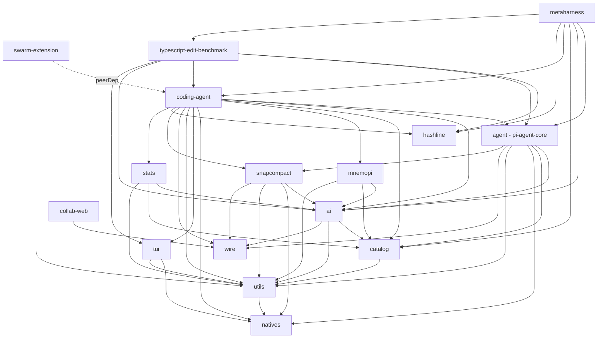

# OMP Architecture Map — Engine vs. UI Seam (for CAD FORK evaluation)

Scope: `/home/hunter/Repositories/CAD/scratch/omp-src/packages/*` (vendored, pinned `6ae7cdbf`), cross-checked
against upstream `/home/hunter/Repositories/omp-inspection/oh-my-pi/docs`. All refs are relative to
`CAD/scratch/omp-src/packages/<pkg>` unless a doc path is given in full.

## 1. Package table

| Package | npm name | Purpose (1 paragraph) | Public entry | Key deps | Class |
|---|---|---|---|---|---|
| `wire` | `@oh-my-pi/pi-wire` | Shared wire-protocol types (message/event shapes) used across packages that need to serialize agent state over IPC/RPC/collab boundaries — no logic, just types + (de)serialization helpers. | `src/index.ts` (types only) | none internal | SUPPORT |
| `utils` | `@oh-my-pi/pi-utils` | Grab-bag of shared utilities: logging (`logger`), path/dir resolution (`getAgentDir`), `VERSION`, templating (handlebars), structured logging (winston). Everything else depends on this. | `src/index.ts` | `pi-natives`, handlebars, winston | SUPPORT |
| `natives` | `@oh-my-pi/pi-natives` | Native Rust/N-API addon: PTY/shell process spawning, ripgrep-backed search, clipboard, image processing, syntax highlighting. Ships prebuilt binaries per-platform; loaded via native addon loader (see `natives-architecture.md`, `natives-binding-contract.md`). | `src/index.ts` + prebuilt `.node` binaries | none (leaf); Rust crates under `native/` | SUPPORT (native binary — **highest FORK risk**: requires per-platform Rust builds; Bun N-API addon, not portable to arbitrary embedders without a bridge) |
| `catalog` | `@oh-my-pi/pi-catalog` | Model catalog: bundled `models.json` (1.8MB) DB of every known model, provider discovery descriptors, model identity/classification/equivalence logic (family/dialect detection, thinking-effort mapping). Pure data + classification, no network calls itself. | `src/index.ts`, `src/model-manager.ts` (`ModelManager`), `src/models.ts` | `pi-utils`; dev-only cyclic dep on `pi-ai` | CORE-ENGINE (model metadata layer beneath the provider layer) |
| `ai` | `@oh-my-pi/pi-ai` | The actual LLM client layer: unified request/response types (`src/types.ts`), streaming (`src/stream.ts`, 66KB), 40+ provider adapters under `src/providers/*` (Anthropic, OpenAI Completions/Responses, Gemini, Cursor proto, etc.), tool-call dialect normalization (`src/dialect/*` — harmony/hermes/kimi/qwen3/anthropic toolconv), OAuth (`src/registry/oauth/*`), auth storage (`src/auth-storage.ts`, 277KB, SQLite via `bun:sqlite`), auth-retry ladder (`src/auth-retry.ts`), auth-broker (multi-seat, skippable). This is **the provider seam** CAD already has its own analog for (`Provider.complete`/`complete_ex`). | `src/index.ts` | `pi-catalog`, `pi-utils`, `pi-wire`, arktype/zod, `@bufbuild/protobuf` | CORE-ENGINE |
| `agent` | `@oh-my-pi/pi-agent-core` | **The generic agent loop**, provider-agnostic and coding-agnostic: `src/agent.ts` (44.5KB) + `src/agent-loop.ts` (88.3KB) implement the turn loop (call provider → parse tool calls → dispatch tools → append messages → repeat), `src/types.ts` (31KB) defines `AgentMessage`/tool-call/event shapes, `src/compaction/*` implements context compaction (pruning, shake, streaming compaction), `src/append-only-context.ts`, `src/telemetry.ts` (75KB), `src/proxy.ts`, `src/pause.ts` (process-global pause gate), `src/run-collector.ts` (telemetry aggregation), `src/replay-policy.ts`. This package has **no TUI, no session-file I/O, no coding tools** — it is transport-abstracted (per its own description) and attachment-capable. **This is the closest thing to a "reusable engine" already separated from coding-agent.** | `src/index.ts` (barrel of the above) | `pi-ai`, `pi-catalog`, `pi-natives`, `pi-utils`, `pi-wire`, `snapcompact`, `@opentelemetry/api` | CORE-ENGINE |
| `snapcompact` | `@oh-my-pi/snapcompact` | Bitmap-frame context compression for vision-capable LLMs — renders past conversation state as compact images to save tokens (`src/snapcompact.ts`, 76.7KB). Optional accelerant, not required for a minimal loop. | `src/index.ts` | `pi-ai`, `pi-natives`, `pi-utils`, `pi-wire` | CORE-ENGINE (optional/pluggable) |
| `mnemopi` | `@oh-my-pi/pi-mnemopi` | Local SQLite long-term memory engine for agents — semantic recall, embeddings (`src/core/*`, `mmr.ts`, `polyphonic-recall.ts`, `query-intent.ts`), MCP tool surface (`src/mcp-tools.ts`, `src/mcp-server.ts`). Persistent, project-scoped memory independent of session transcript. | `src/index.ts`, `src/mcp-server.ts` | `pi-ai`, `pi-catalog`, `pi-utils`, lru-cache | SUPPORT (optional capability, pluggable via MCP) |
| `hashline` | `@oh-my-pi/hashline` | Compact, line-anchored patch language + applier, with pluggable FS/IO backends (disk, in-memory, custom) — used by the `edit`/`write` coding tools for precise diff application. | `src/index.ts` (not fully enumerated but package purpose is explicit in its description) | none listed beyond itself | SUPPORT (coding-tool-adjacent, but backend-agnostic so portable) |
| `coding-agent` | `@oh-my-pi/pi-coding-agent` | **The flagship product**: coding-specific tools (`src/tools/*` — 70+ files: bash, edit, write, todo, web_search, lsp, dap/debug, notebook, sqlite-reader, tts/stt, browser, xdev, vibe, yield, hub, ask, task…), session persistence (`src/session/*` — JSONL format, migrations, blob store, storage abstractions), extensibility (skills/extensions/slash-commands/hooks/MCP/custom-tools under `src/extensibility/*`, `src/mcp/*`, `src/lsp/*`, `src/dap/*`), the CLI (`src/cli.ts`, `src/cli/*`, `src/commands/*`), collab (`src/collab/*`), advisor/watchdog, autoresearch, hindsight, system-prompt building (`src/system-prompt.ts`, 31KB), SDK surface (`src/sdk.ts`, 125KB) and `createAgentSession`. Also directly re-exports `@oh-my-pi/pi-tui` components (`Container, Markdown, Spacer, Text` — index.ts:6) for custom-tool rendering, and its `main.ts:1573` entrypoint dispatches straight into `runCli`. **This package is where coding-domain concerns and TUI concerns both live, entangled with the loop-embedding SDK.** | `src/index.ts` (huge barrel), `src/sdk.ts` (`createAgentSession`), `src/main.ts` (`main()` → `runCli`) | `pi-agent-core`, `pi-ai`, `pi-catalog`, `pi-mnemopi`, `pi-natives`, `pi-tui`, `pi-utils`, `pi-wire`, `snapcompact`, `hashline`, `omp-stats`, opentelemetry | CODING-SPECIFIC (with embedded UI + engine glue) |
| `tui` | `@oh-my-pi/pi-tui` | Standalone terminal-rendering engine: differential renderer, input dispatch/focus/overlays/cursor placement (`src/tui.ts`, 162.6KB), component contract (`Component`/`Focusable`, `render(width)`/`handleInput`), rich widget set (`src/components/*` — markdown 95.5KB, editor 114.2KB, select-list, settings-list, image, tab-bar…), terminal capability detection (`terminal-capabilities.ts`, 43.3KB), keybindings, autocomplete, latex rendering. **This is a real, general terminal-UI toolkit — not coding-specific — but it is a *terminal* renderer; a GUI app has no direct analog and would replace all of it.** | `src/index.ts` | `pi-natives`, `pi-utils`, lru-cache, marked | UI(TUI) |
| `swarm-extension` | `@oh-my-pi/swarm-extension` | Multi-agent DAG orchestration extension (YAML-defined pipeline/parallel/sequential swarms), runs standalone (`omp-swarm` CLI) or as a coding-agent TUI extension (`/swarm run`). Depends on `coding-agent` only as a peer dep (extension contract), not a hard runtime import. | `src/cli.ts`, `src/extension.ts` | `pi-utils`; peer: `pi-coding-agent` | CODING-SPECIFIC (extension, decoupled via extension API) |
| `metaharness` | `@oh-my-pi/pi-metaharness` | Unified benchmark runner + web dashboard for evaluating coding-agent performance across benchmark suites (Harbor-based). | `src/*`, `agent/`, `adapters/` | `pi-agent-core`, `pi-ai`, `pi-catalog`, `pi-coding-agent`, `hashline`, `typescript-edit-benchmark` | SUPPORT (dev/eval tooling, irrelevant to CAD reuse) |
| `stats` | `@oh-my-pi/omp-stats` | Local usage-stats dashboard reading session JSONL logs into a SQLite aggregate DB, served over HTTP. | `omp-stats` bin, `syncAllSessions()`/`getDashboardStats()` | `pi-ai`, `pi-catalog`, `pi-utils`, chart.js, tailwind | SUPPORT |
| `typescript-edit-benchmark` | private | Benchmark harness scoring coding-agent edit-tool success on TS mutation fixtures. | `bench:edit` CLI | `hashline`, `pi-agent-core`, `pi-coding-agent`, `pi-ai`, `pi-tui` | SUPPORT (dev-only) |
| `collab-web` | `@oh-my-pi/collab-web` | Browser-based collaborative viewing/companion web UI for OMP sessions (React). | `index.html` + React app | `pi-wire`, lucide-react, marked | UI (non-terminal, but session-viewer, not the agent driver) |
| `terminal-bench` (referenced in docs, present upstream) | private `@oh-my-pi/terminal-bench` | Terminal-Bench 2 runner for benchmarking `omp` against Harbor tasks. | `tb2` bin | packs `coding-agent` | SUPPORT (dev-only; not confirmed present in vendored CAD copy — check before relying on it) |

Not independently investigated in depth here (out of critical path for the FORK question, all SUPPORT-class):
none omitted from the vendored tree besides `terminal-bench`, which upstream docs list but which may or may not be vendored.

## 2. Dependency graph (who imports whom)

Layering, bottom-up: `wire`/`utils`/`natives` (leaf primitives) → `catalog` → `ai` → `agent` (agent-core loop, also pulls in `snapcompact`) → `coding-agent` (adds `tui`, `mnemopi`, `hashline`, `stats`, coding tools, sessions, CLI) → extensions/dev-tooling (`swarm-extension`, `metaharness`, `typescript-edit-benchmark`, `stats`-as-dashboard, `collab-web`).

Notable: `catalog` has a **dev-only reverse dep on `ai`** (package.json:42, `devDependencies`), i.e. a soft cycle used only for catalog's own tests/tooling, not a runtime cycle.

## 3. Engine/UI boundary — what a GUI-driven CAD app keeps vs. replaces

### Keep (transport-abstracted, no terminal assumptions)
- **`pi-agent-core` (`agent` package)**: the turn loop itself (`agent.ts`, `agent-loop.ts`), `AgentMessage`/event types (`types.ts`), compaction (`compaction/*`), telemetry/run-collector, pause gate, replay policy. Confirmed provider-agnostic and UI-agnostic by its own package description ("transport abstraction, state management, and attachment support") and by the absence of any `tui` import in its `package.json` deps (grep confirmed: only `pi-ai/pi-catalog/pi-natives/pi-utils/pi-wire/snapcompact`).
- **`pi-ai` provider layer**: streaming/dialect/tool-call normalization, auth machinery — this is exactly the layer CAD's own `Provider.complete`/`complete_ex` seam should either subsume or sit beside; see §4/porting-docs note below for the OAuth subset already scoped.
- **`pi-catalog`**: model metadata/classification — reusable as data, no coupling to UI or coding tools.
- **Session core semantics** (`coding-agent/src/session/*`, esp. `session-manager.ts`, `session-entries.ts`, `session-context.ts`): the JSONL entry-tree model (message/model_change/compaction/branch_summary/etc., see `docs/session.md`) is UI-agnostic — it's a data model for conversation state, storage-only. This is nominally inside `coding-agent`, not `agent`, but it doesn't depend on `pi-tui`.
- **`hashline`**: patch language/applier is explicitly "pluggable FS/IO," backend-agnostic — reusable for CAD's own edit/write tools if CAD keeps any code-editing capability, otherwise irrelevant to a CAD (non-coding) engine.
- **`mnemopi`**: optional memory backend, fully decoupled (SQLite + own MCP surface), reusable as-is if CAD wants persistent semantic memory.

### Replace (terminal-specific, CAD GUI has no use for it)
- **`pi-tui` in its entirety**: differential terminal renderer, ANSI-aware components, terminal capability probing, kitty-graphics, keybindings tuned for a terminal. None of this maps to a Qt/native GUI; CAD's own widget/host layer replaces it 1:1 in role (rendering assistant output, streaming deltas, tool-call cards, editors) but not in code.
- **`coding-agent`'s CLI/launch layer**: `main.ts` → `runCli`, `cli.ts`, `cli/*`, `commands/*`, `launch/*` (broker/presence/protocol for multi-window terminal sessions) — this is process/terminal lifecycle plumbing CAD's own C++ host already owns.
- **Coding-specific tools**: `bash`, `edit`, `write`, `lsp`, `dap`, `notebook-tool`, `sqlite-reader`, `xdev`, `git`-heavy `utils/git.ts` (84KB) — CAD is not a coding agent; these tools are either dropped or reimplemented as CAD-domain tools (drawing ops, PLM queries, etc.) using the same tool-call contract the loop expects.
- **`swarm-extension`, `metaharness`, `typescript-edit-benchmark`, `stats`, `collab-web`**: dev/eval/observability tooling, orthogonal — keep only if CAD wants an equivalent dashboard, otherwise skip.

### The entangled middle (`coding-agent`) — the hard part of a FORK
`coding-agent` is where CAD would face the most decision cost, because:
1. Its `src/index.ts` **re-exports TUI components** (`Container, Markdown, Spacer, Text` from `pi-tui`, `index.ts:6`) directly from the package root — meaning even "just use the SDK" consumers pull a `pi-tui` dependency transitively unless CAD tree-shakes/vendors selectively.
2. `createAgentSession`/SDK (`sdk.ts`, `docs/sdk.md`) is the actual reusable embedding surface — it wires auth/model/settings/session/tools/extensions/MCP/LSP together and hands back an `AgentSession` with `.prompt()`, `.subscribe()`, event stream. This is the layer CAD should target for a FORK: call `createAgentSession()` (or a pared equivalent built directly on `pi-agent-core` bypassing `coding-agent` if the coding tools aren't wanted), then drive `.prompt()`/`.subscribe()` from CAD's GUI event loop instead of a TUI render loop.
3. Extension/skill/slash-command/hook discovery (`extensibility/*`) is designed around a filesystem-driven, coding-project-shaped world (`.omp/`, project dirs, `AGENTS.md`-style context files) — reusable in spirit for CAD (discover CAD-specific "skills"/context) but the discovery paths and defaults (`discoverContextFiles`, `discoverSkills`, etc., per `docs/sdk.md:268-279`) are coding-project-flavored and would need CAD-domain equivalents, not necessarily new code.
4. `session/agent-session.ts` (the `AgentSession` class itself, not just the storage) sits in `coding-agent`, not `agent`. It is the actual FORK unit if CAD wants the full lifecycle (compaction triggers, retry/fallback events, todo reminders) without hand-rolling that on top of bare `pi-agent-core`.

**Practical seam for FORK**: build against `createAgentSession()`'s options object — supply `toolNames`/`customTools` (CAD-domain tools only, via `tools` factory contract), a custom `extensions` array (skip skill/slash-command discovery if not needed, or point discovery at CAD-specific paths), and treat `session.subscribe(event)` as the only channel from engine → CAD GUI (message_update/text_delta, tool_execution_start, todo_reminder, etc. per `docs/sdk.md:181-208`). CAD's GUI becomes the sole consumer of that event stream and the sole caller of `.prompt()`/`.steer()`/`.abort()`; `pi-tui` is never imported.

## 4. Top-level composition in `coding-agent` (ai + catalog + snapcompact + mnemopi + tui)

- **`ai`** is consumed as the provider/completion layer underneath everything — `coding-agent` doesn't call `ai` directly for most flows; it goes through `agent`'s loop (`agent-loop.ts`) which itself calls `ai`. `coding-agent`'s own direct `ai` usage is mostly model-registry/auth wiring (`config/model-resolver.ts`, 71.4KB) and settings-driven provider selection (`config/settings.ts`, 56.3KB).
- **`catalog`** feeds `ModelManager`/model resolution used by `config/model-resolver.ts` and exposed via SDK's `ModelRegistry`.
- **`snapcompact`** is wired in as an optional context-compaction accelerant inside session compaction paths (`session/snapcompact-inline.ts`, `session/snapcompact-savings-journal.ts`) — invoked when vision-capable models are active and bitmap compression is enabled, not a hard dependency of the loop.
- **`mnemopi`** is wired in under `src/mnemopi/*` (`state.ts`, `backend.ts`, `config.ts`) as one of several `memory-backend/*` options (`local-backend.ts`, `off-backend.ts`, `resolve.ts`) — pluggable via `memory-backend/types.ts`'s backend contract, selected by settings, not hardwired.
- **`tui`** is the rendering target for everything user-facing: `main.ts` → `runCli` → (not traced further here, but per `docs/tui.md`) mounts `AgentSession` event output plus extension/custom-tool `Component`s into `pi-tui`'s renderer. This is the one hard dependency that has no substitute if CAD keeps `coding-agent` as-is; it is also the one piece a CAD FORK explicitly plans to replace with CAD's own GUI, per the assignment's premise.
- **Composition root**: there isn't a single "wire everything" file exposed as such — `createAgentSession()` (`sdk.ts`) is the closest thing, assembling `Settings`, `AuthStorage`, `ModelRegistry`, `SessionManager`, discovery helpers, `createTools(...)`, MCP/LSP integration, and an `EventBus`, per `docs/sdk.md:54-70`. `runCli`/`main.ts` is the *interactive* composition root layered on top, adding `pi-tui` mounting and CLI arg parsing.

## 5. What the existing porting-docs already cover

`omp-inspection/porting-docs/*` is narrowly scoped to **subscription-auth provider integration**, not general architecture:
- `00-MASTER-PLAN.md`: shared OAuth/PKCE plumbing (`packages/ai/src/registry/oauth/pkce.ts`), local callback server (`callback-server.ts`), credential store schema (`auth-storage.ts` `StoredAuthCredential`/`SqliteAuthCredentialStore`), refresh policy + per-provider skew table, auth-retry ladder (`auth-retry.ts`), the minimal `ProviderDefinition` plugin contract (`registry/types.ts:36-56`), and a recommended build order (Codex → Anthropic → Cursor) with effort estimates.
- `01-anthropic-claude.md`, `02-openai-codex.md`, `03-cursor.md`, `provider-layer/00-provider-layer.md` + `10-xai.md`/`11-gemini.md`/`12-zai.md`/`13-anthropic-openai.md`: per-provider OAuth/header/request-shape replication detail (client-identifier hashes, proto schemas, endpoint quirks) — i.e., how to reuse **first-party subscription logins** rather than metered API keys.
- **Not covered by porting-docs**: the agent-loop/session/tool architecture, the `pi-tui` boundary, or anything about `coding-agent` composition — this dossier is net-new coverage of exactly that gap. The porting-docs' `auth-storage`/`auth-retry`/OAuth findings are directly reusable inputs if CAD's FORK wants first-party subscription auth reuse alongside the engine reuse decided here; they don't need to be re-derived.

## Per-feature recommendation table

| Feature | OMP location | CAD counterpart | Recommendation | Effort | Hard deps/risks |
|---|---|---|---|---|---|
| Agent turn loop (tool-call cycle, message accumulation) | `agent/src/agent.ts`, `agent-loop.ts` | CAD's own Python agent loop (services/agent) | **FORK** (adopt `pi-agent-core` as engine, drive via bun sidecar) or **SIDECAR** if only the loop is wanted short-term | M–L | Requires bun runtime bridge from CAD's Python/C++ host; loop is TS-only, no native binary dep itself |
| Provider/completion layer (streaming, dialects, 40+ providers) | `ai/src/*` | CAD `Provider.complete`/`complete_ex` (sync, single-provider-agnostic) | **SIDECAR** short-term (reuse real code via bridge) or **FORK** long-term if adopting full engine | M | OAuth/auth-storage uses `bun:sqlite` (native to Bun); CAD would keep its own credential store or bridge reads/writes |
| Model catalog/classification | `catalog/src/*` | none (CAD provider seam likely hardcodes models) | **SIDECAR/FORK** alongside `ai` — cheap to carry, mostly data | S | `models.json` is 1.8MB bundled data; trivial to vendor |
| Session persistence (JSONL entry-tree) | `coding-agent/src/session/*` | CAD likely has its own chat-history storage | **PORT** the entry-tree *model* conceptually to Python/CAD storage, or **SIDECAR** and let bun own session files | S–M | JSONL format is well-documented (`docs/session.md`) and storage-abstracted (`FileSessionStorage`/`MemorySessionStorage`) — portable design even if not code |
| Compaction / context management | `agent/src/compaction/*` | none | **SIDECAR/FORK** with engine | M | Coupled to `ai`/provider token counting; not standalone-portable without `ai` |
| Terminal UI (`pi-tui`) | `tui/*` | CAD's native GUI | **KEEP CAD's own** — no reuse possible | — | Terminal-only renderer; zero applicability to a GUI app |
| Coding-specific tools (bash/edit/lsp/dap/notebook) | `coding-agent/src/tools/*` | none (CAD is not a coding agent) | **KEEP CAD's own** (build CAD-domain tools instead) | — | Irrelevant domain; only the *tool-call contract shape* is worth copying |
| `hashline` patch/apply engine | `hashline/*` | none, unless CAD keeps any text/code editing tool | **KEEP/SKIP** unless CAD needs code-editing tools too | — | Backend-agnostic design makes it cheap to reuse **if** needed |
| Memory (`mnemopi`) | `mnemopi/*` | none confirmed in CAD | **SIDECAR** (pluggable backend, low coupling) | S–M | Own SQLite schema; needs a bridge if CAD wants Python-native access to memory data |
| Native addon (`pi-natives`) | `natives/*` | CAD is native C++ already | **KEEP CAD's own** for anything CAD already does (PTY/shell irrelevant to CAD; search/clipboard maybe reusable) | — | Prebuilt per-platform Rust/N-API binaries — **do not** try to embed directly in CAD's C++ host; only reachable via the bun sidecar |
| Auth/OAuth (subscription logins) | `ai/src/auth-storage.ts`, `auth-retry.ts`, `registry/oauth/*` | CAD provider seam has no OAuth | **SIDECAR/FORK**, already scoped by porting-docs | S (per porting-docs effort estimates) | `bun:sqlite`-backed store; porting-docs already give a build order and per-provider detail |
| SDK embedding surface (`createAgentSession`) | `coding-agent/src/sdk.ts` | none | **FORK core target** — this is the API CAD's GUI should call into | L (because of transitive `pi-tui` re-export at `index.ts:6` needing untangling) | Must avoid importing `coding-agent`'s barrel `index.ts` wholesale to escape the `pi-tui` dependency; may need a slimmed re-export or building directly on `pi-agent-core` + hand-picked coding-agent internals |
