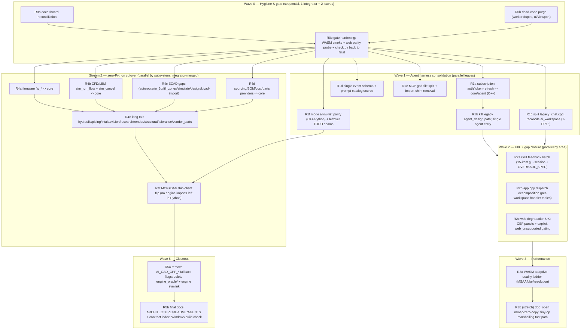

# Chudware Consolidation Refactor — Monolithic DAG Plan

## Why this plan (current-state findings)

Exploration confirmed the desktop↔web parity architecture **already exists and is the right one**:
the web app at chudware.com is the *same* `host/src/ui` tree compiled to WASM
(`host/CMakeLists.txt:244-268`), served by the FastAPI gateway (`Webservice/gateway/app.py`),
talking to the same `aicad-hostd` daemon + `libaicad` (`core/hostd/`, `docs/reference/HOSTD.md`), with
`billet-webd-sync.path` auto-redeploying on every green master rebuild. **So: no new UI
abstraction layer.** The old `ui/abstract` view-model effort was already built once and deleted
(YAGNI won); this plan does not resurrect it. Parity work = closing the specific seams where web
silently diverges, then making divergence structurally impossible via zero-Python.

Real gaps found, with evidence:

1. **Half-finished migration debris.** `services/worker/` holds duplicate modules
   (`async_rpc`, `doc_mirror`, `jobs`, `sim_client`, `selection`, `doc_tabs`, `bootstrap`,
   `worker_command_dispatcher`) that are in **no build**; several have drifted from the live
   `host/src/core/` copies, and `worker_command_dispatcher.cpp` is broken (includes headers from
   the deleted `ui/abstract`). `ui/viewport/` is orphaned (host builds its own renderer; two AICM
   loaders exist). Docs lie: AGENTS.md says ~52k LOC for `host/src/ui` (actually ~110k), references
   deleted docs (`PYTHON_CUTOVER_STATUS.md`, `CPP_MIGRATION.md`) and the retired `ui/imgui` shell;
   stale tasks T-G5–T-G9 target deleted code.
2. **Three agent brains.** C++ `core/agent/run.cpp` (4,168 lines, in-app default), Python
   `services/agent/agent_turn.py` (6,799; drives DAG nodes, PLM assist, MCP subagents), Python
   `services/agent/loop.py` (3,732; only the legacy `agent_design` path). Provider/auth logic
   duplicated C++ (`core/agent/providers.cpp`, 1,573) vs Python (`services/agent/providers/`,
   ~10,191) — and every C++ run calls *back into Python* to refresh subscription tokens
   (`host/src/core/jobs.cpp:45-62`). Event schema maintained twice
   (`services/agent/agent_events.py` 443 vs `core/agent/events.cpp` 696). Prompt catalog manually
   synced (`core/agent/roles.cpp:24-28`). Mode allow-lists implemented separately per runtime.
3. **Chat UI god file.** `host/src/ui/legacy_chat.cpp` is 13,374 lines / 645 KB and is the *live*
   copilot (misnamed); `ai/ai_workspace.cpp` (1,693) duplicates the chat surface via reuse hooks.
4. **MCP god files.** 344 tools; `cad_tools.py` 7,952 lines / 68 tools, `ecad_tools.py` 4,479,
   `ascii2d.py` 3,516, `reveng_tools.py` 2,040; dual-import shims (`services.agent.X`/`agent.X`)
   in 5 modules. Registration itself is fine (registry pattern, `tool_registry.py`).
5. **UI/UX backlog.** the 2026-07-16 GUI session plan (pruned 2026-07-23) 15-item feedback batch (ribbon icon
   artifacts, PM polish, RMB menu, zoom-to-fit, imperial defaults); pending items in
   `docs/plans/GUI_OVERHAUL_SPEC.md`; `app.cpp` is a 5,200-line monolith with one hardcoded dispatch
   if-chain (`app.cpp:1534`); `AppState` is a 1,803-line god struct.
6. **Perf (diagnosed, unbuilt).** WASM viewport GPU-fill-bound on weak iGPUs (23–25 FPS UHD 620):
   full-res 4× MSAA + `glBlitFramebuffer` resolve (`host/src/renderer.cpp:581`), glass/Kawase blur
   (`renderer.cpp:2231`). Adaptive-quality ladder recommended in the 2026-07-16 web audit (doc pruned 2026-07-23),
   never built. `doc_open` memmove floor (mmap/zero-copy noted as future).
7. **Web parity holes (until zero-Python lands).** Python-worker-routed methods (firmware `fw_*`,
   CFD `sim_run_flow`, ECAD gaps, sourcing/BOM, ~25 oracle modules) cannot run for the WASM
   client; CEF-dependent panels (parts browser, vendor sign-in) degrade to `NullWebView`.

## Locked decisions (user-confirmed)

- **Parity strategy:** keep single-source UI compiled twice (native + WASM) on the shared daemon.
  Do **not** build a view-model/panel-schema abstraction. Fix the seams; add a parity gate.
- **Agent auth:** **keep** Cursor/Codex/Kimi/xAI CLI-subscription providers — **port token
  refresh/auth into `core/agent` (C++)** so the per-run Python callback dies.
- **Python endgame:** **full zero-Python push** — port the remaining `engine_oracle/` subsystems
  to `core/`, flip routing, delete the oracle. Python services that remain (MCP server, DAG
  runner, advisor/mission tooling) become **thin clients over libaicad/hostd** with zero engine
  logic (the old plan's accepted N5e fallback).
- **Wave order:** Hygiene → Agent UX/harness → Perf, with the zero-Python cutover as a parallel
  long-running stream once hygiene lands (disjoint write-sets).
- **YAGNI binding.** Deferred tasks untouched: T-W20, T-SIM10, T-SIM11, T-BL51–T-BL55, T-BL52.
  No PLM-server feature work (T-R7/T-R8 stay on the board). No new GUI framework. No
  `services/serving` (LoRA) changes beyond a clarifying doc note.

## Swarm operating model (binding — mirrors AGENTS.md)

- **No worktree isolation**; all subagents run non-isolated in the main tree.
- **One integrator** (this main session) owns all shared/append-only files — top-level CMake,
  `contracts/`, `AGENTS.md`, `scripts/gate.sh`, `core/api/libaicad.h`, `contracts/worker_rpc.md`,
  `services/worker/worker_client.cpp` routing table, `work/` board files — and does **all git
  commits**. Leaf subagents never run git.
- Every node lists its **write-set**; parallel nodes in a wave have disjoint write-sets.
- **A node is done when `bash scripts/gate.sh` is green** (env SKIPs are honest, not failures).
  Integrator rebuilds once per wave; leaf nodes sharing a build graph do not self-build.
- Each node appends a one-paragraph handoff to `docs/REFACTOR_LOG.md` and runs
  `graphify update .`.
- **MCP freshness rule:** any node touching agent-facing tools/prompts/context updates
  `services/mcp/` instructions + `cad_guide` topics + `work/context/` packs in the same branch.
- Kickoff: integrator files `work/tasks/T-RF*.md` entries mirroring the DAG nodes per
  `work/WORKFLOW.md`, so progress is trackable on the board.
- Dispatch mechanics: parallel leaves go out via AgentSwarm (or concurrent Agent calls) with the
  node's write-set + gate criteria in the prompt; integrator merges, builds, gates, commits per
  wave.

## The gate (every node)

`bash scripts/gate.sh` — check.py audits, core build + ctest, host build, pytest suites,
headless `AI_CAD_SHOT` smoke. This plan extends it (node R0c) with: WASM build smoke
(`./build.sh wasm`) and a **web parity probe** (headless scenario driven through hostd exactly as
the WASM client drives it, asserting no `unsupported`/`python-worker-required` responses for the
shipped feature set).

## Execution DAG

### Wave 0 — Hygiene & gate (foundation; nothing parallel depends on stale docs)

- **R0a — Docs + board reconciliation.**
  Scope: top-level `AGENTS.md` (110k LOC, single-GUI reality, delete `ui/imgui`/`ui/abstract`
  references and the dead-doc links), `ARCHITECTURE.md` components section,
  `services/worker/AGENTS.md`, `ui/viewport/AGENTS.md`, `host/DEPRECATED.md` (verify staleness),
  `docs/gui_parity_gaps.md` (stale — pruned 2026-07-23), `README.md` pointer fixes. Retire stale board tasks
  T-G5–T-G9 (mark superseded). Add a one-line note that `services/serving/` = LoRA adapter
  routing (name decoy). Supersede the old cursor plan in `docs/REFACTOR_LOG.md`.
  Write-set: the listed docs + `work/` board files (integrator-owned).
- **R0b — Dead-code purge.**
  Delete the uncompiled `services/worker/` duplicates (`async_rpc.*`, `doc_mirror.*`, `jobs.*`,
  `sim_client.*`, `selection.*`, `doc_tabs.*`, `bootstrap.*`, `worker_command_dispatcher.*`) —
  live copies stay in `host/src/core/`; keep only the four compiled modules
  (`worker_client`, `engine_backend`, `cpp_core`, `worker_router`). Resolve `ui/viewport/`:
  delete the orphaned renderer, keep exactly one AICM loader (the one `core/` builds); retarget
  includes. Verify nothing references the deleted files; gate green.
  Write-set: `services/worker/`, `ui/viewport/`, `host/CMakeLists.txt` + `core/CMakeLists.txt`
  (integrator merges), any retargeted includes.
- **R0c — Gate hardening.**
  Add to `scripts/gate.sh`: (1) WASM build smoke (`./build.sh wasm`, SKIP with reason if
  emsdk absent); (2) web parity probe — scripted scenario over hostd asserting no
  python-worker-only method is reachable from the shipped web feature set (start as an explicit
  `web_unsupported` inventory in `contracts/` so gaps fail loud, not silent); (3) fix or
  explicitly scope the current check.py reds and flip `CHECK_PY_FATAL=1` to default.
  Write-set: `scripts/gate.sh`, `scripts/check.py`, `contracts/web_parity.md` (new).

### Wave 1 — Agent harness consolidation (the user's stated pain point)

- **R1a — Subscription auth → C++.** Port token refresh/PKCE/session store from
  `services/agent/providers/` (`sub_auth.py`, `oauth_pkce.py`, `subscription_login.py`,
  `usage.py`) into `core/agent/`; CLI providers (cursor/codex/kimi/xai/claude-cli) become C++
  adapters that spawn the CLI binaries (they are subprocess transports already). Delete the
  per-run Python token callback in `host/src/core/jobs.cpp:45-62`. Python providers keep working
  read-only against the same token store until R4f. Write-set: `core/agent/` (new `auth.*`,
  `providers_cli.*`), `host/src/core/jobs.cpp`, tests.
- **R1b — Single agent entry.** Route/fold `agent_design` into the v2 run (mode flag) or delete
  it as a distinct method; remove the legacy launcher in `jobs.cpp:357-491`; `loop.py` shrinks
  to nothing and is deleted with its tests. GUI has exactly one run path: `agent_run_v2`.
  Depends R1a (Cursor provider must survive on the C++ path first).
  Write-set: `host/src/core/jobs.*`, `services/agent/loop.py`, `engine_oracle/worker.py`
  agent_design branch, `run_agent.py` CLI.
- **R1c — Split the chat god file.** Break `legacy_chat.cpp` (13,374) into
  `ui/copilot/` modules: chat_log, composer, activity_timeline, cards (plan/clarify/swarm/ai-vc),
  panel host. Reconcile with `ai/ai_workspace.cpp` per board task **T-DP16** (one chat
  implementation, two layouts). Rename away from "legacy". Pure moves + header splits, no
  behavior change; screenshot gate (`AI_CAD_SHOT`) proves parity. Write-set:
  `host/src/ui/legacy_chat.*`, `host/src/ui/ai/`, new `host/src/ui/copilot/`.
- **R1d — Single event-schema + prompt source.** `contracts/agent_events.md` stays the frozen
  vocabulary; make the schema machine-checkable (a JSON event-kind list in `contracts/` consumed
  by both `core/agent/events.cpp` and `services/agent/agent_events.py`, plus a gate lint that
  fails on drift). Replace the hardcoded role list in `core/agent/roles.cpp:24-28` with
  directory enumeration of `services/agent/prompts/*.md` (same source both runtimes already
  read). Write-set: `contracts/agent_events.*`, `core/agent/events.cpp`, `core/agent/roles.cpp`,
  `services/agent/agent_events.py`, `scripts/check.py`.
- **R1e — MCP god-file split.** Split `cad_tools.py` (68 tools) into per-family modules
  (doc/sketch/feature/eval/export…), same for `ecad_tools.py` and `reveng_tools.py`; keep
  `tool_registry.py` as the single enforcement point and `server.py` registration style.
  Remove the 5 dual-import shims (`services.agent.X` / `agent.X` → one canonical path). MCP
  freshness rule applies (instructions + `cad_guide` + context packs). Write-set:
  `services/mcp/`, `services/agent/prompts` (guide text only).
- **R1f — Mode allow-list parity + seam cleanup.** Single source for Agent|Plan|Swarm|Edit|Ask
  tool gating consumed by both `core/agent/run.cpp` and `copilot_mode_tools.py` (JSON table under
  `contracts/` or `services/agent/`), with a parity test that runs the same mode matrix against
  both runtimes. Fix leftover placeholder seams: `services/agent/workspace.py:417-426` (T-W14),
  `advisor/overseer.py:73`, `advisor/overseer_tools.py:64` (T-W7). Write-set:
  `services/agent/`, `core/agent/run.cpp`, `contracts/`, new parity test.

### Wave 2 — UI/UX gap closure (parallel by area; desktop change == web change by construction)

- **R2a — GUI feedback batch.** Execute the 15-item list in
  the pruned 2026-07-16 GUI session plan + pending `[~]` items in `docs/plans/GUI_OVERHAUL_SPEC.md`
  (ribbon icon artifacts, PM collapsed-sections/padding, washer extrude bug, RMB context-menu
  rework, zoom-to-fit timing, imperial-aware defaults). Split into 2–3 sub-nodes with disjoint
  files (ribbon/icons · PropertyManager · viewport/menus). Each verified with `AI_CAD_SHOT`
  scenarios. Write-set: `host/src/ui/` per sub-node split; `assets/icons/` (integrator-owned
  atlas merge).
- **R2b — Dispatch decomposition.** Replace the `app.cpp:1534` if-chain with per-workspace
  command-handler registration (plain table of `cmd_id → handler` living in each workspace
  module, registered at init — data-driven *within C++*, matching existing patterns; no
  framework, no view-model). Slim `AppState` only where a moved handler forces it. Write-set:
  `host/src/app.cpp`, `host/src/core/app_state.h`, workspace modules.
- **R2c — Web degradation UX.** Audit CEF-dependent panels (parts browser, vendor sign-in,
  web_panel) on the WASM build: gate their ribbon/PM entries behind a capability flag with a
  clear "desktop only" affordance instead of silent dead buttons; wire the flag to the R0c
  `web_unsupported` inventory so the list shrinks to zero at R5 and the mechanism self-documents.
  Write-set: `host/src/ui/` (gating only), `contracts/web_parity.md`.

### Wave 3 — Performance

- **R3a — WASM adaptive-quality ladder.** Implement the diagnosed ladder: dynamic render-scale +
  MSAA 4×→2×→off + blur-quality steps, driven by measured frame time (target 60, floor 30),
  applied in `host/src/renderer.cpp` (resolve at :581, Kawase at :2231); native desktop defaults
  to full quality (no behavior change there). Validate with `Webservice/gateway/tests/perf_probe.py`
  and browser FPS beacons; update `perf/baseline.json`. Write-set: `host/src/renderer.cpp`,
  `host/src/ui/viewport_panel.cpp` (HUD indicator), `Webservice/perf/`.
- **R3b — (stretch, only if probe says so)** `doc_open` memmove floor → mmap/zero-copy read;
  tiny-op C-ABI marshalling fast path for `eval_*`/export. Write-set: `core/` doc io,
  `core/api/libaicad.cpp`.

### Stream Z — Zero-Python cutover (starts after R0c; long-running parallel stream)

Per-subsystem nodes, each: reach corpus parity → flip routing default in
`services/worker/worker_client.cpp` (**integrator-owned append point**) → **delete the Python
module in the same commit** → gate. Write-sets are disjoint `core/` + `engine_oracle/`
pairs; `core/api/libaicad.h` is integrator-merged once per wave.

- **R4a** firmware `fw_*` → `core/firmware` (contract `contracts/firmware_rpc.md` already frozen).
- **R4b** CFD/LBM `sim_run_flow` + `sim_cancel` → `core/sim`.
- **R4c** ECAD gaps: doc-id `ecad_autoroute`/`ecad_to_3d`/`ecad_route_diff_pair`,
  `ecad_fill_zones`/`ecad_simulate`/`ecad_design`/`ecad_import_kicad*` → `core/ecad`.
- **R4d** sourcing/BOM/cost/parts providers (`parts_providers.py`, `spec_sheet_matcher.py`,
  vendor_parts, parts_hub) → `core/`.
- **R4e** long tail: hydraulic, piping, intake, vision, research, render, structural, tolerance,
  remaining `engine_oracle/doc` formats/export remnants. (Sub-split at dispatch; each leaf stays
  small enough for one subagent.)
- **R4f — Thin-client flip.** `services/mcp` + `services/dag` call hostd/libaicad only; zero
  `engine_oracle` imports remain anywhere (`grep` proof in gate). Python `agent_turn.py`
  consumers (node_runner, plm/assist, ai_vc, subagent_rpc, mission_dispatch, reviewer_exec)
  either call the C++ agent over RPC or are deleted with their feature. Depends R1a/R1f.

### Wave 5 — Closeout

- **R5a** Remove `AI_CAD_CPP_DOCS/SIM/ECAD/AGENT` fallback flags + Python routing branches from
  `worker_client.cpp`; delete `engine_oracle/`, the root `engine` symlink, and the Python worker
  spawn path. Web parity inventory is empty by construction; keep the probe as a regression gate.
- **R5b** Rewrite `ARCHITECTURE.md`/`README.md`/per-module `AGENTS.md` to final state; contract
  index pass; Linux gate fully green; Windows build (`build.bat`/preset) produces a runnable exe.

## Sequencing / parallelism summary

| Wave | Nodes | Parallelism | Integrator load |
|---|---|---|---|
| W0 | R0a, R0b ∥ then R0c | 2 leaves | docs+gate owner |
| W1 | R1a→R1b; R1c ∥ R1d ∥ R1e ∥ R1f | 4 leaves | jobs.cpp, contracts merges |
| W2 | R2a(x2–3) ∥ R2b ∥ R2c | 4 leaves | app.cpp conflicts watch |
| W3 | R3a → R3b(stretch) | 1 | perf probe |
| Z  | R4a–R4d ∥, then R4e ∥, then R4f | 4 leaves/stream | routing table + libaicad.h |
| W5 | R5a → R5b | sequential | all commits |

Z-stream launches immediately after R0c (disjoint from W1/W2 write-sets) so it doesn't serialize
behind UI work; R4f waits on R1a/R1f; R5a waits on everything.

## Non-goals (explicit)

- No view-model/UI-framework abstraction; no second native frontend.
- No PLM server / live co-editing features (T-R7/T-R8 remain board tasks).
- No deferred items: T-W20, T-SIM10/11, T-BL51–55, T-BL52.
- No `services/serving` (LoRA) refactor, no training work, no Gen-1 streamed-container revival.
- No behavior changes in Wave-0/1 file splits beyond what gates can verify.

## Risks

- **R1a auth port** touches real credentials flows — mitigate by keeping the Python providers
  read-only-compatible until R4f and testing against a scratch config dir, never the live one.
- **R2b app.cpp decomposition** is the conflict magnet with R2a sub-nodes — sequence R2b to land
  first within the wave or give it exclusive `app.cpp` ownership.
- **Z-stream parity** per subsystem is the schedule risk; a subsystem that can't reach corpus
  parity stays Python-routed and is escalated, not force-merged (gate stays green).
- **Stale-plan confusion:** the old cursor plan file marks reversed nodes "completed" — R0a's
  REFACTOR_LOG entry is the authoritative supersession note.
