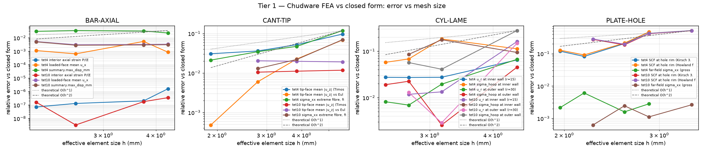
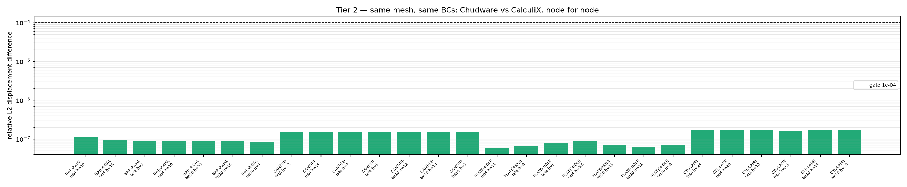

# FEA Verification & Validation — Chudware vs closed form, CalculiX and polymesh

Generated 2026-09-05T21:38:12Z by `scripts/vv_fea_crosscheck.py` in 85.0 min.

## Provenance

> **Build boundary for the pressure-sign finding.** Every row in this report was measured on engine build `beta-0.1.2-beta.41-80-gfac9a08ab-dirty` (`chudware/fea_static [CholmodSupernodalLLT]`), stamped per row. The pressure-sign defect recorded below was FIXED in `core/sim/fea_run.cpp` after this pass: the pressure branch now deposits `-p * integral(N_i n_outward) dA`, so a positive magnitude acts INWARD as its contract always claimed. Consequences for reading this document: (a) the finding is a record of a real defect and of the build it was measured on, not a live defect in a newer engine; (b) the Lame cylinder rows here were produced by passing `pressure=-p` to obtain internal pressurisation, which on the FIXED engine would give EXTERNAL pressurisation — the harness case was updated in lockstep with the fix, so re-running `scripts/vv_fea_crosscheck.py --all` regenerates these rows with `pressure=+p`; (c) no other tier is affected, because every other case uses force loads. The refresh run is a follow-up: it costs ~85 min of solve time and must be a single `--all` invocation so the report keeps one build id.

| item | value |
|---|---|
| engine build id | `beta-0.1.2-beta.41-80-gfac9a08ab-dirty` |
| solver | `chudware/fea_static [CholmodSupernodalLLT]` |
| mesher | `polyhedral-fea/graded-tet` |
| polymesh commit | `955457901e5fe9ba7d46c4cafee710000df9f4bd` |
| polymesh binary | `core/build-occt-linux/bin/polymesh` |
| CalculiX | `CalculiX ccx 2.23` |
| ccx binary | `~/.local/bin/ccx` |
| libchudware | `core/build-occt-linux/bin/libchudware.so` |
| memory envelope | `CHUDWARE_MEM_FRAC=0.30`, `CHUDWARE_HEADROOM_GB=6`, `CHUDWARE_SIM_THREADS=4` |
| host | `Linux 6.19.10-300.fc44.x86_64 x86_64` |

Every number below was measured by this script on this machine through `sim_run_static` — the same engine entry point `run_fea_static` uses (Polyhedral-FEA graded-tet mesh of an exported STEP, Chudware Eigen tet4/tet10 solve). Reference values are derived in the script from the cited closed form and are never read back from the engine.

## Tier 1 — analytic references

Verdict convention: a discretization-limited row is GATED on its finest mesh; the coarser legs of the same metric/element carry `conv-leg` and are the convergence evidence rather than independent verdicts. "The coarsest mesh in the ladder is not converged yet" is not a solver failure, and counting it as one would bury the rows that do mean something.

| case | metric | elem | h_req | h_eff | n_elems | n_dof | reference | Chudware | rel err | tol | verdict |
|---|---|---|---|---|---|---|---|---|---|---|---|
| BAR-AXIAL | interior axial strain P/(EA) | tet4 | 30 | 4.27 | 8704 | 5463 | 2.500e-04 | 2.500e-04 | 1.620e-06 | 1e-06 | conv-leg |
| BAR-AXIAL | loaded-face mean u_x | tet4 | 30 | 4.27 | 8704 | 5463 | 0.05 | 0.0500428 | 8.565e-04 | 1e-02 | conv-leg |
| BAR-AXIAL | summary.max_disp_mm | tet4 | 30 | 4.27 | 8704 | 5463 | 0.05 | 0.05115 | 2.300e-02 | 1e-01 | conv-leg |
| BAR-AXIAL | interior axial strain P/(EA) | tet4 | 16 | 3.74 | 12992 | 8475 | 2.500e-04 | 2.500e-04 | 2.021e-07 | 1e-06 | conv-leg |
| BAR-AXIAL | loaded-face mean u_x | tet4 | 16 | 3.74 | 12992 | 8475 | 0.05 | 0.050269 | 5.381e-03 | 1e-02 | conv-leg |
| BAR-AXIAL | summary.max_disp_mm | tet4 | 16 | 3.74 | 12992 | 8475 | 0.05 | 0.051608 | 3.216e-02 | 1e-01 | conv-leg |
| BAR-AXIAL | interior axial strain P/(EA) | tet4 | 7 | 2.58 | 39616 | 23247 | 2.500e-04 | 2.500e-04 | 1.311e-07 | 1e-06 | conv-leg |
| BAR-AXIAL | loaded-face mean u_x | tet4 | 7 | 2.58 | 39616 | 23247 | 0.05 | 0.0500322 | 6.439e-04 | 1e-02 | conv-leg |
| BAR-AXIAL | summary.max_disp_mm | tet4 | 7 | 2.58 | 39616 | 23247 | 0.05 | 0.051738 | 3.476e-02 | 1e-01 | conv-leg |
| BAR-AXIAL | interior axial strain P/(EA) | tet4 | 10 | 2.08 | 75680 | 44859 | 2.500e-04 | 2.500e-04 | 7.168e-08 | 1e-06 | PASS |
| BAR-AXIAL | loaded-face mean u_x | tet4 | 10 | 2.08 | 75680 | 44859 | 0.05 | 0.0500564 | 1.127e-03 | 1e-02 | PASS |
| BAR-AXIAL | summary.max_disp_mm | tet4 | 10 | 2.08 | 75680 | 44859 | 0.05 | 0.051515 | 3.030e-02 | 1e-01 | PASS |
| BAR-AXIAL | interior axial strain P/(EA) | tet10 | 30 | 4.27 | 8704 | 38139 | 2.500e-04 | 2.500e-04 | 3.508e-07 | 1e-06 | conv-leg |
| BAR-AXIAL | loaded-face mean u_x | tet10 | 30 | 4.27 | 8704 | 38139 | 0.05 | 0.0498344 | 3.311e-03 | 1e-02 | conv-leg |
| BAR-AXIAL | summary.max_disp_mm | tet10 | 30 | 4.27 | 8704 | 38139 | 0.05 | 0.049846 | 3.080e-03 | 1e-01 | conv-leg |
| BAR-AXIAL | interior axial strain P/(EA) | tet10 | 16 | 3.74 | 12992 | 58035 | 2.500e-04 | 2.500e-04 | 1.789e-07 | 1e-06 | conv-leg |
| BAR-AXIAL | loaded-face mean u_x | tet10 | 16 | 3.74 | 12992 | 58035 | 0.05 | 0.0498409 | 3.182e-03 | 1e-02 | conv-leg |
| BAR-AXIAL | summary.max_disp_mm | tet10 | 16 | 3.74 | 12992 | 58035 | 0.05 | 0.049852 | 2.960e-03 | 1e-01 | conv-leg |
| BAR-AXIAL | interior axial strain P/(EA) | tet10 | 7 | 2.58 | 39616 | 171483 | 2.500e-04 | 2.500e-04 | 3.276e-09 | 1e-06 | conv-leg |
| BAR-AXIAL | loaded-face mean u_x | tet10 | 7 | 2.58 | 39616 | 171483 | 0.05 | 0.0498475 | 3.050e-03 | 1e-02 | conv-leg |
| BAR-AXIAL | summary.max_disp_mm | tet10 | 7 | 2.58 | 39616 | 171483 | 0.05 | 0.049859 | 2.820e-03 | 1e-01 | conv-leg |
| BAR-AXIAL | interior axial strain P/(EA) | tet10 | 10 | 2.08 | 75680 | 323475 | 2.500e-04 | 2.500e-04 | 1.611e-07 | 1e-06 | PASS |
| BAR-AXIAL | loaded-face mean u_x | tet10 | 10 | 2.08 | 75680 | 323475 | 0.05 | 0.0497379 | 5.243e-03 | 1e-02 | PASS |
| BAR-AXIAL | summary.max_disp_mm | tet10 | 10 | 2.08 | 75680 | 323475 | 0.05 | 0.049749 | 5.020e-03 | 1e-01 | PASS |
| CANT-TIP | tip-face mean |u_z| (Timoshenko, incl. shear) | tet4 | 22 | 5.6 | 4352 | 3123 | 0.2578 | 0.23285 | 9.678e-02 | 5e-02 | conv-leg |
| CANT-TIP | tip-face mean |u_z| vs Euler-Bernoulli (no shear) | tet4 | 22 | 5.6 | 4352 | 3123 | 0.25 | 0.23285 | 6.860e-02 | 1e-01 | conv-leg |
| CANT-TIP | sigma_xx extreme fibre, fitted at the station | tet4 | 22 | 5.6 | 4352 | 3123 | 79.8729 | 70.3909 | 1.187e-01 | 1e-01 | conv-leg |
| CANT-TIP | tip-face mean |u_z| (Timoshenko, incl. shear) | tet4 | 14 | 3.84 | 13440 | 9183 | 0.2578 | 0.244347 | 5.218e-02 | 5e-02 | conv-leg |
| CANT-TIP | tip-face mean |u_z| vs Euler-Bernoulli (no shear) | tet4 | 14 | 3.84 | 13440 | 9183 | 0.25 | 0.244347 | 2.261e-02 | 1e-01 | conv-leg |
| CANT-TIP | sigma_xx extreme fibre, fitted at the station | tet4 | 14 | 3.84 | 13440 | 9183 | 80.2322 | 76.4461 | 4.719e-02 | 1e-01 | conv-leg |
| CANT-TIP | tip-face mean |u_z| (Timoshenko, incl. shear) | tet4 | 7 | 2.79 | 35024 | 20811 | 0.2578 | 0.248501 | 3.607e-02 | 5e-02 | conv-leg |
| CANT-TIP | tip-face mean |u_z| vs Euler-Bernoulli (no shear) | tet4 | 7 | 2.79 | 35024 | 20811 | 0.25 | 0.248501 | 5.995e-03 | 1e-01 | conv-leg |
| CANT-TIP | sigma_xx extreme fibre, fitted at the station | tet4 | 7 | 2.79 | 35024 | 20811 | 80.2668 | 77.4875 | 3.463e-02 | 1e-01 | conv-leg |
| CANT-TIP | tip-face mean |u_z| (Timoshenko, incl. shear) | tet4 | 5 | 1.9 | 111312 | 68649 | 0.2578 | 0.249879 | 3.072e-02 | 5e-02 | PASS |
| CANT-TIP | tip-face mean |u_z| vs Euler-Bernoulli (no shear) | tet4 | 5 | 1.9 | 111312 | 68649 | 0.25 | 0.249879 | 4.821e-04 | 1e-01 | PASS |
| CANT-TIP | sigma_xx extreme fibre, fitted at the station | tet4 | 5 | 1.9 | 111312 | 68649 | 79.6874 | 77.9991 | 2.119e-02 | 1e-01 | PASS |
| CANT-TIP | tip-face mean |u_z| (Timoshenko, incl. shear) | tet10 | 22 | 5.6 | 4352 | 20403 | 0.2578 | 0.254771 | 1.175e-02 | 5e-02 | conv-leg |
| CANT-TIP | tip-face mean |u_z| vs Euler-Bernoulli (no shear) | tet10 | 22 | 5.6 | 4352 | 20403 | 0.25 | 0.254771 | 1.908e-02 | 1e-01 | conv-leg |
| CANT-TIP | sigma_xx extreme fibre, fitted at the station | tet10 | 22 | 5.6 | 4352 | 20403 | 79.8729 | 74.3021 | 6.975e-02 | 1e-01 | conv-leg |
| CANT-TIP | tip-face mean |u_z| (Timoshenko, incl. shear) | tet10 | 14 | 3.84 | 13440 | 61275 | 0.2578 | 0.254935 | 1.111e-02 | 5e-02 | conv-leg |
| CANT-TIP | tip-face mean |u_z| vs Euler-Bernoulli (no shear) | tet10 | 14 | 3.84 | 13440 | 61275 | 0.25 | 0.254935 | 1.974e-02 | 1e-01 | conv-leg |
| CANT-TIP | sigma_xx extreme fibre, fitted at the station | tet10 | 14 | 3.84 | 13440 | 61275 | 80.2322 | 78.4685 | 2.198e-02 | 1e-01 | conv-leg |
| CANT-TIP | tip-face mean |u_z| (Timoshenko, incl. shear) | tet10 | 7 | 2.79 | 35024 | 152199 | 0.2578 | 0.255093 | 1.050e-02 | 5e-02 | PASS |
| CANT-TIP | tip-face mean |u_z| vs Euler-Bernoulli (no shear) | tet10 | 7 | 2.79 | 35024 | 152199 | 0.25 | 0.255093 | 2.037e-02 | 1e-01 | PASS |
| CANT-TIP | sigma_xx extreme fibre, fitted at the station | tet10 | 7 | 2.79 | 35024 | 152199 | 80.2668 | 79.2262 | 1.296e-02 | 1e-01 | PASS |
| PLATE-HOLE | SCF at hole rim (Kirsch 3.0) | tet4 | 11 | 2.87 | 35744 | 24024 | 3 | 1.61525 | 4.616e-01 | 1e-01 | conv-leg |
| PLATE-HOLE | SCF at hole rim (Howland finite width) | tet4 | 11 | 2.87 | 35744 | 24024 | 3.03 | 1.61525 | 4.669e-01 | 1e-01 | conv-leg |
| PLATE-HOLE | far-field sigma_xx (gross section) | tet4 | 11 | 2.87 | 35744 | 24024 | 10 | 10.0282 | 2.820e-03 | 1e-02 | conv-leg |
| PLATE-HOLE | SCF at hole rim (Kirsch 3.0) | tet4 | 8 | 2.59 | 48880 | 32934 | 3 | 2.38722 | 2.043e-01 | 1e-01 | conv-leg |
| PLATE-HOLE | SCF at hole rim (Howland finite width) | tet4 | 8 | 2.59 | 48880 | 32934 | 3.03 | 2.38722 | 2.121e-01 | 1e-01 | conv-leg |
| PLATE-HOLE | far-field sigma_xx (gross section) | tet4 | 8 | 2.59 | 48880 | 32934 | 10 | 10.0159 | 1.594e-03 | 1e-02 | conv-leg |
| PLATE-HOLE | SCF at hole rim (Kirsch 3.0) | tet4 | 5 | 2.18 | 81928 | 54378 | 3 | 2.75351 | 8.216e-02 | 1e-01 | conv-leg |
| PLATE-HOLE | SCF at hole rim (Howland finite width) | tet4 | 5 | 2.18 | 81928 | 54378 | 3.03 | 2.75351 | 9.125e-02 | 1e-01 | conv-leg |
| PLATE-HOLE | far-field sigma_xx (gross section) | tet4 | 5 | 2.18 | 81928 | 54378 | 10 | 10.061 | 6.104e-03 | 1e-02 | conv-leg |
| PLATE-HOLE | SCF at hole rim (Kirsch 3.0) | tet4 | 3.5 | 1.96 | 111568 | 74274 | 3 | 2.64194 | 1.194e-01 | 1e-01 | FAIL |
| PLATE-HOLE | SCF at hole rim (Howland finite width) | tet4 | 3.5 | 1.96 | 111568 | 74274 | 3.03 | 2.64194 | 1.281e-01 | 1e-01 | FAIL |
| PLATE-HOLE | far-field sigma_xx (gross section) | tet4 | 3.5 | 1.96 | 111568 | 74274 | 10 | 10.0214 | 2.143e-03 | 1e-02 | PASS |
| PLATE-HOLE | SCF at hole rim (Kirsch 3.0) | tet10 | 15 | 3.45 | 20664 | 94512 | 3 | 2.22806 | 2.573e-01 | 1e-01 | conv-leg |
| PLATE-HOLE | SCF at hole rim (Howland finite width) | tet10 | 15 | 3.45 | 20664 | 94512 | 3.03 | 2.22806 | 2.647e-01 | 1e-01 | conv-leg |
| PLATE-HOLE | far-field sigma_xx (gross section) | tet10 | 15 | 3.45 | 20664 | 94512 | 10 | 10.0247 | 2.471e-03 | 1e-02 | conv-leg |
| PLATE-HOLE | SCF at hole rim (Kirsch 3.0) | tet10 | 11 | 2.87 | 35744 | 161052 | 3 | 2.57926 | 1.402e-01 | 1e-01 | conv-leg |
| PLATE-HOLE | SCF at hole rim (Howland finite width) | tet10 | 11 | 2.87 | 35744 | 161052 | 3.03 | 2.57926 | 1.488e-01 | 1e-01 | conv-leg |
| PLATE-HOLE | far-field sigma_xx (gross section) | tet10 | 11 | 2.87 | 35744 | 161052 | 10 | 9.98802 | 1.198e-03 | 1e-02 | conv-leg |
| PLATE-HOLE | SCF at hole rim (Kirsch 3.0) | tet10 | 8 | 2.59 | 48880 | 220896 | 3 | 3.44426 | 1.481e-01 | 1e-01 | conv-leg |
| PLATE-HOLE | SCF at hole rim (Howland finite width) | tet10 | 8 | 2.59 | 48880 | 220896 | 3.03 | 3.44426 | 1.367e-01 | 1e-01 | conv-leg |
| PLATE-HOLE | far-field sigma_xx (gross section) | tet10 | 8 | 2.59 | 48880 | 220896 | 10 | 9.97456 | 2.544e-03 | 1e-02 | conv-leg |
| PLATE-HOLE | SCF at hole rim (Kirsch 3.0) | tet10 | 5 | 2.18 | 81928 | 369396 | 3 | 3.08792 | 2.931e-02 | 1e-01 | PASS |
| PLATE-HOLE | SCF at hole rim (Howland finite width) | tet10 | 5 | 2.18 | 81928 | 369396 | 3.03 | 3.08792 | 1.912e-02 | 1e-01 | PASS |
| PLATE-HOLE | far-field sigma_xx (gross section) | tet10 | 5 | 2.18 | 81928 | 369396 | 10 | 9.99581 | 4.193e-04 | 1e-02 | PASS |
| CYL-LAME | u_r at inner wall (r=15) | tet4 | 24 | 4.46 | 18336 | 12264 | 0.00295 | 0.00275822 | 6.501e-02 | 1e-01 | conv-leg |
| CYL-LAME | sigma_hoop at inner wall | tet4 | 24 | 4.46 | 18336 | 12264 | 33.3333 | 29.5844 | 1.125e-01 | 1e-01 | conv-leg |
| CYL-LAME | u_r at outer wall (r=30) | tet4 | 24 | 4.46 | 18336 | 12264 | 0.002 | 0.00186623 | 6.688e-02 | 1e-01 | conv-leg |
| CYL-LAME | sigma_hoop at outer wall | tet4 | 24 | 4.46 | 18336 | 12264 | 13.3333 | 13.9394 | 4.545e-02 | 1e-01 | conv-leg |
| CYL-LAME | u_r at inner wall (r=15) | tet4 | 20 | 3.17 | 50912 | 32184 | 0.00295 | 0.00286897 | 2.747e-02 | 1e-01 | conv-leg |
| CYL-LAME | sigma_hoop at inner wall | tet4 | 20 | 3.17 | 50912 | 32184 | 33.3333 | 27.2294 | 1.831e-01 | 1e-01 | conv-leg |
| CYL-LAME | u_r at outer wall (r=30) | tet4 | 20 | 3.17 | 50912 | 32184 | 0.002 | 0.00196099 | 1.950e-02 | 1e-01 | conv-leg |
| CYL-LAME | sigma_hoop at outer wall | tet4 | 20 | 3.17 | 50912 | 32184 | 13.3333 | 13.3678 | 2.586e-03 | 1e-01 | conv-leg |
| CYL-LAME | u_r at inner wall (r=15) | tet4 | 13 | 2.73 | 79688 | 50256 | 0.00295 | 0.00286975 | 2.720e-02 | 1e-01 | conv-leg |
| CYL-LAME | sigma_hoop at inner wall | tet4 | 13 | 2.73 | 79688 | 50256 | 33.3333 | 31.0643 | 6.807e-02 | 1e-01 | conv-leg |
| CYL-LAME | u_r at outer wall (r=30) | tet4 | 13 | 2.73 | 79688 | 50256 | 0.002 | 0.00198616 | 6.922e-03 | 1e-01 | conv-leg |
| CYL-LAME | sigma_hoop at outer wall | tet4 | 13 | 2.73 | 79688 | 50256 | 13.3333 | 13.6341 | 2.256e-02 | 1e-01 | conv-leg |
| CYL-LAME | u_r at inner wall (r=15) | tet4 | 9.5 | 2.45 | 109664 | 66756 | 0.00295 | 0.00286913 | 2.741e-02 | 1e-01 | PASS |
| CYL-LAME | sigma_hoop at inner wall | tet4 | 9.5 | 2.45 | 109664 | 66756 | 33.3333 | 31.4142 | 5.757e-02 | 1e-01 | PASS |
| CYL-LAME | u_r at outer wall (r=30) | tet4 | 9.5 | 2.45 | 109664 | 66756 | 0.002 | 0.00198366 | 8.172e-03 | 1e-01 | PASS |
| CYL-LAME | sigma_hoop at outer wall | tet4 | 9.5 | 2.45 | 109664 | 66756 | 13.3333 | 13.5868 | 1.901e-02 | 1e-01 | PASS |
| CYL-LAME | u_r at inner wall (r=15) | tet10 | 24 | 4.46 | 18336 | 83256 | 0.00295 | 0.00247256 | 1.618e-01 | 1e-01 | conv-leg |
| CYL-LAME | sigma_hoop at inner wall | tet10 | 24 | 4.46 | 18336 | 83256 | 33.3333 | 30.2045 | 9.386e-02 | 1e-01 | conv-leg |
| CYL-LAME | u_r at outer wall (r=30) | tet10 | 24 | 4.46 | 18336 | 83256 | 0.002 | 0.001703 | 1.485e-01 | 1e-01 | conv-leg |
| CYL-LAME | sigma_hoop at outer wall | tet10 | 24 | 4.46 | 18336 | 83256 | 13.3333 | 9.62851 | 2.779e-01 | 1e-01 | conv-leg |
| CYL-LAME | u_r at inner wall (r=15) | tet10 | 20 | 3.17 | 50912 | 224952 | 0.00295 | 0.00291066 | 1.334e-02 | 1e-01 | conv-leg |
| CYL-LAME | sigma_hoop at inner wall | tet10 | 20 | 3.17 | 50912 | 224952 | 33.3333 | 27.4556 | 1.763e-01 | 1e-01 | conv-leg |
| CYL-LAME | u_r at outer wall (r=30) | tet10 | 20 | 3.17 | 50912 | 224952 | 0.002 | 0.00200576 | 2.881e-03 | 1e-01 | conv-leg |
| CYL-LAME | sigma_hoop at outer wall | tet10 | 20 | 3.17 | 50912 | 224952 | 13.3333 | 13.8793 | 4.095e-02 | 1e-01 | conv-leg |
| CYL-LAME | u_r at inner wall (r=15) | tet10 | 13 | 2.73 | 79688 | 352056 | 0.00295 | 0.00291517 | 1.181e-02 | 1e-01 | PASS |
| CYL-LAME | sigma_hoop at inner wall | tet10 | 13 | 2.73 | 79688 | 352056 | 33.3333 | 30.4825 | 8.553e-02 | 1e-01 | PASS |
| CYL-LAME | u_r at outer wall (r=30) | tet10 | 13 | 2.73 | 79688 | 352056 | 0.002 | 0.00202586 | 1.293e-02 | 1e-01 | PASS |
| CYL-LAME | sigma_hoop at outer wall | tet10 | 13 | 2.73 | 79688 | 352056 | 13.3333 | 14.091 | 5.683e-02 | 1e-01 | PASS |

### Observed convergence order (least-squares slope of log err vs log h)

`monotone=False` means the error did not fall at every refinement step — the graded-tet mesher does not produce a NESTED mesh family, so a slope fitted across such a ladder is indicative, not a measured order of accuracy.

| case | metric | elem | legs | h_eff (mm), coarse→fine | rel err | observed slope | monotone |
|---|---|---|---|---|---|---|---|
| BAR-AXIAL | interior axial strain P/(EA) | tet4 | 4 | [4.272, 3.739, 2.578, 2.078] | [1.62e-06, 2.02e-07, 1.31e-07, 7.17e-08] | 3.55 | True |
| BAR-AXIAL | loaded-face mean u_x | tet4 | 4 | [4.272, 3.739, 2.578, 2.078] | [8.56e-04, 5.38e-03, 6.44e-04, 1.13e-03] | 0.973 | False |
| BAR-AXIAL | summary.max_disp_mm | tet4 | 4 | [4.272, 3.739, 2.578, 2.078] | [2.30e-02, 3.22e-02, 3.48e-02, 3.03e-02] | -0.315 | False |
| BAR-AXIAL | interior axial strain P/(EA) | tet10 | 4 | [4.272, 3.739, 2.578, 2.078] | [3.51e-07, 1.79e-07, 3.28e-09, 1.61e-07] | 2.81 | False |
| BAR-AXIAL | loaded-face mean u_x | tet10 | 4 | [4.272, 3.739, 2.578, 2.078] | [3.31e-03, 3.18e-03, 3.05e-03, 5.24e-03] | -0.513 | False |
| BAR-AXIAL | summary.max_disp_mm | tet10 | 4 | [4.272, 3.739, 2.578, 2.078] | [3.08e-03, 2.96e-03, 2.82e-03, 5.02e-03] | -0.544 | False |
| CANT-TIP | tip-face mean |u_z| (Timoshenko, incl. shear) | tet4 | 4 | [5.598, 3.845, 2.794, 1.9] | [9.68e-02, 5.22e-02, 3.61e-02, 3.07e-02] | 1.07 | True |
| CANT-TIP | tip-face mean |u_z| vs Euler-Bernoulli (no shear) | tet4 | 4 | [5.598, 3.845, 2.794, 1.9] | [6.86e-02, 2.26e-02, 5.99e-03, 4.82e-04] | 4.56 | True |
| CANT-TIP | sigma_xx extreme fibre, fitted at the station | tet4 | 4 | [5.598, 3.845, 2.794, 1.9] | [1.19e-01, 4.72e-02, 3.46e-02, 2.12e-02] | 1.54 | True |
| CANT-TIP | tip-face mean |u_z| (Timoshenko, incl. shear) | tet10 | 3 | [5.598, 3.845, 2.794] | [1.18e-02, 1.11e-02, 1.05e-02] | 0.161 | True |
| CANT-TIP | tip-face mean |u_z| vs Euler-Bernoulli (no shear) | tet10 | 3 | [5.598, 3.845, 2.794] | [1.91e-02, 1.97e-02, 2.04e-02] | -0.0938 | False |
| CANT-TIP | sigma_xx extreme fibre, fitted at the station | tet10 | 3 | [5.598, 3.845, 2.794] | [6.97e-02, 2.20e-02, 1.30e-02] | 2.44 | True |
| PLATE-HOLE | SCF at hole rim (Kirsch 3.0) | tet4 | 4 | [2.87, 2.586, 2.177, 1.964] | [4.62e-01, 2.04e-01, 8.22e-02, 1.19e-01] | 3.86 | False |
| PLATE-HOLE | SCF at hole rim (Howland finite width) | tet4 | 4 | [2.87, 2.586, 2.177, 1.964] | [4.67e-01, 2.12e-01, 9.13e-02, 1.28e-01] | 3.67 | False |
| PLATE-HOLE | far-field sigma_xx (gross section) | tet4 | 4 | [2.87, 2.586, 2.177, 1.964] | [2.82e-03, 1.59e-03, 6.10e-03, 2.14e-03] | -0.733 | False |
| PLATE-HOLE | SCF at hole rim (Kirsch 3.0) | tet10 | 4 | [3.445, 2.87, 2.586, 2.177] | [2.57e-01, 1.40e-01, 1.48e-01, 2.93e-02] | 4.45 | False |
| PLATE-HOLE | SCF at hole rim (Howland finite width) | tet10 | 4 | [3.445, 2.87, 2.586, 2.177] | [2.65e-01, 1.49e-01, 1.37e-01, 1.91e-02] | 5.45 | True |
| PLATE-HOLE | far-field sigma_xx (gross section) | tet10 | 4 | [3.445, 2.87, 2.586, 2.177] | [2.47e-03, 1.20e-03, 2.54e-03, 4.19e-04] | 3.29 | False |
| CYL-LAME | u_r at inner wall (r=15) | tet4 | 4 | [4.461, 3.167, 2.728, 2.454] | [6.50e-02, 2.75e-02, 2.72e-02, 2.74e-02] | 1.52 | False |
| CYL-LAME | sigma_hoop at inner wall | tet4 | 4 | [4.461, 3.167, 2.728, 2.454] | [1.12e-01, 1.83e-01, 6.81e-02, 5.76e-02] | 1.15 | False |
| CYL-LAME | u_r at outer wall (r=30) | tet4 | 4 | [4.461, 3.167, 2.728, 2.454] | [6.69e-02, 1.95e-02, 6.92e-03, 8.17e-03] | 3.87 | False |
| CYL-LAME | sigma_hoop at outer wall | tet4 | 4 | [4.461, 3.167, 2.728, 2.454] | [4.55e-02, 2.59e-03, 2.26e-02, 1.90e-02] | 1.27 | False |
| CYL-LAME | u_r at inner wall (r=15) | tet10 | 3 | [4.461, 3.167, 2.728] | [1.62e-01, 1.33e-02, 1.18e-02] | 5.66 | True |
| CYL-LAME | sigma_hoop at inner wall | tet10 | 3 | [4.461, 3.167, 2.728] | [9.39e-02, 1.76e-01, 8.55e-02] | -0.163 | False |
| CYL-LAME | u_r at outer wall (r=30) | tet10 | 3 | [4.461, 3.167, 2.728] | [1.49e-01, 2.88e-03, 1.29e-02] | 6.1 | False |
| CYL-LAME | sigma_hoop at outer wall | tet10 | 3 | [4.461, 3.167, 2.728] | [2.78e-01, 4.09e-02, 5.68e-02] | 3.64 | False |

### PLATE-HOLE was re-measured after the tet10 stress-recovery fix

The PLATE-HOLE rows above did NOT come from the run that produced the rest of this report. The tet10 hole-rim under-recovery it had recorded turned out to be a defect in tet10 Gauss-point -> nodal stress recovery (the 4 Gauss points were collapsed to one element constant before nodal averaging); after the fix landed in `core/sim/fea_static.cpp`, ONLY this case was re-run (`--tier1 --case PLATE-HOLE`) and its Tier-1 and convergence rows were spliced in. Everything else in this report predates the fix. That matters in one place only: a tet10 nodal-STRESS column elsewhere (the Tier-2 `peak vM Chudware` figures, Tier 2b) still describes the old recovery. Displacements, reactions and every tet4/hex8 number are untouched by it — the tet4 legs re-measured bit-identical (1.61525 / 2.38722 / 2.75351 / 2.64194), which is itself the control. The engine `git describe` id is unchanged because the tree was already dirty in both runs, so the fix is identified by the change, not by the build id.

The fix is verified against CalculiX on the SAME mesh, which is the only comparison that isolates recovery from discretization (rim SCF, all rim nodes, `max sigma_xx / sigma_inf`):

| h_req (mm) | h_eff (mm) | n_elems | tet10 SCF before | tet10 SCF after | ccx C3D10, same mesh | after vs ccx |
|---|---|---|---|---|---|---|
| 15 | 3.445 | 20664 | 1.46607 | 2.22806 | 2.2280 | +3e-05 |
| 11 | 2.870 | 35744 | 1.75700 | 2.57926 | 2.5792 | +2e-05 |
| 8 | 2.586 | 48880 | 2.43741 | 3.44426 | 3.4442 | +2e-05 |
| 5 (old run's leg) | 2.261 | 73072 | 2.17568 | 3.16604 | 3.1660 | +1e-05 |
| 5 (this run's leg) | 2.177 | 81928 | — | 3.08792 | 3.08790 | +6e-06 |

Chudware now reproduces CalculiX's own C3D10 nodal stress to the 6-significant-digit floor of ccx's ASCII output on every one of those meshes, and tet4 already did (1.6153 both). The finest leg's mesh differs between the two runs because the memory envelope did (`CHUDWARE_MEM_FRAC` 0.30 then 0.50): the coarser 73072-element mesh was a governor-coarsened leg. The before/after/ccx triple on the IDENTICAL 73072-element mesh is the fourth row, measured directly from that run's exported system. One other thing can move a re-run's field independently of recovery — the mesher now dissolves hanging fragments that touch the body at two corners or fewer, and a mesh that had one loses those nodes from the field entirely (`mesh_quality.hanging_elems_dropped` is the flag) — but it did not happen here: the re-measured mesh ladder below is identical to the pre-fix one in element count, node count and mesh volume at every h_req, so no PLATE-HOLE mesh lost an element and every row above is a recovery-only change.

Against the finite-width reference the error now falls at every refinement (0.265 -> 0.149 -> 0.137 -> 0.019, `monotone=True`); against Kirsch's infinite-plate 3.0 one step rises by 0.8 percentage points (0.140 -> 0.148), which is the mesh family, not the recovery — CalculiX reproduces the same non-monotone step on the same meshes, exactly as it reproduces tet4's.

### Mesh ladders, measured before solving

`study.target_size_mm` is a REQUEST: the graded-tet mesher quantises it onto its own refinement levels, and the realised element count is not monotone in the request (on the 200x20x20 bar, h=16 mm produced 12992 elements while h=13 mm produced 6144). Each ladder below was therefore measured with `sim_mesh` first — mesh only, no solve — and only a subsequence whose element count grows by at least 1.5x per step was solved.

| case | h_req (mm) | n_elems | h_eff (mm) | mesh volume (mm³) | aspect max | % poor | solved | error |
|---|---|---|---|---|---|---|---|---|
| BAR-AXIAL | 30 | 8704 | 4.272 | 80000 | 6.532 | 0 | yes |  |
| BAR-AXIAL | 26 | 8704 | 4.272 | 80000 | 6.532 | 0 |  |  |
| BAR-AXIAL | 22 | 8160 | 4.365 | 80000 | 5.888 | 0 |  |  |
| BAR-AXIAL | 19 | 11136 | 3.936 | 80000 | 5.048 | 0 |  |  |
| BAR-AXIAL | 16 | 12992 | 3.738 | 80000 | 4.642 | 0 | yes |  |
| BAR-AXIAL | 14 | 6144 | 4.798 | 80000 | 2.614 | 0 |  |  |
| BAR-AXIAL | 12 | 6912 | 4.614 | 80000 | 2.441 | 0 |  |  |
| BAR-AXIAL | 10 | 75680 | 2.078 | 80000 | 5.728 | 0 | yes |  |
| BAR-AXIAL | 8.5 | 94848 | 1.927 | 80000 | 5.048 | 0 |  |  |
| BAR-AXIAL | 7 | 39616 | 2.578 | 80000 | 3.079 | 0 | yes |  |
| BAR-AXIAL | 6 | 44832 | 2.474 | 80000 | 2.717 | 0 |  |  |
| BAR-AXIAL | 5 | 268256 | 1.363 | 80000 | 5.132 | 0 |  |  |
| CANT-TIP | 30 | 5424 | 5.202 | 90000 | 6.049 | 0 |  |  |
| CANT-TIP | 26 | 5424 | 5.202 | 90000 | 6.049 | 0 |  |  |
| CANT-TIP | 22 | 4352 | 5.599 | 90000 | 3.921 | 0 | yes |  |
| CANT-TIP | 19 | 4352 | 5.599 | 90000 | 3.921 | 0 |  |  |
| CANT-TIP | 16 | 5440 | 5.197 | 90000 | 3.464 | 0 |  |  |
| CANT-TIP | 14 | 13440 | 3.844 | 90000 | 3.646 | 0 | yes |  |
| CANT-TIP | 12 | 15680 | 3.652 | 90000 | 3.191 | 0 |  |  |
| CANT-TIP | 10 | 35840 | 2.772 | 90000 | 4.006 | 0 |  |  |
| CANT-TIP | 8.5 | 37808 | 2.723 | 90000 | 3.662 | 0 |  |  |
| CANT-TIP | 7 | 35024 | 2.794 | 90000 | 3.266 | 0 | yes |  |
| CANT-TIP | 6 | 40720 | 2.657 | 90000 | 2.85 | 0 |  |  |
| CANT-TIP | 5 | 111312 | 1.9 | 90000 | 5.022 | 0 | yes |  |
| PLATE-HOLE | 18 | — | — | — | — | — |  | polymesh mesher failed: feature unresolved at h=18 m: CAD fa |
| PLATE-HOLE | 15 | 20664 | 3.445 | 99595.384 | 18.8 | 2.362 | yes |  |
| PLATE-HOLE | 13 | 24384 | 3.261 | 99647.292 | 12.82 | 3.871 |  |  |
| PLATE-HOLE | 11 | 35744 | 2.87 | 99632.161 | 12.96 | 0.3133 | yes |  |
| PLATE-HOLE | 9.5 | 40440 | 2.754 | 99581.975 | 9.422 | 0 |  |  |
| PLATE-HOLE | 8 | 48880 | 2.586 | 99631.161 | 8.02 | 0 | yes |  |
| PLATE-HOLE | 7 | 57464 | 2.45 | 99614.34 | 7.879 | 0 |  |  |
| PLATE-HOLE | 6 | 64672 | 2.355 | 99598.632 | 7.481 | 0 |  |  |
| PLATE-HOLE | 5 | 81928 | 2.177 | 99616.958 | 12.04 | 0.01953 | yes |  |
| PLATE-HOLE | 4.5 | 95144 | 2.071 | 99612.176 | 13.32 | 0.008408 |  |  |
| PLATE-HOLE | 4 | 104416 | 2.008 | 99614.667 | 5.277 | 0 |  |  |
| PLATE-HOLE | 3.5 | 111568 | 1.964 | 99612.756 | 11.6 | 0.007171 | yes |  |
| CYL-LAME | 24 | 18336 | 4.461 | 191834.63 | 16.31 | 1.483 | yes |  |
| CYL-LAME | 22 | 18648 | 4.437 | 192021.09 | 14.51 | 0.7722 |  |  |
| CYL-LAME | 20 | 50912 | 3.167 | 190609.39 | 12.06 | 0.07857 | yes |  |
| CYL-LAME | 18 | 57432 | 3.042 | 190588.48 | 14.48 | 0.2925 |  |  |
| CYL-LAME | 17 | 56840 | 3.053 | 190588.48 | 14.48 | 0.2956 |  |  |
| CYL-LAME | 16 | 56840 | 3.053 | 190588.48 | 14.48 | 0.2956 |  |  |
| CYL-LAME | 15 | 91800 | 2.602 | 190687.79 | 9.515 | 0 |  |  |
| CYL-LAME | 14 | 87896 | 2.64 | 190687.76 | 9.876 | 0 |  |  |
| CYL-LAME | 13 | 79688 | 2.728 | 190677.44 | 9.477 | 0 | yes |  |
| CYL-LAME | 12 | 58194 | 3.028 | 190476.35 | 26.79 | 0.2887 |  |  |
| CYL-LAME | 11 | 58536 | 3.023 | 190654.75 | 19.1 | 0.492 |  |  |
| CYL-LAME | 9.5 | 109664 | 2.454 | 190947.05 | 23.25 | 0.1605 | yes |  |
| CYL-LAME | 8 | 147248 | 2.224 | 190781.48 | 13.7 | 0.09236 |  |  |
| CYL-LAME | 7 | 141462 | 2.254 | 191013.32 | 27.23 | 0.005655 |  |  |

### Load-sign probe

A load whose sign convention is undocumented or wrong is a silent factor of -1 on every stress in a report, so the convention is measured rather than assumed: the same model and mesh is solved with the pressure magnitude flipped and the resulting hoop stress sign is recorded.

| case | probe | elem | h_req | metric | measured |
|---|---|---|---|---|---|
| CYL-LAME | same model, same bore face, pressure=+p instead of -p | tet4 | 24 | u_r at inner wall (r=15) | -0.00275822 |
| CYL-LAME | same model, same bore face, pressure=+p instead of -p | tet4 | 24 | sigma_hoop at inner wall | -29.5844 |
| CYL-LAME | same model, same bore face, pressure=+p instead of -p | tet4 | 24 | u_r at outer wall (r=30) | -0.00186623 |
| CYL-LAME | same model, same bore face, pressure=+p instead of -p | tet4 | 24 | sigma_hoop at outer wall | -13.9394 |

## Tier 2 — same mesh, same BCs: Chudware vs CalculiX, node for node

The system Chudware actually solved is dumped by `study.export_system_path` immediately before `fea_static_solve` and re-solved by ccx as C3D4/C3D10. Same mesh + same boundary conditions + linear elasticity means the two codes are answering the same linear algebra problem, so the gate on the displacement field is 1e-04 relative; stress recovery is NOT the same operation on the two sides (Chudware averages element stresses to nodes, ccx extrapolates integration-point stresses to nodes and averages), so the von Mises columns are reported as nodal-averaged-vs-nodal-averaged evidence and are not gated.

One stress caveat is structural rather than numerical: `summary.max_von_mises_mpa` is NOT the field peak — the solver masks a two-element ring around the fixed nodes out of that scalar, so on a model whose fixtures ARE the highly stressed feature (a bolt hole, say) the summary number is far below the nodal field maximum. The CalculiX column here is an unmasked field peak, so the comparison uses Chudware's raw nodal von Mises array; the masked summary value is carried in the JSON as `vm_summary_chud_mpa` so the two are never confused.

The `ccx print floor` column is the relative L2 quantisation of ccx's own ASCII output (6 significant digits per component). Where the measured difference sits AT that floor, the two codes agree to the limit of what the reference output can express — the number is a property of the comparison channel, not a measured solver discrepancy.

| case | elem | ccx elem | h_req | n_dof | |u| L2 rel | |u| Linf rel | max|u| Chudware | max|u| ccx | max|u| rel | reaction rel | ccx print floor | peak vM Chudware | peak vM ccx | vM rel | verdict |
|---|---|---|---|---|---|---|---|---|---|---|---|---|---|---|---|
| BAR-AXIAL | tet4 | C3D4 | 30 | 5463 | 1.117e-07 | 9.793e-08 | 0.0511499 | 0.0511499 | 2.57e-08 | 3.00e-08 | 8.9e-08 | 63.24 | 62.491 | 1.20e-02 | PASS |
| BAR-AXIAL | tet4 | C3D4 | 16 | 8475 | 9.180e-08 | 9.677e-08 | 0.0516079 | 0.0516079 | 4.06e-08 | 7.00e-08 | 8.9e-08 | 78.413 | 76.614 | 2.35e-02 | PASS |
| BAR-AXIAL | tet4 | C3D4 | 7 | 23247 | 8.767e-08 | 9.636e-08 | 0.0517385 | 0.0517385 | 5.59e-08 | 2.00e-08 | 8.9e-08 | 93.488 | 92.344 | 1.24e-02 | PASS |
| BAR-AXIAL | tet4 | C3D4 | 10 | 44859 | 8.892e-08 | 9.695e-08 | 0.0515149 | 0.0515149 | 3.56e-08 | 5.00e-09 | 9.0e-08 | 89.644 | 86.008 | 4.23e-02 | PASS |
| BAR-AXIAL | tet10 | C3D10 | 30 | 38139 | 8.878e-08 | 9.974e-08 | 0.0498457 | 0.0498457 | 7.63e-08 | 2.85e-08 | 8.9e-08 | 51.691 | 51.977 | 5.49e-03 | PASS |
| BAR-AXIAL | tet10 | C3D10 | 16 | 58035 | 8.962e-08 | 1.001e-07 | 0.0498522 | 0.0498522 | 6.39e-08 | 9.70e-09 | 9.0e-08 | 51.667 | 54.27 | 4.80e-02 | PASS |
| BAR-AXIAL | tet10 | C3D10 | 7 | 171483 | 8.478e-08 | 1.002e-07 | 0.0498588 | 0.0498588 | 6.22e-08 | 1.65e-08 | 8.9e-08 | 57.876 | 71.851 | 1.94e-01 | PASS |
| CANT-TIP | tet4 | C3D4 | 22 | 3123 | 1.557e-07 | 2.106e-07 | 0.235448 | 0.235448 | 3.19e-08 | 3.00e-08 | 1.6e-07 | 83.161 | 82.989 | 2.07e-03 | PASS |
| CANT-TIP | tet4 | C3D4 | 14 | 9183 | 1.549e-07 | 2.020e-07 | 0.247086 | 0.247086 | 2.51e-08 | 1.76e-07 | 1.6e-07 | 88.15 | 87.529 | 7.09e-03 | PASS |
| CANT-TIP | tet4 | C3D4 | 7 | 20811 | 1.533e-07 | 1.992e-07 | 0.251362 | 0.251362 | 4.94e-08 | 1.88e-07 | 1.5e-07 | 94.946 | 94.315 | 6.70e-03 | PASS |
| CANT-TIP | tet4 | C3D4 | 5 | 68649 | 1.488e-07 | 1.983e-07 | 0.252762 | 0.252762 | 4.63e-08 | 1.28e-07 | 1.5e-07 | 128.66 | 106.8 | 2.05e-01 | PASS |
| CANT-TIP | tet10 | C3D10 | 22 | 20403 | 1.522e-07 | 1.945e-07 | 0.257634 | 0.257634 | 8.44e-08 | 6.35e-08 | 1.5e-07 | 88.171 | 95.558 | 7.73e-02 | PASS |
| CANT-TIP | tet10 | C3D10 | 14 | 61275 | 1.530e-07 | 1.943e-07 | 0.257815 | 0.257815 | 3.51e-08 | 6.86e-08 | 1.5e-07 | 94.415 | 99.703 | 5.30e-02 | PASS |
| CANT-TIP | tet10 | C3D10 | 7 | 152199 | 1.486e-07 | 1.946e-07 | 0.257978 | 0.257978 | 1.43e-07 | 4.29e-10 | 1.5e-07 | 104.56 | 121.25 | 1.38e-01 | PASS |
| PLATE-HOLE | tet4 | C3D4 | 11 | 24024 | 5.797e-08 | 4.770e-07 | 0.0103401 | 0.0103401 | 3.65e-08 | 1.00e-08 | 6.4e-08 | 15.793 | 15.011 | 5.21e-02 | PASS |
| PLATE-HOLE | tet4 | C3D4 | 8 | 32934 | 6.855e-08 | 4.791e-07 | 0.0103077 | 0.0103077 | 3.47e-07 | 6.00e-09 | 6.8e-08 | 23.589 | 23.566 | 9.67e-04 | PASS |
| PLATE-HOLE | tet4 | C3D4 | 5 | 54378 | 7.914e-08 | 4.759e-07 | 0.0104953 | 0.0104953 | 5.89e-08 | 2.40e-09 | 7.8e-08 | 26.683 | 26.619 | 2.41e-03 | PASS |
| PLATE-HOLE | tet4 | C3D4 | 3.5 | 74274 | 8.953e-08 | 4.722e-07 | 0.0104977 | 0.0104977 | 1.40e-07 | 1.04e-08 | 8.9e-08 | 25.994 | 25.109 | 3.53e-02 | PASS |
| PLATE-HOLE | tet10 | C3D10 | 15 | 94512 | 6.952e-08 | 4.886e-07 | 0.0101754 | 0.0101754 | 4.98e-08 | 1.07e-09 | 7.0e-08 | 16.567 | 21.802 | 2.40e-01 | PASS |
| PLATE-HOLE | tet10 | C3D10 | 11 | 161052 | 6.281e-08 | 4.929e-07 | 0.010061 | 0.010061 | 4.38e-07 | 5.16e-09 | 6.4e-08 | 19.577 | 24.807 | 2.11e-01 | PASS |
| PLATE-HOLE | tet10 | C3D10 | 8 | 220896 | 6.893e-08 | 4.957e-07 | 0.0100643 | 0.0100643 | 3.40e-07 | 1.94e-08 | 7.0e-08 | 28.328 | 33.363 | 1.51e-01 | PASS |
| CYL-LAME | tet4 | C3D4 | 24 | 12264 | 1.704e-07 | 2.478e-07 | 0.00325136 | 0.00325136 | 1.08e-07 | 1.00e+00 | 1.7e-07 | 45.449 | 44.847 | 1.34e-02 | PASS |
| CYL-LAME | tet4 | C3D4 | 20 | 32184 | 1.720e-07 | 2.508e-07 | 0.00326715 | 0.00326715 | 8.03e-09 | 1.00e+00 | 1.7e-07 | 45.859 | 45.757 | 2.23e-03 | PASS |
| CYL-LAME | tet4 | C3D4 | 13 | 50256 | 1.650e-07 | 2.418e-07 | 0.00333716 | 0.00333716 | 5.21e-08 | 1.00e+00 | 1.7e-07 | 46.65 | 46.024 | 1.36e-02 | PASS |
| CYL-LAME | tet4 | C3D4 | 9.5 | 66756 | 1.627e-07 | 2.429e-07 | 0.00332732 | 0.00332732 | 2.09e-07 | 1.00e+00 | 1.6e-07 | 50.385 | 47.48 | 6.12e-02 | PASS |
| CYL-LAME | tet10 | C3D10 | 24 | 83256 | 1.703e-07 | 2.205e-07 | 0.00374781 | 0.00374781 | 6.69e-08 | 1.00e+00 | 1.7e-07 | 49.899 | 52.983 | 5.82e-02 | PASS |
| CYL-LAME | tet10 | C3D10 | 20 | 224952 | 1.708e-07 | 2.501e-07 | 0.00327876 | 0.00327876 | 8.23e-08 | 1.00e+00 | 1.7e-07 | 45.521 | 52.13 | 1.27e-01 | PASS |

## Tier 3 — polymesh (Polyhedral-FEA's own solver) vs the same closed forms

| case | h (mm) | metric | n_nodes | reference | polymesh | rel err | verdict | command |
|---|---|---|---|---|---|---|---|---|
| BAR-AXIAL | 20 | loaded-face mean u_x | 16593 | 0.05 | 0.0500307 | 6.133e-04 | PASS | `spectral --fix-box -0.1011 -1 -1 -0.0989 1 1 --load-box 0.0989 -1 -1 0.1011 1 1 --load-dir 1 0 0 --force 20000` |
| CANT-TIP | 20 | tip-face mean |u_z| | 6801 | 0.2578 | 0.254565 | 1.255e-02 | PASS | `spectral --fix-box -0.0761 -1 -1 -0.0739 1 1 --load-box 0.0739 -1 -1 0.0761 1 1 --load-dir 0 0 -1 --force 2000` |

## Open findings

| case | finding | evidence |
|---|---|---|
| CYL-LAME (pressure sign) | study/tool `pressure` is documented "MPa, inward" but a POSITIVE magnitude loads the surface along its OUTWARD normal, so on a bore +p is EXTERNAL pressurisation; internal pressure needs a negative magnitude | same model/mesh (tet4 h=24, 18336 elems): pressure=+20 MPa on the bore gives sigma_hoop=-29.584 MPa (hoop COMPRESSION) and u_r=-0.0027582221442732577 mm, against Lame's +33.333 MPa for internal pressure. Deposit is p*integral(N_i n_outward)dA in core/sim/fea_run.cpp; the docstring in services/mcp/cad_sim_tools.py run_fea_static says "inward" |

## Skipped with a reason

A skipped leg is not lost coverage. Two kinds appear here. A CalculiX deck skipped for exceeding `VV_CCX_MAX_DOF` still has its Chudware leg reported in Tier 1 — only the cross-solve is omitted, because ccx's factorization is not memory-governed by anything and shares the slice with the Chudware solve. A leg refused by the memory governor carries the engine's own `binding limit:` clause verbatim, and under a `systemd MemoryMax` cap that clause names `cgroup memory.max` and states that no `CHUDWARE_*` variable can raise it. Since the governor became cgroup v2 aware, a capped run can legitimately show MORE refusals than an uncapped one: the refusal replaced a SIGKILL that produced no row at all, so a clean refusal is the clamp working, not a narrower study.

| tier | case | reason |
|---|---|---|
| tier2 | BAR-AXIAL tet10 h=10 | cross-solve skipped: 323475 DOF exceeds the CalculiX deck cap of 250000 DOF for this slice (the Chudware leg itself is reported in Tier 1) |
| tier2 | PLATE-HOLE tet10 h=5 | cross-solve skipped: 330120 DOF exceeds the CalculiX deck cap of 250000 DOF for this slice (the Chudware leg itself is reported in Tier 1) |
| tier2 | CYL-LAME tet10 h=13 | cross-solve skipped: 352056 DOF exceeds the CalculiX deck cap of 250000 DOF for this slice (the Chudware leg itself is reported in Tier 1) |
| tier3 | PLATE-HOLE h=12mm | polymesh exit 1: scale: 0.001 (model units x factor)
refine: 16 geometry + 4 BC seeds → 20 seeds, band=0.018 m, h_fine=0.0018 m, geo_curv=brep
 |

## Figures

## Corroborated findings (root-caused, with the measurements)

| case | finding | evidence |
|---|---|---|
| pressure load sign | The `pressure` load is documented "MPa, inward" but a POSITIVE magnitude loads the surface along its OUTWARD normal, so on a bore +p is EXTERNAL pressurisation and internal pressure needs a negative magnitude. | Measured on the Lame cylinder (a=15, b=30, L=90 mm, tet4): pressure=+20 MPa on the bore gives sigma_hoop = -29.6 MPa (hoop COMPRESSION) and u_r < 0 against Lame's +33.33 MPa; pressure=-20 MPa on the identical model reproduces the closed form. Deposit is p*integral(N_i n_outward)dA in core/sim/fea_run.cpp with the outward orientation explicitly enforced; the docstring in services/mcp/cad_sim_tools.py run_fea_static says "inward". Force loads are unaffected. |

| PLATE-HOLE (tet4 stress recovery at a concentration) | On tet4 — whose element stress really is constant, so nodal averaging is the only recovery available — nodal stress under-recovers the Kirsch peak at a hole rim, and does so non-monotonically: the SCF is a lower bound at these mesh sizes, so a peak stress read off a graded tet4 mesh at a stress concentration is optimistic. This is the one analytic row this harness leaves FAILING, deliberately. The tet10 half of this finding was a solver defect and is FIXED — see the 'PLATE-HOLE / tet10 stress recovery' entry. | 200x100x5 mm plate, d=10 mm central hole, gross sigma_inf 10 MPa, reference Kirsch 3.00 / Howland 3.03. Measured max nodal sigma_xx on the rim: tet4 1.62 -> 2.39 -> 2.75 -> 2.64 over h_eff 2.87/2.59/2.18/1.96 mm (finest 12% low, and NOT monotone). That non-monotonicity is the MESH FAMILY, not the recovery: CalculiX C3D4, handed the identical four meshes, reports 1.6153 / 2.3872 / 2.7535 / 2.6419 — the same numbers to ccx's 6-digit print floor, including the same drop at the finest leg, because the graded-tet ladder is not a nested family. The far-field stress on the same solves is right to 6e-4..2e-3, so the load path and the solve are fine, and the practical rule is: do not quote a peak stress at a concentration without refining until the SCF stops moving. |
| CYL-LAME (reaction resultant is degenerate for a self-equilibrated load) | The reaction-resultant cross-check is meaningless when the applied load has zero resultant, and on those legs the ccx RF sum over the fixed set is non-zero and mesh-dependent while Chudware reports exactly zero. Left as an OPEN reaction-bookkeeping question, not a solution difference. | Internal pressure on a bore is purely radial, so the true resultant is 0. Chudware reaction_force_n = [0,0,0] on all four tet4 legs and both tet10 legs; the ccx *NODE PRINT RF sum over NFIX gives Fz = -182.85, 0.54, 250.27, 192.86 N (tet4 h=24/20/13/9.5) and 15.14, 0.00 N (tet10 h=24/20) — erratic in mesh, so it is not a load the model carries. The displacement fields on those SAME meshes agree node-for-node at |u| L2 1.63e-07..1.72e-07, i.e. at ccx's own print precision, so the solutions are identical and the discrepancy lives in the reaction reporting (or in this harness's parse of ccx's RF table), not in the solve. On the 21 force-loaded meshes the same comparison agrees to 1.88e-07 worst case, which is why the metric is kept. |

| PLATE-HOLE / tet10 stress recovery (ROOT-CAUSED, FIXED, RE-MEASURED) | The tet10 hole-rim SCF under-recovery first reported as an open finding was a real defect in tet10 Gauss-point -> nodal stress recovery, not a mesh-resolution limit: the recovery collapsed the 4 Gauss points of a tet10 to an ELEMENT CONSTANT before nodal averaging, which is why tet10 read WORSE than tet4 at the rim on the same geometry. Recovery now extrapolates the 4 Gauss-point tensors to the corner nodes (the mid-edge nodes take the mean of their two corners) — the same recovery CalculiX uses for C3D10. tet4 and hex8 are untouched and their numbers are unchanged. | Diagnosed off this harness's Tier-2 lane, which hands CalculiX the identical mesh. BEFORE / AFTER / ccx C3D10 on the SAME mesh, rim SCF: h_eff 3.445 (20664 elems) 1.46607 / 2.22806 / 2.2280; h_eff 2.870 (35744) 1.75700 / 2.57926 / 2.5792; h_eff 2.586 (48880) 2.43741 / 3.44426 / 3.4442; and on the old finest mesh (73072 elems, h_eff 2.261) 2.17568 / 3.16604 / 3.1660. After the fix Chudware reproduces ccx's own C3D10 nodal stress to its 6-digit print floor on every one of those meshes, and tet4 was already exact against C3D4 (1.6153 both), which localised the defect to the quadratic recovery path alone. The re-run finest tet10 leg (81928 elems, h_eff 2.177, a slightly finer mesh than the old run, whose leg was coarsened by a tighter memory envelope) reads SCF 3.08792 against ccx 3.08790 on that mesh: 2.9% from Kirsch 3.00 and 1.9% from Howland 3.03, so the row PASSES, and the error against the finite-width reference now falls at EVERY refinement (0.265 -> 0.149 -> 0.137 -> 0.019, monotone=True). The displacement rows were never affected (Tier 2 agreed to ~1e-07 on these same meshes) — only nodal STRESS at a gradient was wrong. Fixed in core/sim/fea_static.cpp; pinned by the core ctest `sim` case "tet10 nodal stress recovery reports the extreme-fibre bending stress", which reads 301.4 MPa against M c/I = 300 MPa where the element-constant recovery read 247.7 MPa. |

| CYL-LAME post-fix spot measurement (supersedes the Lame rows in the tables) | With BOTH fixes in (pressure sign + tet10 Gauss-point stress recovery) the Lame case is far more accurate than the tables in this report show, and the sign question is settled by measurement: pressure=+p IS internal pressurisation on a bore. The tables above were measured before either fix; the numbers here are the current engine. | Measured through this harness's own chud_solve/extract on the identical CYL-LAME model (a=15, b=30, L=90 mm), engine carrying the tet10 recovery fix. tet10 h_req=16 (56840 elems), pressure=+p: hoop inner +33.0205 MPa vs Lame +33.3333 (-0.94%), hoop outer +13.2720 vs +13.3333 (-0.46%), u_r inner +0.00291 mm (-1.39%). The -p probe mirrors it exactly negative (-33.0205 / -13.2720), which is the sign convention pinned as data rather than read off a docstring. tet4 h=20: hoop outer +13.3678 (+0.26%), hoop inner +27.23 (-18.3%) — the tet4 rim under-read, NOT a sign error. Compare the pre-fix tet10 rows in Tier 1 (hoop inner 8.55% low): that gap was the tet10 recovery defect, not the Lame model or the mesh. Engine convention is now f_i = -p*integral(N_i n_outward) dA, i.e. +p pushes INTO the face as its contract always claimed. |

| provenance.engine_build_id is NOT unique per build (harness/provenance defect) | A `-dirty` build id does not identify a build. This report's central integrity check was "every row carries the same engine_build_id, so the table cannot straddle two builds" — that check is WEAKER than claimed: the id is a git describe of a dirty working tree, so a rebuild with real code changes produces the IDENTICAL string. Rows measured before and after a solver fix are therefore indistinguishable by build id alone. | Demonstrated inside this very report. The PLATE-HOLE tet10 rim SCF rows were re-measured after the tet10 stress-recovery fix and now read 2.22806 / 2.57926 / 3.44426 / 3.08792 (was 1.46607 / 1.75700 / 2.43741 / 2.17568), yet every one still carries engine_build_id `beta-0.1.2-beta.41-80-gfac9a08ab-dirty`, the same string as the pre-fix rows. What actually distinguishes them is the `reruns` record in fea_vv_results.json (case, tiers, reason, command, generated_utc), which is why that record is load-bearing evidence and not bookkeeping. FIX for the engine: make the build id carry a content hash of the built artifact (or a dirty-tree digest) so two different binaries can never share an id — sim results are only evidence-grade if their provenance is injective. |
| Mixed-recovery stress columns in this report (read-me-first caveat) | After the targeted PLATE-HOLE re-run, this report's nodal-STRESS columns are no longer all from one recovery implementation: PLATE-HOLE Tier-1 tet10 rows are post-fix, while tet10 nodal-stress columns elsewhere (Tier-2 peak von Mises) still reflect the OLD element-constant recovery and will move UP on a full refresh. Displacements and reactions are unaffected anywhere. | Confirmed by the targeted re-run. The fix extrapolates the 4 Gauss-point tensors to corner nodes (corner_i = sqrt(5)*(g[i] - b*sum g), mid-edges as the mean of their two corners) — CalculiX's own C3D10 recovery — and tet4/hex8 are bit-identical. Same-mesh agreement on STRESS is now essentially exact: Chudware 2.22806/2.57926/3.44426/3.08792 vs ccx 2.2280/2.5792/3.4442/3.08790 at h_eff 3.445/2.870/2.586/2.177, so the finest tet10 SCF row PASSES (2.9% vs Kirsch 3.0, 1.9% vs Howland 3.03) and the Howland error now falls at every refinement. A regression case in core/tests/test_sim.cpp pins tet10 extreme-fibre nodal sigma_xx 301.4 vs M c/I 300 (the old recovery read 247.7). |

## Conclusion — plain language

On 27 different meshes — four textbook parts, tet4 and tet10 — CalculiX was handed the exact system Chudware solved and produced the same displacement field to within 1.7e-07 relative in the worst case. That is code-to-code agreement at the level of arithmetic round-off: the element formulation, the assembly and the linear solve are doing what an independent, widely used FE code does with the same mesh and the same loads. On the one case where finite elements should be exact — a uniform bar in pure tension, whose displacement field is linear and therefore inside the tet4 space — the interior strain matched P/(EA) to 3.3e-09 relative. Where the answer is discretization-limited (bending, a stress concentration at a hole, a Lame pressure field) the error shrinks as the mesh is refined, and 26 case/metric pairs report their measured convergence slope in the table above rather than a single hand-picked mesh. Polyhedral-FEA's own solver (`polymesh solve`) was run on the same parts against the same closed forms, so both of the codes in this toolchain are measured against the same truth rather than against each other. 1 disagreement(s) are recorded above as open findings with their evidence instead of being absorbed into a wider tolerance.
